<!-- categoria assegnata per inferenza: verificare (la bilancia Icona non ha una categoria dedicata nell'elenco) -->

# Articoli PLU: anagrafica e schede dell'articolo

**Target:** tecnico installatore / rivenditore.

## Obiettivo

Creare un articolo PLU con prezzo e tipo di vendita, conoscere le **schede di personalizzazione** (Stampa, Tracciabilità, Barcode, Testi, Immagini, Extra) e collegare l'articolo a categoria, tracciabilità, promozioni e immagini.

## Prerequisiti

- Le [Categorie Merceologiche](categorie-merceologiche.md) sono state create.
- Il banco su cui lavori è quello attivo: in alto a destra la pagina mostra **Banco 02** e il numero del **PLU** in modifica. Gli articoli appartengono al banco: il PLU numero 1 della macelleria è diverso dal PLU numero 1 della salumeria.

!!! note "Bilancia di partenza"
    Una bilancia nuova può avere già programmati tre o quattro articoli di esempio: non incidono sulla programmazione che si fa qui. Tutti i campi sono modificabili anche tramite aggiornamento diretto sul database o tracciati di file esterni.

## Procedura

### 1. Apri Articoli PLU

Da **Archivi Dati** tocca **Articoli PLU**. La lista mostra le colonne **PLU**, **Descrizione**, **Prezzo**, **Tipo**, **B.Prz**, **Attivo** e **Tracc.**. Il pulsante **+** crea un articolo.

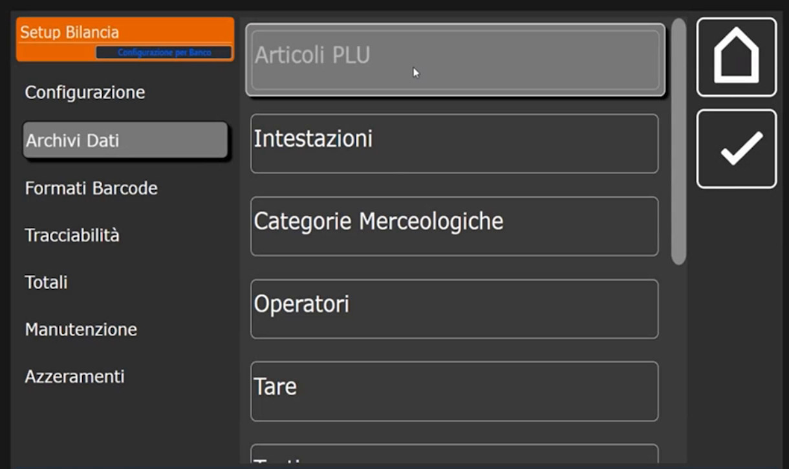

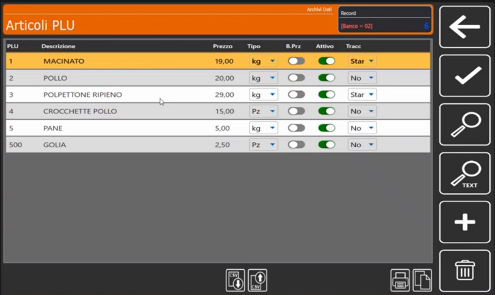

### 2. Crea un articolo: scheda Generale

Tocca **+**, digita il **Codice PLU** (per esempio **6**) e conferma con **Ok**. Si apre la scheda **Generale**: nella maggior parte dei casi basta questa per programmare la bilancia.

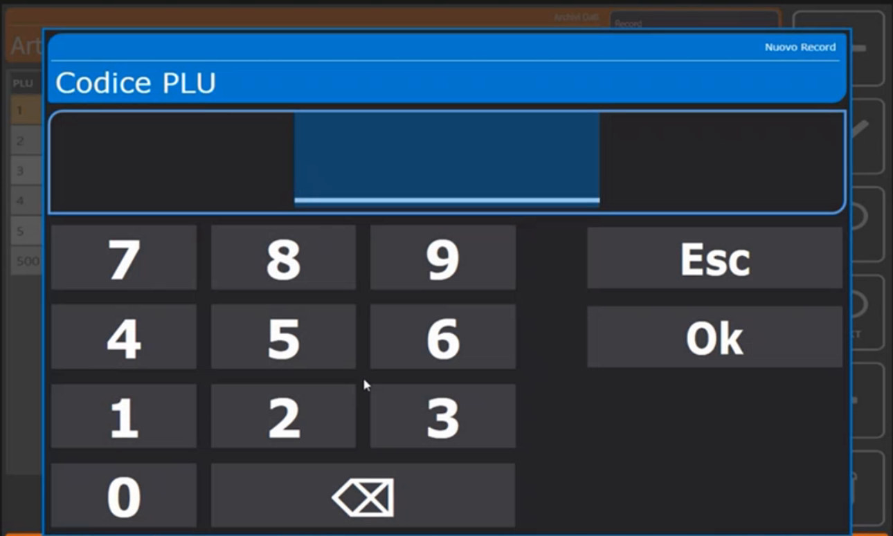

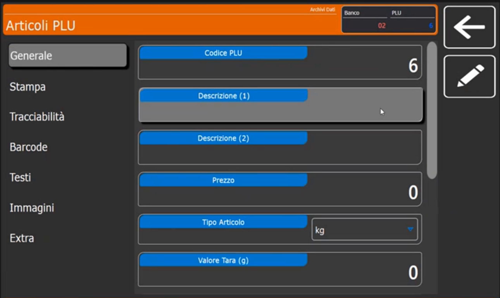

1. **Descrizione (1)**: tocca il campo e scrivi il nome con la tastiera. Esiste una **Descrizione (2)**, utile quando la prima non basta a definire l'articolo o per le varie uscite di stampa.

    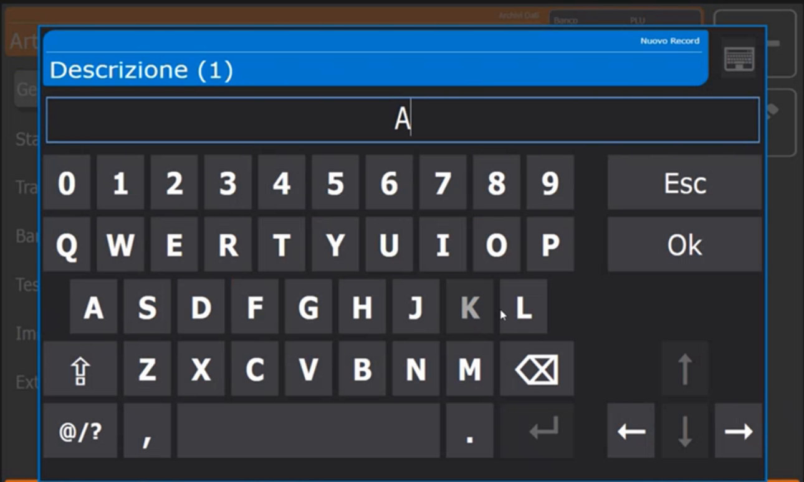

2. **Prezzo**: il prezzo di riferimento (per esempio 5 euro).

    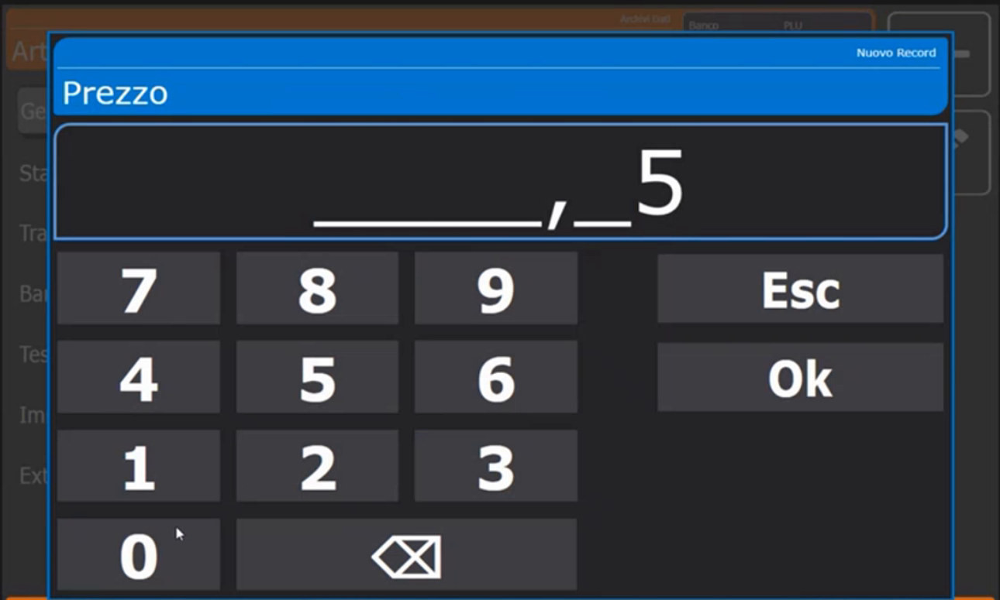

3. **Tipo Articolo**: a **kg**, a pezzo (**Pz**) o **Ng**. La scelta determina il modo di vendita.

    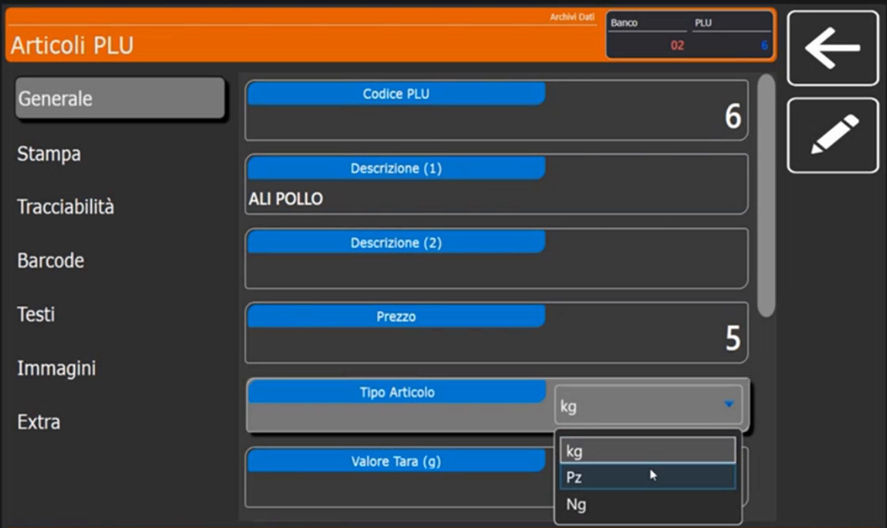

4. **Valore Tara (g)**: si può assegnare una tara già in anagrafica. Serve soprattutto per l'etichettatura.
5. **Pezzi Predeterminati**: per gli articoli a pezzo, i pezzi proposti (nell'esempio 1).
6. **Blocco Prezzo**: blocca il prezzo del PLU. Il comportamento generale dipende dalla [Configurazione Operativa](configurazione-operativa.md).
7. **Data Scadenza**, **Data Stagionatura**, **Data Produzione**: servono all'etichettatura (vedi sotto).
8. **PLU Attivo**: l'interruttore deve essere acceso (verde).

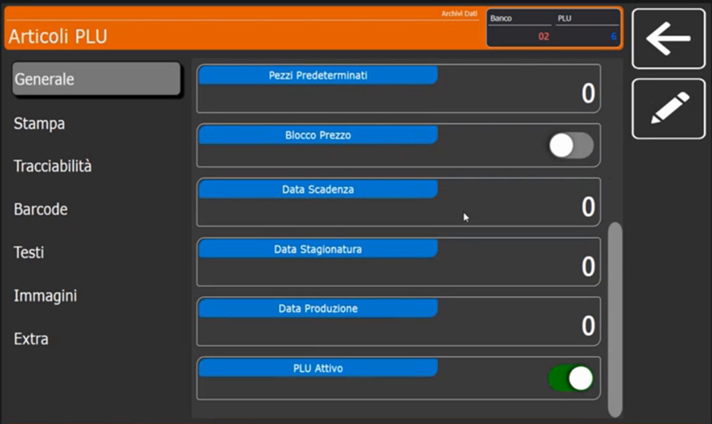

!!! tip "Date in giorni o in data pura"
    Toccando un campo data compare il tastierino **Data Scadenza ( ... in Giorni )**. Se digiti un numero breve (per esempio **20**) la bilancia lo interpreta come **giorni**; se continui a scrivere, il numero si trasforma direttamente in una **data**, indipendente dal giorno in cui si etichetta. Se non indichi la data di produzione, il sistema usa la data odierna; puoi forzarla per etichettare in modo retroattivo (o con una data futura). Il numero scelto decide se la scadenza è espressa in giorni o in data pura.

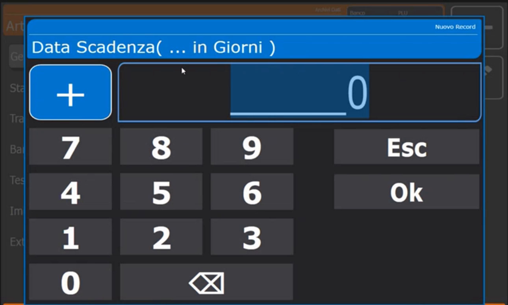

Fatto questo l'articolo è già creato e compare nell'archivio.

### 3. Le schede dell'articolo

Rientrando nell'articolo, a sinistra compaiono le schede **legate all'articolo stesso**: **Generale**, **Stampa**, **Tracciabilità**, **Barcode**, **Testi**, **Immagini**, **Extra**. Valgono **al di là di quanto impostato nelle configurazioni generali**: la scheda dell'articolo prevale.

#### Stampa

Quando si vende l'articolo e si etichetta può stampare un **layout grafico particolare per quell'articolo**. Con la lente si apre l'archivio a cui sono collegate le tabelle. Se lasci **0** come formato, la bilancia usa il formato di default delle opzioni di etichetta oppure il formato che cambi al volo in etichettatura (vedi [Etichettatura in vendita](etichettatura.md)).

Campi: **Formato Etichetta**, **Formato Etichetta Totale (1)**, **(2)** e **(3)**, **Formato Riga Scontrino**, **Formato Coupon**. I formati totali servono per chi fa confezionamenti a più livelli: per esempio una scatola, poi il pallet, con un'etichetta totale che riepiloga le informazioni.

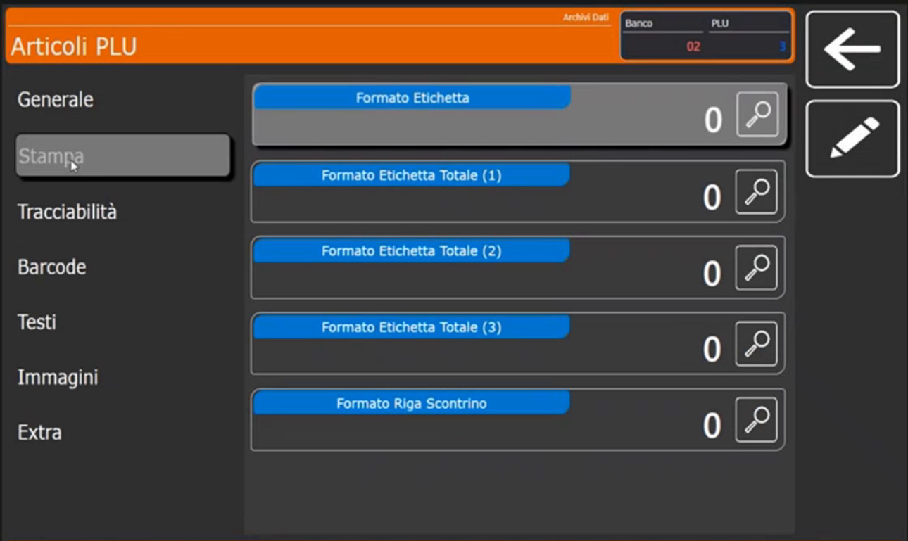

#### Tracciabilità

Per le carni e per tutti i prodotti che lo richiedono. Campi: **Tracciabilità** (nella lista la colonna **Tracc.** mostra *Star* per **Standard**, oppure *No*) e **Lotto Predefinito**. Il lotto predefinito di norma **non si assegna** per i prodotti tracciati, perché il lotto cambia di settimana in settimana in base alla carne acquistata. Come si definiscono definizioni e lotti: [Tracciabilità e lotti](tracciabilita.md).

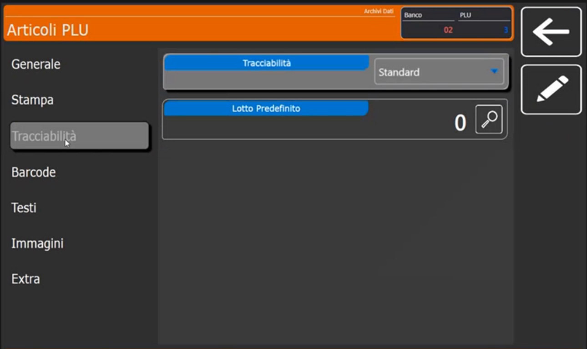

#### Barcode

Permette di personalizzare il barcode sul **singolo articolo**: oltre al barcode generico programmato, puoi indicare un EAN specifico che non segue la struttura impostata sulla bilancia. Campi: **Formato Barcode Etichetta**, **Barcode Etichetta**, **Formato Barcode Etichetta Totale (1)**, **(2)** e relativi barcode. Con due barcode (articolo e totale) puoi identificare lo stesso articolo con due EAN diversi quando lo usi in etichettatura o su un formato di etichetta totale.

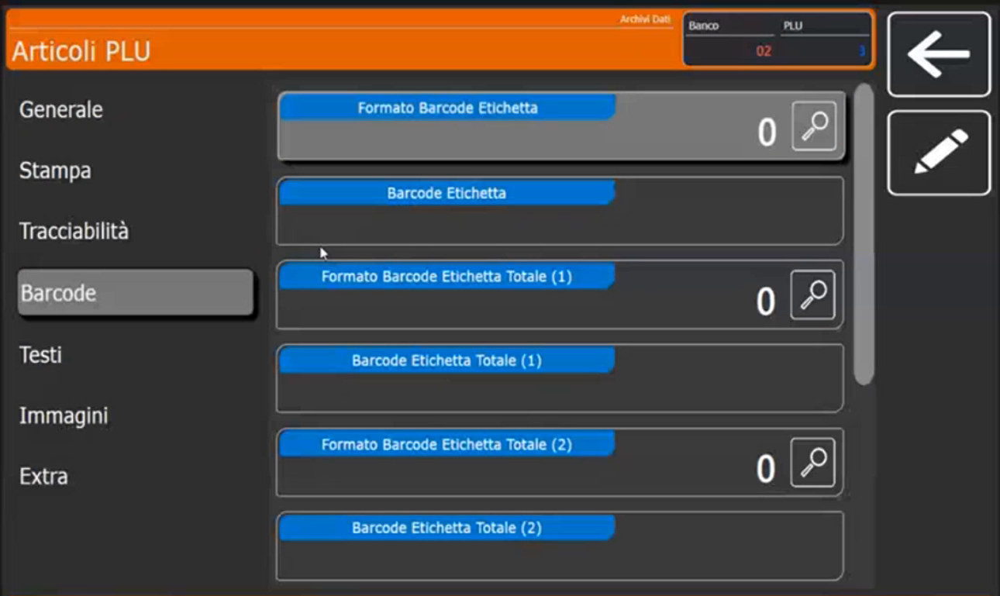

Per gli **articoli a pezzo** venduti con lo **scanner** (per esempio una confezione di caramelle) il campo **Barcode Scanner** riceve l'EAN letto fisicamente dallo scanner collegato alla bilancia.

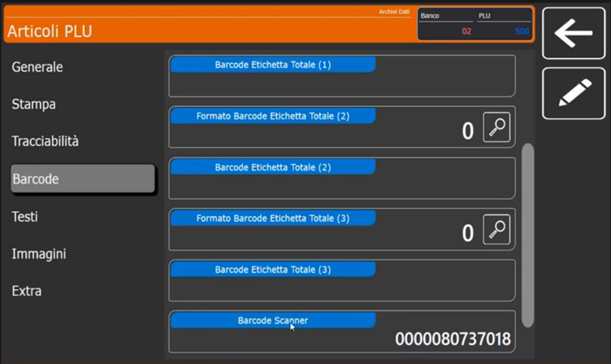

#### Testi

La bilancia gestisce **più box di testo** per articolo (ingredienti, allergeni, istruzioni) e può collegare **tabelle di testo** e la **tabella nutrizionale**. È un capitolo ampio: vedi [Box ingredienti e tabelle testi](box-ingredienti-testi.md) e [Tabelle nutrizionali](tabelle-nutrizionali.md).

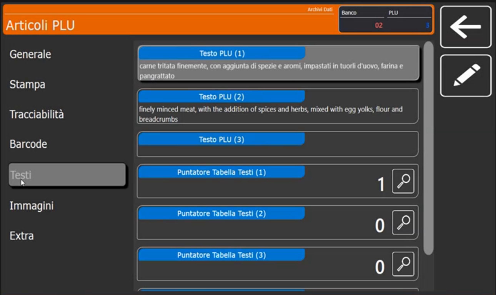

#### Immagini

Campi: **Immagine Tasto**, **Immagine Self Service**, **Immagine Promozionale** e **Immagine B/N per Stampa**. Con la **lente** si richiama un'immagine dall'archivio immagini della bilancia; il cestino la rimuove.

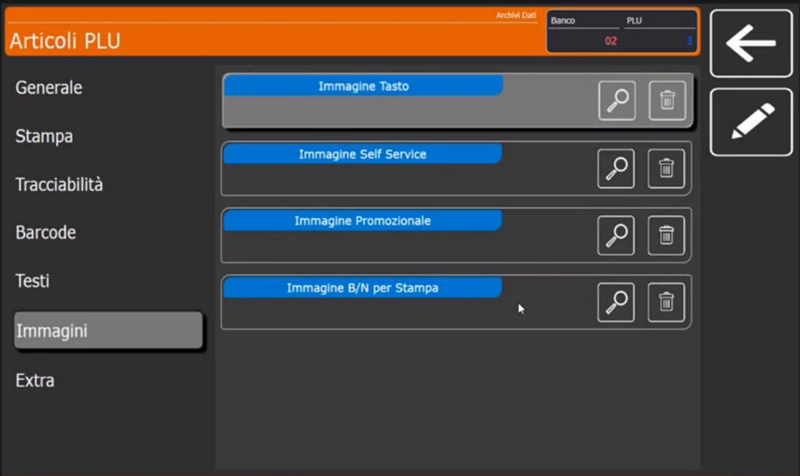

| Immagine | Quando viene mostrata | Dimensioni |
|---|---|---|
| **Immagine Tasto** | Sul tasto dell'articolo nella tastiera Retail | **120x120 pixel** per il tasto grande quadrato, **60x60 pixel** per il tasto piccolo standard, **60x120** o **120x60** per i tasti doppi in verticale o in orizzontale |
| **Immagine Self Service** | Quando la bilancia lavora in Self Service | secondo il formato del tasto |
| **Immagine Promozionale** | Sul display lato cliente, quando si tocca l'articolo | |
| **Immagine B/N per Stampa** | Stampata sull'etichetta, in **BMP** | |

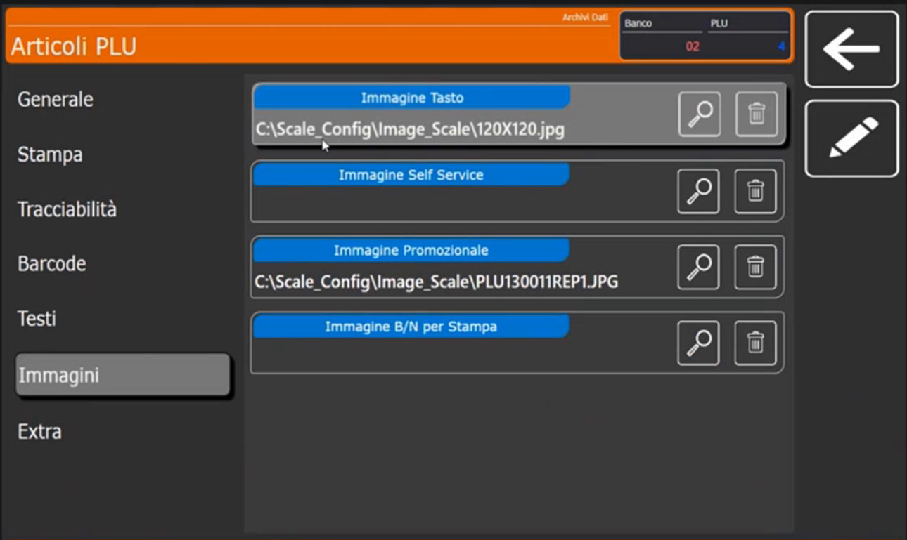

- Più immagini ci sono nella bilancia (anche un migliaio) e più sono ad alta risoluzione, più la bilancia impiega circa **un secondo** a mostrare l'elenco.
- Le immagini **non vengono ridimensionate**. Su un tasto grande da 120x120 un'immagine 60x60 non viene mostrata: al suo posto la bilancia visualizza un segnaposto con la dicitura "120x120 pixel" e una croce rossa. Sui tasti doppi, invece, un'immagine 60x60 viene mostrata **centrata**. Vedi [Funzioni di vendita](funzioni-di-vendita.md).
- **Immagine in stampa.** Una foto in bianco e nero stampata sull'etichetta ha poco significato, ma il campo si può sfruttare in altri modi: per esempio un **QR code** che apre il profilo social dell'esercente o un ricettario. Si converte il QR code in un'immagine **BMP** e la si aggancia al formato etichetta. Con uno spazio ridotto si ottiene una sorta di pubblicità gratuita (vedi [Formati Etichetta](formati-etichetta.md)).

#### Extra

Campi: **Prezzo Alternativo**, **Gruppo Merceologico**, **Iva %**, **Sconto %** e **ID Promozione**.

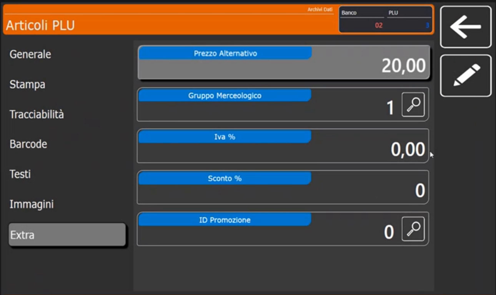

- **Gruppo Merceologico**: collega l'articolo a una categoria. È il collegamento che fa comparire l'articolo nella scheda corrispondente della tastiera. La lente apre l'elenco delle categorie.

    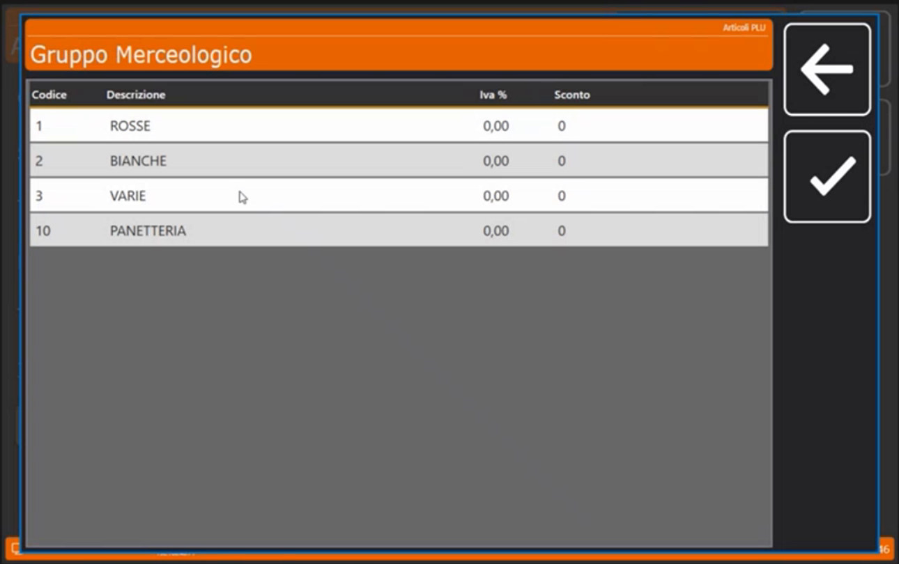

- **Prezzo Alternativo**: se serve un **doppio listino** si può definire un secondo prezzo, comodo soprattutto per il confezionamento per conto terzi. Si passa da un listino all'altro con un tasto (vedi [Funzioni di vendita](funzioni-di-vendita.md)).

    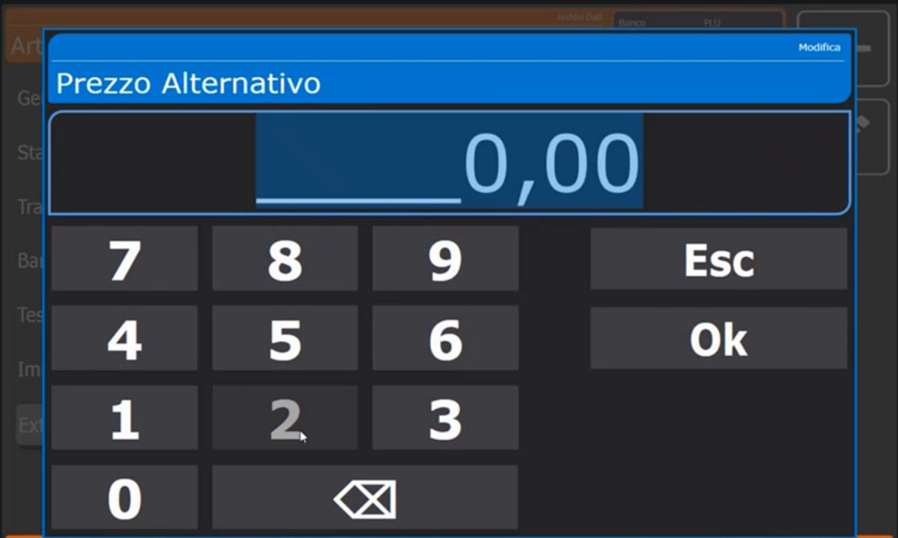

- **ID Promozione**: collega l'articolo a una promozione (vedi [Promozioni](promozioni.md)).

    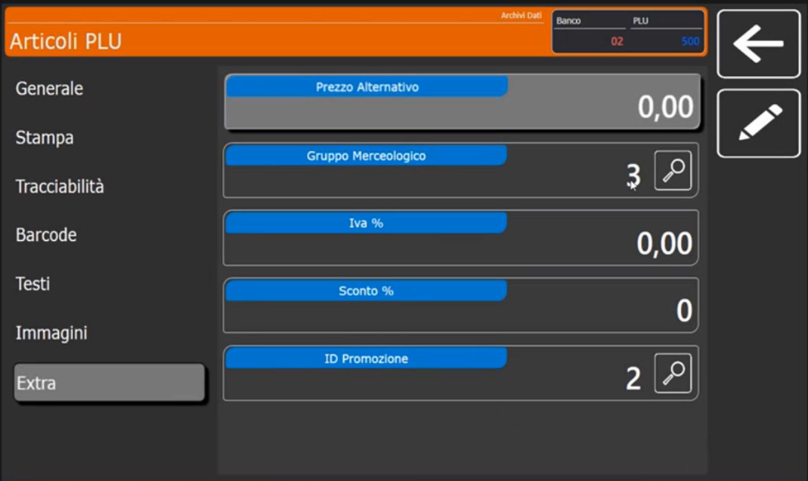

## Esempio: articolo a pezzo

Un articolo a pezzo si crea come un articolo a peso, impostando **Tipo Articolo** su **Pz** e **Pezzi Predeterminati**. Nell'esempio un pacchetto da 250 g viene venduto a 2,50 con **Barcode Scanner** valorizzato.

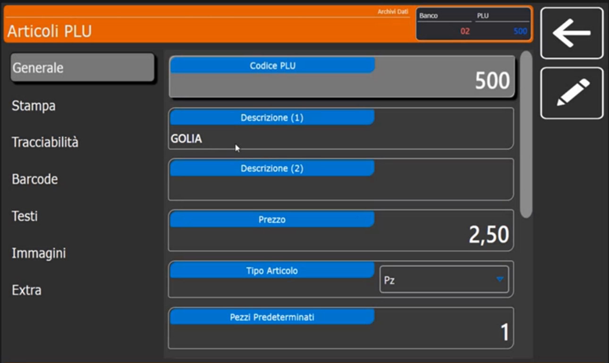

## Verifica

Nella lista l'articolo compare con **Prezzo**, **Tipo**, **Attivo** acceso e **Tracc.** secondo la programmazione.

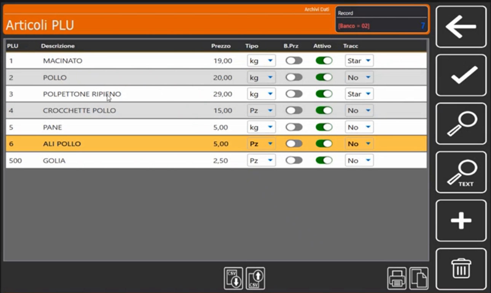

Esci dal configuratore e torna in vendita: la bilancia mostra il messaggio **Programmazione Bilancia ...** e ricarica il layout. I tasti compaiono quando l'articolo è collegato a una tastiera ([Configurazione Tastiera](configurazione-tastiera.md)) o a una scheda ([Schede Tastiera](schede-tastiera.md)).

## Errori comuni

| Problema | Causa probabile | Rimedio |
|---|---|---|
| L'articolo non compare nella scheda della tastiera | **Gruppo Merceologico** non impostato o diverso da quello della scheda | Nella scheda **Extra** collega l'articolo alla categoria giusta |
| L'etichetta non riporta la tracciabilità | Articolo con **Tracciabilità** disattivata, oppure banco senza tracciabilità | Attiva la tracciabilità sul banco e sull'articolo ([Tracciabilità e lotti](tracciabilita.md)) |
| L'immagine non compare sul tasto | Dimensioni non adatte al tasto o immagini tastiera disattivate | Usa 60x60 per il tasto standard e 120x120 per il tasto grande, e attiva **Abilita immagini tastiera RETAIL** |
| La scadenza è sbagliata | Il numero digitato è stato interpretato come data | Controlla se il campo mostra giorni o data pura |

!!! tip "Prossimo passo"
    Per collegare gli articoli ai tasti: [Configurazione Tastiera](configurazione-tastiera.md).
