<!-- categoria assegnata per inferenza: verificare (la bilancia Icona non ha una categoria dedicata nell'elenco) -->

# Articoli PLU: creare i primi due articoli

**Target:** tecnico installatore / rivenditore · **Video:** Custom Academy, webinar *Icona configurazione di base* (10/04/2025), dal minuto 38:46 al 49:30.

## Obiettivo

Al termine sai creare un articolo PLU con prezzo e tipo di vendita, conosci le schede di personalizzazione di ogni articolo (Stampa, Tracciabilità, Barcode, Testi, Immagini, Extra) e sai collegare l'articolo a una categoria merceologica.

## Prerequisiti

- Le [Categorie Merceologiche](categorie-merceologiche.md) **ROSSE** e **BIANCHE** sono state create.
- Il banco su cui lavori è quello attivo: in alto a destra la pagina mostra **Banco 02** e il numero del **PLU** in modifica. Gli articoli appartengono al banco, quindi il PLU numero 1 della macelleria è diverso dal PLU numero 1 della salumeria.

!!! note "Bilancia di partenza"
    Il relatore parte da una bilancia **completamente vuota**. Quando arriva la bilancia si possono trovare già programmati tre o quattro articoli di esempio: non incidono sulla programmazione che si fa qui.

## Passaggi

### 1. Apri Articoli PLU

> Nel video: 38:46

Da **Archivi Dati** tocca **Articoli PLU**. La lista è vuota: le colonne sono **PLU**, **Descrizione**, **Prezzo**, **Tipo**, **B.Prz**, **Attivo** e **Tracc.**. Il pulsante **+** crea un articolo.

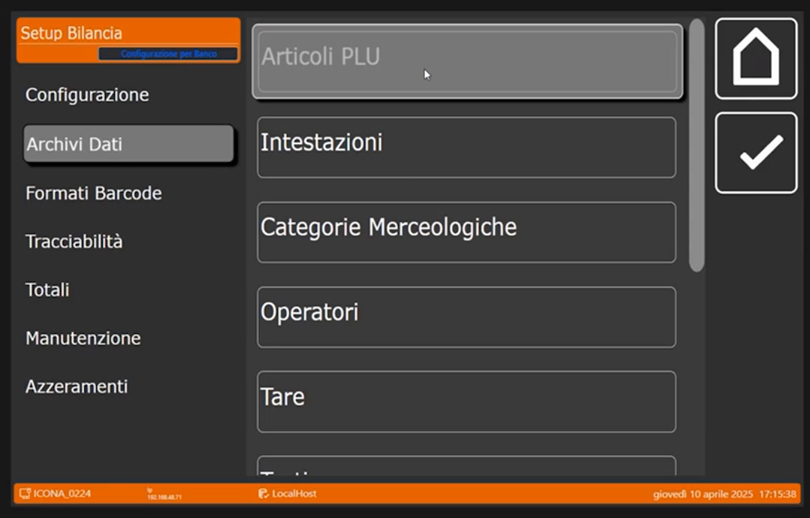

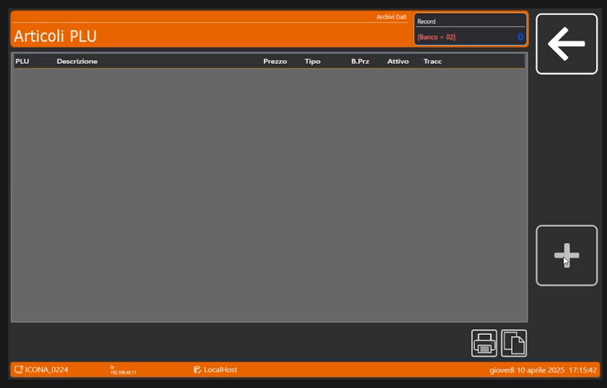

### 2. Crea l'articolo 1: la parte Generale

> Nel video: 38:49

Tocca **+**, digita il **Codice PLU** **1** e conferma con **Ok**.

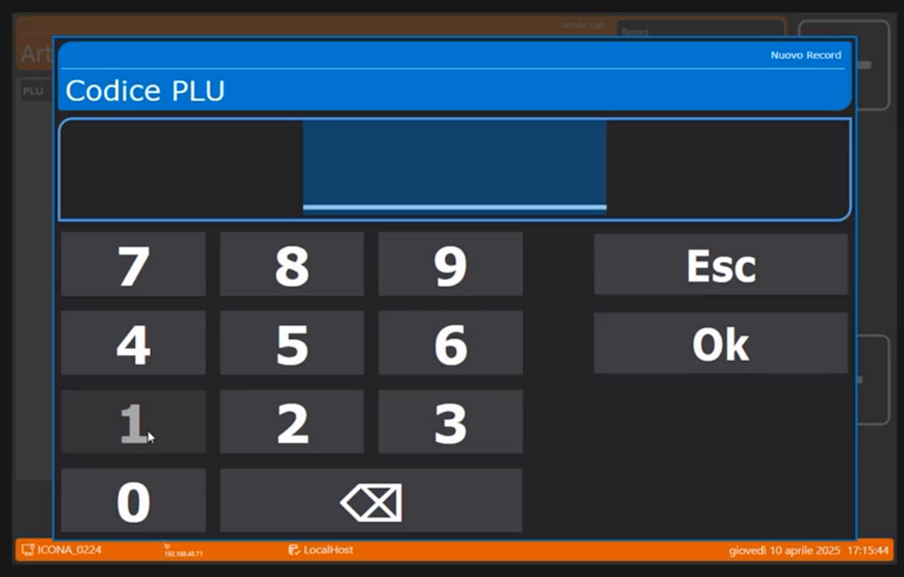

Si apre la scheda **Generale**. Per il relatore, la parte generale **nella maggior parte dei casi basta per programmare la bilancia**.

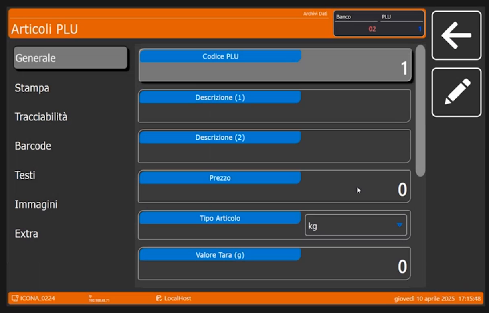

1. **Descrizione (1)**: tocca il campo, scrivi il nome con la tastiera e conferma con **Ok**. Il relatore scrive **MACINATO**. Esiste anche una **Descrizione (2)**, utile per le varie uscite di stampa.

    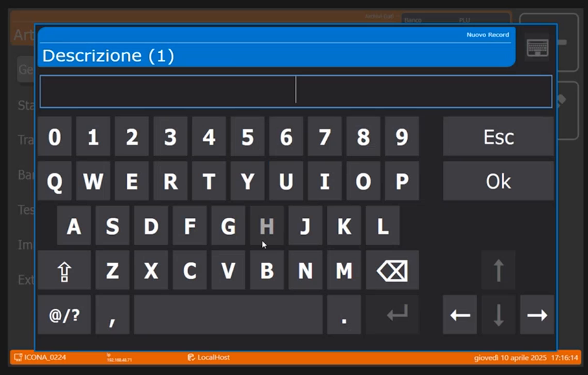

    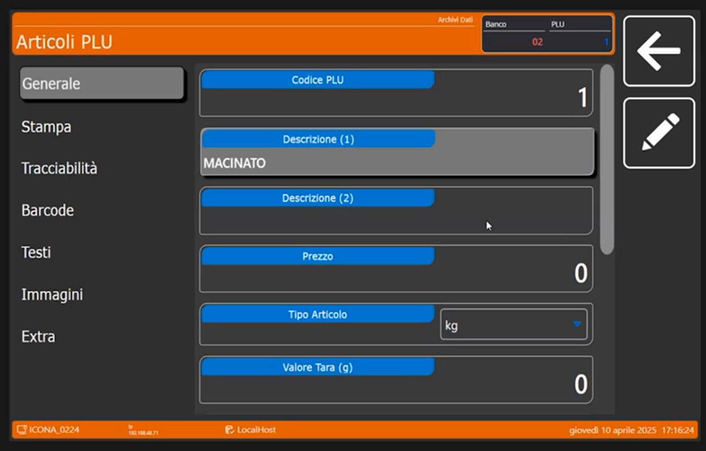

2. **Prezzo**: il relatore imposta un prezzo di riferimento di **19 euro al chilogrammo**.

    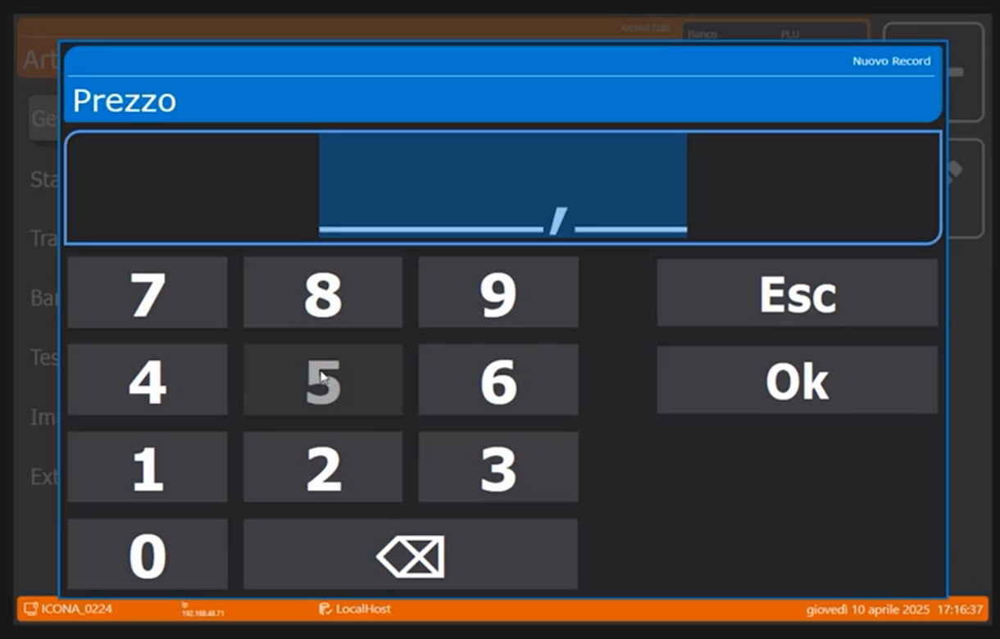

    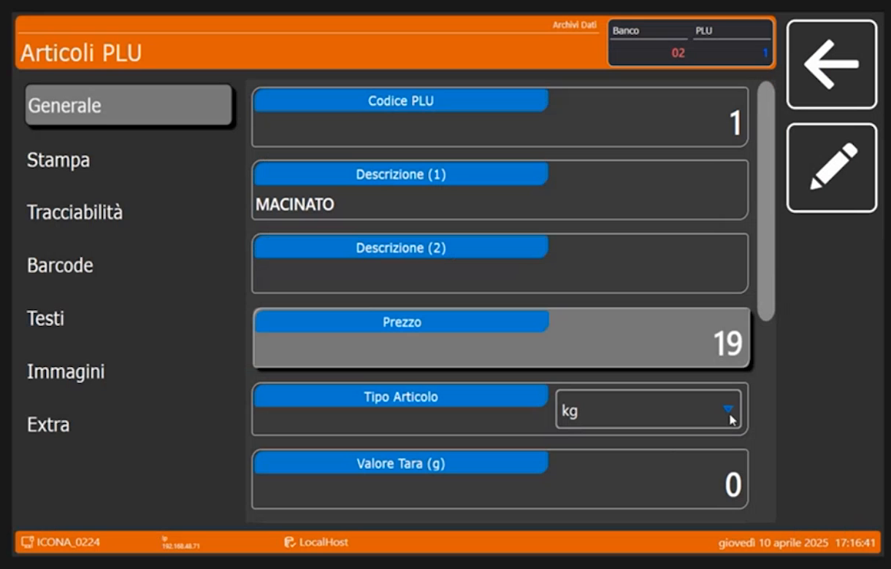

3. **Tipo Articolo**: determina se l'articolo è **a pezzo** o **a peso**; qui è **kg**.
4. **Valore Tara (g)**: si può assegnare già un valore di tara. Nel caso del webinar non serve; serve in primo luogo per l'etichettatura.
5. **Blocco Prezzo**: è il settaggio accennato nella [Configurazione Operativa](configurazione-operativa.md). Resta disattivato.

    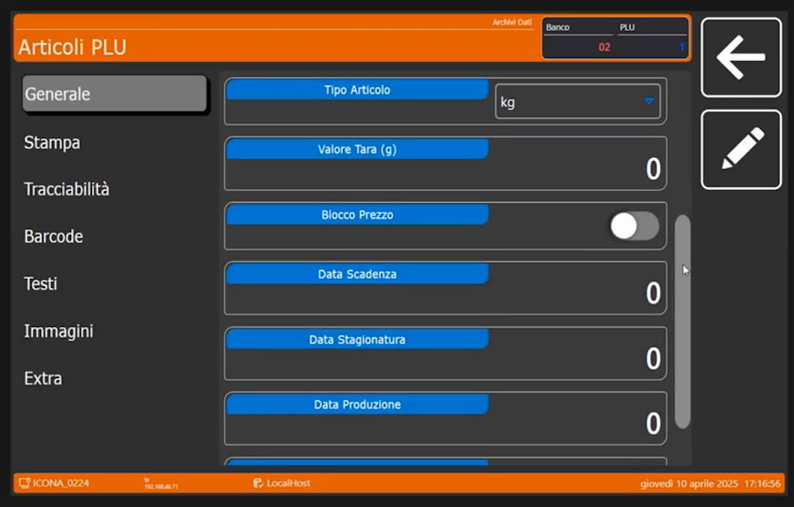

6. **Data Scadenza**, **Data Stagionatura**, **Data Produzione**: servono all'etichettatura e permettono di indicare date diverse da quella odierna. Toccando il campo il tastierino chiede il valore **in giorni**. Il relatore osserva che si potrebbe etichettare con una data nel futuro o nel passato, cosa che in etichettatura non si dovrebbe fare, ma la funzione è stata lasciata libera nella bilancia.

    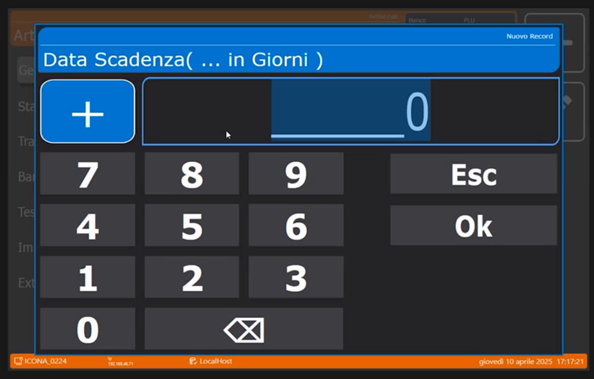

7. **PLU Attivo**: l'interruttore deve essere acceso (verde).

    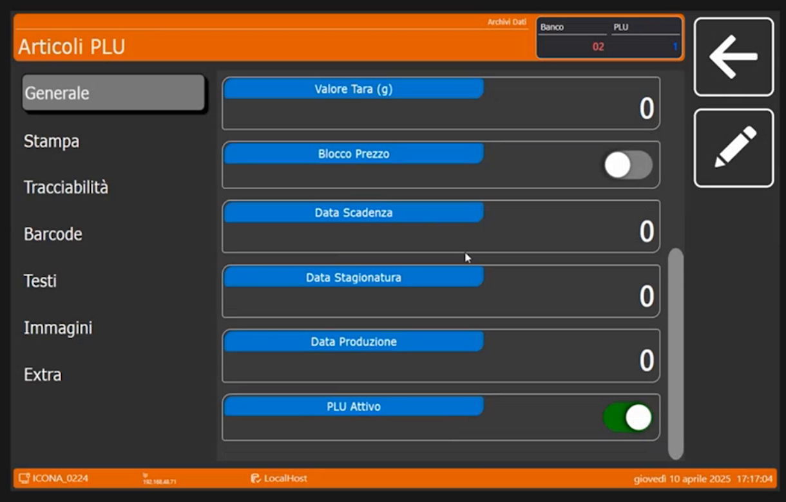

Fatto questo, l'articolo è già creato. Uscendo dalla scheda si ritrova nell'archivio l'articolo **MACINATO**, a 19,00 al kg.

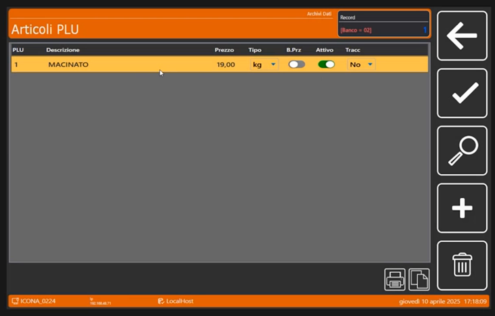

### 3. Rientra nell'articolo: le schede di personalizzazione

> Nel video: 41:18

Rientrando nello stesso articolo, a sinistra compare una serie di schede **legate all'articolo stesso**: **Generale**, **Stampa**, **Tracciabilità**, **Barcode**, **Testi**, **Immagini**, **Extra**. Valgono **al di là di quanto impostato nelle configurazioni generali**.

**Stampa** (41:41). Quando si vende l'articolo e si etichetta, può stampare un **layout grafico particolare per quell'articolo**. Con la lente si apre l'archivio a cui sono collegate le tabelle. Il discorso vale anche per i **totali**, per il **formato riga scontrino** e per il **coupon**. Campi: **Formato Etichetta**, **Formato Etichetta Totale (1)**, **(2)** e **(3)**, **Formato Riga Scontrino**, **Formato Coupon**.

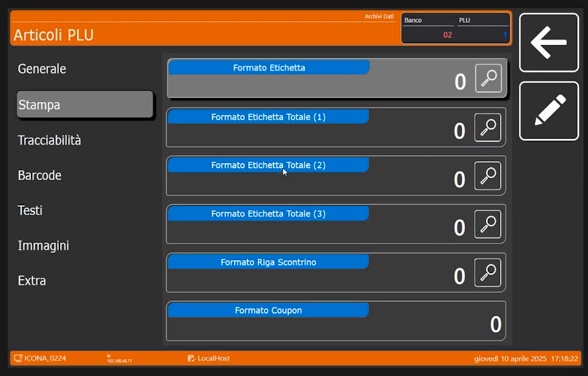

**Tracciabilità** (42:12). Per la carne andrebbe attivata. Il relatore precisa che oggi non si parla né di tracciabilità né di lotti. Campi: **Tracciabilità** (nel webinar *No*) e **Lotto Predefinito**.

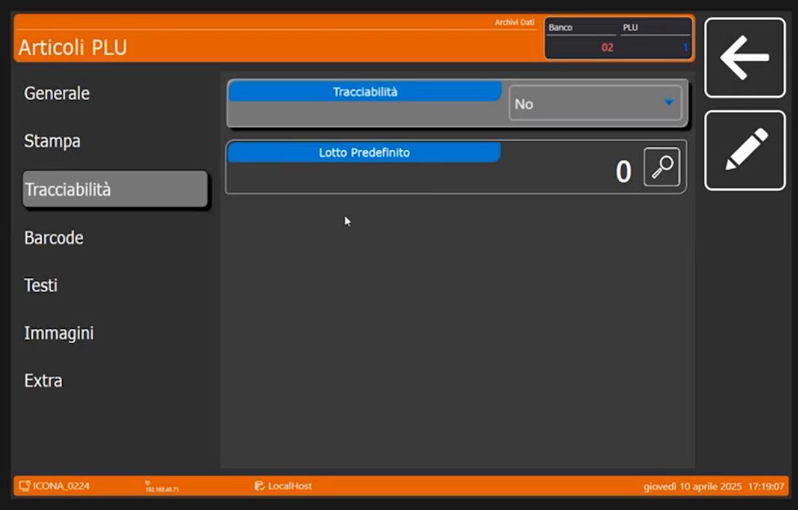

**Barcode** (42:26). Permette di personalizzare il barcode sul **singolo articolo**: oltre al barcode generico programmato, per questo articolo si può indicare un EAN che non fa riferimento alla struttura impostata sulla bilancia. Campi: **Formato Barcode Etichetta**, **Barcode Etichetta**, **Formato Barcode Etichetta Totale (1)** e **(2)** con i relativi barcode.

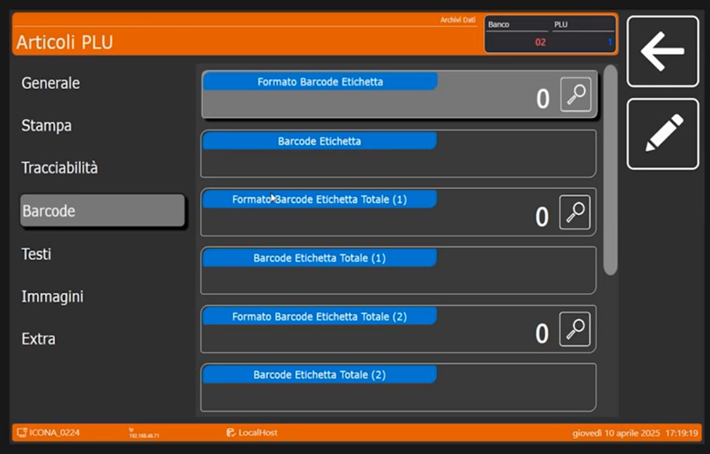

**Testi** (42:49). È un capitolo importante. La bilancia permette di avere **più box di testo**, per esempio gli ingredienti, associati al singolo articolo.

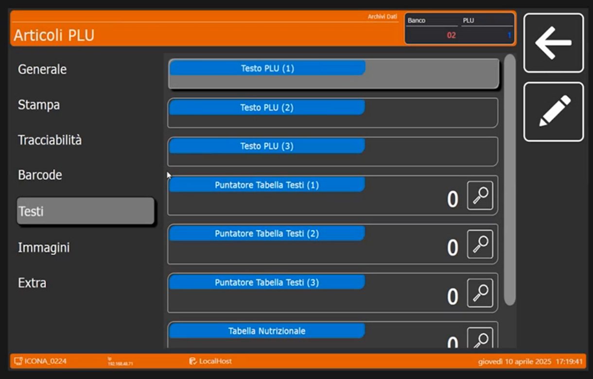

- Commercialmente apre molte possibilità: un **unico anagrafico** di articoli può soddisfare l'esigenza dell'etichettatura **multilingua**. Si attiva il **Testo PLU (1)** per gli ingredienti, e il relatore lo scrive in italiano.
- Dalla tastiera si attivano **grassetto**, **corsivo** e **sottolineato** (tasti **B**, **I** e **a**): servono a evidenziare gli **allergeni** in modo molto evidente sullo scontrino.
- Il testo è **autolivellante**: si può scrivere a lungo sul primo rigo, e quando viene stampato sull'etichetta **si compatta**. Non serve contare i caratteri né andare a capo, anche se serve spazio per gli ingredienti. Vale per tutti i box.
- Nel **Testo PLU (2)** si possono scrivere gli stessi ingredienti in un'altra lingua, oppure ripetere gli **allergeni**: l'etichettatura impone non solo di evidenziarli ma di riportarli in una tabella a parte nello stesso formato etichetta. Oppure si può usare il box 2 per i **consigli di cottura**.

    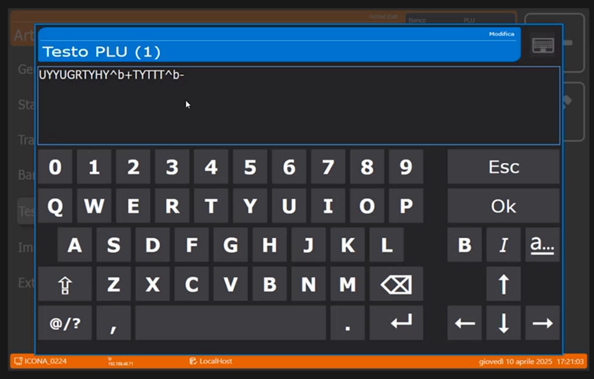

- In alternativa ai testi scritti si possono collegare **tabelle di testo già preconfigurate** (campi **Puntatore Tabella Testi (1)**, **(2)** e **(3)**), presenti nello stesso archivio. Esempio del relatore: scrivere una sola volta "conservare in frigo a circa 4 gradi", oppure gli ingredienti del pane (acqua, farina, lievito) da riusare su pane, panini e rosette senza ripeterli. Entrambe le possibilità sono utilizzabili sui formati di stampa e sui formati etichetta.
- Qui si collega anche la **Tabella Nutrizionale** dell'articolo.

    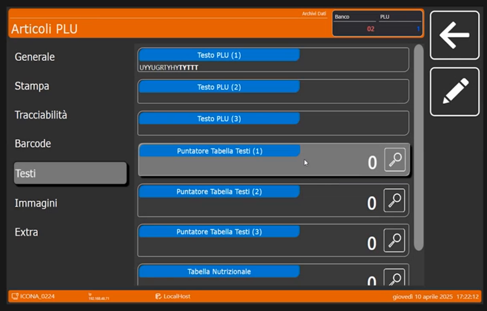

**Immagini** (45:55). Le immagini attivano più modalità di lavoro della bilancia. I campi sono **Immagine Tasto**, **Immagine Self Service**, **Immagine Promozionale** e **Immagine B/N per Stampa**.

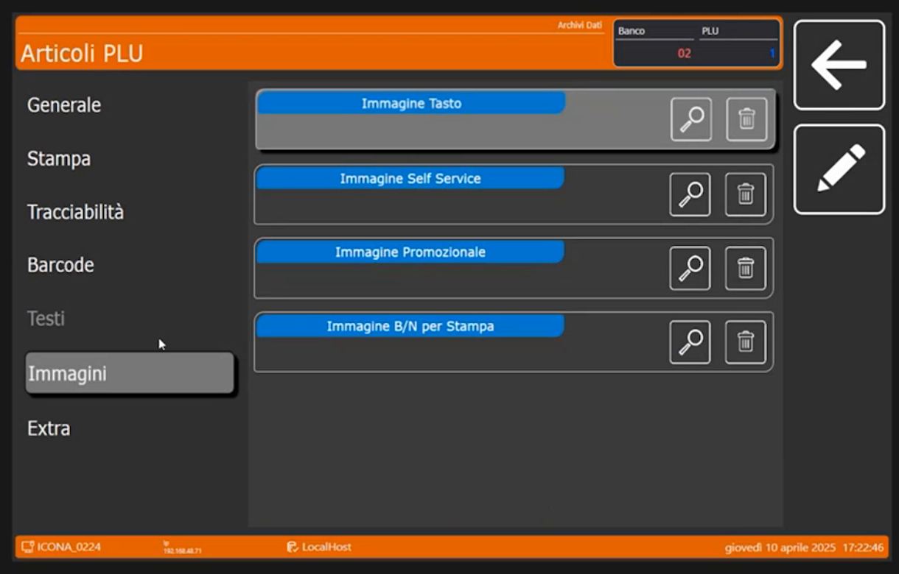

- Con la **lente** si richiama un'immagine dall'**archivio di immagini** presente nella bilancia. L'**immagine del tasto** è quella mostrata sul tasto, per esempio in modalità Self Service; l'**immagine promozionale** permette di avere un'immagine specifica, diversa dal prodotto, quando ci si seleziona sopra. Si possono usare anche immagini ad alta risoluzione.
- Più immagini ci sono nella bilancia (il relatore ne ha circa un migliaio) e più sono ad alta risoluzione, più la bilancia impiega **circa un secondo** prima di mostrare l'elenco.

    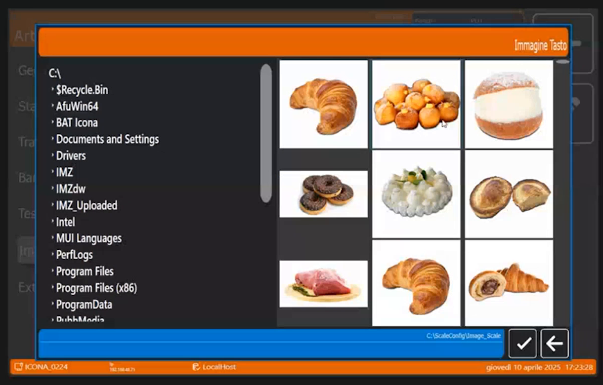

- **Novità rispetto alle bilance del passato**: si può agganciare all'articolo un'**immagine in stampa**. Una foto in bianco e nero stampata sull'etichetta ha poco significato, ma il campo si può sfruttare in altri modi: per esempio un **QR code** che apre il link al profilo Facebook o Instagram del titolare, o un ricettario. Si converte il QR code in un'immagine **BMP** e la si aggancia al formato etichetta. Con uno spazio realmente piccolo sull'etichetta si ottiene una sorta di **pubblicità praticamente gratuita**.

**Extra** (48:08). Qui sono visibili **Codice Alternativo**, **Prezzo Alternativo**, **Gruppo Merceologico**, **Iva %**, **Sconto %** e **ID Promozione**. Le promozioni e gli sconti verranno spiegati più avanti. Ora serve **agganciare l'articolo a un merceologico**, in questo caso **ROSSE**, per ottenere poi in vendita il concetto delle schede della tastiera.

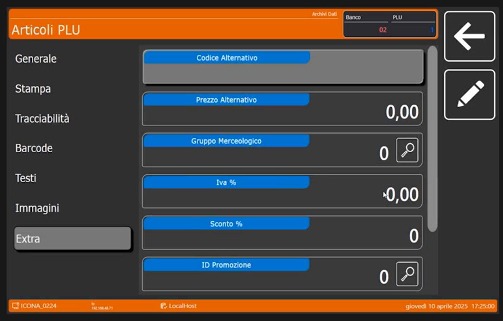

Il campo **Gruppo Merceologico** ha una lente che apre l'elenco delle categorie.

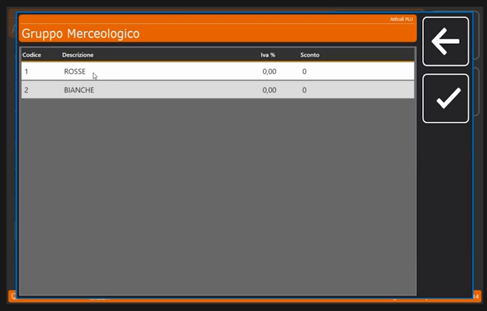

### 4. Crea l'articolo 2: POLLO

> Nel video: 48:32

Per avere un secondo esempio, tocca **+**, crea l'articolo **2** con descrizione **POLLO** e prezzo **20,00**.

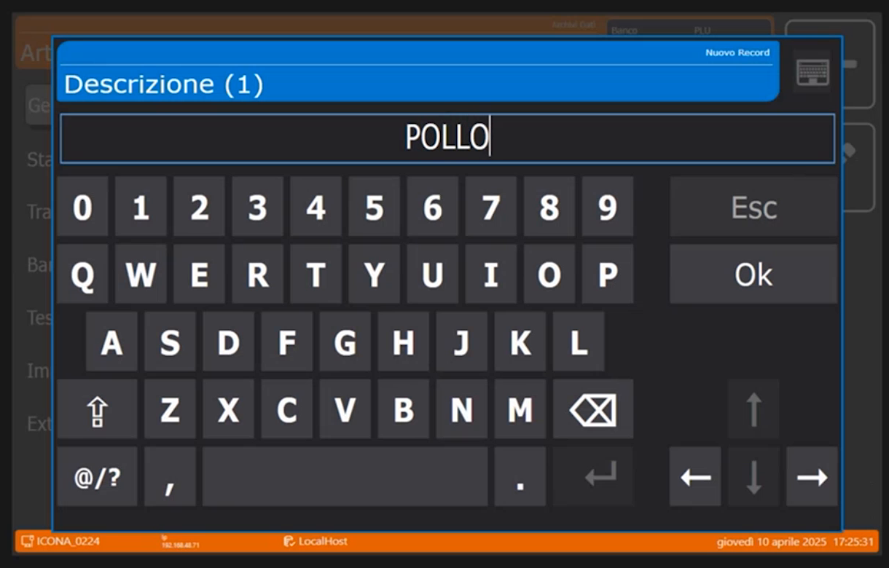

Poi vai direttamente in **Extra** e, come **Gruppo Merceologico**, aggancialo alle **BIANCHE** (codice **2**).

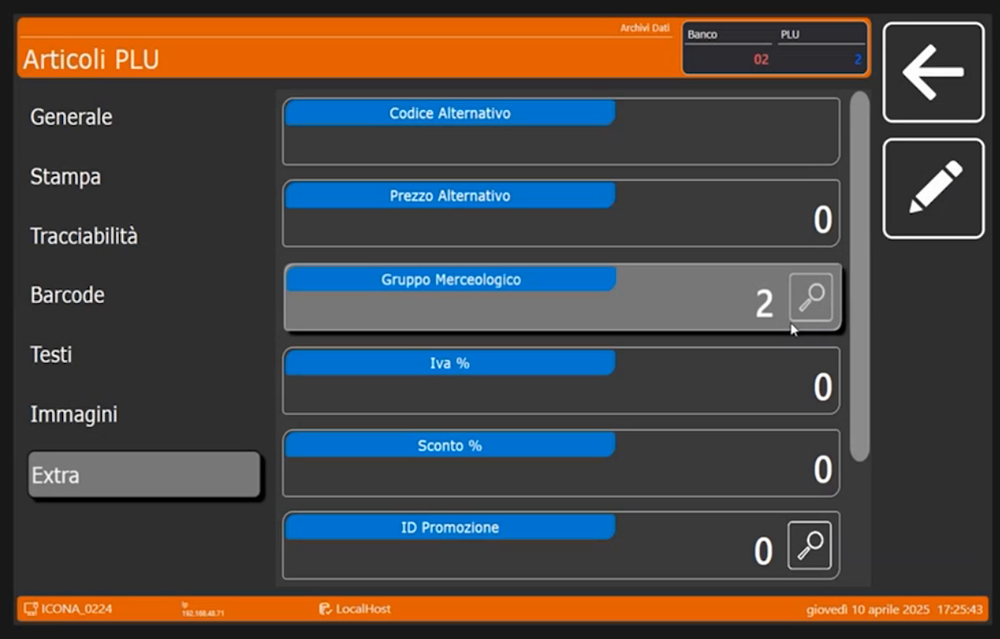

## Verifica

Nella lista degli articoli devono esserci **1 MACINATO**, 19,00 al kg, e **2 POLLO**, 20,00 al kg, entrambi attivi.

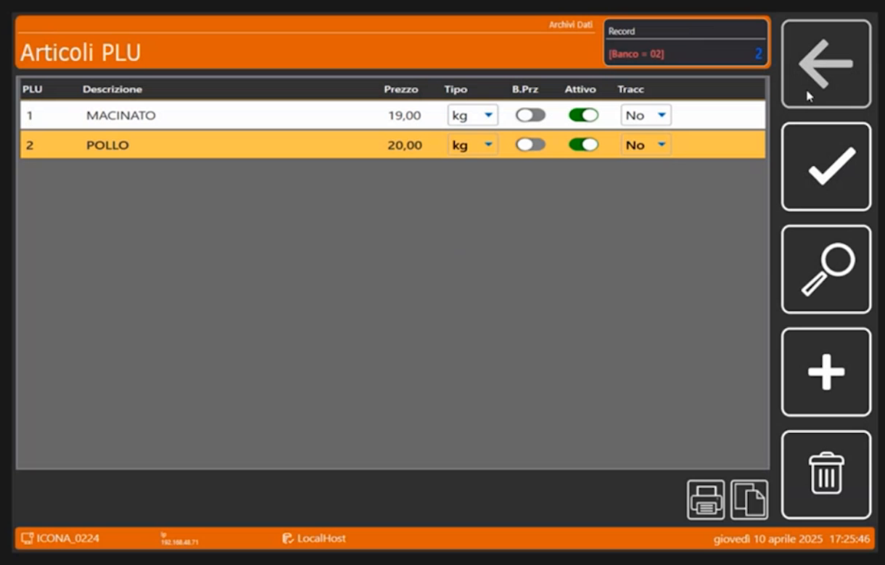

Il relatore si ferma qui, senza personalizzare operatori e tare, e torna in vendita per vedere il risultato. La bilancia impiega un momento, mostra il messaggio **Programmazione Bilancia ...** e carica il **layout grafico del retail**. I tasti non sono ancora visibili, perché la tastiera è ancora vuota.

!!! tip "Prossimo passo"
    Per collegare gli articoli ai tasti si attivano le schede e si configura la tastiera: pagina [Configurazione Tastiera](configurazione-tastiera.md).
