<!-- categoria assegnata per inferenza: verificare (la bilancia Icona non ha una categoria dedicata nell'elenco) -->

# Bilancia: identità, banco attivo e parametri di base

**Target:** tecnico installatore / rivenditore.

## Obiettivo

Dichiarare a quale banco appartiene la bilancia e quale banco è attivo, scegliere il **tipo di configurazione** (per banco, per bilancia o globale) e conoscere le sezioni della pagina **Bilancia**: quali toccare e quali lasciare di default.

## Prerequisiti

- I banchi sono stati creati: [Lista Banchi](lista-banchi.md).
- I [Collegamenti](collegamenti.md) sono stati controllati.

## Procedura

### 1. Apri la pagina Bilancia

Dopo aver creato i banchi si dichiara che cos'è **questa** bilancia. Dal menu **Setup Bilancia**, sezione **Configurazione**, tocca **Bilancia**.

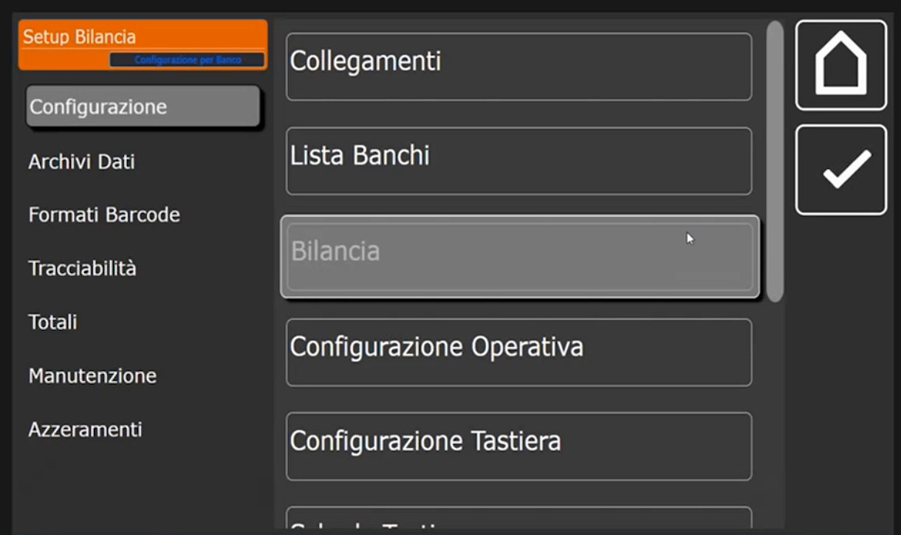

### 2. ID Bilancia: banco, numero e nome

La prima sezione è **ID Bilancia**. I campi sono **Numero Banco**, **Numero Bilancia**, **Banco Attivo**, **Nome Bilancia**, **Tipo Configurazione** e **Configurazione Display**.

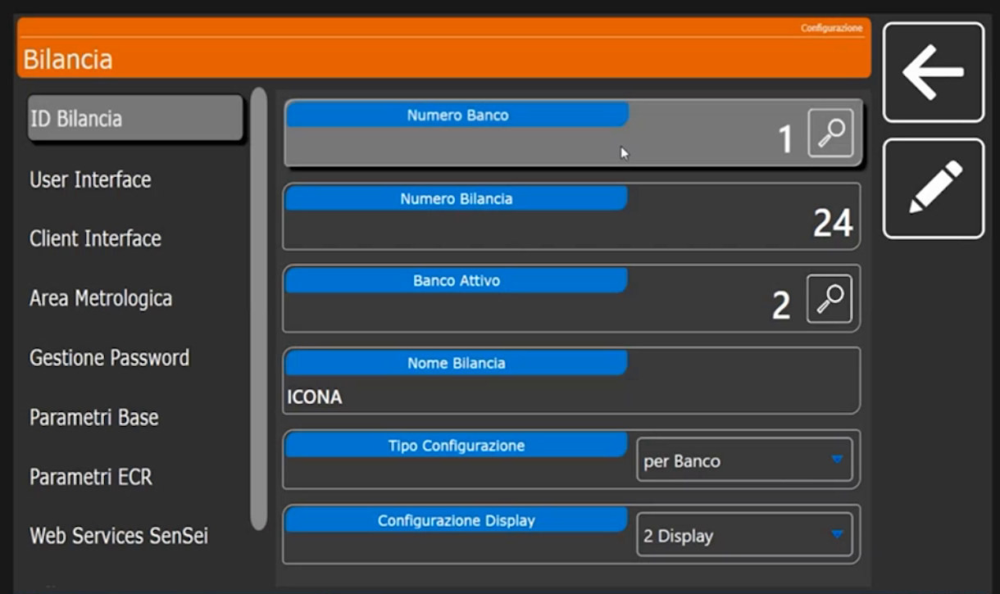

- **Numero Banco**: il banco di riferimento della bilancia. Tocca la lente accanto al valore per aprire la lista dei banchi.

    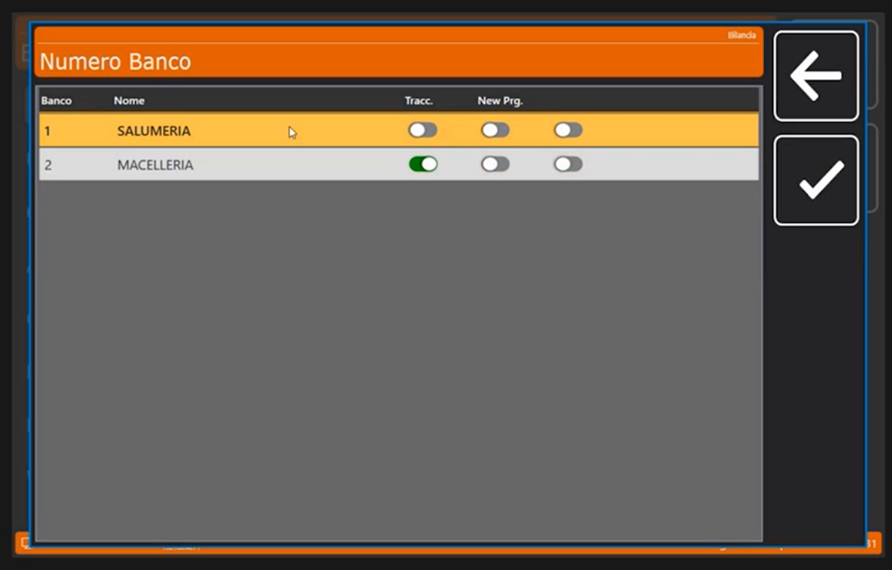

- **Banco Attivo**: il banco attivo in questo momento. Può essere diverso dal banco di riferimento: per esempio si può tenere come riferimento il banco 1 e attivare momentaneamente il 2. Riporta il banco al valore voluto prima di uscire, per non dover riavviare la bilancia.
- **Numero Bilancia**: partendo dalla bilancia principale (il server) si dichiara **1**; ma può essere anche la 24ª bilancia del banco. In un sistema di bilance collegate più bilance possono lavorare sullo stesso banco e **condividere lo stesso database**. Il numero non incide sul funzionamento: sono tutti punti di accesso al database.
- **Nome Bilancia**: nell'esempio **ICONA**.

### 3. Scegli il Tipo Configurazione

Il menu a tendina **Tipo Configurazione** propone **Globale**, **per Banco** e **per Bilancia**.

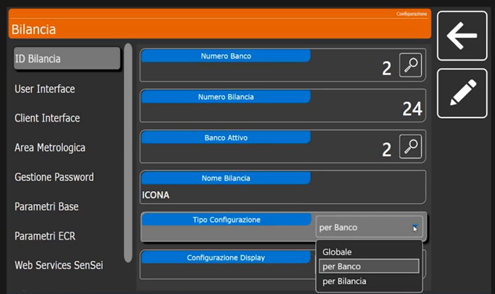

| Valore | Quando usarlo |
|---|---|
| **per Banco** | È il valore di default e va **lasciato così**. Le impostazioni valgono per tutto il banco: i settaggi fatti su una bilancia vengono riportati su tutte le altre collegate alla stessa rete e allo stesso banco. Adatto a salumeria, macelleria, frutta e verdura (che magari dovranno attivare il Self Service) |
| **Globale** | Tutte le programmazioni successive (dalle configurazioni tastiera ai formati etichetta) sono **condivise da tutti i banchi** presenti sulla bilancia |
| **per Bilancia** | Serve solo quando due o tre bilance sono collegate in rete sullo stesso banco e una di esse deve lavorare diversamente, per esempio in etichettatura con un layout grafico diverso da quello del banco |

!!! note "Configurazione Display"
    Indica i display usati: nell'esempio **2 Display**. Per il Self Service si usa un solo display, perché il secondo non esiste; non va confuso con il servizio rapido, che richiede i due display.<!-- verificare: la distinzione tra Self Service e "servizio rapido" va controllata sul prodotto -->

### 4. Sezioni a sinistra: legate al banco selezionato

Sulla sinistra si apre una serie di sezioni collegate al **banco selezionato**. Alcune sono da lasciare di default, altre vanno guardate.

**User Interface.** Di norma **non si tocca**: indica l'ambiente di lavoro, cioè la cartella dove la bilancia registra le sue configurazioni e gli eseguibili di riferimento. Campi: **Cartella di Lavoro** `C:\Scale_UI`, **Nome Eseguibile** `FrontEnd.exe`, **Tipo Icone**.

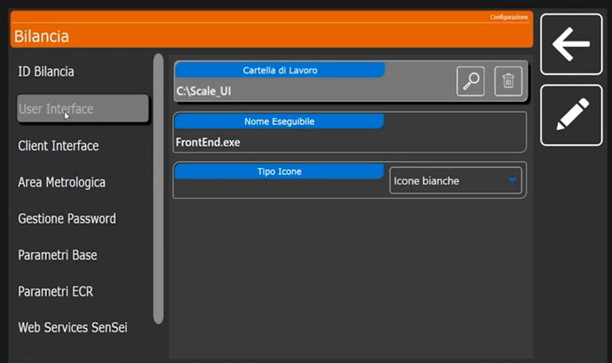

L'unico campo modificabile è **Tipo Icone**: **Icone bianche**, **Icone nere** (stile classico) o **Icone Colorate**, con cui in vendita alcuni tasti e funzioni si accendono in modo particolare.

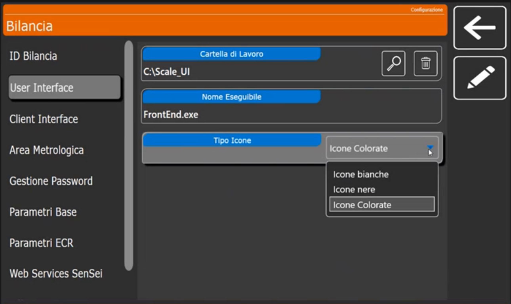

**Client Interface.** Riguarda la gestione dei client interfacciati: **da non toccare**. Campi: **Cartella di Lavoro** `C:\Program Files (x86)\CUSTOM\Vis_Banchi\`, **Nome Eseguibile** `VIS_BNC.EXE`, **Timer Image Sequenza Pubblicitaria** 10, **Timer Elimina Code** 5, **Disabilita Cross Selling** e **Abilita Pubblicità Esterna** (disattivati).

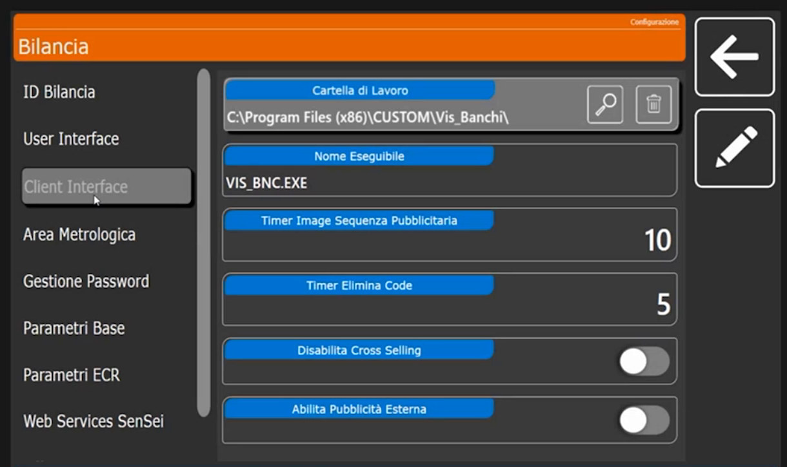

**Area Metrologica.** Offre un minimo di personalizzazione. L'area metrologica è **inviolabile**: è l'unica parte sotto vincolo metrologico. Si può solo scegliere **dove** mostrare i dati metrologici sul display posteriore: in alto o in basso, a destra o a sinistra, in orizzontale o in verticale. Lato **Operatore** e lato **Cliente** hanno ciascuno posizione verticale, posizione orizzontale e stile (**Layout Orizzontale** o **Layout Verticale**).

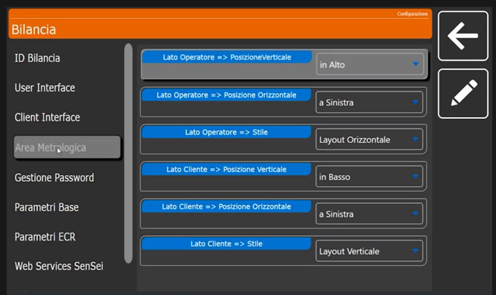

**Gestione Password.** Per le configurazioni particolari di un cliente conviene **attivare le password**: impediscono al cliente di entrare nella bilancia e sprogrammare o sconfigurare impostazioni che possono avere richiesto parecchio tempo. Si possono gestire sia in programmazione sia allo spegnimento dello strumento. Interruttori: **Abilita Password Accesso Programmazione** e **Abilita Password Spegnimento**, entrambi disattivati di default. A seconda del cliente e dell'impianto la funzione è sempre consigliabile.

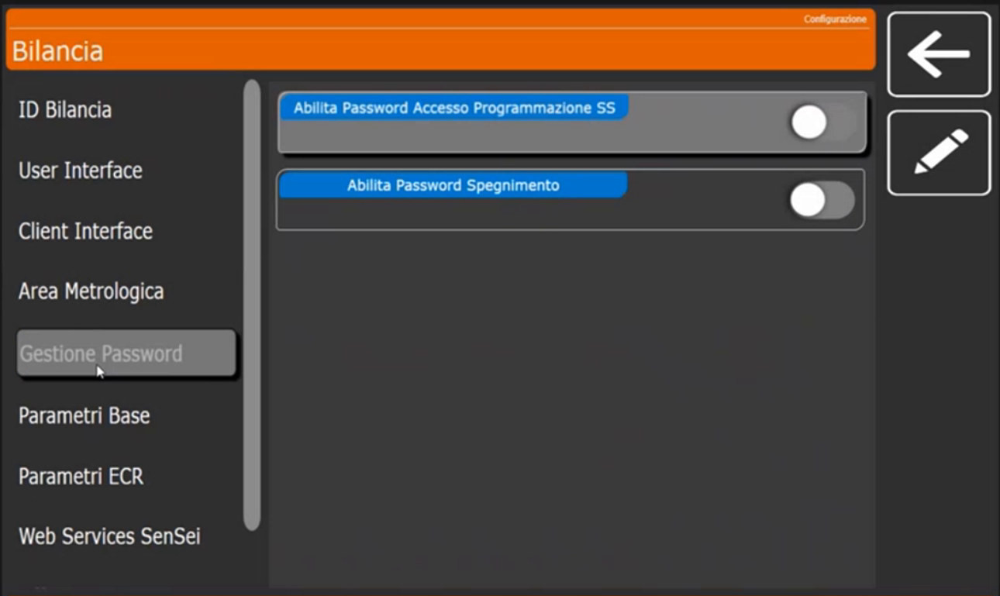

**Parametri Base.** Di default sono già impostati per la testina da **3 pollici** (stampa fino a 80 mm di larghezza) e per una corretta gestione del touch e degli **offset delle etichette**. L'offset è la parte grafica in cui viene stampata l'etichetta: i contorni lasciati vuoti perché la carta esca correttamente. Di norma questa sezione **non si tocca**, salvo settaggi particolari in fase di emissione dell'etichetta. Campi: **Suono Tocco Touch** *Alto*, **Luminosità Schermi**, **Offset Etichetta x (mm)** 2, **Offset Etichetta y (mm)** 0, **Avanzamento Stampa (mm)** 5, **Apri Cassetto dopo stampa scontrino** (disattivato).

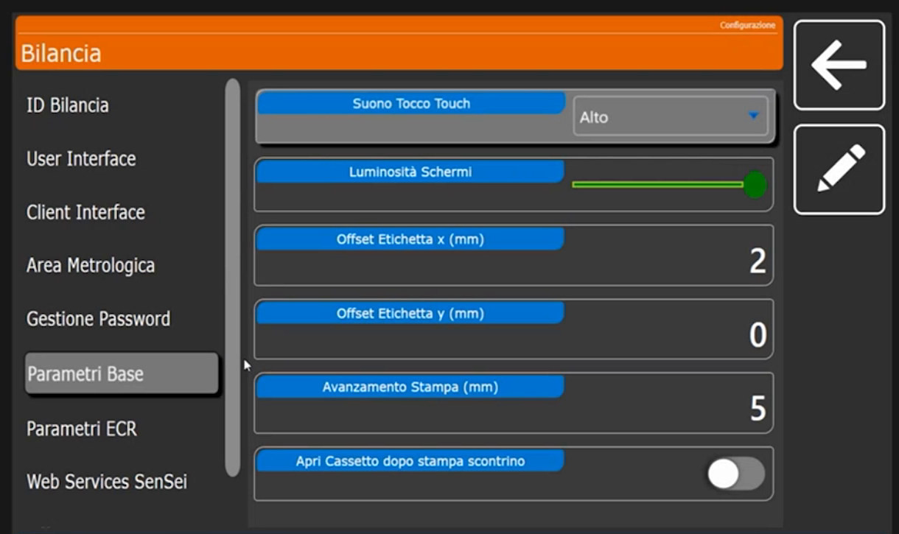

**Parametri ECR.** Servono a collegare un **registratore di cassa** in seriale. Il registratore deve usare il protocollo seriale **XON/XOFF** a **9600 baud, N, 8, 1**.<!-- verificare: protocollo seriale ricavato dal parlato, trascritto in modo incerto -->. Abilitando **ECR Collegato** la bilancia può stampare direttamente lo scontrino sul registratore: per farlo si crea un tasto con funzione **Invio Scontrino a ECR** (vedi [Configurazione Tastiera](configurazione-tastiera.md)). Gli altri interruttori sono **Invio alla Chiusura Scontrino** e **Richiedi Codice Lotteria**, tutti disattivati di default.

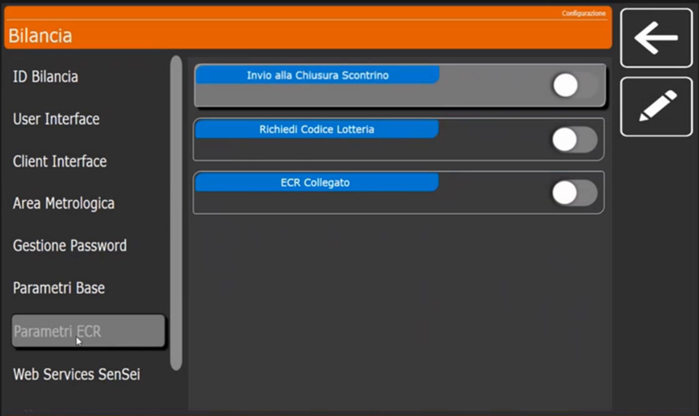

**Web Services SenSei.** Serve per la gestione con **terminali esterni**. Le opzioni oltre alla prima sono facoltative. Campi: **WS SenSei - URL**, **WS SenSei - Terminal Id** (0) e **WS SenSei - Timeout** (5).

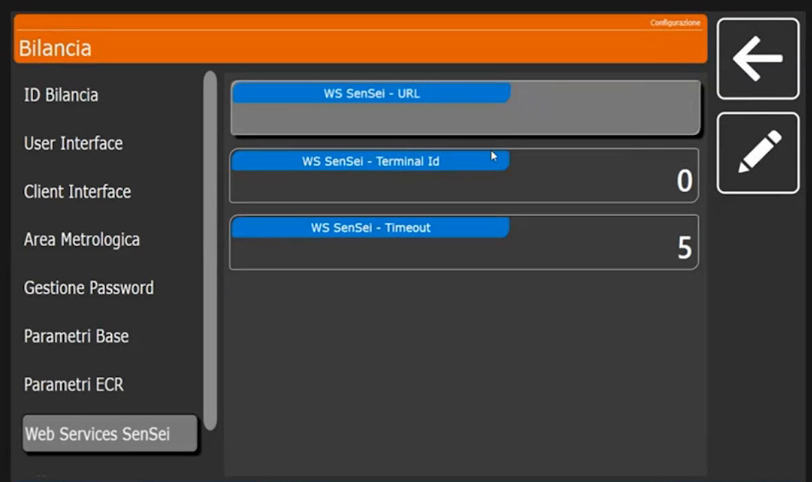

## Verifica

In **ID Bilancia** compaiono **Numero Banco** e **Banco Attivo** voluti, il **Numero Bilancia** e il **Tipo Configurazione** *per Banco*.

## Errori comuni

| Problema | Causa probabile | Rimedio |
|---|---|---|
| La bilancia mostra la tastiera di un altro banco | **Banco Attivo** diverso da quello atteso | Reimposta **Banco Attivo** |
| Una modifica su una bilancia non compare sulle altre | **Tipo Configurazione** impostato su **per Bilancia** | Riporta il valore a **per Banco** |
| Il cliente ha cambiato le impostazioni | Password di programmazione non attiva | Attiva **Abilita Password Accesso Programmazione** |

!!! tip "Prossimo passo"
    Prima di creare gli articoli bisogna dire alla bilancia **come deve comportarsi**, cioè in quale modalità deve lavorare: [Configurazione Operativa](configurazione-operativa.md).
