<!-- categoria assegnata per inferenza: verificare (la bilancia Icona non ha una categoria dedicata nell'elenco) -->

# Bilancia: identità, banco attivo e parametri di base

**Target:** tecnico installatore / rivenditore · **Video:** Custom Academy, webinar *Icona configurazione di base* (10/04/2025), dal minuto 17:25 al 23:00.

## Obiettivo

Al termine sai dichiarare a quale banco appartiene la bilancia e quale banco è attivo, scegliere il tipo di configurazione (per banco, per bilancia o globale) e conosci le sezioni della pagina **Bilancia**: quali toccare e quali lasciare di default.

## Prerequisiti

- I banchi sono stati creati: vedi [Lista Banchi](lista-banchi.md).
- I [Collegamenti](collegamenti.md) sono stati controllati.

## Passaggi

### 1. Apri la pagina Bilancia

> Nel video: 17:25

Dopo aver creato i banchi, si dichiara che cos'è **questa** bilancia. Dal menu **Setup Bilancia**, sezione **Configurazione**, tocca **Bilancia**.

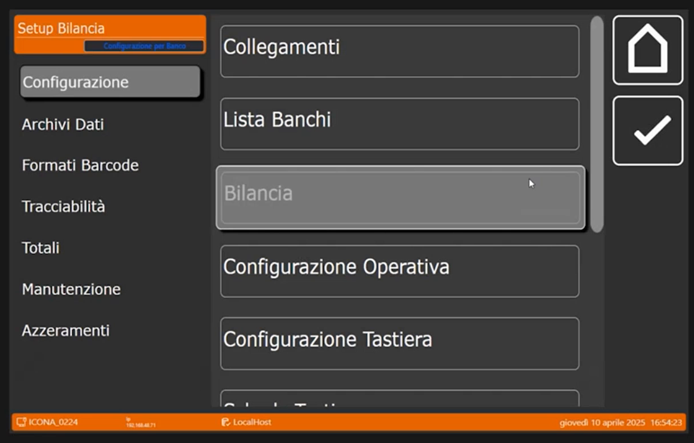

### 2. ID Bilancia: banco, numero e nome

> Nel video: 17:29

La prima sezione è **ID Bilancia**. I campi sono **Numero Banco**, **Numero Bilancia**, **Banco Attivo**, **Nome Bilancia**, **Tipo Configurazione** e **Configurazione Display**.

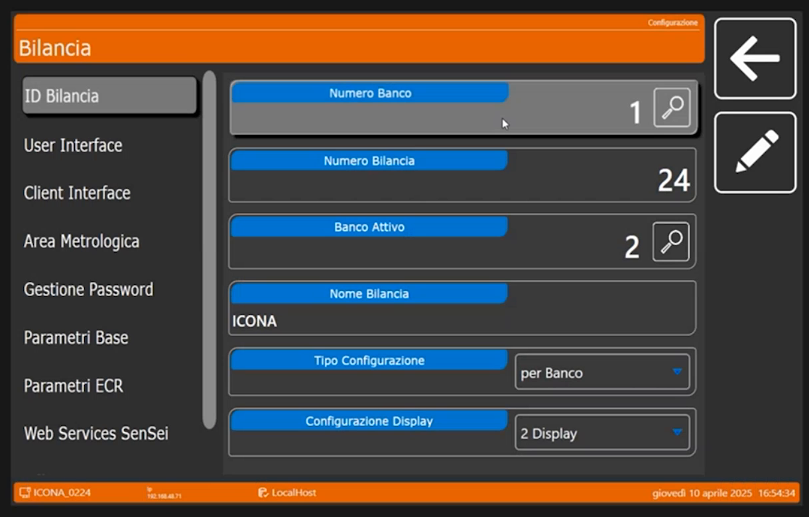

- **Numero Banco**: dichiara il banco a cui appartiene la bilancia. Tocca la lente accanto al valore per aprire la lista dei banchi e scegline uno.

    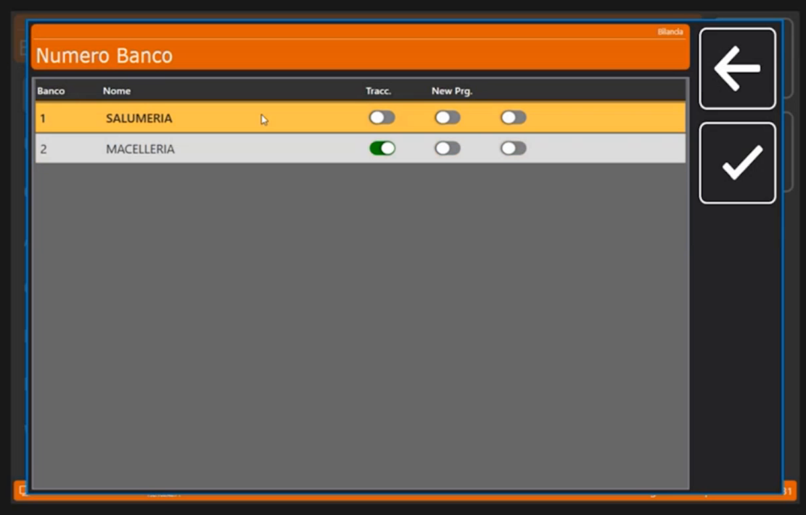

- **Banco Attivo**: è il banco attivo in questo momento sulla bilancia. Può essere diverso dal banco di riferimento: per esempio il banco di riferimento è l'1 ma si attiva momentaneamente il 2. Il relatore riporta infine tutto sul banco 2 per non riavviare la bilancia.
- **Numero Bilancia**: partendo dalla bilancia principale, che nel caso del relatore è il server, si dichiara **1**; ma può anche essere, per esempio, la **24ª** bilancia del banco. Non indica il funzionamento della bilancia: sono punti di accesso al database, quindi il numero della bilancia non incide sul ruolo della bilancia.
- **Nome Bilancia**: nel webinar è **ICONA**.

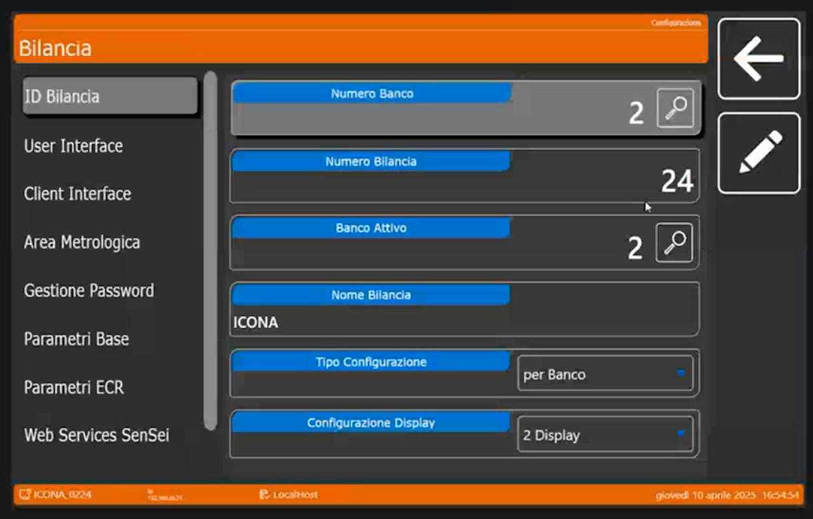

### 3. Scegli il Tipo Configurazione

> Nel video: 18:29

Qui sta la parte importante: le configurazioni. Il menu a tendina **Tipo Configurazione** propone **Globale**, **per Banco** e **per Bilancia**.

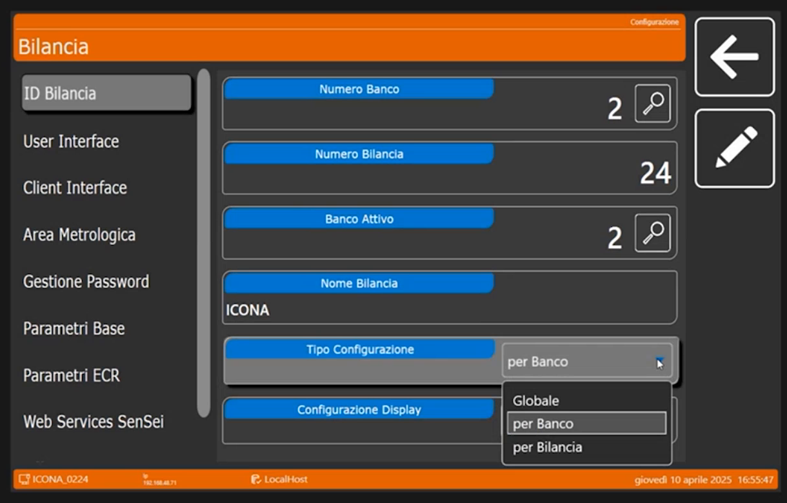

| Valore | Quando usarlo, secondo il relatore |
|---|---|
| **per Banco** | È il valore di default, e il relatore consiglia di **lasciarlo così**. Le impostazioni di lavoro si determinano per la tipologia di banco in cui si sta operando: salumeria, macelleria, frutta e verdura (che magari dovranno attivare il Self Service). |
| **Globale** | Tutte le programmazioni successive (dalle configurazioni della tastiera ai formati etichetta) sono **condivise da tutti i banchi** presenti sulla bilancia. |
| **per Bilancia** | Serve solo quando ci sono due o tre bilance connesse in rete sullo stesso banco (per esempio la salumeria) e una di queste deve lavorare diversamente, per esempio in etichettatura con un layout grafico diverso da quello del banco. |

!!! note "Configurazione Display"
    Il campo **Configurazione Display** indica i display usati: nel webinar è **2 Display**. Il relatore ricorda che per il Self Service si usa un solo display, perché il secondo non esiste.

<!-- verificare: la trascrizione dice "da non confondere con il servizio rapido che ha necessità dei due display"; il termine esatto va controllato sul video (19:46-19:58) -->

### 4. Sezioni a sinistra: legate al banco selezionato

> Nel video: 20:03

Sulla sinistra si apre una serie di configurazioni che si collegano al **banco selezionato**. Alcune sono da lasciare di default, altre vanno guardate.

**User Interface** (20:13). Sono configurazioni che di norma **non si toccano**: indicano l'ambiente di lavoro, cioè la cartella dove la bilancia registra le sue configurazioni e gli eseguibili di riferimento. Nella schermata: **Cartella di Lavoro** `C:\Scale_UI`, **Nome Eseguibile** `FrontEnd.exe`, **Tipo Icone** *Icone bianche*.

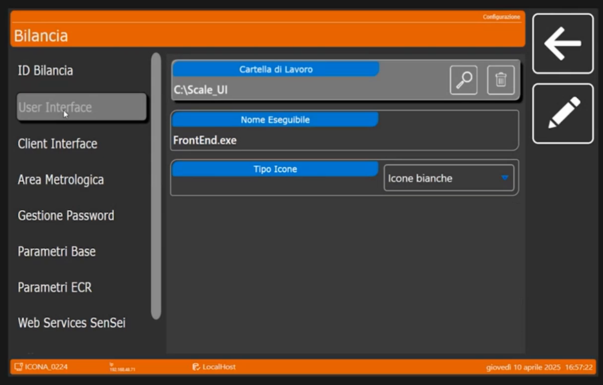

**Client Interface** (20:39). Riguarda la gestione dei client interfacciati: è una parte **da non toccare**. Nella schermata: **Cartella di Lavoro** `C:\Program Files (x86)\CUSTOM\Vis_Banchi\`, **Nome Eseguibile** `VIS_BNC.EXE`, **Timer Image Sequenza Pubblicitaria** 10, **Timer Elimina Code** 5, **Disabilita Cross Selling** e **Abilita Pubblicità Esterna** (entrambi disattivati).

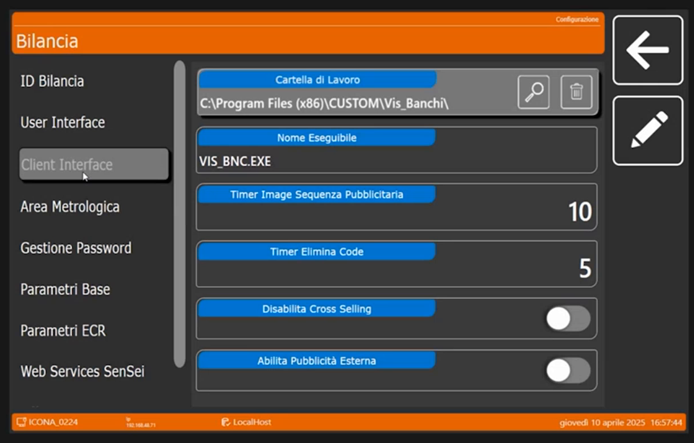

**Area Metrologica** (20:49). Offre un minimo di personalizzazione: l'area metrologica è **inviolabile**, è l'unica parte **sotto vincolo metrologico**, quindi non si può modificare a piacere. Si può solo scegliere **in quale posizione dello schermo posteriore** visualizzare i dati metrologici: in orizzontale o in verticale, a destra o a sinistra, in alto o in basso. Il lato **Operatore** e il lato **Cliente** hanno ciascuno posizione verticale, posizione orizzontale e stile (**Layout Orizzontale** o **Layout Verticale**).

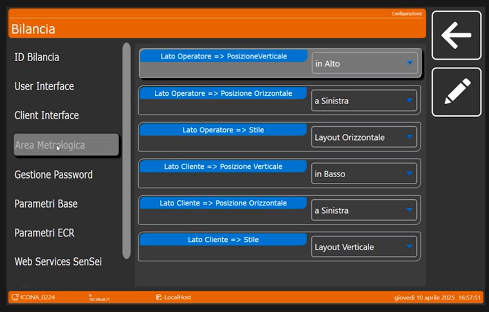

**Gestione Password** (21:31). Per le configurazioni particolari per un cliente è importante **attivare la gestione delle password**: impedisce al cliente di entrare nella bilancia e sprogrammare o sconfigurare impostazioni che possono avere richiesto parecchio tempo. A seconda del cliente e dell'impianto, la funzione è sempre consigliabile. Gli interruttori sono **Abilita Password Accesso Programmazione** e **Abilita Password Spegnimento**, entrambi disattivati nel webinar.

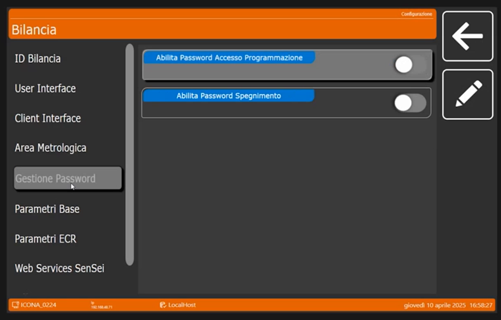

**Parametri Base** (21:57). Di default sono già impostati per una corretta gestione del touch e degli **offset delle etichette**. L'offset è la parte grafica in cui viene poi visualizzata l'etichetta: i contorni lasciati vuoti perché la carta esca correttamente dalla stampante. Nella schermata: **Suono Tocco Touch** *Alto*, **Luminosità Schermi**, **Offset Etichetta x (mm)** 2, **Offset Etichetta y (mm)** 0, **Avanzamento Stampa (mm)** 5, **Apri Cassetto dopo stampa scontrino** (disattivato).

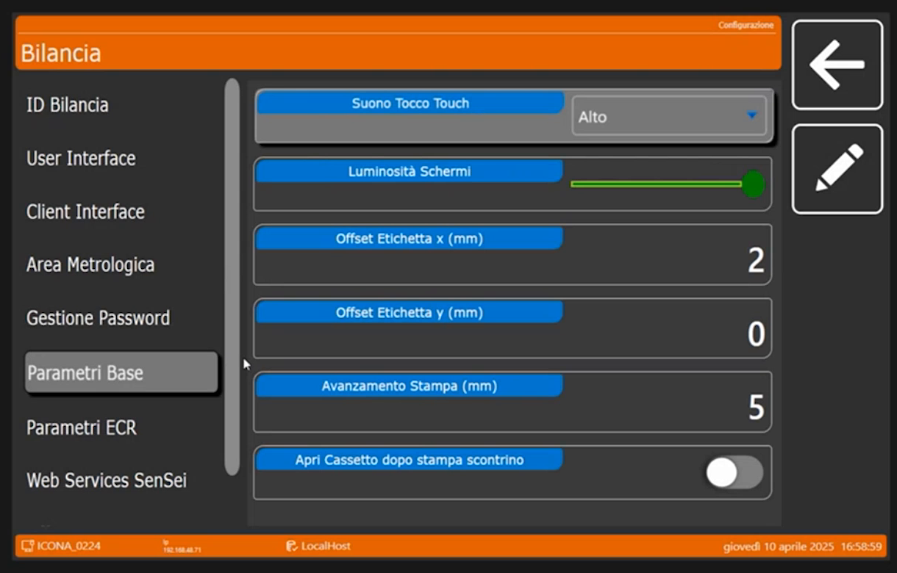

**Parametri ECR** (22:26). Il relatore li definisce **intuitivi** e non li apre nel webinar.

**Web Services SenSei** (22:26). Serve per la gestione con **terminali esterni**. Il relatore indica come fondamentale solo la prima parte; le altre sono opzioni che si possono saltare. Nella schermata: **WS SenSei - URL**, **WS SenSei - Terminal Id** (0) e **WS SenSei - Timeout** (5).

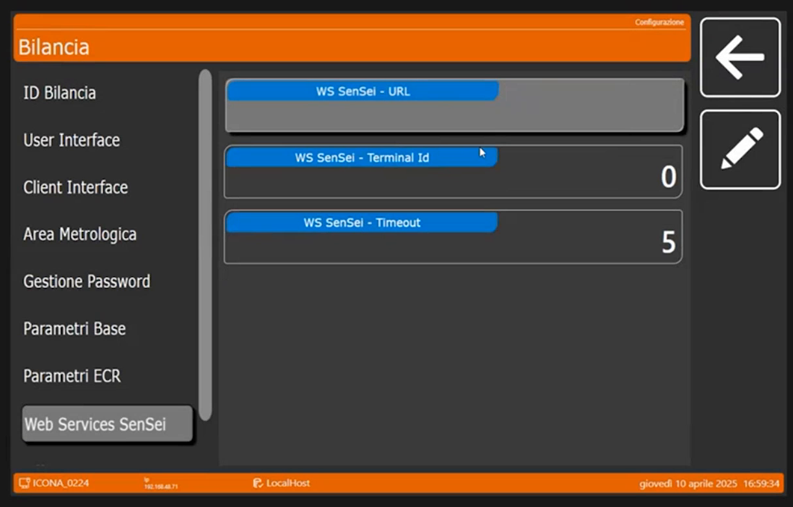

<!-- verificare: la trascrizione di 22:26-22:46 e' confusa; "prima parte" potrebbe riferirsi solo al campo URL -->

## Verifica

Dopo questo passaggio sono stati creati i banchi **SALUMERIA** e **MACELLERIA** e la bilancia sa a quale banco appartiene: in **ID Bilancia** devono comparire il **Numero Banco** e il **Banco Attivo** voluti, il **Numero Bilancia** e il **Tipo Configurazione** *per Banco*.

!!! tip "Prossimo passo"
    Prima di passare agli archivi (la creazione dei PLU) bisogna dire alla bilancia **come deve comportarsi**, cioè in quale modalità deve lavorare: pagina [Configurazione Operativa](configurazione-operativa.md).
