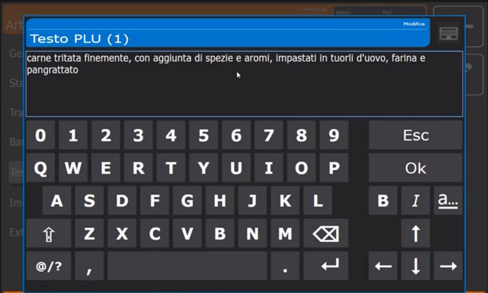
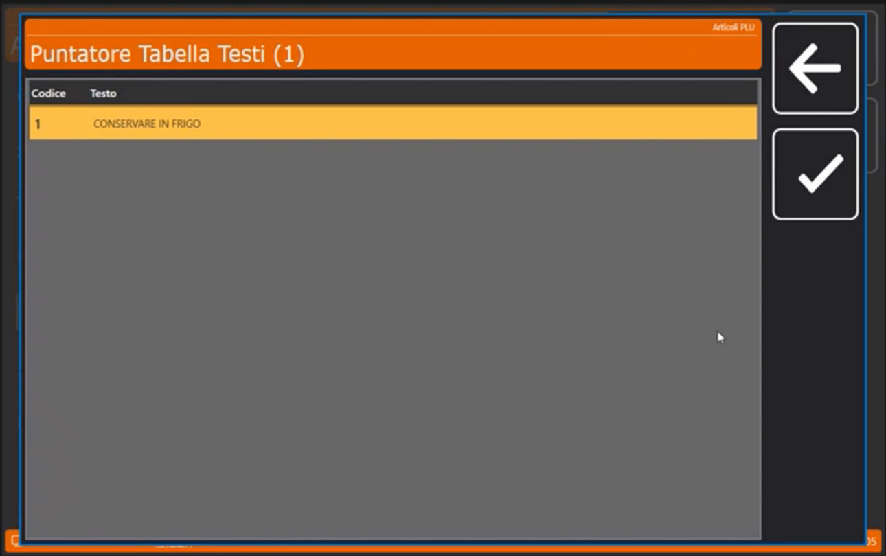
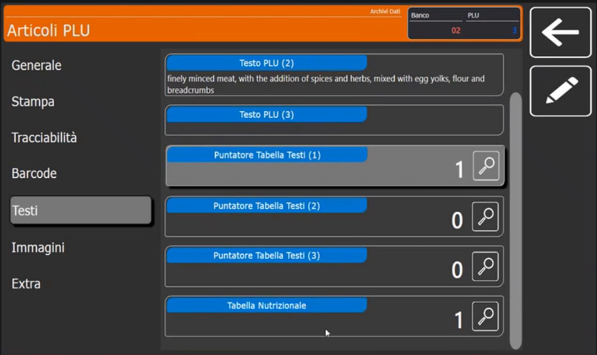
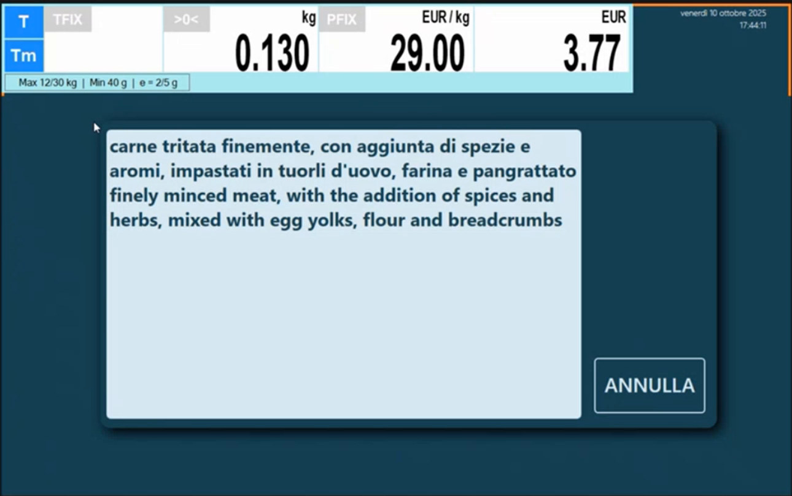

<!-- categoria assegnata per inferenza: verificare (la bilancia Icona non ha una categoria dedicata nell'elenco) -->

# Box ingredienti e tabelle testi

**Target:** tecnico installatore / rivenditore.

## Obiettivo

Gestire ingredienti, allergeni e istruzioni d'uso sulle etichette usando i **box di testo** dell'articolo e le **tabelle di testo** riutilizzabili, anche in più lingue.

## Come ragiona la bilancia

Una bilancia classica ha un solo campo di testo in cui scrivere tutte le informazioni. Icona invece permette di collegare a ogni articolo **più box di testo** (in tutto sei: tre **Testo PLU** e tre **Puntatori Tabella Testi**). Questo apre molte possibilità: un **unico anagrafico** di articoli soddisfa anche l'esigenza dell'**etichettatura multilingua**.

## I box di testo (Testo PLU 1, 2, 3)

Nella scheda **Testi** dell'articolo ([Articoli PLU](articoli-plu.md)) toccando un box si apre la tastiera.

- **Autolivellante.** Puoi scrivere **senza limite** di lunghezza: quando il testo viene stampato sull'etichetta la bilancia lo **compatta da sola**. Non serve contare i caratteri né andare a capo, anche se l'etichetta deve lasciare spazio agli ingredienti. Vale per tutti i box.
- **Formattazione.** Dalla tastiera attivi **grassetto** (**B**), **corsivo** (**I**) e **sottolineato** (**a**): servono a evidenziare gli **allergeni** in modo molto evidente sullo scontrino.
- **Uso dei tre box.** A titolo di esempio: **Testo PLU (1)** per gli ingredienti in italiano; **Testo PLU (2)** per gli stessi ingredienti in **inglese** (così si etichetta in multilingua senza duplicare gli articoli); **Testo PLU (3)** per ripetere gli **allergeni** o dare **istruzioni** su come consumare l'alimento.

!!! note "Allergeni"
    L'etichettatura richiede non solo di evidenziare gli allergeni, ma anche di riportarli in una **tabella a parte** nello stesso formato etichetta. Puoi usare un box per questo.

## I puntatori a tabelle di testo (Puntatore Tabella Testi 1, 2, 3)

Al posto di (o oltre a) scrivere il testo nel box, puoi collegare il **puntatore** a una **tabella di testi già preconfigurata** nell'archivio **Testi** ([Intestazioni, Operatori e Testi](intestazioni-operatori-testi.md)). Serve per le informazioni ripetitive su molti articoli:

- frasi di conservazione: *conservare in frigo*, *lasciare in ambiente asciutto*, *non disperdere nell'ambiente*;
- ingredienti identici su più articoli: in un panificio pane, rosette e filoncini hanno gli stessi ingredienti (acqua, farina, lievito, sale): invece di ripeterli su ogni articolo li scrivi una volta nell'archivio Testi e **colleghi gli articoli al testo**.

Entrambe le possibilità (testo scritto nel box e puntatore) sono utilizzabili sui formati di stampa e sui formati etichetta: come richiamarle nel layout è spiegato in [Formati Etichetta](formati-etichetta.md).

## Collegamento della tabella nutrizionale

Sotto i puntatori c'è il campo **Tabella Nutrizionale**: con la lente colleghi la tabella configurata nell'archivio **Tabelle Nutrizionali** ([Tabelle nutrizionali](tabelle-nutrizionali.md)).

## Ingredienti a video in vendita

Durante la vendita, toccando il **nome dell'articolo** si vedono al volo gli ingredienti riportati a video di **tutti i box attivi**: nell'esempio compaiono sia gli ingredienti in italiano sia quelli in inglese, perché la bilancia concatena i due box.

## Errori comuni

| Problema | Causa probabile | Rimedio |
|---|---|---|
| Gli ingredienti non compaiono sull'etichetta | Il campo del formato etichetta non punta al box giusto | Controlla **Origine Dato** e **Id Testo** nel formato ([Formati Etichetta](formati-etichetta.md)) |
| Compare il testo in italiano invece dell'inglese | Il formato richiama il box 1 | Imposta **Id Testo** sul box 2 |
| Il testo è troppo lungo per l'etichetta | Formato con poco spazio per gli ingredienti | Scegli un formato con più righe dedicate agli ingredienti o accorcia il testo |

!!! tip "Prossimo passo"
    Per la tabella dei valori nutrizionali: [Tabelle nutrizionali](tabelle-nutrizionali.md).
