<!-- categoria assegnata per inferenza: verificare (la bilancia Icona non ha una categoria dedicata nell'elenco) -->

# Categorie Merceologiche: raggruppare gli articoli

**Target:** tecnico installatore / rivenditore.

## Obiettivo

Creare le **categorie merceologiche** nell'archivio della bilancia e collegarle agli articoli, alle schede della tastiera e (se serve) all'IVA e agli sconti.

## Cosa sono

Le categorie sono **famiglie** in cui raggruppare gli articoli, come i reparti di un gestionale. **Non sono obbligatorie**, ma conviene crearle **prima degli articoli**, soprattutto con la tastiera **RETAIL => 4 Operatori** e le [schede](schede-tastiera.md) al richiamo del PLU.

Servono a:

- avere una **tastiera più comoda** per il cliente, perché permettono di passare da una pagina all'altra in modalità di lavoro;
- fini di **statistica**;
- **ordinare** gli archivi e gli articoli collegati;
- gestire correttamente l'**IVA in vendita**: nella costruzione degli EAN stampabili sotto lo scontrino (o di un QR code) si può richiamare un dato collegato alle categorie, per raggruppare gli articoli per aliquota (per esempio 10% o 4%) senza specificarla articolo per articolo;
- collegare uno **sconto diretto** alla categoria, aprendo il capitolo delle [promozioni](promozioni.md).

Non c'è un limite al numero di categorie: puoi usare qualsiasi codice (per esempio la categoria **10** chiamata **PANETTERIA**).

## Prerequisiti

- La [Configurazione Operativa](configurazione-operativa.md) è completata.
- Si parte da una bilancia **vuota**: nessun articolo e nessuna categoria.

## Procedura

### 1. Apri Archivi Dati

Dal menu **Setup Bilancia** tocca **Archivi Dati**. Compaiono **Articoli PLU**, **Intestazioni**, **Categorie Merceologiche**, **Operatori**, **Tare** e, scorrendo, **Testi**, **Formati Etichetta**, **Tabelle Nutrizionali** e **Promozioni**.

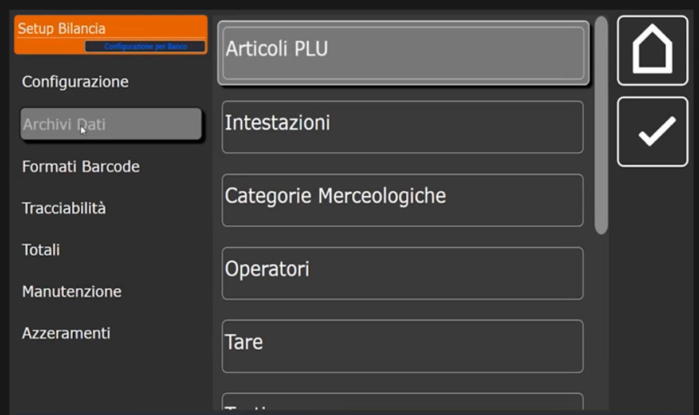

### 2. Seleziona Categorie Merceologiche

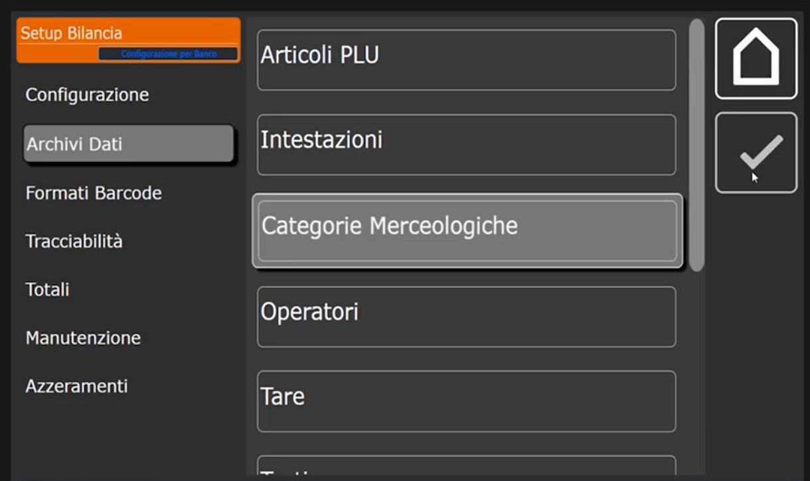

La lista parte vuota. Le colonne sono **Codice**, **Descrizione**, **Iva %** e **Sconto**. Il pulsante **+** crea una nuova categoria.

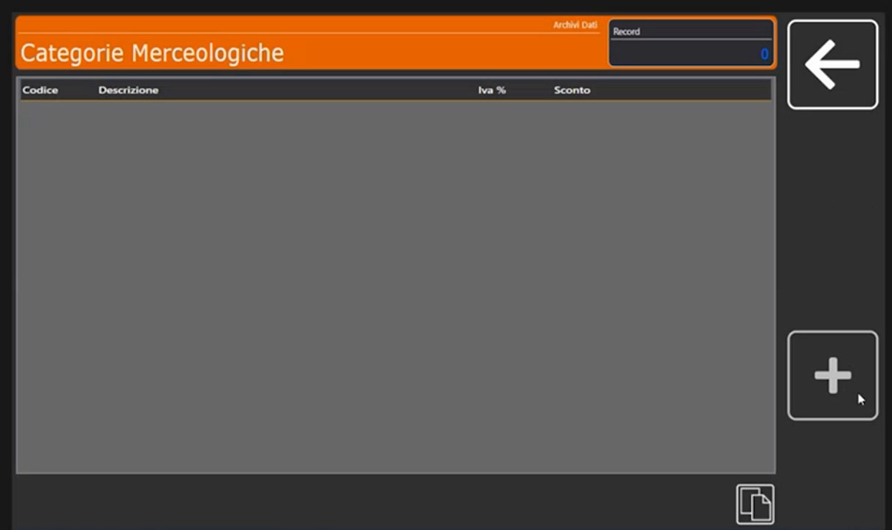

### 3. Crea la prima categoria

Tocca **+**: si apre il tastierino **Codice Categoria Merceologica**. Digita **1** e conferma con **Ok**. Si apre la scheda **Parametri** con **Codice Categoria Merceologica**, **Descrizione Categoria**, **Iva %** e **Sconto %**.

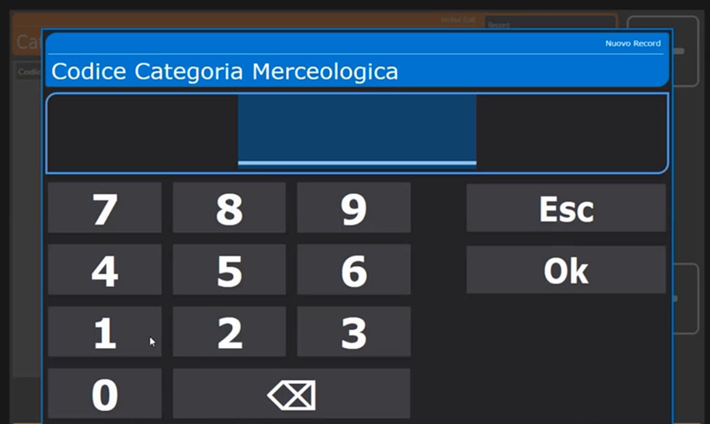

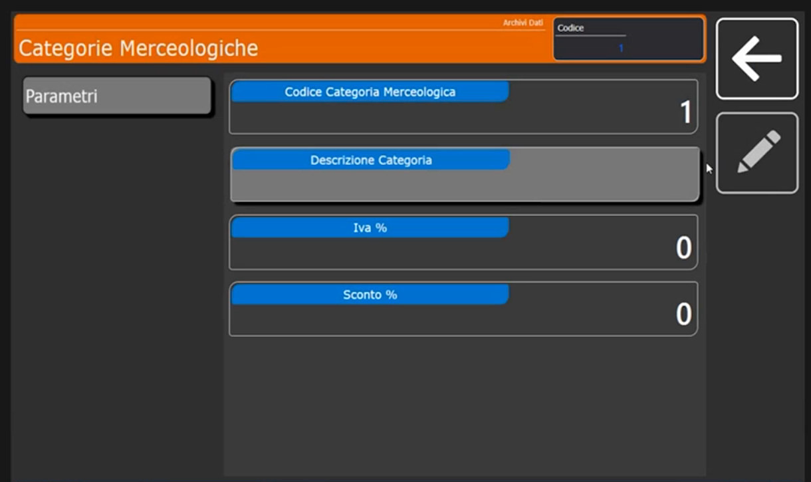

Tocca **Descrizione Categoria** e scrivi il nome: nell'esempio **ROSSE** (carni rosse), poi **BIANCHE** (carni bianche) e **VARIE**.

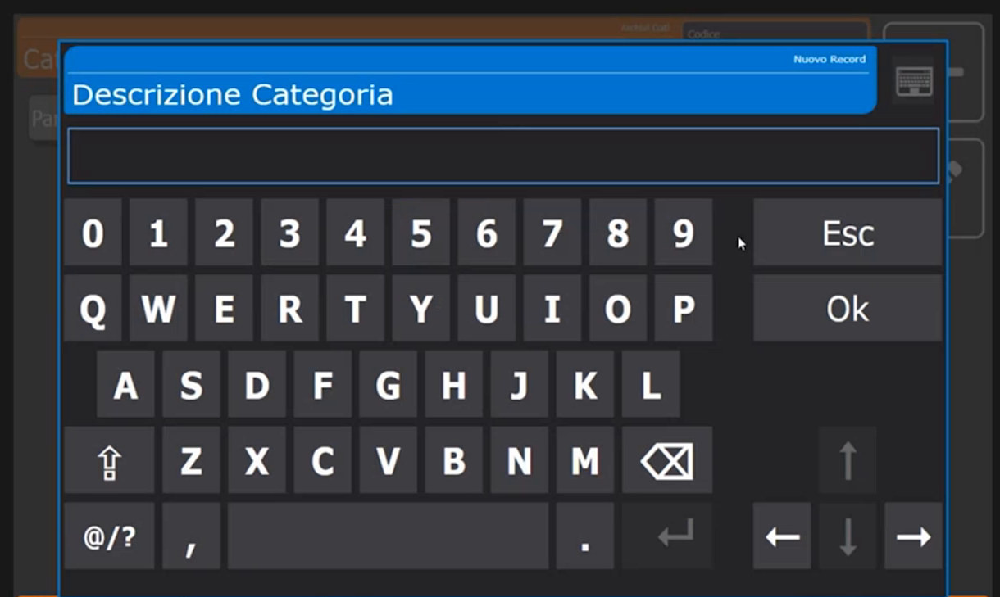

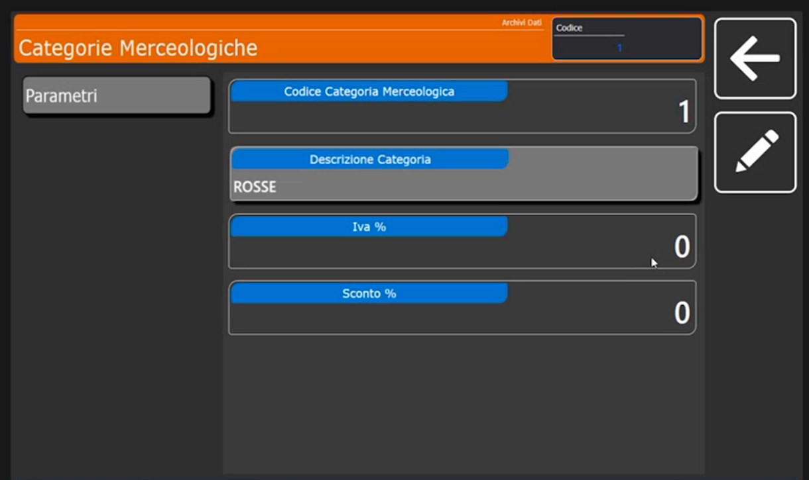

### 4. Facoltativo: IVA e sconto

Nella stessa scheda due campi, che di default restano a **0**:

- **Iva %**: l'aliquota IVA di riferimento della categoria.
- **Sconto %**: collega lo **sconto diretto** alla categoria.

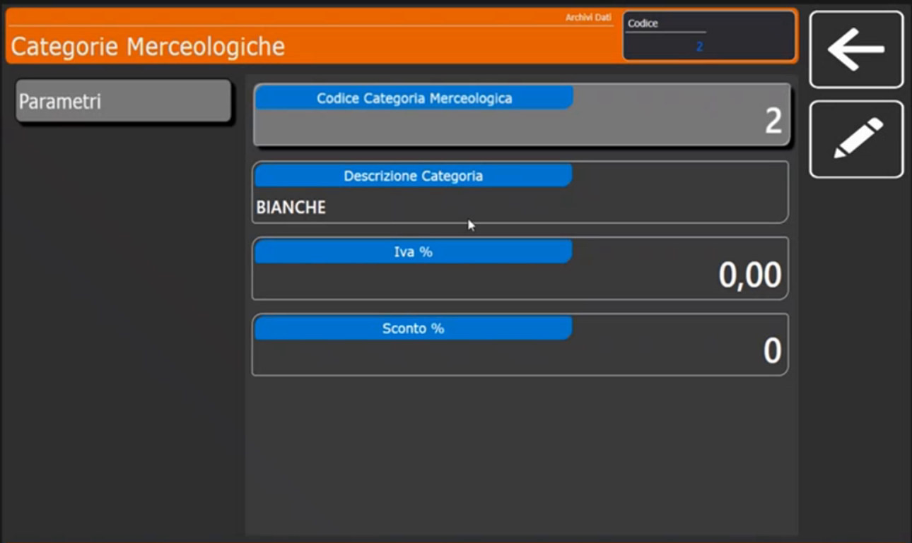

### 5. Aggiungi le altre categorie

Ripeti con **+**, un nuovo codice e la descrizione. Per un codice a due cifre, come **10**, digita il numero sul tastierino.

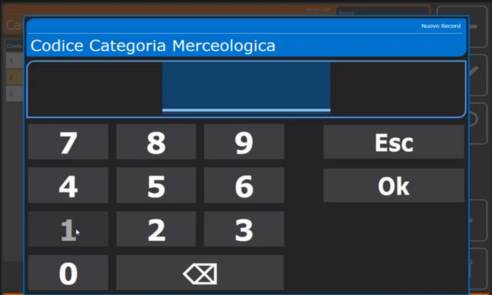

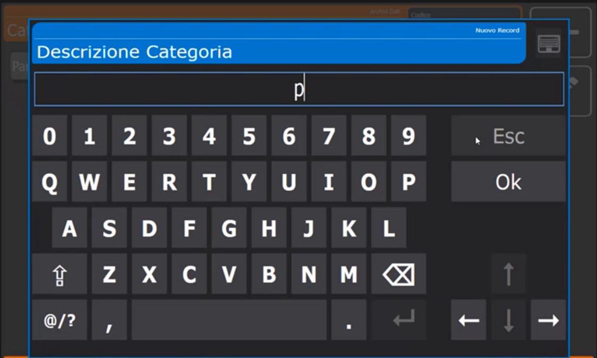

## Verifica

La lista mostra le categorie create con Iva % e Sconto a 0.

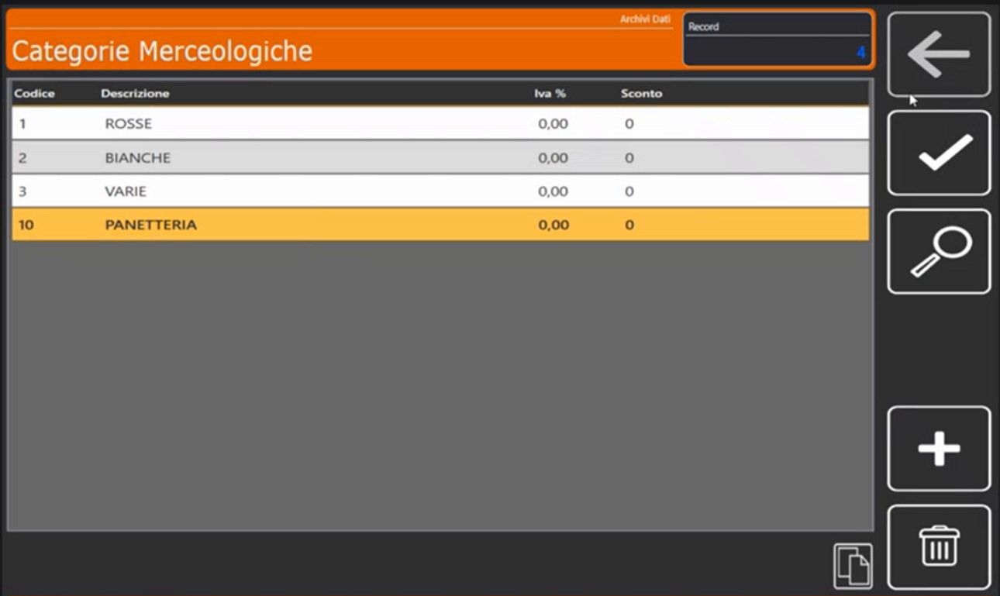

## Errori comuni

| Problema | Causa probabile | Rimedio |
|---|---|---|
| Una scheda della tastiera resta vuota | Gli articoli non sono collegati alla categoria | Nella scheda **Extra** dell'articolo imposta **Gruppo Merceologico** ([Articoli PLU](articoli-plu.md)) |
| Il collegamento tra scheda e categoria non funziona | Il **Tipo Scheda** non è *Retail - PLU Merceologico* | Controlla la scheda in [Schede Tastiera](schede-tastiera.md) |

!!! tip "Prossimo passo"
    Con le categorie create si passa agli [Articoli PLU](articoli-plu.md).
