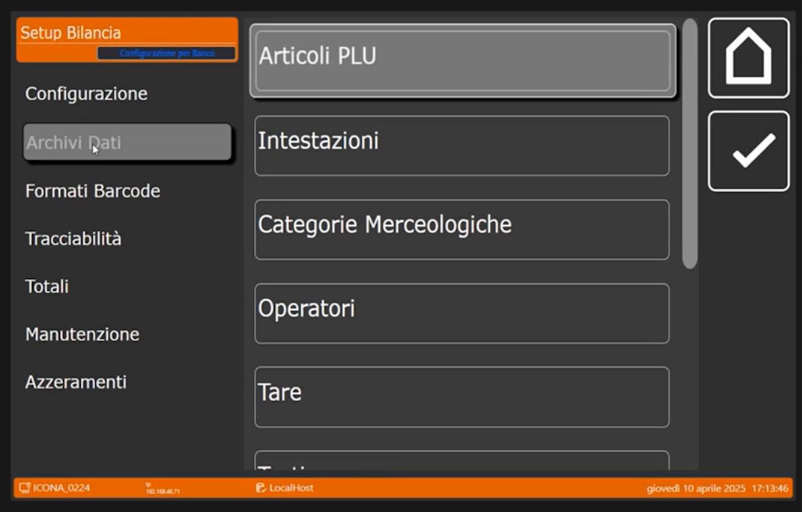
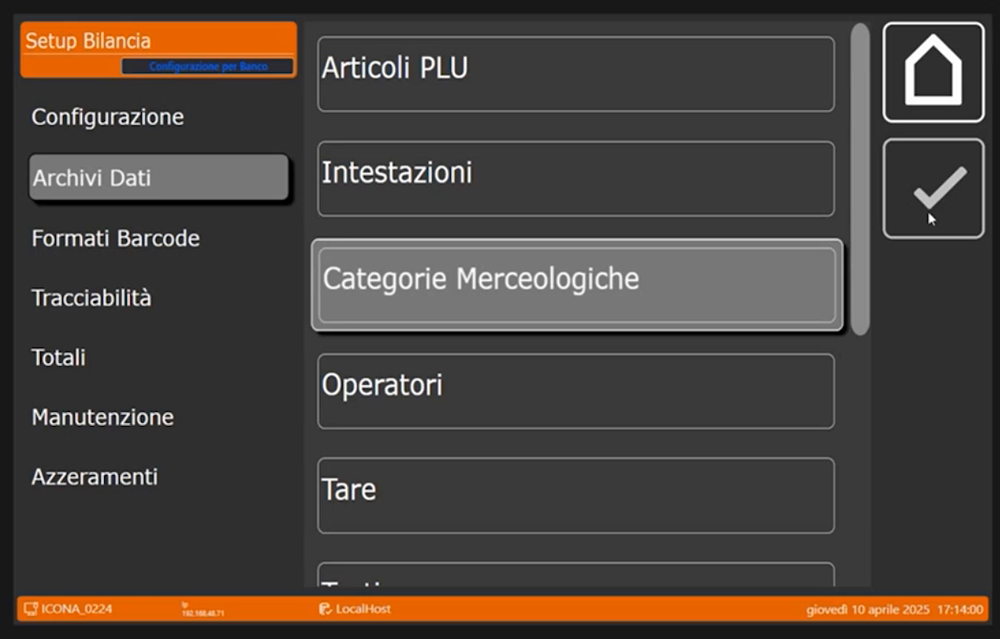
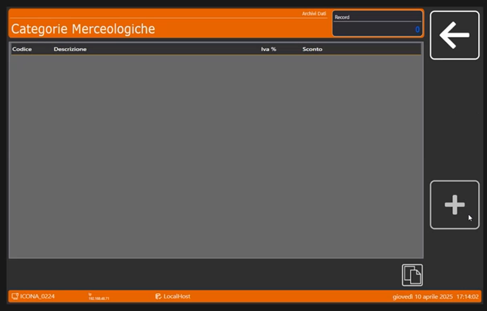
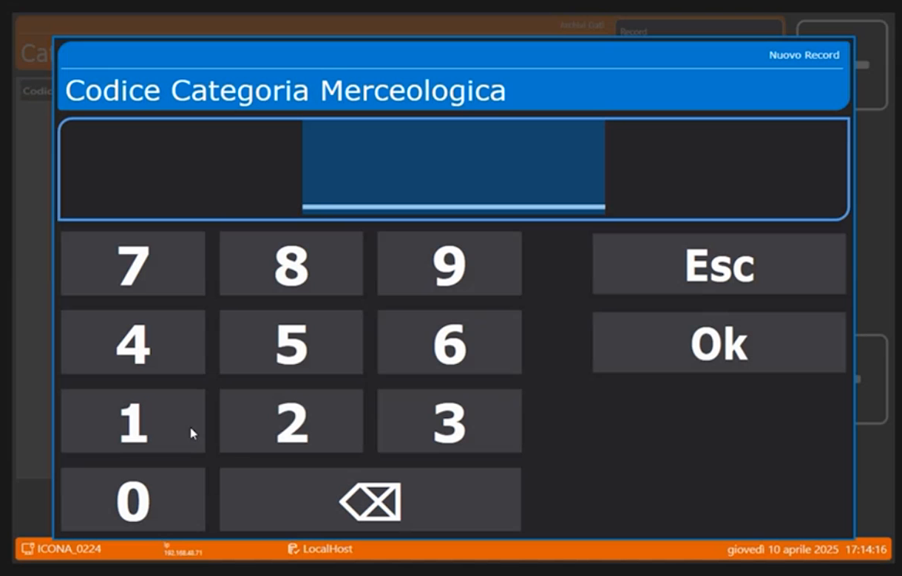
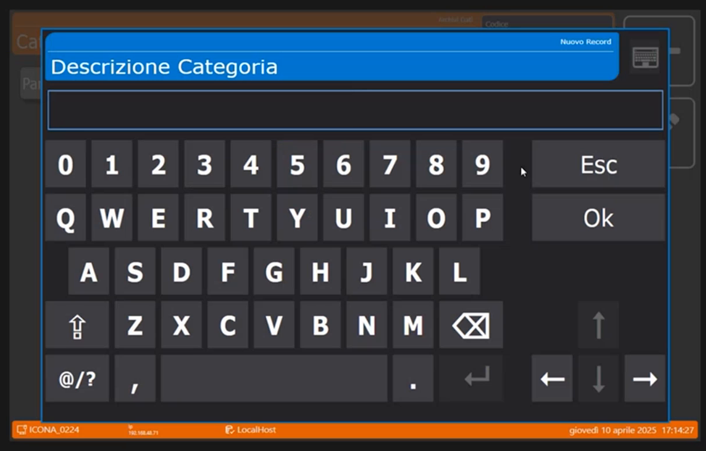
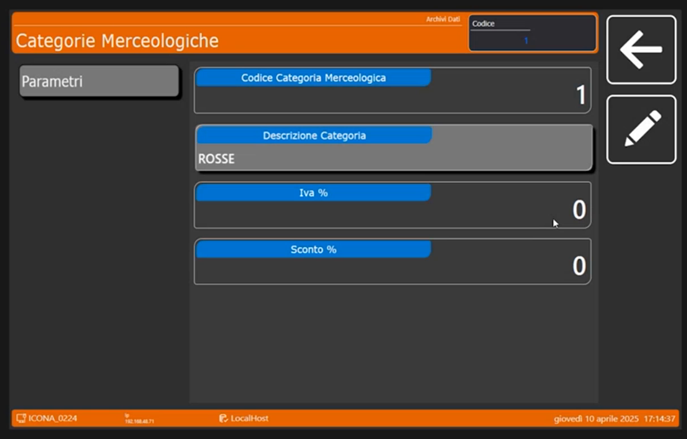
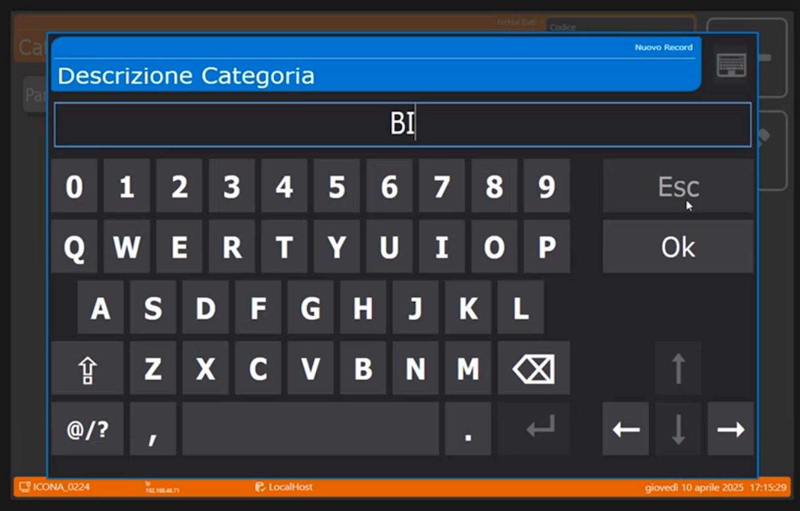
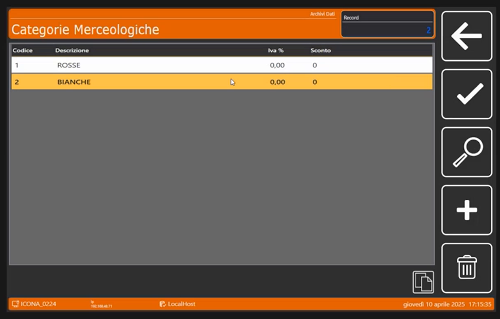

<!-- categoria assegnata per inferenza: verificare (la bilancia Icona non ha una categoria dedicata nell'elenco) -->

# Categorie Merceologiche: creare ROSSE e BIANCHE

**Target:** tecnico installatore / rivenditore · **Video:** Custom Academy, webinar *Icona configurazione di base* (10/04/2025), dal minuto 36:44 al 38:49.

## Obiettivo

Al termine sai creare le **categorie merceologiche** nell'archivio della bilancia e sai a cosa servono, così da poterle collegare agli articoli.

## Prerequisiti

- La [Configurazione Operativa](configurazione-operativa.md) è completata.
- Si parte da una bilancia **completamente vuota**: nessun articolo e nessuna categoria.

## Perché creare le categorie per prime

Il relatore passa agli **archivi** e lascia per dopo la configurazione della tastiera, perché avrà più senso capirla quando saranno creati gli articoli. Creando gli articoli si creano anche i merceologici ad essi collegati, quindi **in prima battuta si creano le categorie**.

Le categorie merceologiche **non sono obbligatorie** nella bilancia. Possono servire per:

- avere una **configurazione della tastiera più comoda** per il cliente, perché permettono di passare da una pagina all'altra in modalità di lavoro;
- scopi di **statistica**;
- **ordinare gli archivi** e gli articoli ad esse collegati.

## Passaggi

### 1. Apri Archivi Dati

> Nel video: 36:44

Dal menu **Setup Bilancia** tocca **Archivi Dati**. A destra compaiono **Articoli PLU**, **Intestazioni**, **Categorie Merceologiche**, **Operatori**, **Tare** e altre voci più in basso.

### 2. Seleziona Categorie Merceologiche

> Nel video: 37:04

Tocca **Categorie Merceologiche**.

La lista è vuota: le colonne sono **Codice**, **Descrizione**, **Iva %** e **Sconto**. Il pulsante **+** crea una nuova categoria.

### 3. Crea la prima categoria

> Nel video: 37:24

Tocca **+**: si apre il tastierino **Codice Categoria Merceologica**. Digita **1** e conferma con **Ok**. Si apre la scheda con **Codice Categoria Merceologica**, **Descrizione Categoria**, **Iva %** e **Sconto %**.

Tocca **Descrizione Categoria** e scrivi il nome con la tastiera. Il relatore ragiona sulle carni e crea **ROSSE** (carni rosse); poi crea **BIANCHE** (carni bianche).

### 4. Facoltativo: IVA e sconto di riferimento

> Nel video: 37:40

Nella stessa scheda si possono impostare due campi, che nel webinar restano a **0**:

- **Iva %**: l'aliquota IVA di riferimento. Serve perché nella costruzione degli EAN stampabili sotto gli scontrini si può richiamare un EAN collegato ai merceologici, per avere una gestione corretta dell'IVA in vendita. Non interessa la specifica dei singoli articoli, ma raggruppare gli articoli per aliquota, per esempio al 10% o al 4%: lo si fa dando già al merceologico l'IVA di riferimento.
- **Sconto %**: apre tutto il mondo delle **promozioni** spiegato nel webinar precedente: è possibile collegare al merceologico lo **sconto diretto**.

### 5. Crea la seconda categoria

> Nel video: 38:30

Ripeti con **+**, codice **2** e descrizione **BIANCHE** per avere un secondo esempio.

## Verifica

La lista deve mostrare le due righe: **1 ROSSE** e **2 BIANCHE**, con Iva % e Sconto a 0.

!!! tip "Prossimo passo"
    Con le due categorie create, il relatore passa alla grafica degli articoli per creare il primo PLU: pagina [Articoli PLU](articoli-plu.md).
