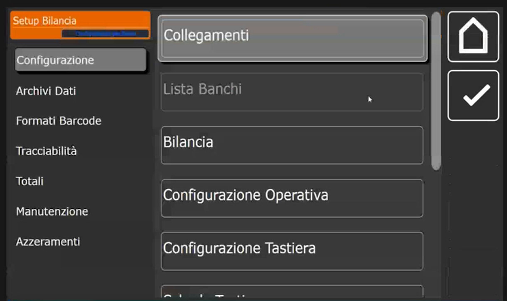
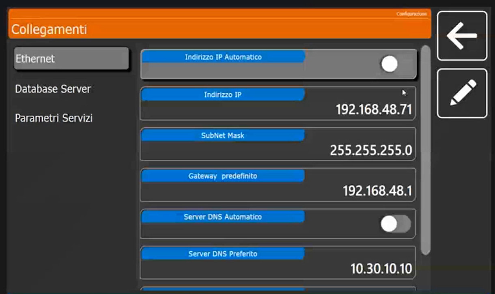
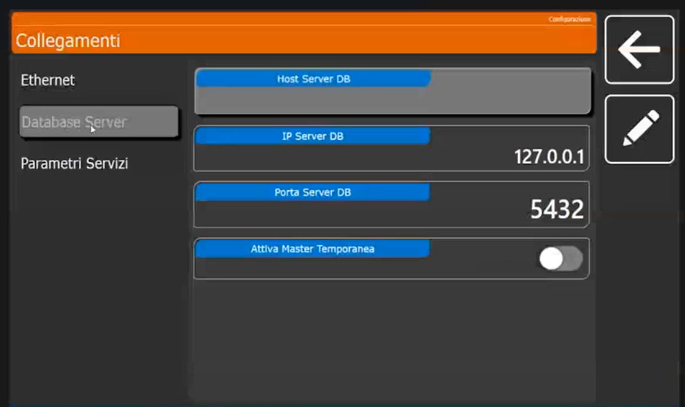
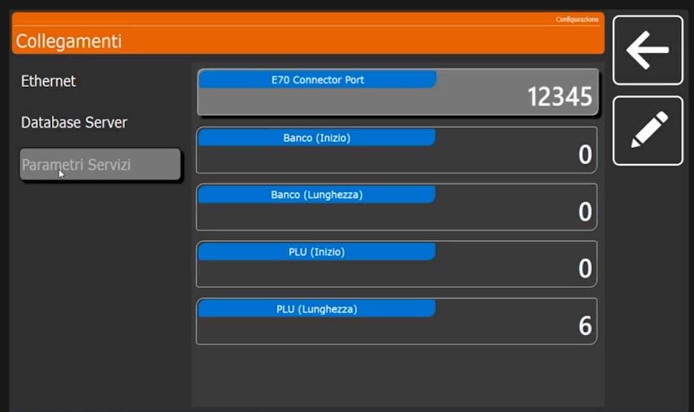

<!-- categoria assegnata per inferenza: verificare (la bilancia Icona non ha una categoria dedicata nell'elenco) -->

# Collegamenti: rete, database e parametri di servizio

**Target:** tecnico installatore.

## Obiettivo

Impostare l'indirizzo IP della bilancia, scegliere il database a cui lavora e conoscere i parametri di servizio usati dagli applicativi collegati.

## Prerequisiti

- I banchi sono già stati creati ([Lista Banchi](lista-banchi.md)). La lista dei banchi va compilata prima di attivare qualsiasi altra configurazione.

## Come funziona la rete di bilance

Ogni bilancia ha un proprio database PostgreSQL locale. Più bilance si connettono tra loro tramite **rete e indirizzo IP**: la bilancia principale (server) ospita il database e le altre lo usano come punto di accesso. Il database può risiedere su una bilancia, su un'altra o su un server esterno.

## Procedura

### 1. Apri Collegamenti

Dal menu **Setup Bilancia**, sezione **Configurazione**, tocca **Collegamenti**. La pagina ha tre sezioni a sinistra: **Ethernet**, **Database Server** e **Parametri Servizi**.

### 2. Ethernet: indirizzo IP

Di default la bilancia ha l'**indirizzo IP automatico**, quindi in **DHCP**. Collegando il cavo di rete si attiva la connessione a internet e quindi la possibilità di collegarsi con TeamViewer per l'assistenza remota.<!-- verificare: "TeamViewer" ricavato dal parlato, trascritto in modo incerto -->

I campi sono: **Indirizzo IP Automatico** (selettore), **Indirizzo IP**, **SubNet Mask**, **Gateway predefinito**, **Server DNS Automatico** (selettore) e **Server DNS Preferito**.

- **Bilancia stand alone**, non connessa ad altri dispositivi: puoi lasciare il **DHCP**. Non c'è l'obbligo di assegnare un indirizzo statico.
- **Due o più bilance in rete**: l'**IP statico** è estremamente necessario, perché le bilance si connettono e dialogano tramite l'indirizzo IP.

!!! note "Valori mostrati negli esempi"
    Nella schermata di esempio **Indirizzo IP Automatico** e **Server DNS Automatico** sono disattivati e i valori sono IP **192.168.48.71**, subnet mask **255.255.255.0**, gateway **192.168.48.1**, DNS preferito **10.30.10.10**. Sono dati dell'impianto di prova, non valori da riutilizzare.

### 3. Database Server

Di default la bilancia lavora sul **suo database locale**. Se è una **bilancia secondaria**, scrivi qui l'**indirizzo IP della bilancia principale**.

I campi sono **Host Server DB** (vuoto), **IP Server DB** (**127.0.0.1**, cioè il database locale), **Porta Server DB** (**5432**) e **Attiva Master Temporanea** (selettore disattivato).

### 4. Parametri Servizi

Servono alla **connettività corretta con gli applicativi** collegati (per esempio BenchComm, vedi [Conoscere Icona](panoramica-icona.md)). Salvo esigenze di integrazione non vanno modificati.

I campi sono **E70 Connector Port** (12345), **Banco (Inizio)** (0), **Banco (Lunghezza)** (0), **PLU (Inizio)** (0) e **PLU (Lunghezza)** (6).

## Verifica

Su una bilancia singola **IP Server DB** resta **127.0.0.1**, porta **5432**. Su una bilancia di rete controlla che l'indirizzo IP sia quello previsto e che, per le bilance secondarie, **IP Server DB** punti alla bilancia principale.

## Errori comuni

| Problema | Causa probabile | Rimedio |
|---|---|---|
| Due bilance non si vedono | Una delle due è ancora in DHCP | Assegna indirizzi IP statici nella stessa rete |
| Una bilancia secondaria non vede gli articoli | **IP Server DB** è ancora 127.0.0.1 | Scrivi l'IP della bilancia principale |
| Un applicativo esterno non si collega | Numero banco o parametri di servizio non coerenti | Controlla il numero del banco ([Lista Banchi](lista-banchi.md)) e **E70 Connector Port** |

!!! tip "Prossimo passo"
    Dichiara a quale banco appartiene la bilancia e quale banco è attivo: pagina [Bilancia](bilancia.md).
