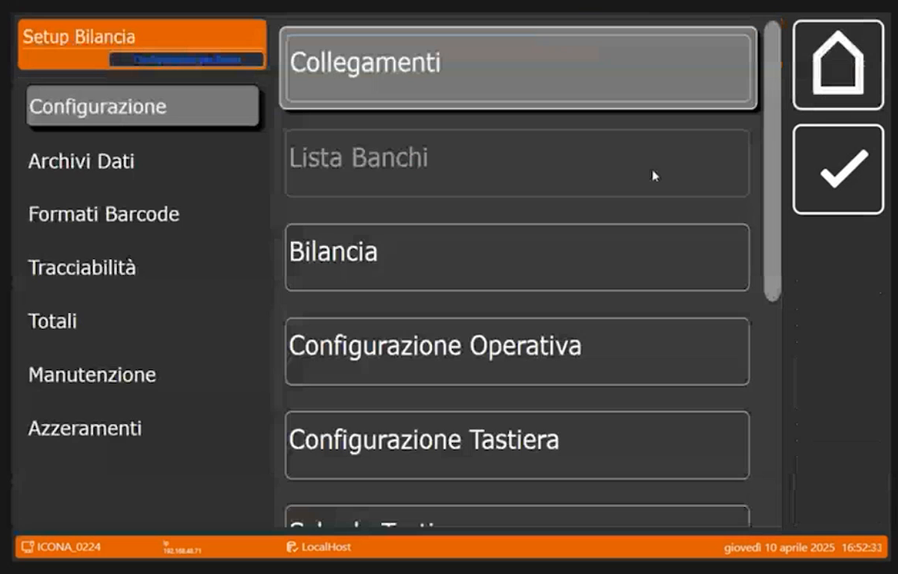
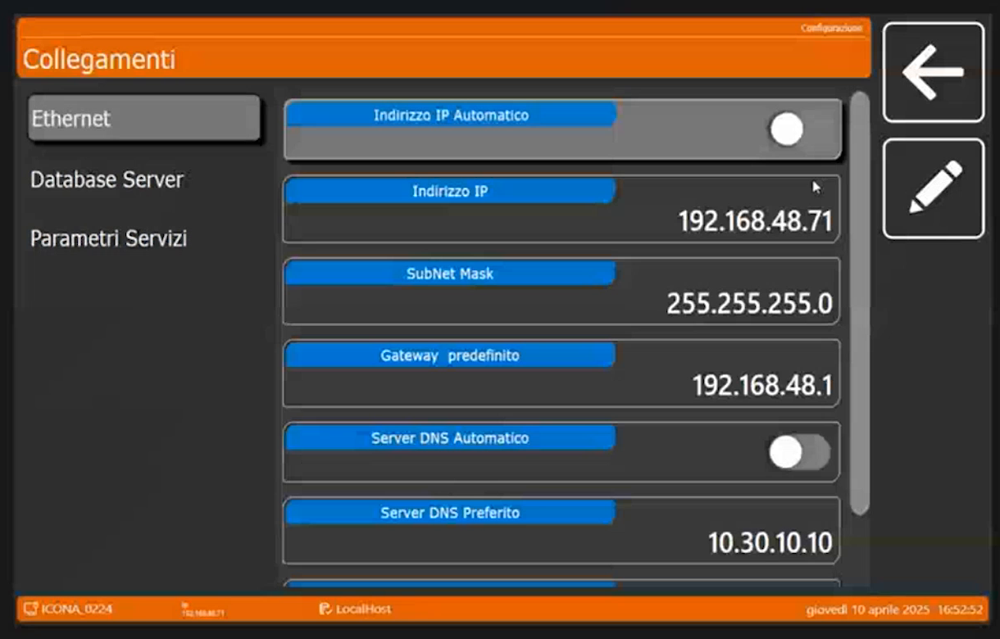
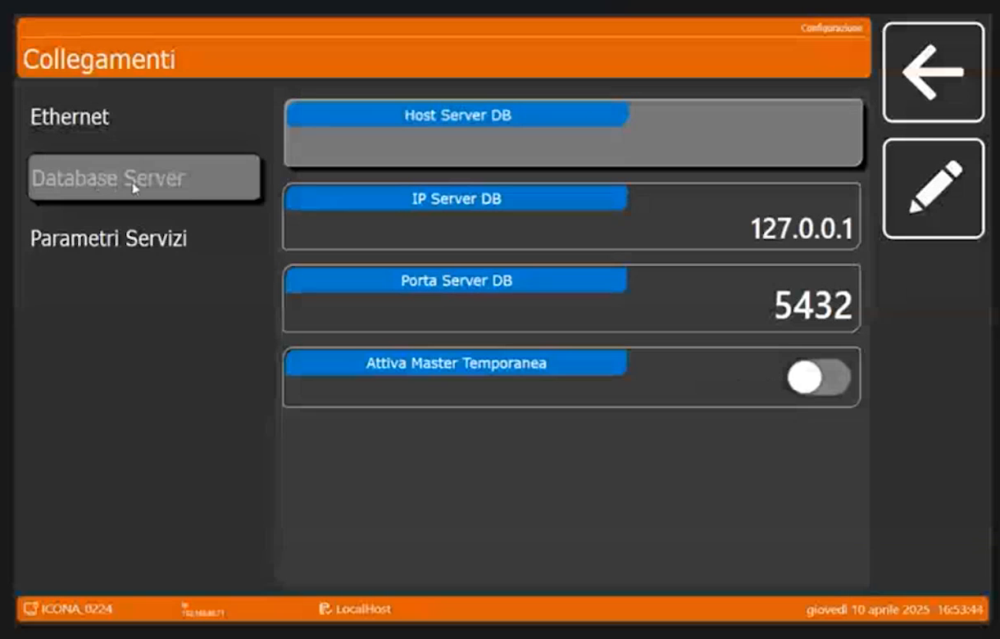
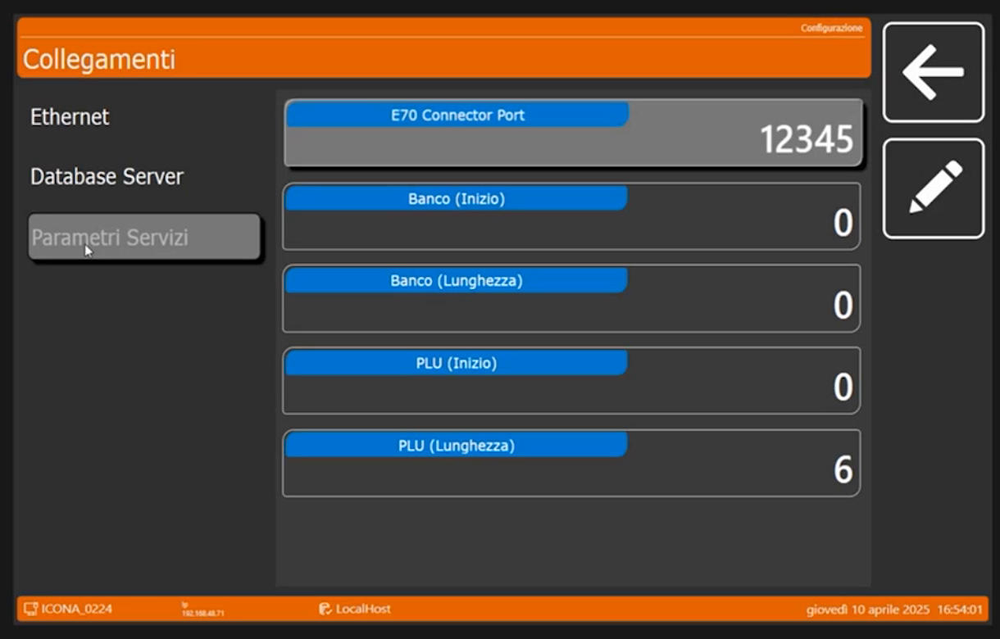

<!-- categoria assegnata per inferenza: verificare (la bilancia Icona non ha una categoria dedicata nell'elenco) -->

# Collegamenti: rete, database e parametri di servizio

**Target:** tecnico installatore · **Video:** Custom Academy, webinar *Icona configurazione di base* (10/04/2025), dal minuto 15:40 al 17:25.

## Obiettivo

Al termine sai dove impostare l'indirizzo IP della bilancia, quale database usa e dove si trovano i parametri di servizio per gli applicativi collegati.

## Prerequisiti

- I banchi sono già stati creati: vedi [Lista Banchi](lista-banchi.md). Il relatore ha saltato volutamente i Collegamenti prima di creare i banchi, perché **la lista dei banchi è fondamentale prima di attivare qualsiasi tipo di configurazione**.

## Passaggi

### 1. Apri Collegamenti

> Nel video: 15:40

Dal menu **Setup Bilancia**, sezione **Configurazione**, tocca **Collegamenti**. La pagina ha tre sezioni a sinistra: **Ethernet**, **Database Server** e **Parametri Servizi**.

### 2. Ethernet: indirizzo IP

> Nel video: 15:58

Di default la bilancia ha l'**indirizzo IP automatico**, quindi in **DHCP**. Collegando il cavo di rete si attiva la connessione a internet e quindi la possibilità di collegarsi con TeamViewer.<!-- verificare: la trascrizione automatica riporta "Teamweaver"; interpretato come TeamViewer, coerente con il collegamento remoto citato a 7:36 -->

I campi della sezione sono: **Indirizzo IP Automatico** (selettore), **Indirizzo IP**, **SubNet Mask**, **Gateway predefinito**, **Server DNS Automatico** (selettore) e **Server DNS Preferito**.

- Se la bilancia è **in standalone**, da sola e non connessa a niente, la puoi lasciare in **DHCP**: non c'è l'obbligo di assegnare un indirizzo IP statico.
- L'**IP statico** è invece estremamente necessario quando devi **collegare due bilance in rete tra loro**, perché si connettono e dialogano tramite la rete e l'indirizzo IP.

!!! note "Valori mostrati nel webinar"
    Nella schermata la bilancia su cui lavora il relatore ha **Indirizzo IP Automatico** disattivato e questi valori: IP **192.168.48.71**, subnet mask **255.255.255.0**, gateway **192.168.48.1**, **Server DNS Automatico** disattivato, DNS preferito **10.30.10.10**. Sono i dati dell'impianto di prova, non valori da riutilizzare.

### 3. Database Server

> Nel video: 16:50

Di default la bilancia lavora sul **suo database locale**. Se invece è una **bilancia secondaria**, in questa sezione si scrive l'**indirizzo IP della bilancia principale**.

Nella schermata si vedono i campi **Host Server DB** (vuoto), **IP Server DB** (**127.0.0.1**, cioè il database locale), **Porta Server DB** (**5432**) e **Attiva Master Temporanea** (selettore disattivato).

### 4. Parametri Servizi

> Nel video: 17:05

Questa sezione serve per la **connettività corretta con gli applicativi** visti nelle slide, per esempio BenchComm. Il relatore non li approfondisce ora: li vedrà in seguito. Per questo aveva saltato questa parte all'inizio.

I campi mostrati sono **E70 Connector Port** (12345), **Banco (Inizio)** (0), **Banco (Lunghezza)** (0), **PLU (Inizio)** (0) e **PLU (Lunghezza)** (6).

## Verifica

Per una bilancia di rete controlla che l'**indirizzo IP** sia quello previsto e che, per una bilancia secondaria, **IP Server DB** punti alla bilancia principale. In una bilancia singola resta **127.0.0.1**, porta **5432**.

!!! tip "Prossimo passo"
    Creati i banchi e controllati i collegamenti, si passa a dichiarare che cos'è questa bilancia e quale banco è attivo: pagina [Bilancia](bilancia.md).
