<!-- categoria assegnata per inferenza: verificare (la bilancia Icona non ha una categoria dedicata nell'elenco) -->

# Configurazione Operativa: modalità di lavoro della bilancia

**Target:** tecnico installatore / rivenditore.

## Obiettivo

Dire alla bilancia **in quale modalità deve lavorare** (Multipesata, Single Ticket, Etichetta o Self Service), impostare barcode di default, tipo di carta e tipo di tastiera, e conoscere le altre sezioni della pagina: Richiamo Articoli, Totali Etichette e Gestione Cliente.

## Prerequisiti

- Banchi creati e bilancia dichiarata: [Lista Banchi](lista-banchi.md) e [Bilancia](bilancia.md).
- Questa pagina va completata **prima degli archivi**, cioè prima di creare i PLU.

!!! note "Un unico configuratore per tutta la famiglia"
    Un unico configuratore, un unico archivio, un'unica release permettono di modellare la bilancia **indipendentemente dall'hardware**: bassa o alta, con uno o due monitor, i passaggi di configurazione sono sempre gli stessi.

!!! note "A quale banco si applica"
    In alto a destra la pagina mostra **per Banco** e **Banco = 2**: le impostazioni valgono per il banco indicato, perché nella pagina Bilancia il **Tipo Configurazione** è *per Banco*.

!!! tip "Regola generale: il PLU prevale"
    Le programmazioni fatte negli **archivi PLU** (per esempio formato etichetta, blocco prezzo, barcode, lotto) **prevalgono** sulle impostazioni generali di questa pagina. Se nel PLU non si specifica nulla, la bilancia usa le impostazioni generali.

## Le sezioni della pagina

Dal menu **Setup Bilancia**, sezione **Configurazione**, tocca **Configurazione Operativa**. A sinistra compaiono le sezioni: **Generale**, **Opzioni Multipesata**, **Opzioni Single Ticket**, **Opzioni Etichetta**, **Opzioni Self Service**, **Richiamo Articoli**, **Totali Etichette**, **Gestione Cliente** e **Personalizzazioni**.

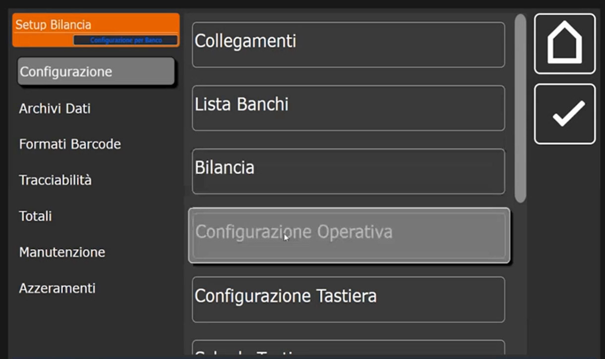

## 1. Generale: scegli il modo di funzionamento

La sezione **Generale** dice alla bilancia **in che modalità deve operare**.

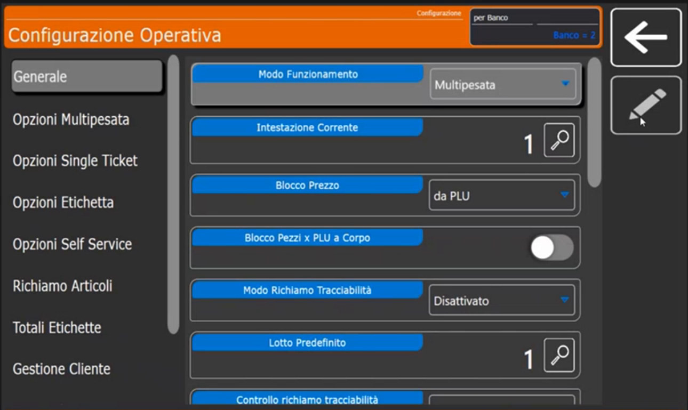

Il menu a tendina **Modo Funzionamento** propone quattro modalità:

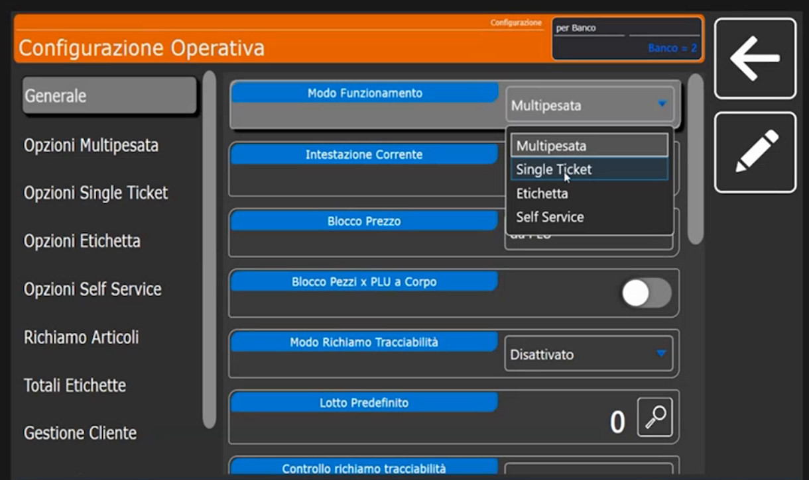

| Modalità | Cosa fa |
|---|---|
| **Multipesata** | Bilancia classica: più pesate (pesata a transazione, scontrino somma) e un unico scontrino finale. Dinamiche descritte più sotto |
| **Single Ticket** | Scontrino singolo: ogni transazione effettuata sulla bilancia produce uno scontrino |
| **Etichetta** | Apre l'ambiente di etichettatura avanzata ed evoluta: vedi [Etichettatura in vendita](etichettatura.md) |
| **Self Service** | Modalità self service, con le sue impostazioni dedicate |

### Campi della sezione Generale

| Campo | Valore di default | Funzione |
|---|---|---|
| **Intestazione Corrente** | 1 | Intestazione dello scontrino usata a livello generale. La bilancia può avere più intestazioni (utile a chi etichetta per conto terzi): vedi [Intestazioni, Operatori e Testi](intestazioni-operatori-testi.md). Con la lente si apre l'elenco |
| **Blocco Prezzo** | da PLU | Se nel PLU il prezzo è bloccato, la bilancia lo rispetta |
| **Blocco Pezzi x PLU a Corpo** | disattivato | Blocco sui pezzi per gli articoli venduti a corpo |
| **Modo Richiamo Tracciabilità** | Disattivato | Come la bilancia richiama la tracciabilità: vedi [Tracciabilità e lotti](tracciabilita.md) |
| **Lotto Predefinito** | 1 | Lotto proposto di default |
| **Controllo richiamo tracciabilità** | Nessun controllo | Controllo sul richiamo della tracciabilità |
| **Cambio Banco Automatico** | disattivato | Cambio automatico del banco |
| **Tara Predefinita** | 0 | Tara usata di default |
| **Usa Tara Predefinita all'Avvio** | disattivato | Applica la tara predefinita all'avvio |
| **Utilizza tara predefinita Self Service** | disattivato | Come sopra, in modalità Self Service |
| **Formato Stampa dati Lotto** | 0 | Formato per la stampa dei dati del lotto |
| **Formato Stampa Ticket Ordini** | 0 | Formato di stampa dei ticket ordini |
| **Abilita forme di Pagamento** | disattivato | Gestione delle forme di pagamento |
| **Se data Produzione =0 usa data odierna** | disattivato | Se la data di produzione dell'articolo è 0, usa la data odierna |
| **Abilita password multilivello** | disattivato | Password a più livelli |

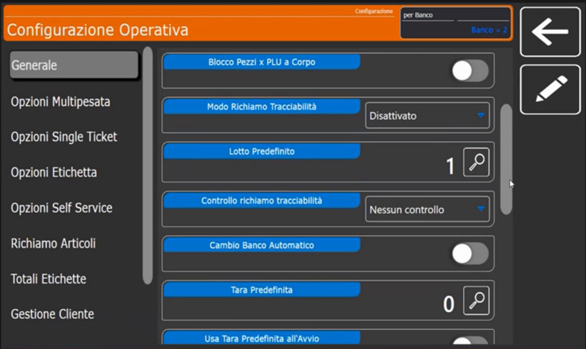

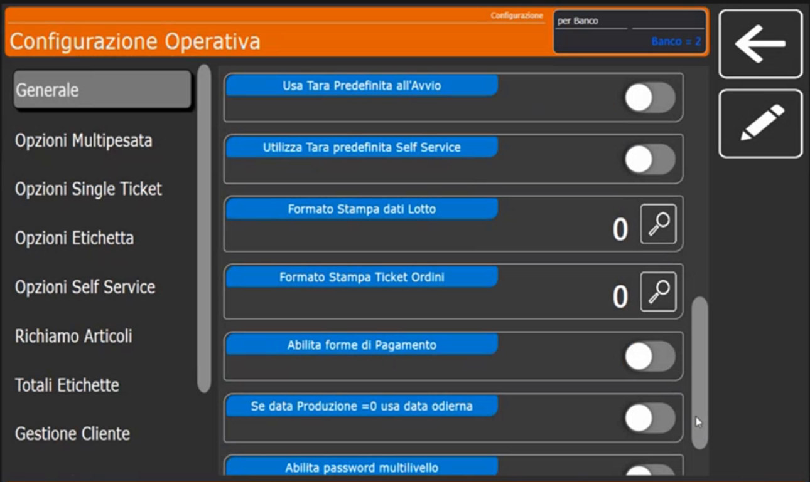

Gli altri settaggi della sezione sono intuitivi.

!!! warning "Blocco Prezzo e programmazione del PLU"
    Con **Blocco Prezzo** impostato su **da PLU**, vale la programmazione fatta nell'archivio articoli. Se nel PLU non si specifica nulla, la bilancia prende le impostazioni generali.

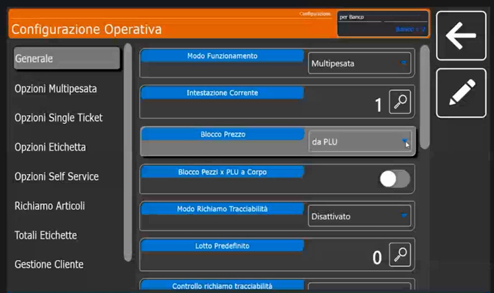

## 2. Opzioni Multipesata

Ogni modalità ha le sue peculiarità. La **Multipesata** è la modalità usata negli esempi di questo manuale.

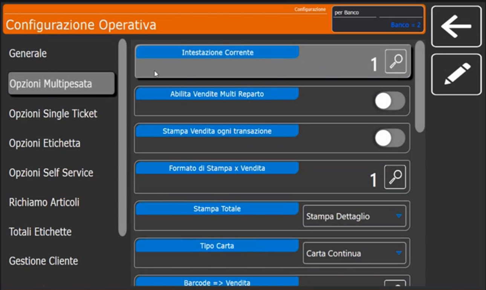

| Campo | Valore di esempio | Funzione |
|---|---|---|
| **Intestazione Corrente** | 1 | Intestazione usata in Multipesata. Si può impostare un'intestazione generica e una diversa per Multipesata o Single Ticket: passando da una modalità all'altra con i tasti funzione, **cambia da sola anche l'intestazione** |
| **Abilita Vendite Multi Reparto** | disattivato | Abilita la vendita multireparto |
| **Stampa Vendita ogni transazione** | disattivato | Stampa un ticket **ogni volta che si seleziona o si batte un articolo**: con tre articoli si hanno tre ticket e poi lo scontrino riepilogativo di chiusura |
| **Formato di Stampa x Vendita** | 1 | Formato di stampa dello scontrino |
| **Stampa Totale** | Stampa Dettaglio | Stampa del dettaglio o del solo totale |
| **Tipo Carta** | Carta Continua | **Carta Continua** o **Etichette**: la bilancia riconosce la carta e si adatta, quindi si possono stampare etichette su carta continua, ma anche un single ticket su un'etichetta preconfigurata e pretagliata |
| **Barcode => Vendita** | 2 | Barcode del singolo PLU |
| **Barcode => Multipesata** | 6 | Barcode raccoglitivo della multipesata |
| **Barcode => QR Code Datacollect** | 1 | Formato del QR code |
| **QRCode => Esplosione Raggruppata x Iva** | disattivato | Raggruppamento per IVA nel QR code |
| **Tipo Tastiera** | RETAIL => 4 Operatori | Tastiera da usare in vendita |
| **Cliente Multipesata** | disattivato | Gestione cliente in Multipesata |
| **Dettaglio Numero Pezzi su Totale** | attivo | Mostra il numero di pezzi nel totale |
| **Abilita immagini tastiera RETAIL** | attivo | Mostra le immagini sui tasti della tastiera Retail |
| **Visualizza Operatore Impegnato** | attivo (disattivo di default) | Colora il tasto dell'operatore che sta lavorando: vedi [Funzioni di vendita](funzioni-di-vendita.md) |
| **Disabilita stampa tara su scontrino** | disattivato | Non stampa la tara sullo scontrino |

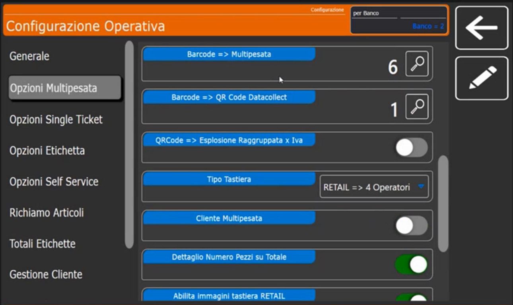

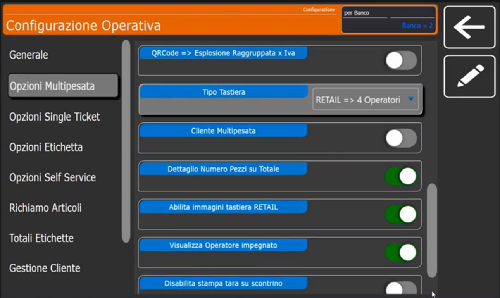

### Barcode di default

Nelle configurazioni della Multipesata si può impostare un **barcode di default**. Toccando la **lente** si apre l'archivio dei barcode, una buona parte dei quali è già impostata.

- Le sigle dei nomi (per esempio *L BBBBBB IIII K*) ricalcano l'archivio storico delle bilance Italiana Macchi. Sono **solo un nome**: la costruzione del codice a barre è personalizzabile (vedi [Formati Barcode](formati-barcode.md)).
- **Barcode => Vendita** (valore **2**): il codice a barre della transazione singola del PLU riporta il codice identificativo del PLU scritto nell'anagrafica, nella parte finale il prezzo e il check di controllo.
- **Barcode => Multipesata**: è concettualmente un EAN diverso, un barcode **raccoglitivo**. Il formato proposto è **9**, che identifica il banco.

    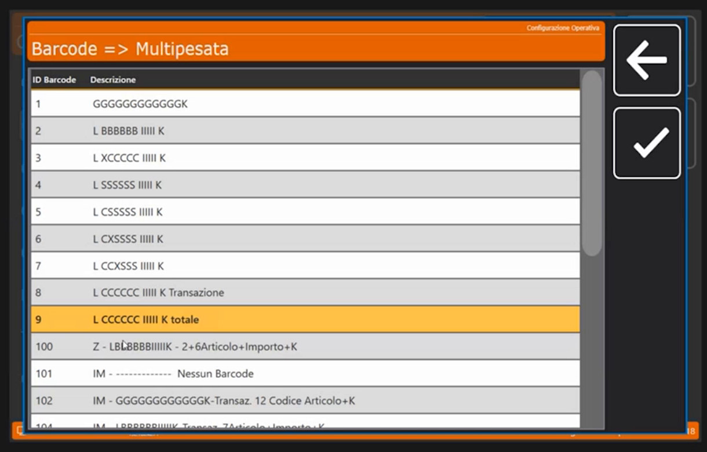

    Per il formato **6** il barcode porta al suo interno il **numero dello scontrino**, il concetto visto nei parametri dei [banchi](lista-banchi.md). Se la bilancia è **connessa a un sistema** che esplode lo scontrino in cassa, è fondamentale usare il formato **6** (o equivalente).

    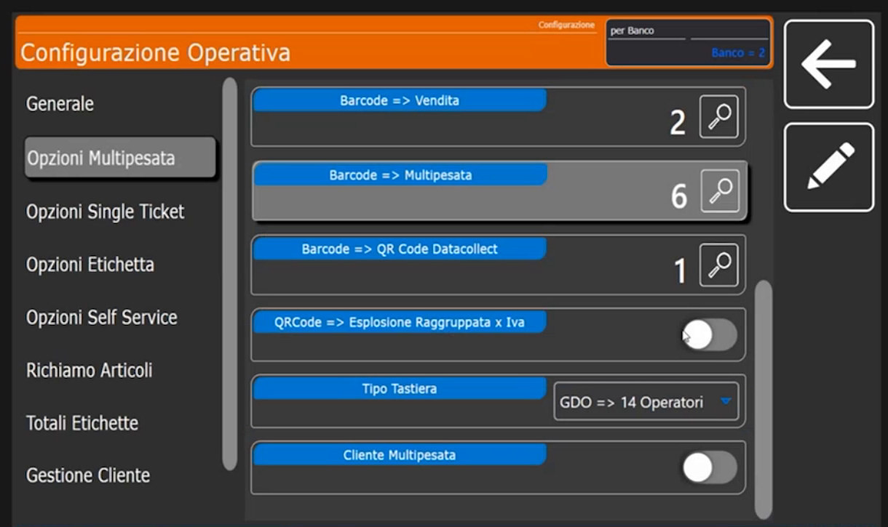

<!-- verificare: il parlato sui formati 9 e 6 è confuso; il senso è che il 9 identifica il banco e il 6 riporta il numero scontrino -->

### Tipo Tastiera

La tastiera è l'impostazione con **impatto immediato** sulle programmazioni successive. La bilancia dispone di diversi layout grafici di tastiera preconfigurati, con un minimo di personalizzazione, adatti alla postazione di lavoro più idonea al cliente.

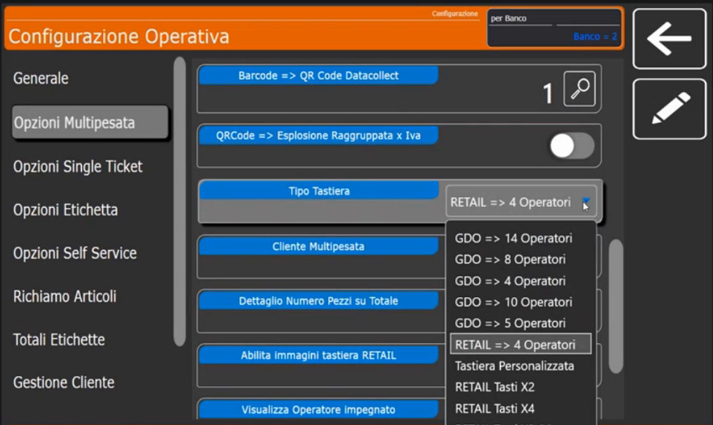

| Tipo tastiera | Quando usarla |
|---|---|
| **GDO => 14 Operatori**, **GDO => 8 Operatori**, **GDO => 4 Operatori**, **GDO => 10 Operatori**, **GDO => 5 Operatori** | Bilance in GDO, dove non serve avere i PLU sulla schermata di vendita ma si vende tutto a codice: serve invece avere più operatori |
| **RETAIL => 4 Operatori** | È la scelta consigliata per un negozio retail. Offre molta personalizzazione di adattamento e supporta le **schede** (vedi [Schede Tastiera](schede-tastiera.md)) |
| **RETAIL Tasti X2**, **RETAIL Tasti X4**, **RETAIL Tasti X2 (V)** | Varianti con **tasti doppi** (in orizzontale o in verticale) e **tasti grandi quadrati**: vedi [Funzioni di vendita](funzioni-di-vendita.md) |
| **Tastiera Personalizzata** | Layout personalizzato a partire da quelli preconfigurati. Non si può creare una schermata da zero, ma si possono fare piccole personalizzazioni |

La bilancia, appena configurata, mostra già 14 operatori (impostazione di default). Selezionando **RETAIL => 4 Operatori** la schermata si adatta.

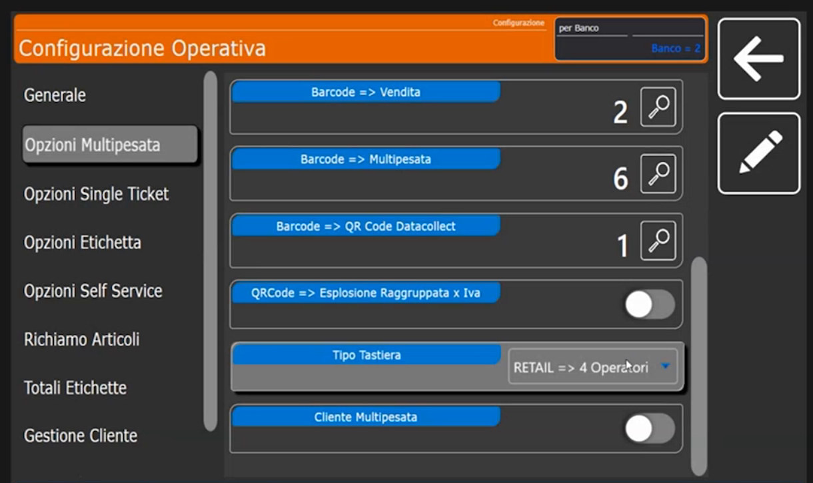

## 3. Opzioni Single Ticket

I campi sono: **Intestazione Corrente** (1), **Operatore Single Ticket** (100), **Barcode Default => Single Ticket** (2), **Tipo Carta** (Carta Continua), **Formato di Stampa** (13) e **Cliente Single Ticket** (disattivato).

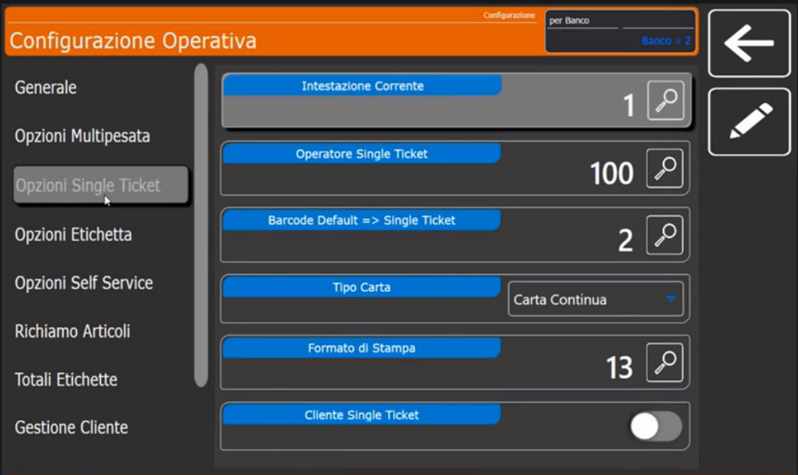

## 4. Opzioni Etichetta

Passando a **Etichetta** la bilancia gestisce l'etichetta in modo **manuale, automatico o preconfezionato**. È il cuore dell'etichettatura evoluta: la modalità d'uso è descritta in [Etichettatura in vendita](etichettatura.md).

| Campo | Valore di esempio | Funzione |
|---|---|---|
| **Intestazione Corrente** | 0 | Intestazione usata in etichettatura |
| **Modo Acquisizione Transazione** | MAN | **MAN**: la bilancia stampa l'etichetta solo con la **conferma dal tasto di stampa**. **AUT**: stampa **in automatico** quando si fa la pesata e si tocca l'articolo. **PRECONF**: modalità preconfezionato |
| **Operatore Etichette** | 101 | Operatore di default a cui si aggancia la gestione dell'etichettatura |
| **Barcode Default => Etichetta** | 2 | Barcode di default per le etichette |
| **Tipo Carta** | Carta Continua | Carta continua o etichette |
| **Formato di Stampa** | 13 | Formato etichetta di default. Con la lente si sceglie da un elenco di formati personalizzabili, copiati da un archivio già presente sulla bilancia: vedi [Formati Etichetta](formati-etichetta.md) |
| **Simbolo Riconfezionamento** | vuoto | Simbolo stampato sulle etichette riconfezionate |
| **Tipo Tastiera** | Retail | Tastiera usata in etichettatura. Selezionando Retail si porta in etichettatura la stessa impostazione della multipesata |
| **Cliente Etichetta** | disattivato | Gestione cliente in etichettatura |

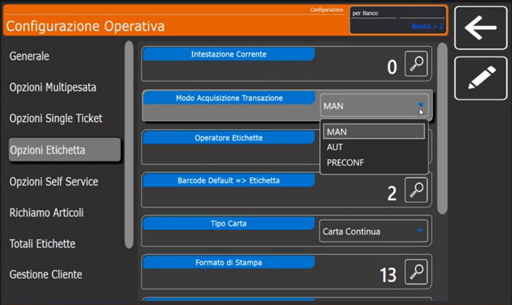

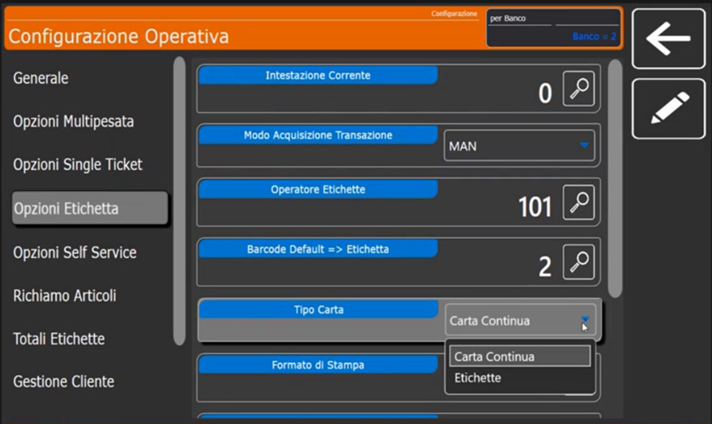

!!! tip "Uso ibrido: scontrino ed etichetta sullo stesso rotolo"
    Si può usare la bilancia in modo ibrido: stampare i formati etichetta su **carta continua** termica. Il cliente lavora con lo scontrino termico normale in Multipesata e, quando serve un'etichetta (per un takeaway o per confezionare una vaschetta), tocca un tasto e stampa l'etichetta senza cambiare il rotolo. Non c'è il riconoscimento da parte del sensore di prelievo dell'etichetta.

## 5. Opzioni Self Service

Per il Self Service serve un'attenzione maggiore. Indipendentemente da come si è impostata la modalità nei parametri generali, qui si decide **in che modalità deve lavorare** la bilancia in Self Service (non in servizio rapido).

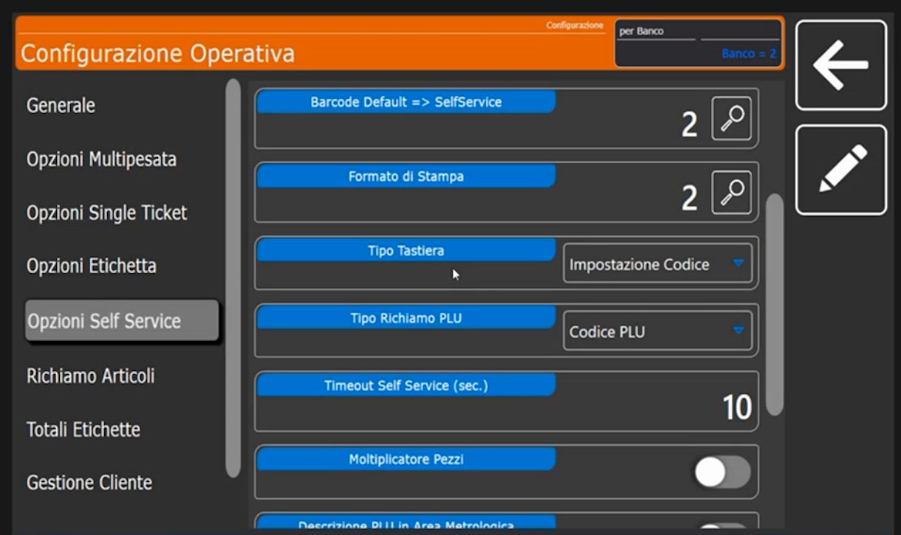

Il campo **Tipo Tastiera** offre quattro modalità:

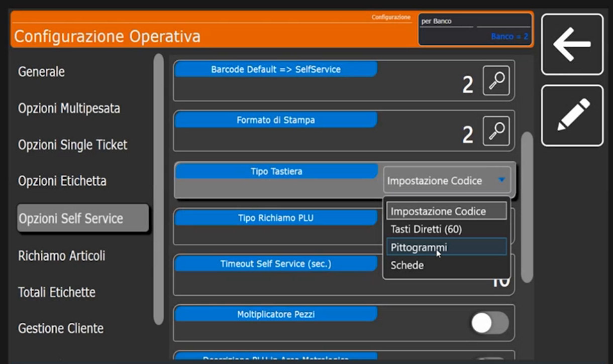

| Modalità | Descrizione |
|---|---|
| **Pittogrammi** | Sulla tastiera si vedono prima le **immagini delle famiglie** (per esempio frutta, verdura, frutta secca), poi gli **articoli con l'immagine** e infine la stampa |
| **Tasti Diretti (60)** | Si lavora a tasti diretti: la voce indica il numero massimo di tasti in tastiera, ai quali saranno collegati gli articoli |
| **Schede** | Modalità attivabile sia in Self Service sia in Multipesata |
| **Impostazione Codice** | Valore mostrato in schermata |

Altri campi: **Tipo Richiamo PLU** (richiamo **a codice o a tasto**; nell'esempio *Codice PLU*) e **Timeout Self Service (sec.)** (10). Per il Self Service si possono scegliere anche formati etichetta ad hoc, che lavorano **in simultanea** con le altre modalità, e anche la personalizzazione grafica si fa in questa parte. Più in basso: **Moltiplicatore Pezzi**, **Descrizione PLU in Area Metrologica** e **Abilita Web Services SenSei** (disattivati) e **Immagine Logo Self Service**.

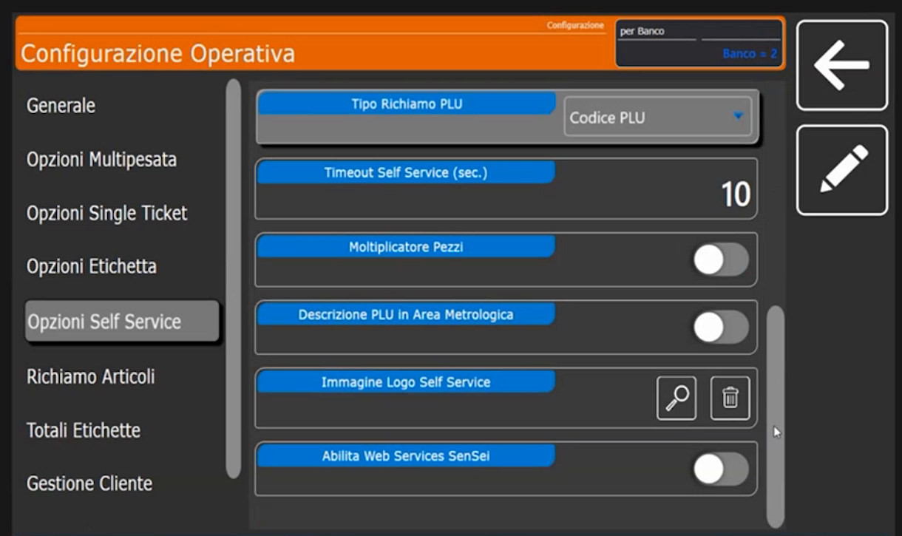

<!-- verificare: la tabella dei tipi di tastiera Self Service è compilata dalla schermata; "Impostazione Codice" non è descritta a parole -->

## 6. Richiamo Articoli

Il richiamo degli archivi e degli articoli è **condiviso da tutte le modalità di lavoro**. Serve perché la bilancia è anche un **gestionale al proprio interno**: si possono creare archivi che **non fanno parte della parte metrologica**. Esempio: in una gastronomia con degustazione si possono caricare sulla bilancia tutti i vini con l'EAN di riferimento, collegare uno scanner e aggiungere questi prodotti, che sono **a pezzo**, allo stesso scontrino.

| Campo | Valore | Funzione |
|---|---|---|
| **Manuale - Modo Richiamo PLU** | Normale | Come si richiama un PLU a mano |
| **Manuale - N. Cifre x PLU** | 0 | Cifre del PLU nel richiamo manuale |
| **Manuale - Tempo in decimi di secondo** | 0 | Tempo di attesa sul richiamo manuale |
| **Scanner - Cifre Codice PLU EAN13** | 6 | Cifre del codice PLU nell'EAN13 letto dallo scanner |
| **Scanner - Cifre Iniziale x Peso Variabile** | 2 | Cifre iniziali dell'EAN a peso variabile |
| **Scanner - Barcode Prefix (1)** / **(2)** | 0 | Prefissi del barcode |
| **Scanner - Barcode Suffix (1)** / **(2)** | 13 / 0 | Suffissi del barcode |

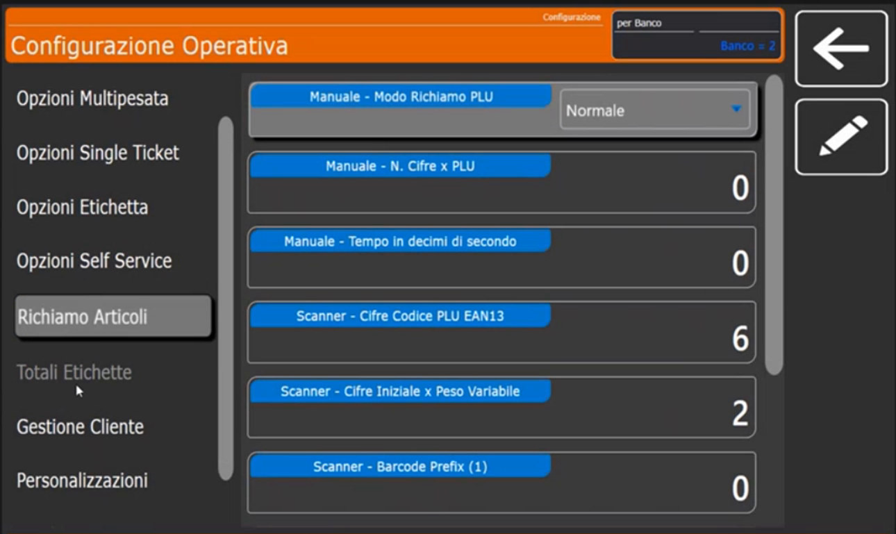

## 7. Totali Etichette e Gestione Cliente

**Totali Etichette** contiene **Formato Barcode Etichetta Totale** e i **Formato Etichetta Totale [1]**, **[2]**, **[3]**, **[4]**, **[5]**, tutti a 0 di default: servono alla stampa delle etichette dei totali (vedi [Etichettatura in vendita](etichettatura.md)).

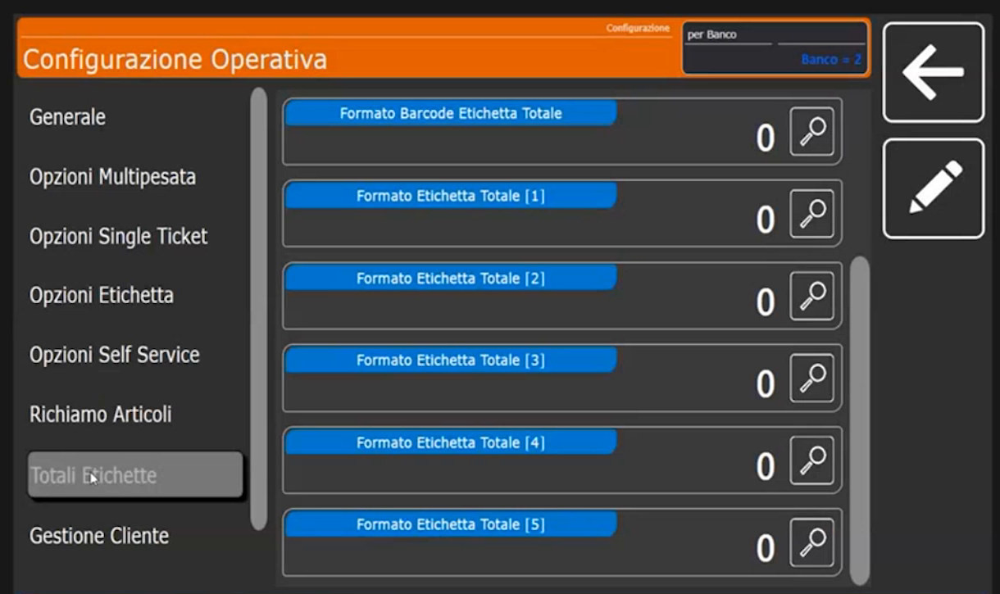

**Gestione Cliente** è una sezione in evoluzione: nelle release in arrivo sono previste diverse novità. Sono visibili gli interruttori **Cliente Zero** e **Ultimo Cliente**, entrambi disattivati.

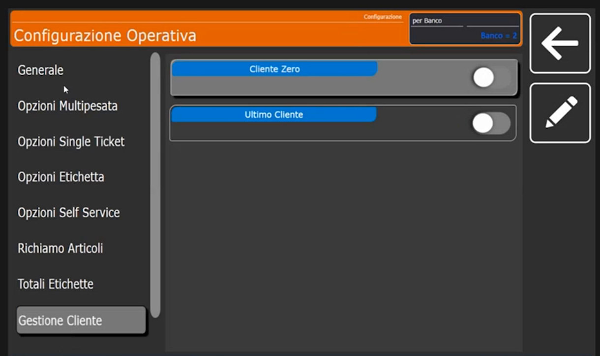

**Personalizzazioni** raccoglie opzioni specifiche di alcuni impianti: nell'esempio compare **Abilita funzionalità Tgr** (disattivato).

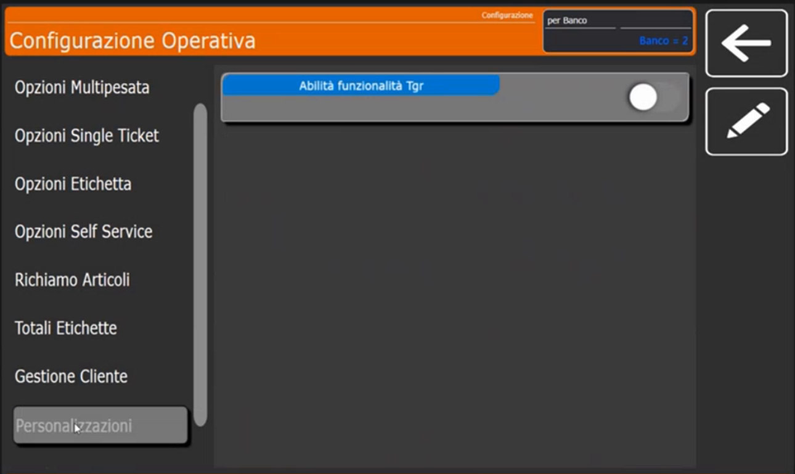

!!! note "Annullare l'ultimo scontrino chiuso"
    Tra le novità c'è la possibilità di far **dimenticare alla bilancia l'ultimo scontrino chiuso** dopo un certo numero di secondi (o dal subtotale). La funzione nasce perché, tenendo sempre in memoria l'ultimo scontrino, un operatore poteva confondersi e, ritoccando il totale, riaprire uno scontrino già emesso. Il nome esatto del campo va verificato sulla bilancia in uso.<!-- verificare: dove si trova il campo e come si chiama -->

## Verifica

La bilancia è in **Multipesata**, con barcode di vendita **2**, barcode multipesata **6** e tastiera **RETAIL => 4 Operatori**. Tornando in vendita la schermata si adatta alle impostazioni.

## Errori comuni

| Problema | Causa probabile | Rimedio |
|---|---|---|
| Lo scontrino non riporta l'intestazione attesa | **Intestazione Corrente** diversa per la modalità in uso | Controlla il valore nelle sezioni Generale, Multipesata, Single Ticket ed Etichetta |
| L'etichetta non stampa dopo la pesata | **Modo Acquisizione Transazione** è **MAN** | Conferma con il tasto di stampa oppure passa a **AUT** |
| La tastiera non cambia | **Tipo Tastiera** impostato in una sezione diversa da quella in uso | Imposta **Tipo Tastiera** nella sezione della modalità attiva |
| Il prezzo non è quello atteso | **Blocco Prezzo** da PLU: vale l'archivio articoli | Controlla il prezzo e il blocco nella scheda dell'articolo |

!!! tip "Prossimo passo"
    Con la modalità di lavoro definita si passa agli archivi: [Categorie Merceologiche](categorie-merceologiche.md).
