<!-- categoria assegnata per inferenza: verificare (la bilancia Icona non ha una categoria dedicata nell'elenco) -->

# Configurazione Operativa: modalità di lavoro della bilancia

**Target:** tecnico installatore / rivenditore · **Video:** Custom Academy, webinar *Icona configurazione di base* (10/04/2025), dal minuto 23:00 al 36:10.

## Obiettivo

Al termine sai dire alla bilancia **in quale modalità deve lavorare** (Multipesata, Single Ticket, Etichetta o Self Service), impostare barcode di default, tipo di carta e tipo di tastiera, e conosci le altre sezioni della pagina: Richiamo Articoli, Totali Etichette e Gestione Cliente.

## Prerequisiti

- Banchi creati e bilancia dichiarata: vedi [Lista Banchi](lista-banchi.md) e [Bilancia](bilancia.md).
- Il relatore completa questa pagina **prima** degli archivi, cioè prima di creare i PLU.

!!! note "Un unico configuratore per tutta la famiglia"
    Un unico configuratore, un unico archivio, un'unica release permettono di modellare la bilancia **indipendentemente dall'hardware**: bassa o alta, con uno o due monitor, i passaggi di configurazione sono sempre gli stessi.

!!! note "A quale banco si applica"
    In alto a destra la pagina mostra **per Banco** e **Banco = 2**: le impostazioni che modifichi valgono per il banco indicato, perché nella pagina Bilancia il **Tipo Configurazione** è *per Banco*.

## Passaggi

### 1. Apri Configurazione Operativa

> Nel video: 23:16

Dal menu **Setup Bilancia**, sezione **Configurazione**, tocca **Configurazione Operativa**. A sinistra compaiono le sezioni: **Generale**, **Opzioni Multipesata**, **Opzioni Single Ticket**, **Opzioni Etichetta**, **Opzioni Self Service**, **Richiamo Articoli**, **Totali Etichette** e **Gestione Cliente**.

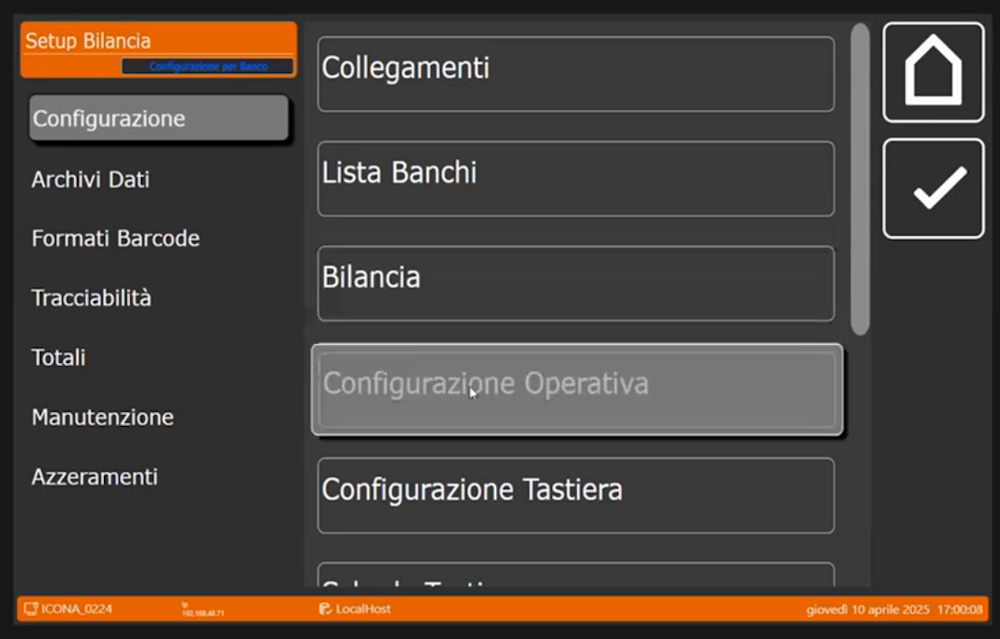

### 2. Generale: scegli il modo di funzionamento

> Nel video: 23:40

La prima sezione, **Generale**, dice alla bilancia **in che modalità deve operare**.

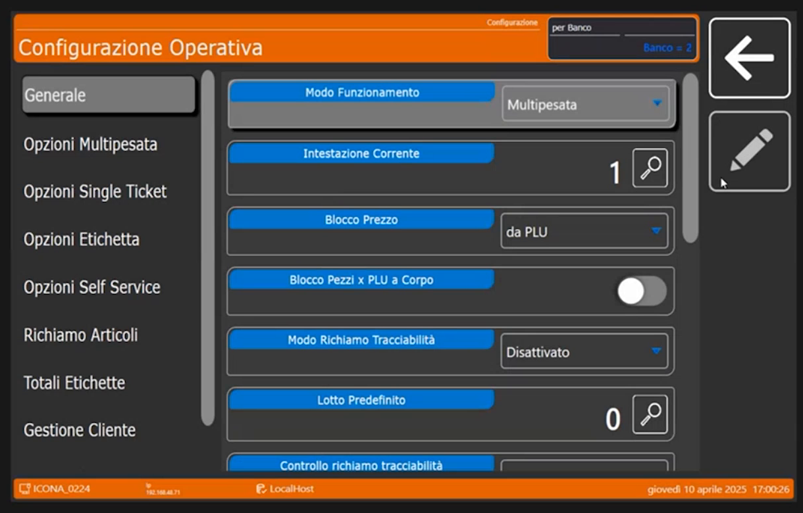

Il menu a tendina **Modo Funzionamento** propone quattro modalità:

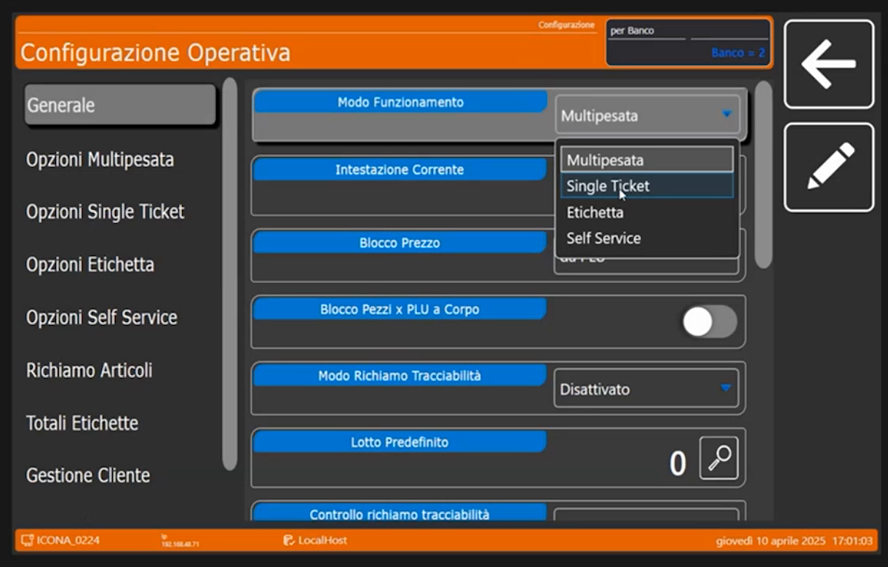

| Modalità | Cosa significa, secondo il relatore |
|---|---|
| **Multipesata** | Scontrini: pesata a transazione e scontrino somma, con una serie di dinamiche che si vedono nel seguito. È la modalità scelta nel webinar. |
| **Single Ticket** | Scontrino singolo: ogni transazione effettuata sulla bilancia produce uno scontrino. |
| **Etichetta** | Apre il mondo dell'etichettatura avanzata ed evoluta. |
| **Self Service** | Modalità self service, con le sue impostazioni dedicate. |

Lasciata la modalità su **Multipesata**, la sezione Generale chiede altre personalizzazioni:

- **Intestazione Corrente**: la bilancia può avere più di un'intestazione. È utile a chi etichetta per conto terzi, perché si riferisce a una parte dell'archivio tabellare. Di default vale **1**; l'intestazione non è ancora stata creata perché non si è ancora arrivati agli archivi. Toccando la lente si apre l'elenco delle intestazioni, per ora vuoto.

    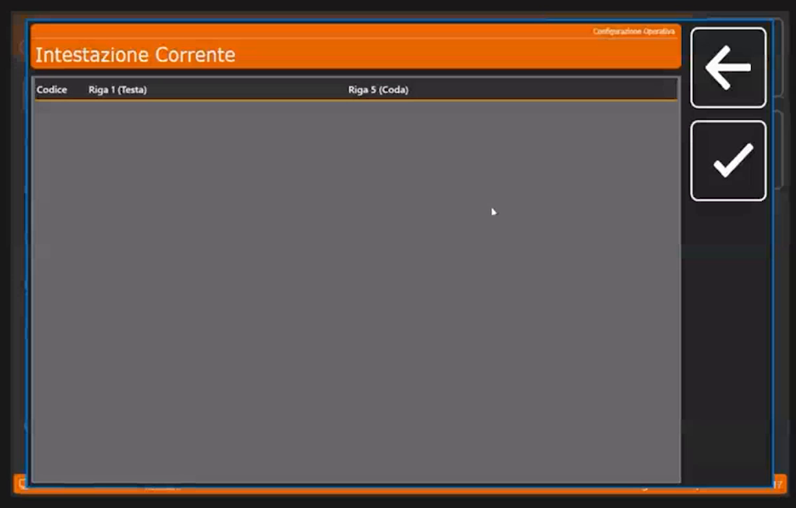

- **Blocco Prezzo**: può essere impostato **da PLU**. Se nella programmazione del PLU il prezzo è bloccato, la bilancia lo rispetta. Regola generale: **le programmazioni fatte negli archivi PLU prevalgono sulle impostazioni generali**; se nel PLU non si specifica nulla, la bilancia prende le impostazioni generali che si stanno definendo ora.

    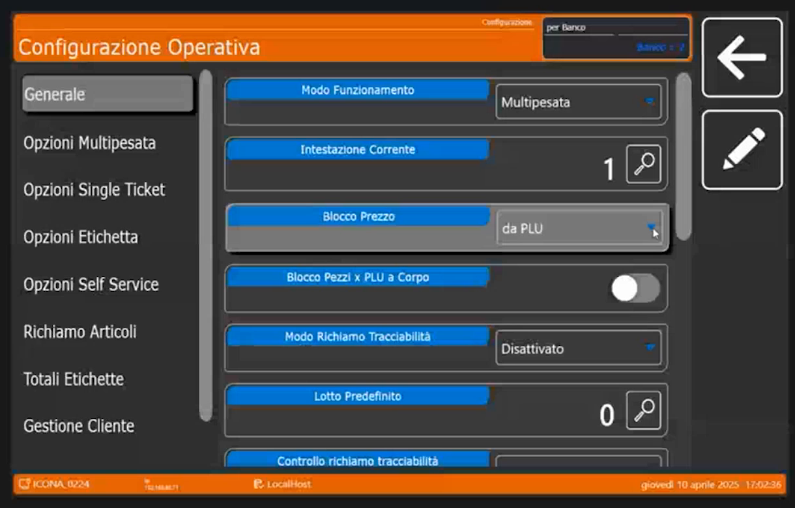

Gli altri settaggi della sezione il relatore li definisce intuitivi e li salta per non togliere tempo alla parte più interessante.

### 3. Opzioni Multipesata

> Nel video: 26:28

Ogni modalità ha le sue peculiarità. Il relatore si ferma sulla **Multipesata**, che è la modalità scelta.

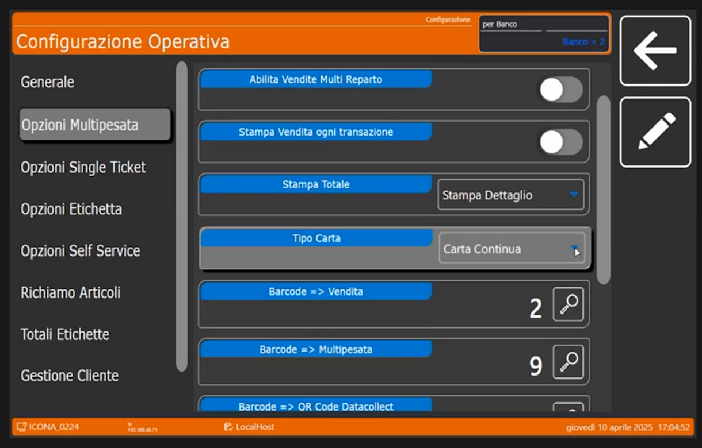

- **Intestazione Corrente** (prima voce della pagina): si può impostare la bilancia con un'intestazione a livello generico e usare un'intestazione diversa per Multipesata o Single Ticket. Quando con i tasti funzione sulla tastiera si passa da una modalità all'altra, **cambia da sola anche l'intestazione**: la bilancia fa tutto in autonomia.
- **Abilita Vendite Multi Reparto** e **Stampa Vendita ogni transazione**: si può abilitare la vendita multireparto e stampare un ticket **ogni volta che si seleziona o si batte un articolo**. Con tre articoli si hanno tre ticket e poi lo scontrino riepilogativo di chiusura. Nel webinar entrambi gli interruttori sono disattivati.
- **Stampa Totale**: nel webinar è *Stampa Dettaglio*.
- **Tipo Carta**: nel webinar è **Carta Continua**. La proposta compare sempre, *carta continua* o *carta etichetta*, perché la bilancia riconosce la carta e si adatta: si possono stampare etichette su carta continua, ma anche un single ticket su un'etichetta preconfigurata e pretagliata.

#### Barcode di default

Nelle configurazioni generali della Multipesata si può impostare un **barcode di default**. Toccando la **lente** si apre l'archivio dei barcode, una bella fetta dei quali è già impostata di default.

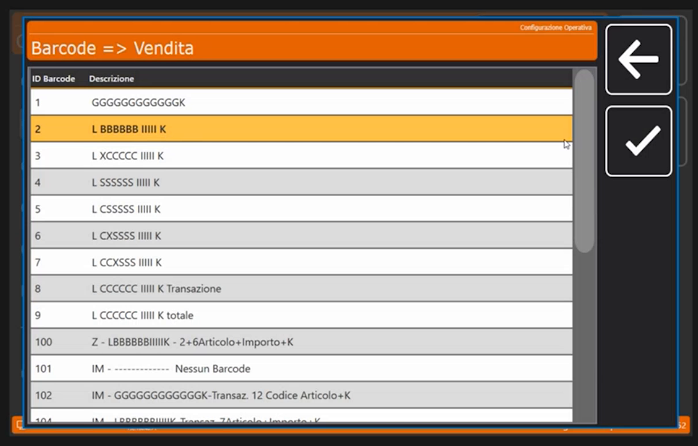

- Il nome che identifica ogni barcode, per esempio una stringa del tipo *L BBBBBB IIII K*, è quello che storicamente usa l'archivio delle bilance Italiana Macchi, per facilitare il concetto. È **solo un nome**: la costruzione del codice a barre è personalizzabile e riadattabile alle esigenze, come si vedrà più avanti nei [Formati Barcode](formati-barcode.md).
- **Barcode => Vendita** (nel webinar **2**): il codice a barre della transazione singola del PLU riporta il codice identificativo del PLU scritto nell'anagrafica, nella parte finale il prezzo e il check di controllo.
- **Barcode => Multipesata**: concettualmente è un EAN diverso dal precedente, un barcode **raccoglitivo**. Il valore proposto è **9**.

    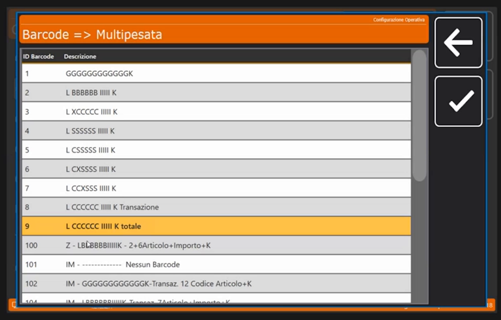

    Il relatore indica che il barcode porta al suo interno il **numero dello scontrino**, il concetto spiegato prima nei [parametri dei banchi](lista-banchi.md). Se la bilancia è **connessa a un sistema**, è fondamentale attivare questo tipo oppure il **formato 6**, per poter procedere all'esplosione dello scontrino in cassa. Nel webinar il valore viene portato a **6**.

    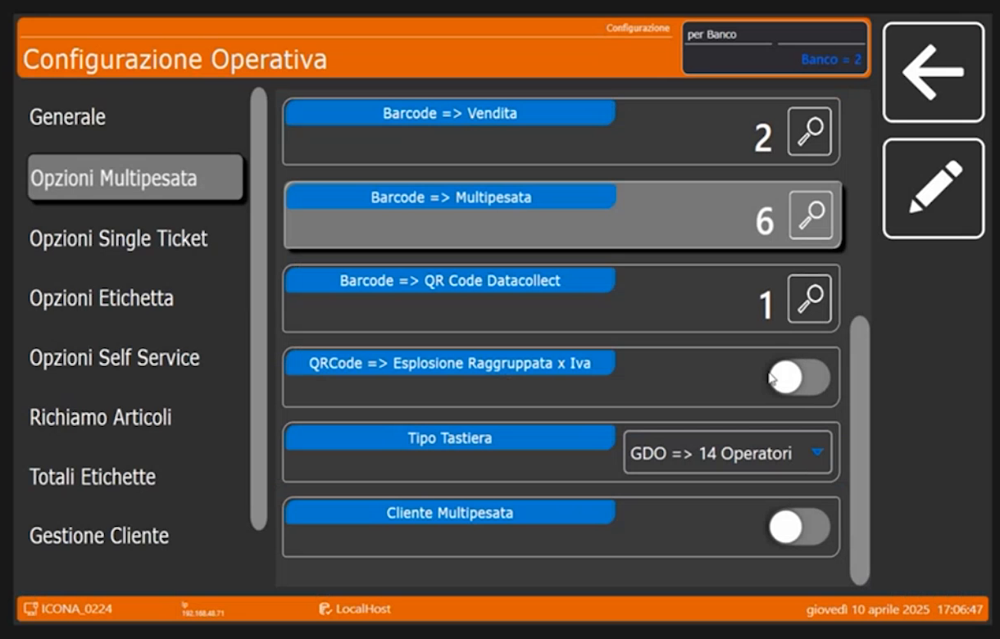

<!-- verificare: la trascrizione di 29:23-29:37 e' confusa ("viene indicato C come un codice... LCSS"); il senso e' che il formato 9 identifica il banco e il formato 6 riporta il numero scontrino -->

#### Tipo Tastiera

> Nel video: 30:03

È la parte che ha **impatto immediato** sulle programmazioni successive. Quando si è vista la bilancia prima di entrare in configurazione, aveva già **14 operatori** (impostazione di default). Il relatore spiega che sono stati creati diversi **layout grafici di tastiera preconfigurati**, con un minimo di personalizzazione, adatti alla posizione di lavoro più idonea al cliente. È prevista anche una **Tastiera Personalizzata**, che sarà oggetto del webinar dedicato agli applicativi connessi.

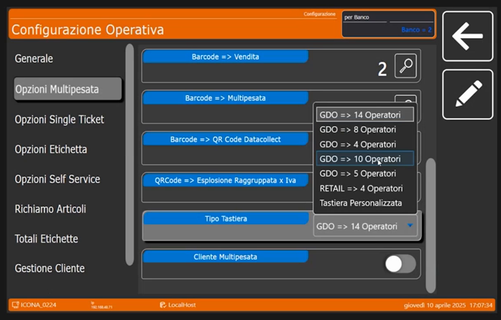

Le voci sono **GDO => 14 Operatori**, **GDO => 8 Operatori**, **GDO => 4 Operatori**, **GDO => 10 Operatori**, **GDO => 5 Operatori**, **RETAIL => 4 Operatori** e **Tastiera Personalizzata**.

Il relatore sceglie **RETAIL => 4 Operatori**, che è la più usata: si adatta perfettamente all'attività di retail, il mercato su cui in gran parte ci si muove, e offre molta personalizzazione di adattamento.

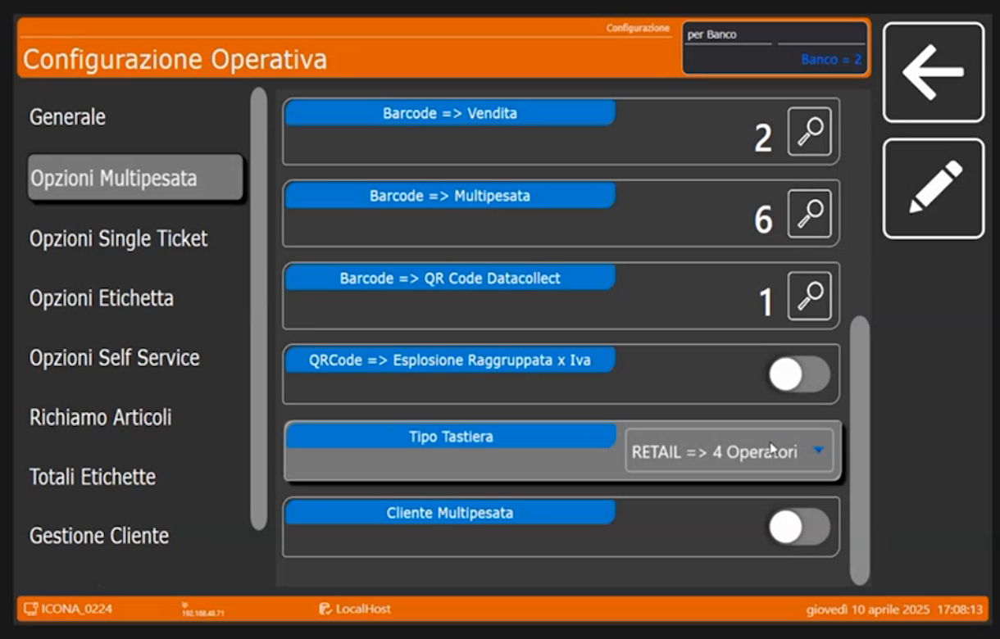

Il campo **Barcode => QR Code Datacollect** vale **1**; **QRCode => Esplosione Raggruppata x Iva** e **Cliente Multipesata** sono disattivati.

### 4. Opzioni Single Ticket

> Nel video: 31:36

Nelle sezioni successive esistono personalizzazioni adatte al tipo di transazione. Per il Single Ticket il relatore non commenta i singoli campi, che sono: **Intestazione Corrente** (1), **Operatore Single Ticket** (100), **Barcode Default => Single Ticket** (2), **Tipo Carta** (Carta Continua), **Formato di Stampa** (1) e **Cliente Single Ticket** (disattivato).

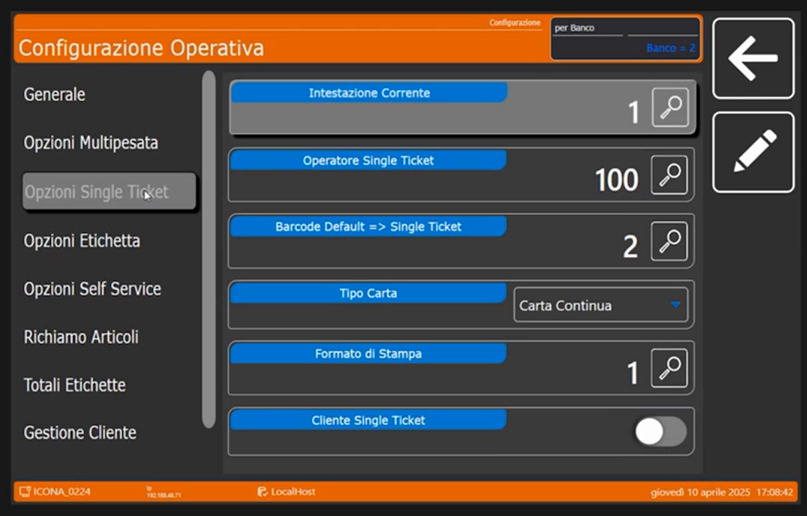

### 5. Opzioni Etichetta

> Nel video: 31:55

Passando a **Etichetta**, la bilancia gestisce l'etichetta in modo **automatico, manuale o preconfezionamento**. Il campo **Modo Acquisizione Transazione** decide se la bilancia stampa l'etichetta **in automatico**, solo dalla variazione del peso, oppure richiede sempre la **conferma con il tasto**. C'è inoltre un **operatore di default** (**Operatore Etichette**, nel webinar 101) a cui si aggancia la gestione dell'etichettatura.

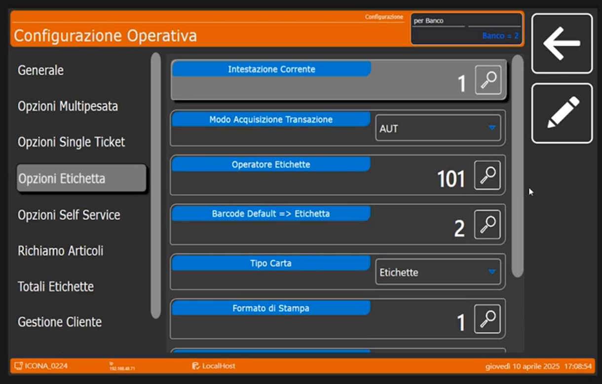

Il **Tipo Carta** indica dove stampare l'etichetta. A differenza dello scontrino, qui si determina in modo generico anche il **Formato di Stampa** dell'etichetta, scegliendolo da un elenco di formati personalizzabili, preso da un archivio già esistente nella bilancia (vedi [Formati Etichetta](formati-etichetta.md)).

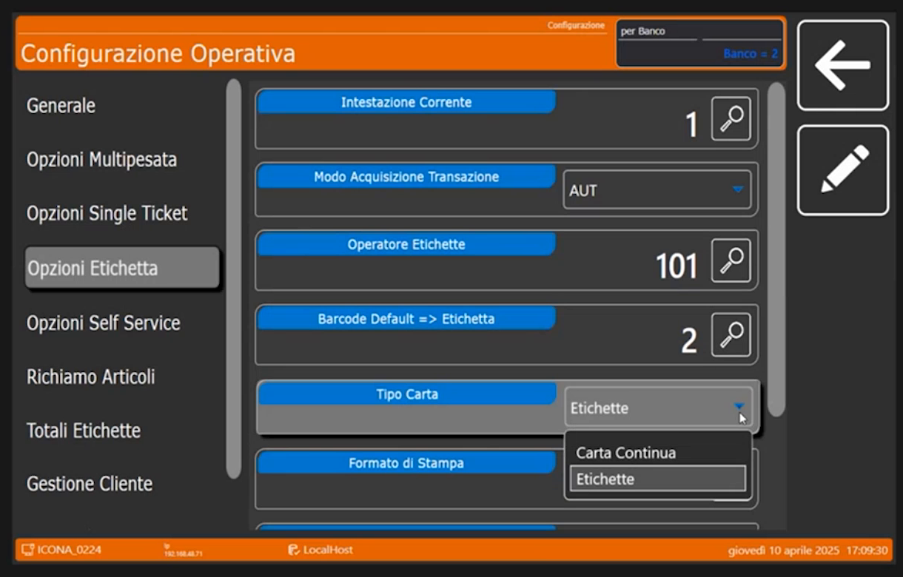

### 6. Opzioni Self Service

> Nel video: 33:02

Per il Self Service serve un'attenzione maggiore. Indipendentemente da come si è impostata la modalità nei parametri generali, qui si decide **in che modalità deve lavorare** la bilancia in Self Service.

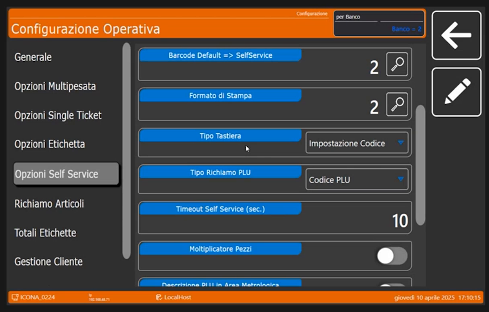

Il campo **Tipo Tastiera** offre quattro modalità:

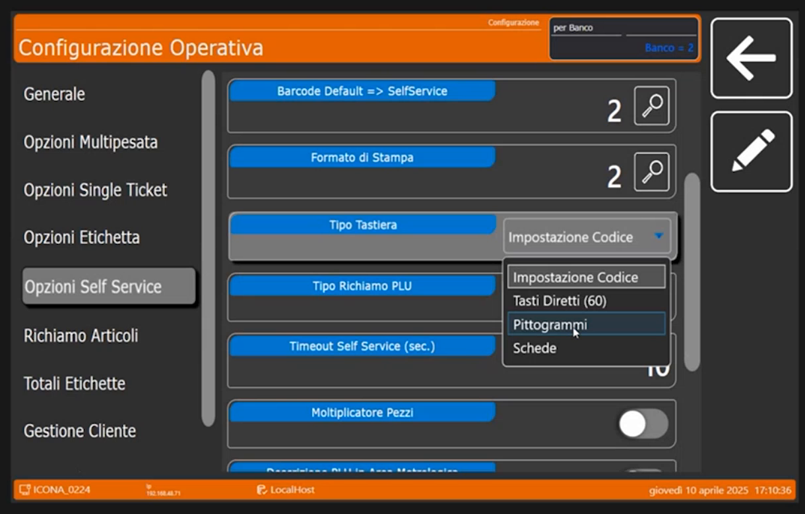

| Modalità | Descrizione del relatore |
|---|---|
| **Pittogrammi** | Sulla tastiera si vedono prima le **immagini della famiglia** (per esempio frutta, verdura, frutta secca), poi gli **articoli con l'immagine** e infine la stampa. |
| **Tasti Diretti (60)** | Si lavora a tasti diretti: la voce indica subito quanti tasti massimi ci saranno in tastiera, e agli articoli saranno legati questi tasti. |
| **Schede** | Modalità attivabile sia in Self Service sia in Multipesata: è quella che si userà nel webinar. |
| **Impostazione Codice** | Valore mostrato in schermata. |

Altri campi: **Tipo Richiamo PLU** (si può richiamare **a codice o a tasto**; nel webinar *Codice PLU*) e **Timeout Self Service (sec.)** (10). Per il Self Service si possono scegliere anche formati etichetta ad hoc, che lavorano **in simultanea** con le altre modalità della bilancia. Anche la personalizzazione grafica si fa in questa parte.

Più in basso: **Moltiplicatore Pezzi**, **Descrizione PLU in Area Metrologica** e **Abilita Web Services SenSei** (disattivati), e **Immagine Logo Self Service**.

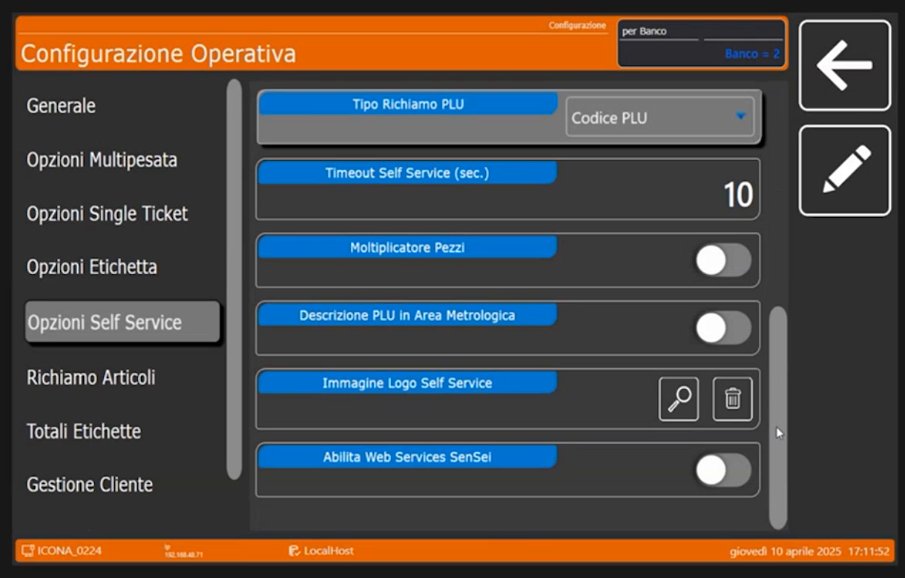

!!! note "Intuitività"
    Il relatore ripete che ogni singola voce è intuitiva e che la configurazione risulta quasi guidata.

<!-- verificare: la tabella dei tipi di tastiera Self Service e' compilata da schermata e parlato; "Impostazione Codice" non e' commentata dal relatore -->

### 7. Richiamo Articoli

> Nel video: 35:07

Il richiamo degli archivi e degli articoli è **condiviso da tutte le modalità di lavoro**. Serve perché la bilancia è un **gestionale al proprio interno**: si possono creare archivi che **non fanno parte della parte metrologica**. Esempio del relatore: in una gastronomia che fa degustazione si possono caricare sulla bilancia tutti i vini con l'EAN di riferimento, collegare uno scanner e aggiungere questi prodotti, che sono **prodotti a pezzo**, allo stesso scontrino.

I campi mostrati sono **Scanner - Cifre Codice PLU EAN13** (6), **Scanner - Cifre Iniziale x Peso Variabile** (2), **Scanner - Barcode Prefix (1)** e **(2)** (0), **Scanner - Barcode Suffix (1)** (13) e **(2)** (0).

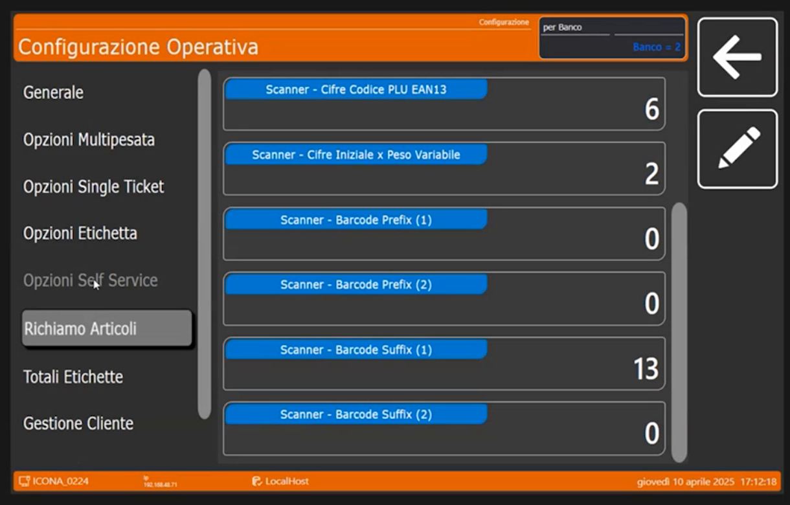

### 8. Totali Etichette e Gestione Cliente

> Nel video: 35:30

**Totali Etichette** non viene commentata: contiene **Formato Barcode Etichetta Totale** e i **Formato Etichetta Totale [1]**, **[2]**, **[3]**, **[4]**, **[5]**, tutti a 0 nel webinar.

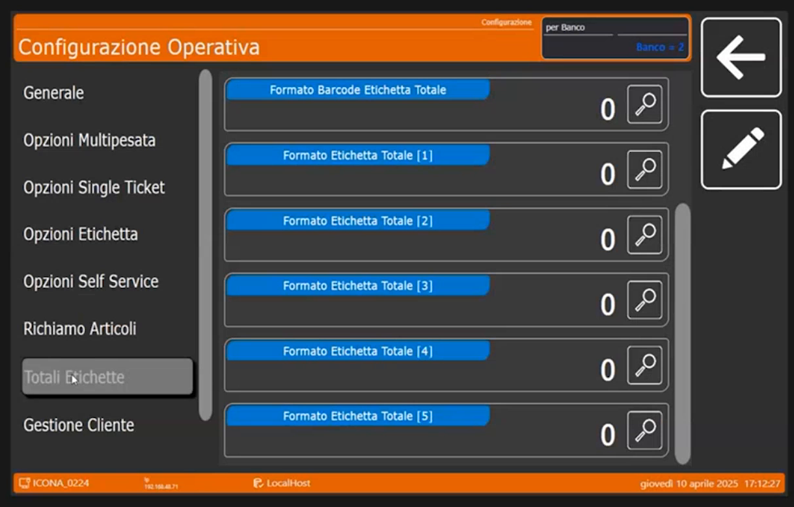

**Gestione Cliente**: il relatore la vedrà meglio nelle release in arrivo, che porteranno diverse novità. Nel webinar sono visibili gli interruttori **Cliente Zero** e **Ultimo Cliente**, entrambi disattivati.

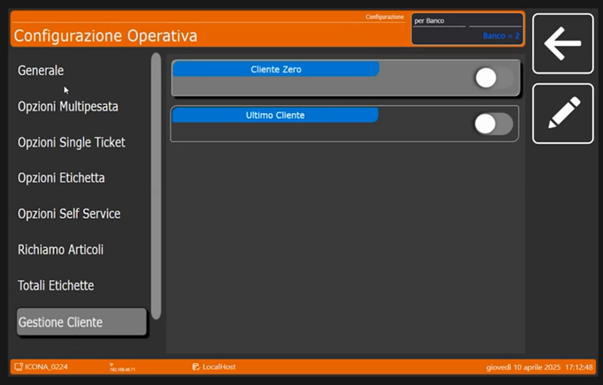

## Verifica

La bilancia è ora in **Multipesata**, con barcode di vendita **2**, barcode multipesata **6** e tastiera **RETAIL => 4 Operatori**. Chiusa questa parte, il relatore dichiara di essere **pronto a spostarsi negli archivi** per creare gli articoli.

!!! tip "Prossimo passo"
    Il relatore passa agli archivi per creare gli articoli, a partire dalle [Categorie Merceologiche](categorie-merceologiche.md). La [Configurazione Tastiera](configurazione-tastiera.md), che qui si intravede soltanto, viene ripresa dopo: avrà più senso capirla una volta creati gli articoli.
