<!-- categoria assegnata per inferenza: verificare (la bilancia Icona non ha una categoria dedicata nell'elenco) -->

# Configurazione Tastiera: tasti funzione e tasti articolo

**Target:** tecnico installatore / rivenditore.

## Obiettivo

Assegnare una funzione o un articolo a un tasto della tastiera della bilancia, usando la pagina **Configurazione Tastiera**, e conoscere le funzioni disponibili per i tasti.

## Prerequisiti

- Gli [Articoli PLU](articoli-plu.md) da collegare sono stati creati.
- Il **Tipo Tastiera** scelto nella [Configurazione Operativa](configurazione-operativa.md) è *RETAIL => 4 Operatori* (o una variante Retail).

## Come funziona

Su una bilancia appena programmata la schermata di vendita **non mostra nessun tasto** assegnato: la tastiera è vuota. Ogni posizione, però, riporta in alto a sinistra il proprio **codice** (per esempio **9001**, **9003**, **9004**): quel numero è il **codice del tasto** da usare nella configurazione.

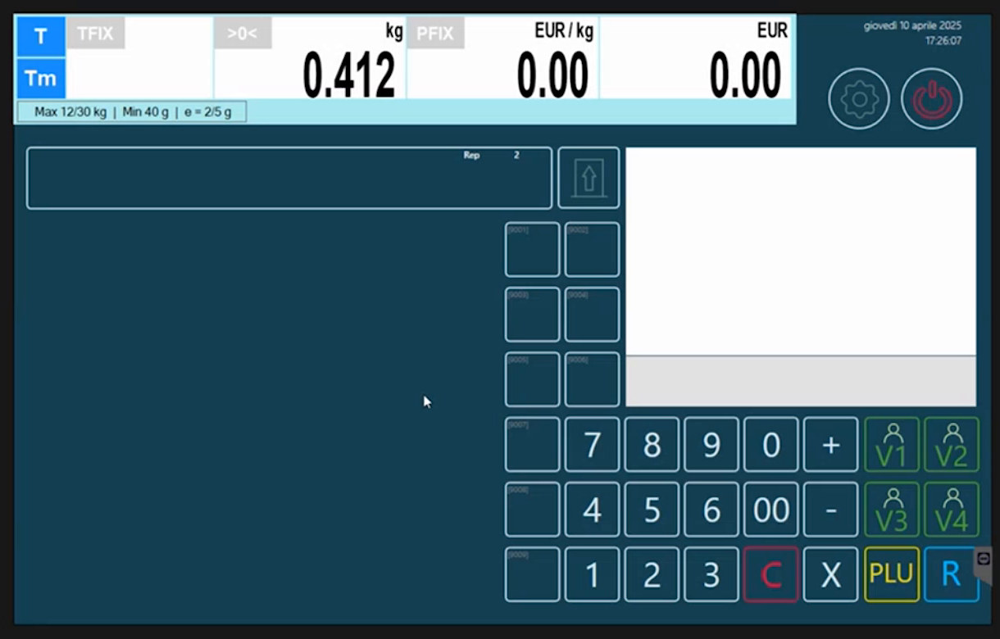

## Procedura

### 1. Apri Configurazione Tastiera

Dal menu **Setup Bilancia**, sezione **Configurazione**, tocca **Configurazione Tastiera**.

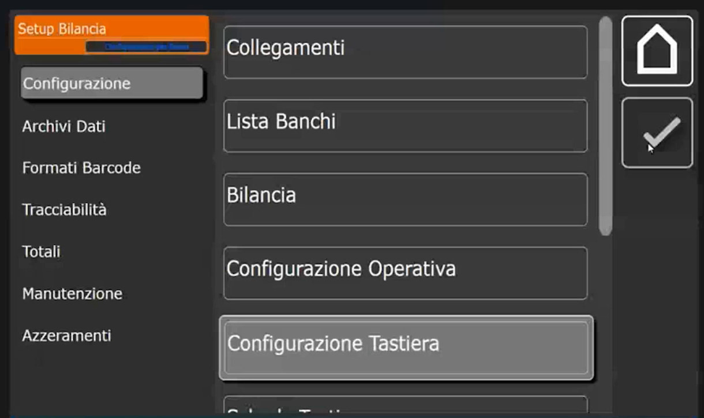

La lista dei tasti è vuota. Le colonne sono **ID**, **Condivisione**, **Tipo**, **Valore** e **Codice Breve**, e a destra c'è il pulsante **+**.

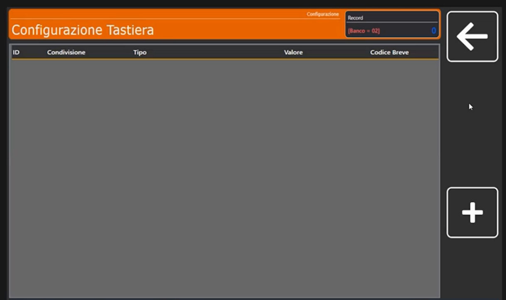

### 2. Crea un tasto funzione: ricerca alfanumerica (9001)

1. Tocca **+** e digita l'**ID Tasto** **9001**, cioè il codice che la posizione scelta riporta sulla schermata di vendita.
2. Si apre il tastierino **Condivisione ( 0=Banco NN=Bilancia )**. La pagina indica sempre se la programmazione vale **per banco** o **per la singola bilancia**, come nella pagina [Bilancia](bilancia.md). Digita **0** per il banco.

    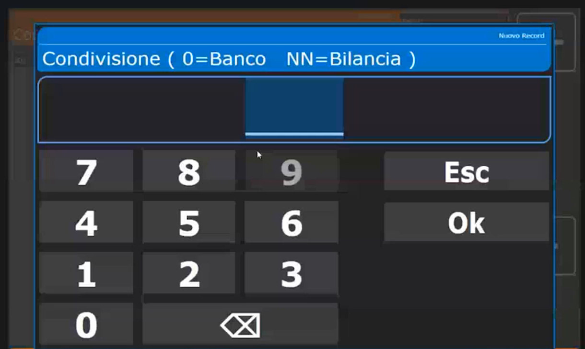

3. Nella scheda **Configurazione Tasto** i campi sono **ID Tasto**, **Condivisione**, **Tipo Tasto** e **Valore Associato**.

    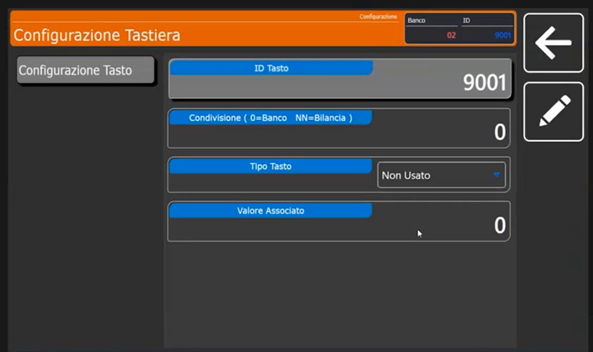

4. Apri il menu a tendina **Tipo Tasto**: qui si dice **che tipo di funzione deve essere**. Nella prima parte dell'elenco compaiono **Non Usato**, **Codice PLU**, **Valore Tara (in g)**, **Codice Operatore**, **Scelta Reparto**, **Imposta Reparto**, **PLU => Ricerca Alfa**, **Self Service <=> Etichettatrice**, **Multi Pesata <=> Etichettatrice** e **Ristampa**.

    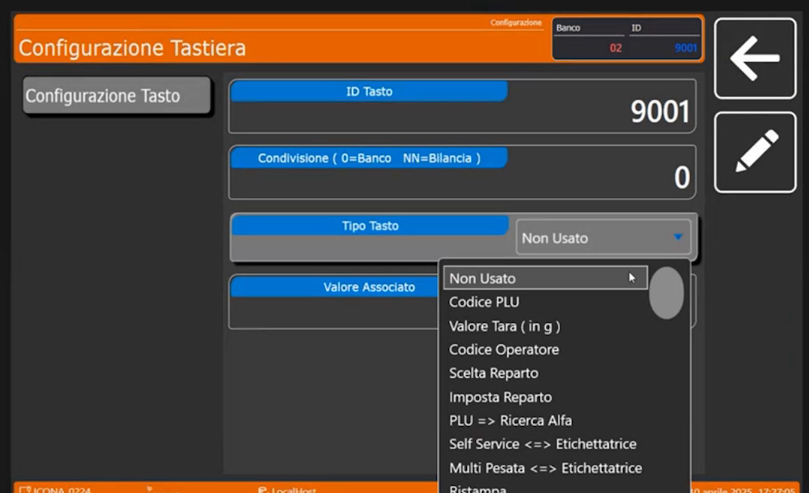

5. Scegli **PLU => Ricerca Alfa**, cioè la **ricerca alfanumerica degli articoli PLU**. Il primo tasto funzione è creato.

    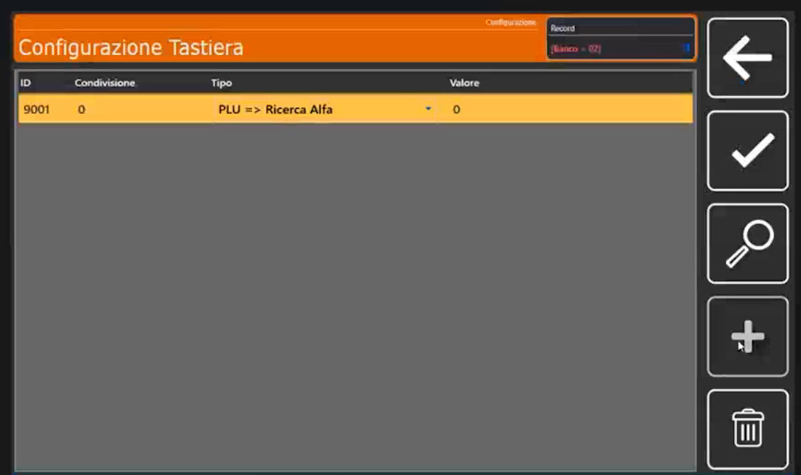

### 3. Crea un tasto funzione: pulizia del touch (9002)

Crea un altro tasto: **9002**, anche questo **per banco** (Condivisione 0). Scorrendo l'elenco del **Tipo Tasto** si trovano altre funzioni: **Lotto Generico**, **Elimina Code**, **Imposta Coda**, **Ripeti Coda**, **Barcode**, **Invio Scontrino a ECR**, **Apertura Cassetto**, **Sconto %**, **Sconto su Totale %** e **Testo Manuale**.

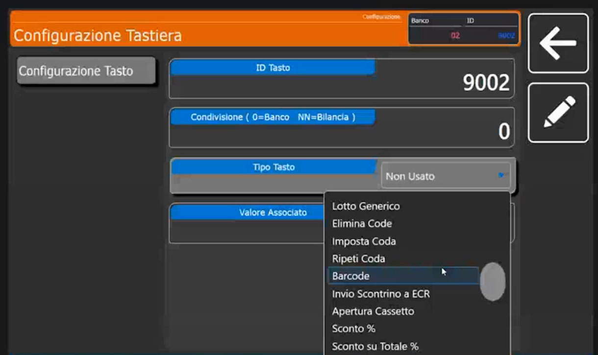

Scegli **Pulizia Touch** e come **Valore Associato** imposta i **secondi** di disattivazione: nell'esempio **10**.

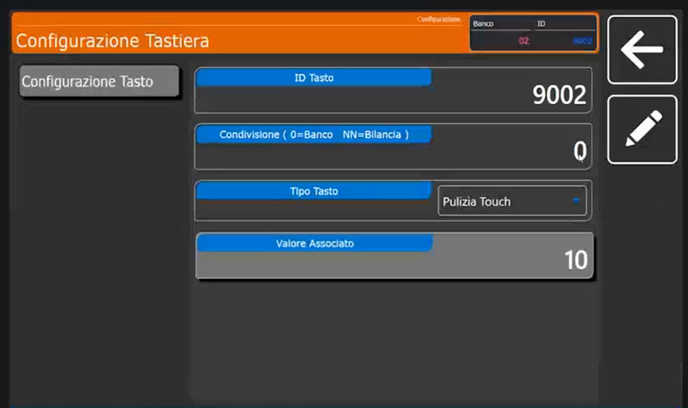

!!! tip "A cosa serve Pulizia Touch"
    È molto utile in ambienti come la macelleria, dove serve pulire lo schermo: il tasto **disabilita momentaneamente il touch** per i secondi impostati, così si dà una pulita rapida allo schermo.

### 4. Crea i tasti articolo

1. Tocca **+**, digita l'**ID Tasto** **1**, **Condivisione** **0** (sempre per banco).
2. Come **Tipo Tasto** scegli **Codice PLU**: il tasto richiama un articolo.
3. Imposta il **Valore Associato** **1** (il codice del PLU da collegare) e il **Codice Breve** **1**.

    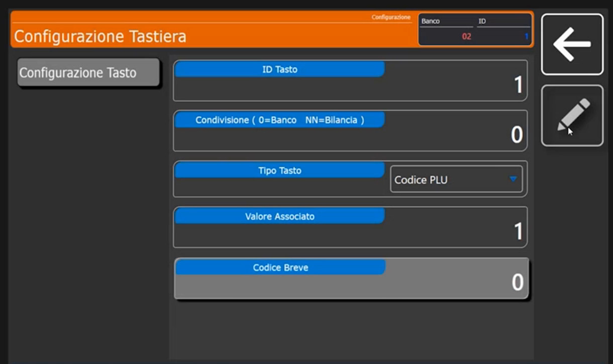

4. Ripeti per gli altri tasti, sempre per banco e sempre **Codice PLU**, con il rispettivo **Valore Associato** e **Codice Breve**.

## Funzioni dei tasti più usate

| Funzione (**Tipo Tasto**) | Che cosa fa | Pagina di riferimento |
|---|---|---|
| **Codice PLU** | Richiama un articolo | questa pagina |
| **PLU => Ricerca Alfa** | Ricerca alfanumerica degli articoli | questa pagina |
| **Pulizia Touch** | Disabilita il touch per i secondi indicati | questa pagina |
| **Multi Pesata <=> Etichettatrice** | Commuta tra Multipesata ed etichettatura | [Etichettatura in vendita](etichettatura.md) |
| **Self Service <=> Etichettatrice** | Commuta tra Self Service ed etichettatura | [Configurazione Operativa](configurazione-operativa.md) |
| **Invio Scontrino a ECR** | Stampa lo scontrino sul registratore di cassa collegato | [Bilancia](bilancia.md) (Parametri ECR) |
| **Testo Manuale** | Inserisce un testo libero sull'etichetta | [Etichettatura in vendita](etichettatura.md) |
| **Lotto Generico** | Gestione del lotto | [Tracciabilità e lotti](tracciabilita.md) |
| **Sconto %**, **Sconto su Totale %** | Sconti manuali | |
| **Barcode**, **Apertura Cassetto**, **Ristampa** | Funzioni di servizio | |

<!-- verificare: le funzioni "Lotto Generico", "Sconto %" e simili sono elencate dal menu ma non tutte sono state provate; controllare il comportamento esatto -->

## Verifica

La lista dei tasti contiene le righe create (per esempio **1**, **9001** e **9002**).

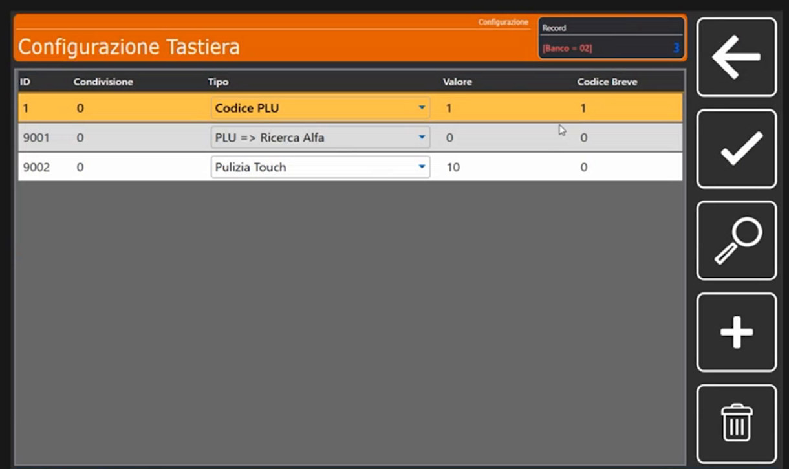

Esci dal configuratore e torna in vendita: compaiono **gli articoli** collegati alle posizioni e **i tasti funzione** appena creati.

## Errori comuni

| Problema | Causa probabile | Rimedio |
|---|---|---|
| Il tasto creato non compare in vendita | **ID Tasto** diverso dal codice della posizione | Controlla il codice mostrato sulla posizione, in alto a sinistra |
| Il tasto vale solo su una bilancia | **Condivisione** impostata con un numero di bilancia | Usa **0** per valere per tutto il banco |
| L'articolo non compare dopo il tasto | **Valore Associato** non corrisponde al codice PLU | Verifica il codice dell'articolo |

!!! tip "Prossimo passo"
    Per non mostrare tutti gli articoli nella stessa schermata si attivano le schede: [Schede Tastiera](schede-tastiera.md).
