<!-- categoria assegnata per inferenza: verificare (la bilancia Icona non ha una categoria dedicata nell'elenco) -->

# Configurazione Tastiera: tasti funzione e tasti articolo

**Target:** tecnico installatore / rivenditore · **Video:** Custom Academy, webinar *Icona configurazione di base* (10/04/2025), dal minuto 49:20 al 51:55.

## Obiettivo

Al termine sai assegnare una funzione o un articolo a un tasto della tastiera della bilancia, usando la pagina **Configurazione Tastiera**.

## Prerequisiti

- Gli [Articoli PLU](articoli-plu.md) 1 (MACINATO) e 2 (POLLO) sono stati creati.
- Il **Tipo Tastiera** scelto nella [Configurazione Operativa](configurazione-operativa.md) è *RETAIL => 4 Operatori*.

## Come funziona

Tornato in vendita, il relatore osserva che **non si vede nessun tasto**: la tastiera è vuota. Nella schermata di vendita, però, ogni posizione mostra in alto a sinistra il proprio **codice** (per esempio **9001**, **9003**, **9004**): quel numero è il **codice del tasto** da usare nella configurazione. Il relatore ricorda come esempio il **9001**.

## Passaggi

### 1. Apri Configurazione Tastiera

> Nel video: 49:51

Dal menu **Setup Bilancia**, sezione **Configurazione**, tocca **Configurazione Tastiera**.

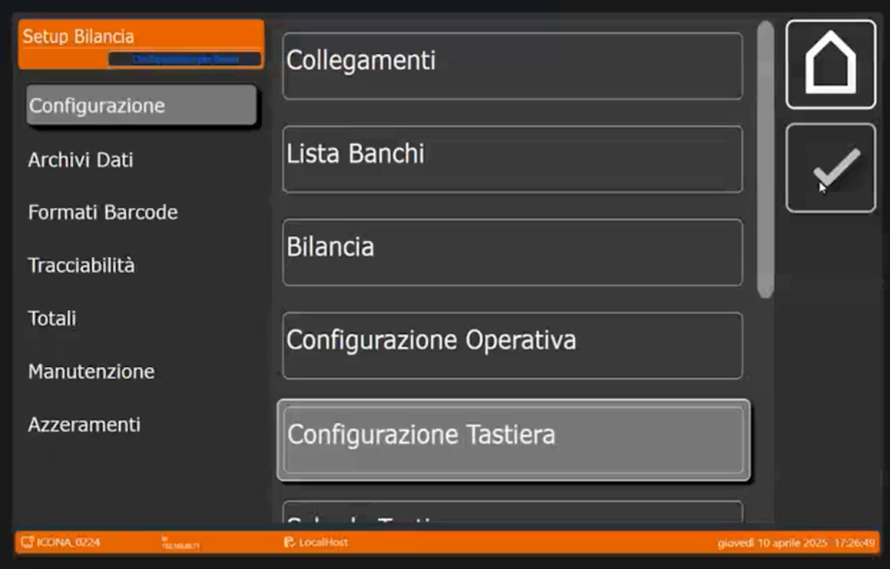

La lista dei tasti è vuota. Le colonne sono **ID**, **Condivisione**, **Tipo**, **Valore** e **Codice Breve**, e a destra c'è il pulsante **+**.

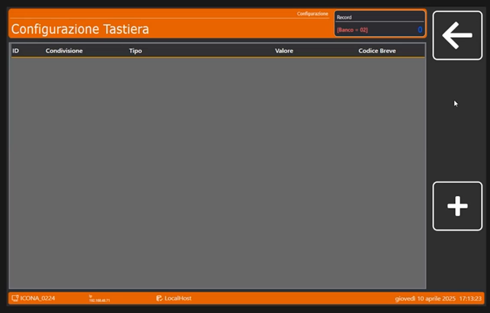

### 2. Crea il tasto funzione 9001: ricerca alfanumerica

> Nel video: 49:56

1. Tocca **+** e digita l'**ID Tasto** **9001**: il relatore sceglie questa posizione perché è sicuro di quale tasto sia.
2. Si apre il tastierino **Condivisione ( 0=Banco NN=Bilancia )**. La pagina indica sempre se la programmazione vale **per banco** o **per la singola bilancia**, come visto nella pagina [Bilancia](bilancia.md). Digita **0** per il banco.

    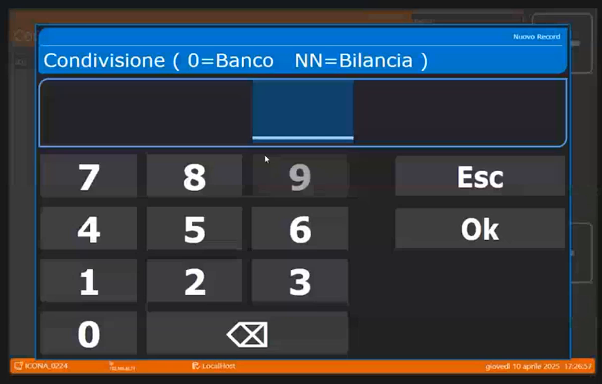

3. Nella scheda **Configurazione Tasto** i campi sono **ID Tasto**, **Condivisione**, **Tipo Tasto** e **Valore Associato**.

    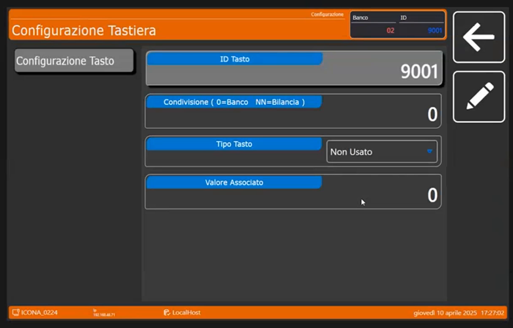

4. Apri il menu a tendina **Tipo Tasto**: qui si dice **che tipo di funzione deve essere**. Nella prima parte dell'elenco compaiono **Non Usato**, **Codice PLU**, **Valore Tara (in g)**, **Codice Operatore**, **Scelta Reparto**, **Imposta Reparto**, **PLU => Ricerca Alfa**, **Self Service <=> Etichettatrice**, **Multi Pesata <=> Etichettatrice** e **Ristampa**.

    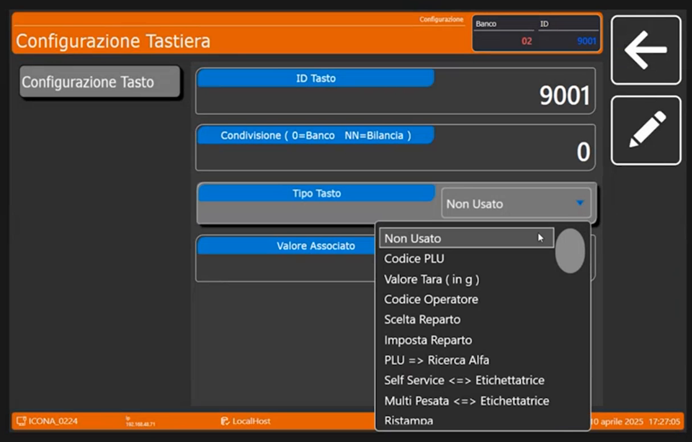

5. Scegli **PLU => Ricerca Alfa**, cioè la **ricerca alfanumerica degli articoli PLU**. Il primo tasto funzione è creato.

    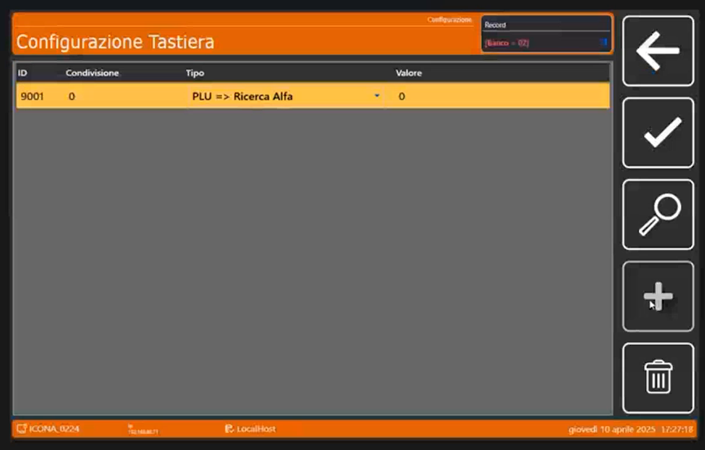

### 3. Crea il tasto funzione 9002: pulizia del touch

> Nel video: 50:26

Crea un altro tasto: **9002**, anche questo **per banco** (Condivisione 0). Scorrendo l'elenco del **Tipo Tasto** si trovano altre funzioni: **Lotto Generico**, **Elimina Code**, **Imposta Coda**, **Ripeti Coda**, **Barcode**, **Invio Scontrino a ECR**, **Apertura Cassetto**, **Sconto %**, **Sconto su Totale %** e **Testo Manuale**.

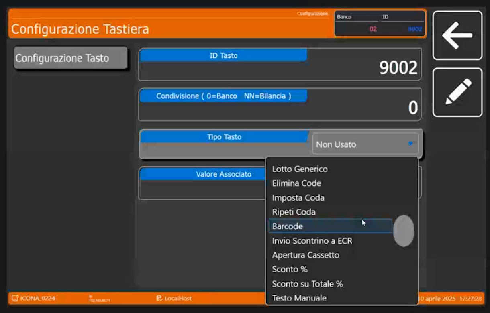

Il relatore sceglie **Pulizia Touch** e come **Valore Associato** imposta i **secondi**: nell'esempio **10**.

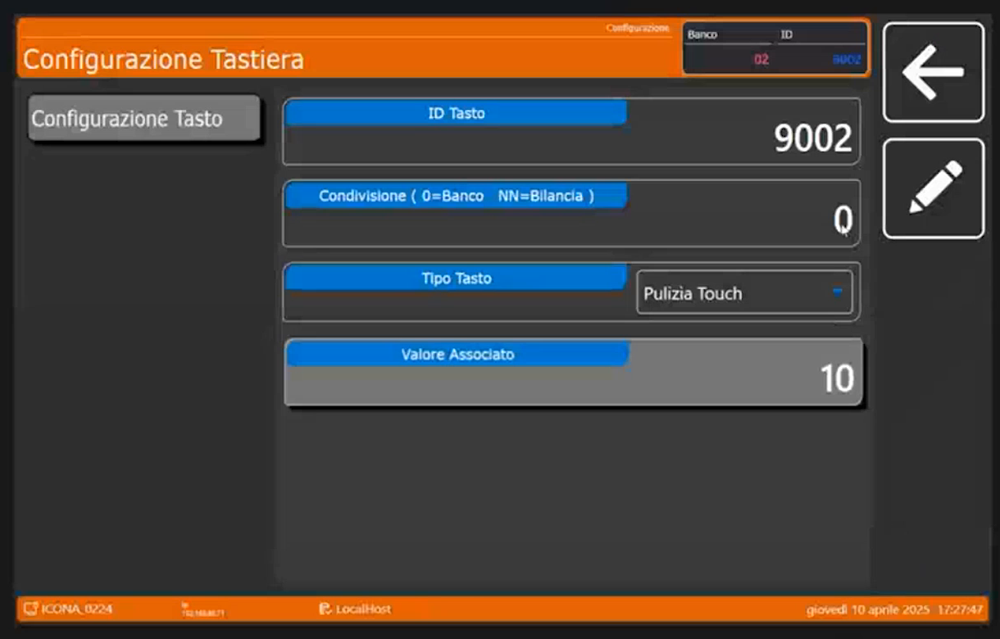

!!! tip "A cosa serve Pulizia Touch"
    È molto utile in ambienti come la macelleria, dove serve pulire lo schermo: il tasto **disabilita momentaneamente il touch** per i secondi impostati, così si dà una pulita rapida allo schermo.

### 4. Crea i tasti articolo 1 e 2

> Nel video: 51:04

1. Tocca **+**, digita l'**ID Tasto** **1**, **Condivisione** **0** (sempre per banco).
2. Come **Tipo Tasto** scegli **Codice PLU** (il relatore dice «gli dico che è un PLU»).
3. Imposta il **Valore Associato** **1** (il codice del PLU da collegare) e il **Codice Breve** **1**.

    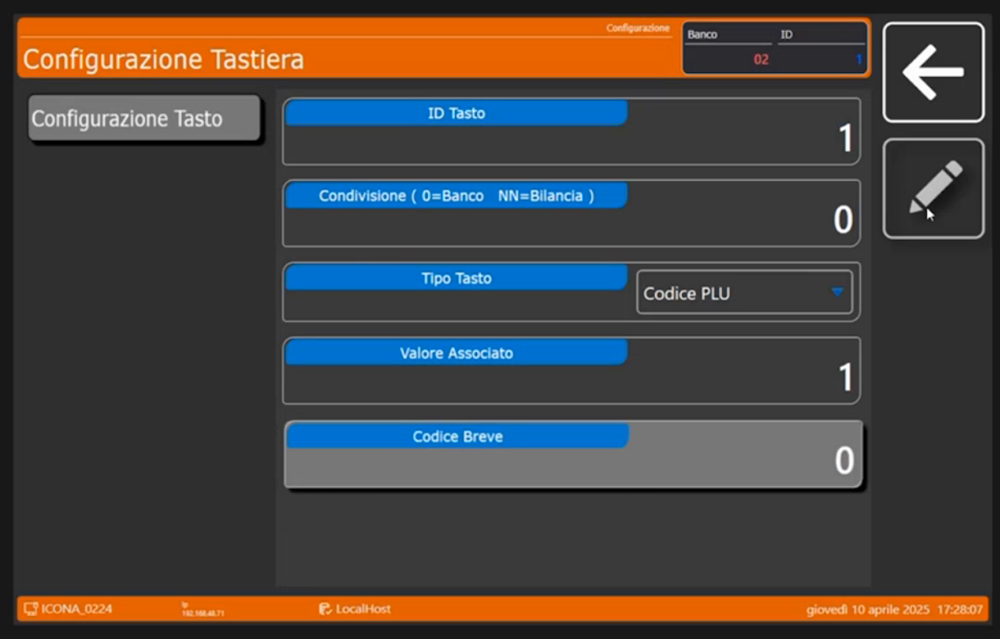

4. Ripeti per il **tasto numero 2**, sempre per banco e sempre **Codice PLU**, con **Valore Associato** **2** e **Codice Breve** **2**.

## Verifica

La lista dei tasti deve contenere tre righe: **1** (Codice PLU), **9001** (PLU => Ricerca Alfa) e **9002** (Pulizia Touch).

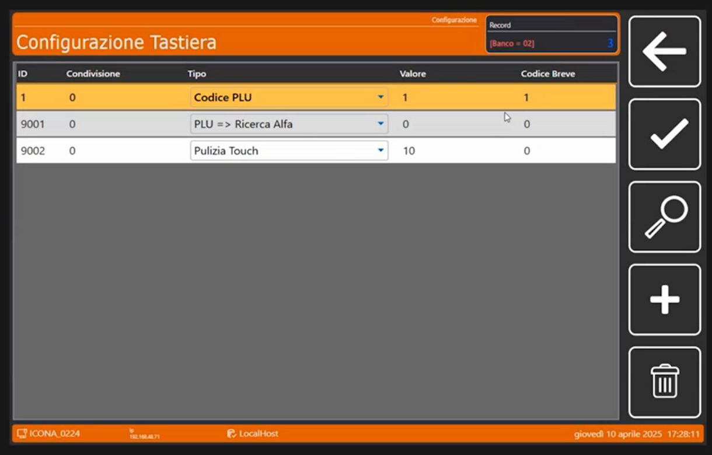

Esci dal configuratore e torna in vendita: compaiono **i primi due articoli**, MACINATO e POLLO, collegati alle posizioni, e **i due tasti funzione** appena creati. Il relatore la definisce la prima costruzione dell'abbinamento.

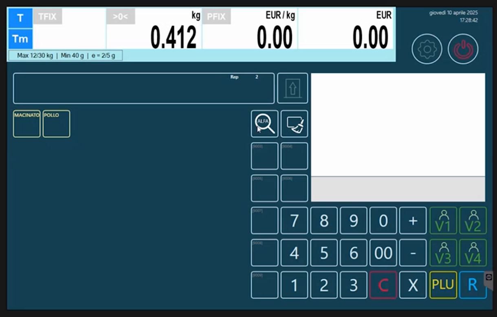

!!! tip "Prossimo passo"
    Per non mostrare tutti gli articoli nella stessa schermata si attivano le schede: pagina [Schede Tastiera](schede-tastiera.md).
