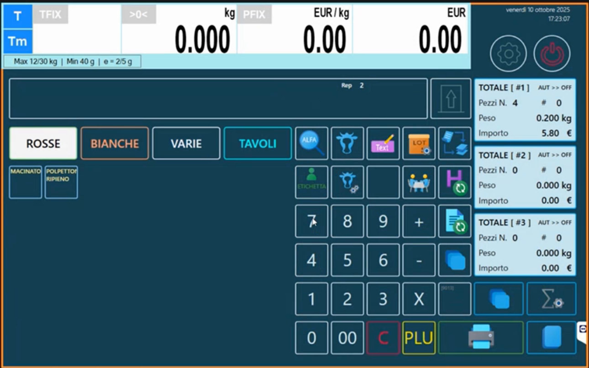
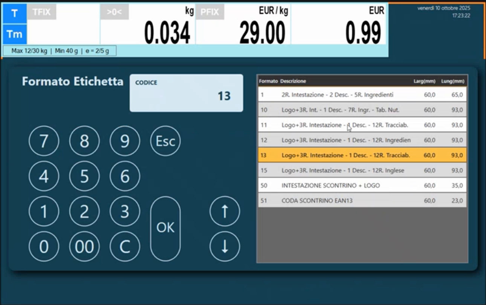
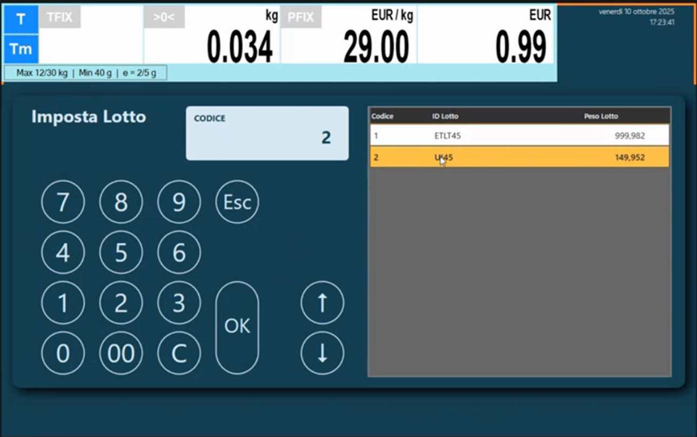
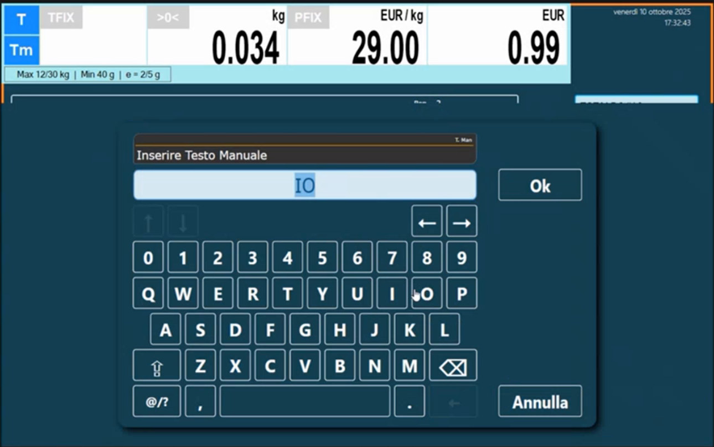
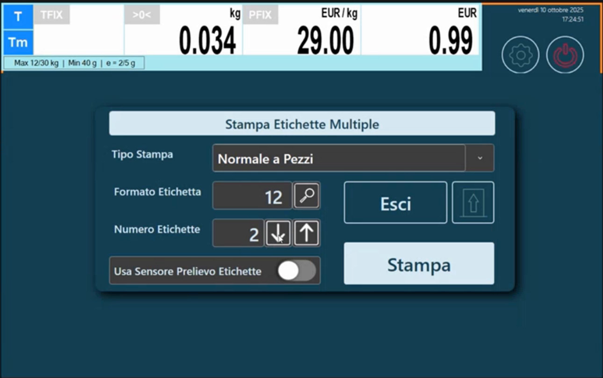
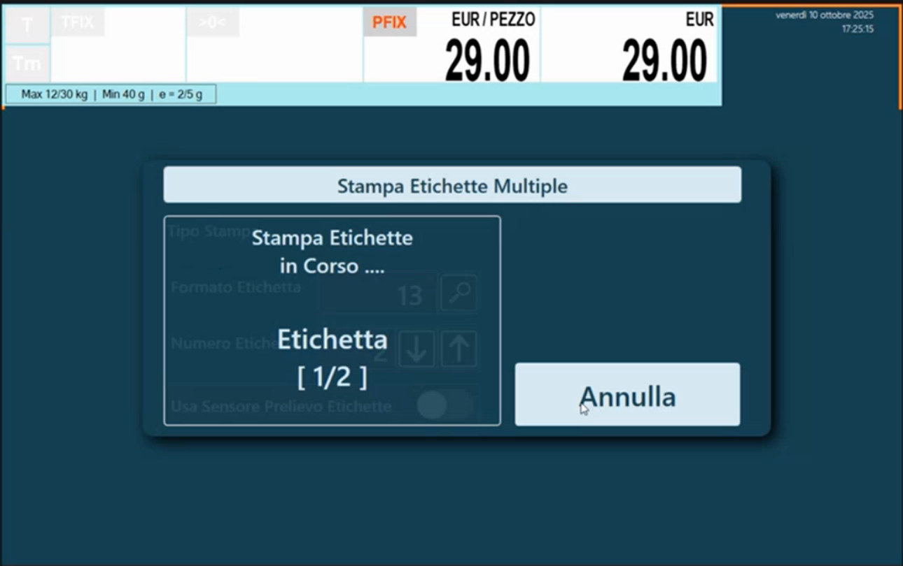

<!-- categoria assegnata per inferenza: verificare (la bilancia Icona non ha una categoria dedicata nell'elenco) -->

# Etichettatura in vendita: etichette, lotti e totali

**Target:** tecnico installatore / rivenditore.

## Obiettivo

Usare la modalità **Etichetta** della bilancia: scegliere il modo di acquisizione, cambiare formato e intestazione al volo, selezionare il lotto di tracciabilità, inserire lotto di produzione e testo manuale, stampare più etichette e usare i totali.

!!! note "Aggiornamento necessario"
    L'etichettatura evoluta è disponibile **aggiornando la bilancia all'ultima versione**: le prime installazioni Icona sono nate senza questa infrastruttura. Se il cliente ha una bilancia vecchia, l'aggiornamento abilita tutte le funzioni descritte qui.

## Prerequisiti

- La modalità e le opzioni di etichetta sono impostate in [Configurazione Operativa](configurazione-operativa.md) (sezione **Opzioni Etichetta**).
- Formati etichetta, intestazioni, testi e (se serve) tabella nutrizionale e tracciabilità sono stati preparati: [Formati Etichetta](formati-etichetta.md), [Tracciabilità e lotti](tracciabilita.md).

## Come si passa all'etichettatura

Nella tastiera Retail si può creare un **tasto personalizzato** con la funzione che commuta la bilancia tra **modalità Multipesata** e **modalità Etichettatura**: lo stesso tasto riporta in Multipesata. La funzione si assegna in [Configurazione Tastiera](configurazione-tastiera.md) (tipo tasto **Multi Pesata <=> Etichettatrice**).

In etichettatura la schermata mostra, a destra, i blocchi **TOTALE [#1]**, **[#2]** e **[#3]** con **Pezzi N.**, **Peso** e **Importo**: sono i tre livelli di totale (vedi sotto).

## Modo di acquisizione

Il campo **Modo Acquisizione Transazione** (**Opzioni Etichetta**) decide quando la bilancia stampa:

| Valore | Comportamento |
|---|---|
| **AUT** | Stampa scontrini ed etichette **non appena** si fa la pesata e si tocca l'articolo |
| **MAN** | Stampa solo dopo la **conferma con il tasto di stampa** |
| **PRECONF** | Modalità preconfezionato |

## Procedura in vendita

### 1. Scegli articolo e peso

Seleziona l'articolo (nell'esempio un polpettone ripieno) e appoggia il peso sulla bilancia.

### 2. Cambia formato etichetta o intestazione

Sempre con i tasti funzione puoi **cambiare il formato etichetta al volo**: per esempio per scegliere un formato con la tabella nutrizionale se non è già agganciato all'articolo, oppure cambiare l'intestazione. Se nella scheda dell'articolo il formato è **0**, vale il formato di default o quello scelto qui.

Il selettore mostra l'elenco dei formati del banco (**Formato**, **Descrizione**, **Larg**, **Lung**): per esempio **13** *Logo+3R. Intestazione - 1 Desc. - 12R. Tracciab.* oppure **15** *Logo+3R. Intestazione - 1 Desc. - 12R. Inglese*.

### 3. Seleziona il lotto tracciabile

Se l'articolo ha la tracciabilità attiva, scegli il **lotto tracciabile**: la bilancia propone l'elenco **Imposta Lotto** con i lotti disponibili e il peso residuo.

### 4. Lotto di produzione e testo aggiuntivo (facoltativi)

Sulla stessa etichetta si possono impostare altri dati:

- **Lotto di produzione personalizzato.** Serve a identificare un prodotto che lavori tu (per esempio una torta). È un codice **alfanumerico** da inserire a mano, che puoi cambiare ogni volta o tenere uguale per tutto il giorno. La bilancia può anche stampare in automatico un **lotto giuliano**: un numero progressivo riferito all'anno di emissione delle etichette, per etichettare con lotti di produzione automatici.<!-- verificare: la definizione esatta di "lotto giuliano" (giorno dell'anno) va confermata sul prodotto -->

    

- **Testo manuale (testo aggiuntivo).** Un testo libero che non c'entra con il lotto di produzione: per esempio il **nome del cliente** quando si etichetta per conto terzi.

    

Tutti questi dati vengono stampati sull'etichetta. Perché compaiano, il formato etichetta deve avere i relativi campi (**Lotto Produzione**, testo manuale: vedi [Formati Etichetta](formati-etichetta.md)).

### 5. Stampa

Conferma con il tasto di stampa (in **MAN**) o semplicemente seleziona l'articolo (in **AUT**). Contemporaneamente il **totale #1** si aggiorna con l'etichetta registrata: serve per la somma delle etichette.

## Stampa di più etichette

Un altro tasto funzione permette di **stampare più etichette** (finestra **Stampa Etichette Multiple**). Campi: **Tipo Stampa**, **Formato Etichetta**, **Numero Etichette** (con le frecce), **Usa Sensore Prelievo Etichette** (interruttore).

| Tipo Stampa | Cosa stampa |
|---|---|
| **Normale a Pezzi** | Etichette per articoli **a pezzo**: stampare molte etichette significa stampare solo a pezzi. Si sceglie il formato (per esempio uno con soli ingredienti) e il numero di etichette, anche 10 |
| **Senza Dati Metrici** | Stampa il layout dell'etichetta **senza i dati metrologici** (peso, prezzo...): restano scadenza, pezzo e le altre informazioni collegate |

**Usa Sensore Prelievo Etichette**: attivalo quando sulla bilancia c'è fisicamente un **rotolo di etichette** e vuoi che la bilancia gestisca il sensore di prelievo; altrimenti basta premere **Stampa**.

## Totali a più livelli

In etichettatura evoluta la bilancia gestisce **tre livelli di totale**, utili a chi fa confezionamenti: per esempio si confeziona una scatola, poi un pallet, e si ottiene un'etichetta totale con il riepilogo. I formati dei totali si assegnano:

- per articolo nella scheda **Stampa** ([Articoli PLU](articoli-plu.md): **Formato Etichetta Totale (1)**, **(2)**, **(3)**);
- in generale in **Totali Etichette** ([Configurazione Operativa](configurazione-operativa.md)).

## Verifica

L'etichetta stampata riporta intestazione, descrizione, ingredienti, eventuale tracciabilità con i dati del lotto, lotto di produzione, testo manuale e tabella nutrizionale, secondo il formato scelto. Il **peso giacenza** del lotto è diminuito.

## Errori comuni

| Problema | Causa probabile | Rimedio |
|---|---|---|
| La bilancia non stampa dopo la pesata | **Modo Acquisizione Transazione** su **MAN** | Premi il tasto di stampa o passa a **AUT** |
| L'etichetta non riporta il lotto | Il formato non contiene i campi del lotto, o la tracciabilità non è attiva | Scegli un formato "Tracciab." e controlla articolo e banco |
| Il lotto di produzione o il testo manuale non compaiono | Il formato non ha i campi corrispondenti | Aggiungi i campi nell'editor ([Formati Etichetta](formati-etichetta.md)) |
| Si stampa sempre lo stesso formato | Formato impostato in modo fisso nella scheda dell'articolo | Imposta **0** nel formato del PLU per lasciar decidere alla bilancia |

!!! tip "Prossimo passo"
    Come si costruisce e si personalizza un formato etichetta: [Formati Etichetta](formati-etichetta.md).
