<!-- categoria assegnata per inferenza: verificare (la bilancia Icona non ha una categoria dedicata nell'elenco) -->

# Formati Barcode: costruire EAN13, CODE 128 e QR Code

**Target:** tecnico installatore / rivenditore.

## Obiettivo

Sapere dove si trovano i formati dei codici a barre, copiare e rinominare un formato EAN13, cambiare la composizione dei suoi campi (per esempio per ottenere un **EAN a peso**) e conoscere i formati **CODE 128**, **GS1-128** e **QR Code**, anch'essi personalizzabili.

## Prerequisiti

- I barcode di default sono scelti nella [Configurazione Operativa](configurazione-operativa.md): campi **Barcode => Vendita** (valore 2) e **Barcode => Multipesata** (valore 6).
- Un barcode si può anche assegnare al **singolo articolo**: vedi [Articoli PLU](articoli-plu.md), scheda **Barcode**.

## Come ragiona la bilancia

I barcode sono archiviati come **formati numerati**. Ogni formato è l'elenco dei **campi** che compongono il codice, nell'ordine in cui vengono stampati. I formati forniti di default si possono usare così come sono oppure **copiare e adattare**: la costruzione del codice è sempre personalizzabile.

## Passaggi

### 1. Apri Formati Barcode

Dal menu **Setup Bilancia** tocca **Formati Barcode**. Le voci sono **Formati Barcode EAN13**, **Formati Barcode CODE 128**, **Formati QRCODE**, **Formati Barcode GS1-128** e **Composizione QRCode Data Collect**.

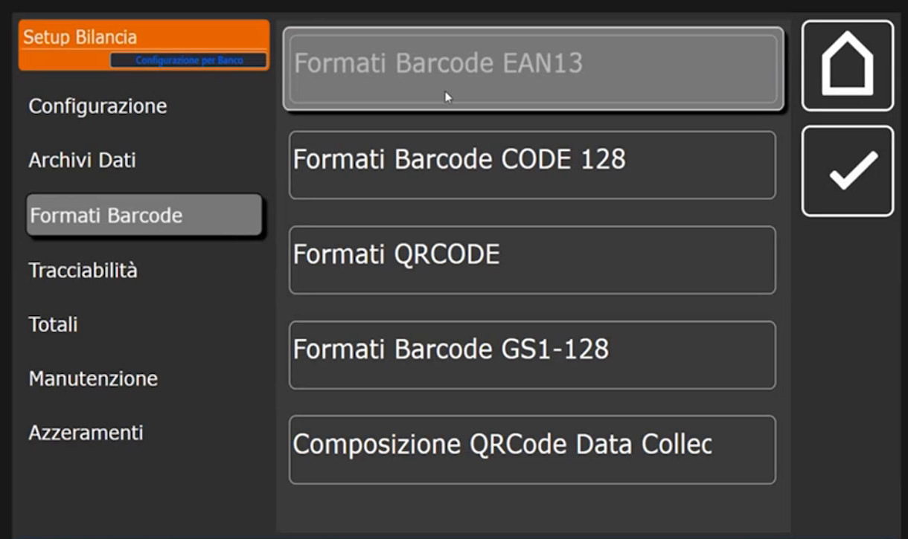

### 2. Consulta i formati EAN13 di default

Tocca **Formati Barcode EAN13**. La lista ha le colonne **ID Barcode** e **Descrizione**.

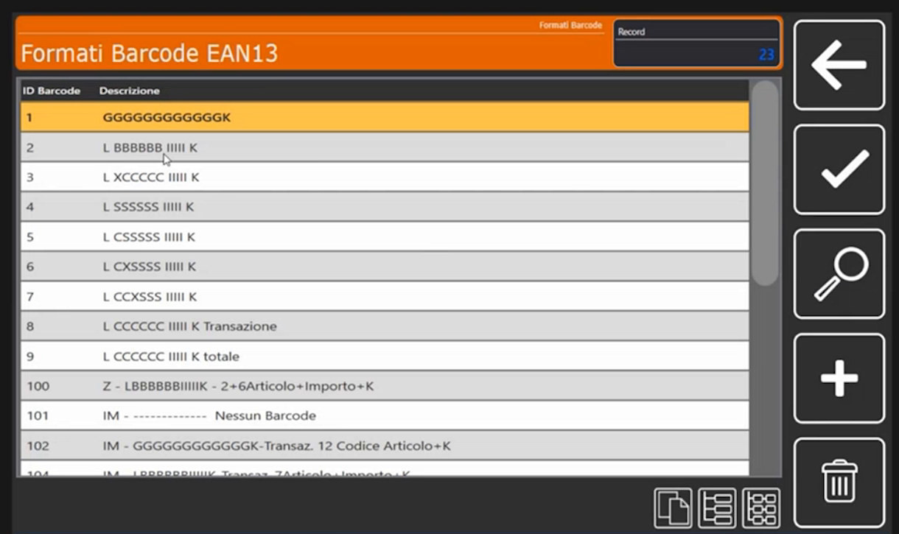

!!! note "Le sigle della descrizione sono solo un nome"
    Le descrizioni di default (per esempio *L BBBBBB IIII K*) ricalcano la storia dell'archivio delle bilance Italiana Macchi e servono a riconoscere il formato a colpo d'occhio. Sono **solo un nome**: non c'è l'obbligo di rispettarle e il contenuto reale del codice dipende dai campi del formato.

### 3. Copia un formato e dagli un nome

Per non modificare i formati di default, parti da una copia.

1. Seleziona il formato da copiare, per esempio il **2**.

    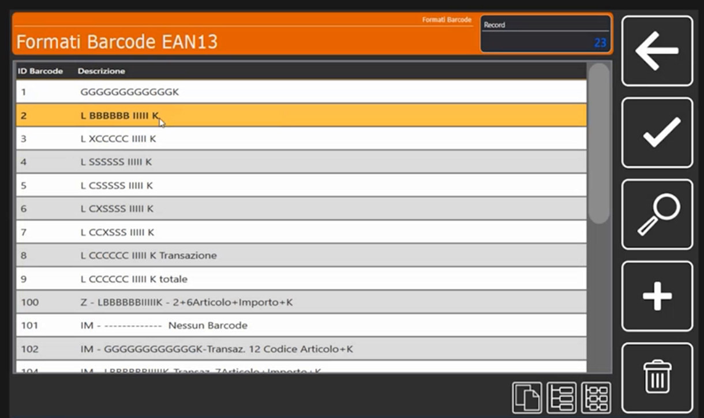

2. Copialo in un nuovo numero libero, per esempio **11**, con l'icona di copia in basso a destra: nella lista compare la nuova riga **11**, ancora con la descrizione del formato 2.

    

3. Apri il formato **11** e tocca **Descrizione**: scrivi il nome che preferisci (nell'esempio **MIO**).

    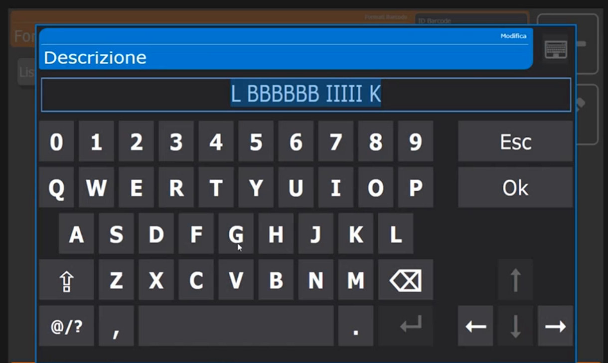

    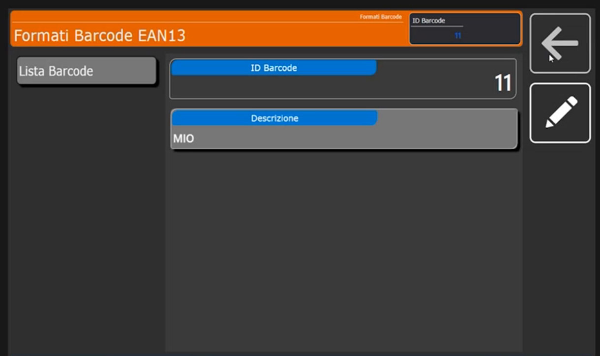

La lista contiene ora il formato **11 MIO**.

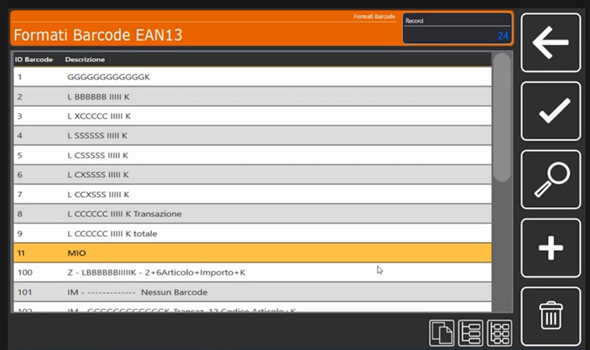

### 4. Leggi la composizione del barcode

Apri il formato **11**: compare l'elenco dei **campi** che formano il codice, con le colonne **Posizione**, **Descrizione** e **Tipo**.

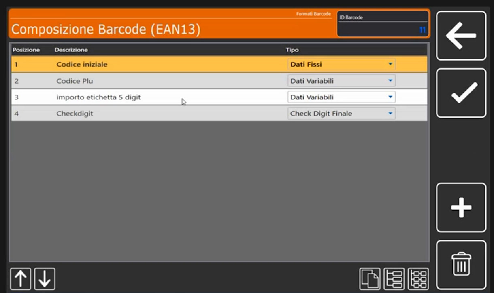

| Posizione | Descrizione | Tipo |
|---|---|---|
| 1 | Codice iniziale | Dati Fissi |
| 2 | Codice Plu | Dati Variabili |
| 3 | importo etichetta 5 digit | Dati Variabili |
| 4 | Checkdigit | Check Digit Finale |

Il formato qui descritto è un EAN13 a **importo**: 1 cifra fissa, 6 cifre di codice PLU, 5 cifre di importo e 1 cifra di controllo, per un totale di **13 cifre**.

Ogni campo si apre in **Composizione Barcode (EAN13)**, sezione **Campo Barcode**:

- **Campo 1, codice iniziale.** È un **codice fisso**: il **Tipo Campo** è *Dati Fissi* e il **Testo Fisso / Caratteri Speciali** vale **2**.

    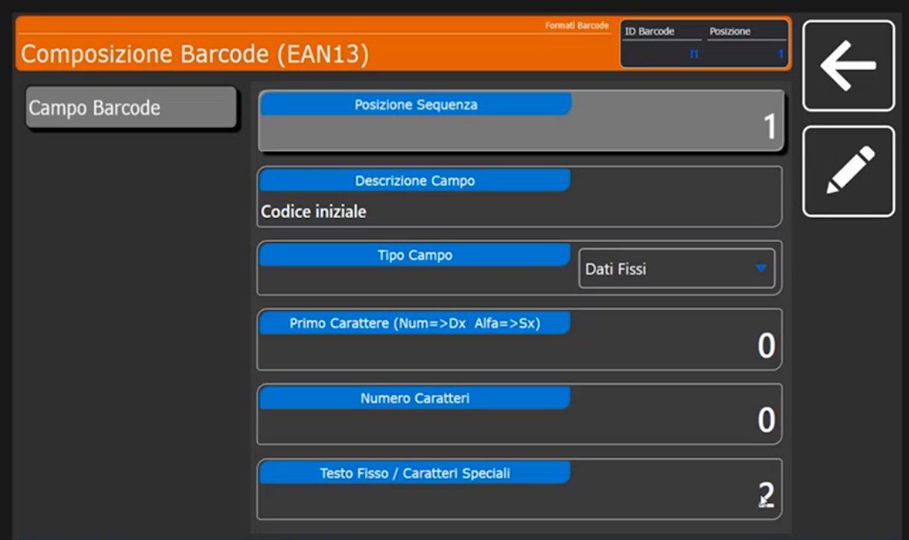

- **Campo 2, codice PLU.** Il **Tipo Campo** è *Dati Variabili*. Si regolano il **Numero Caratteri** (qui 6), il **Primo Carattere** (qui 12; l'etichetta del campo ricorda che i valori numerici si allineano a destra e quelli alfanumerici a sinistra) e l'**Origine Dato Variabile**, cioè da dove la bilancia prende il valore.

    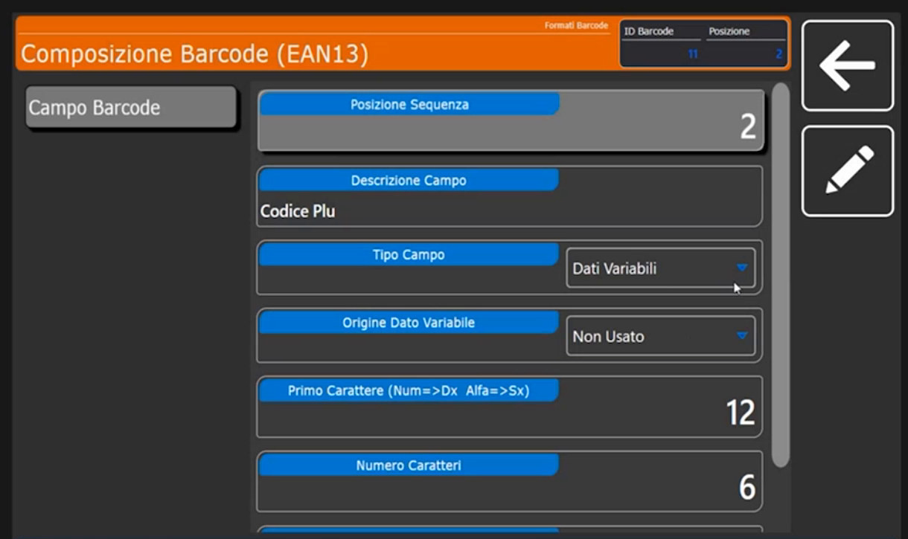

- **Campo 4, check digit.** È necessario ed è sempre l'ultimo campo (*Check Digit Finale*).

### 5. Cambia l'origine dei dati: l'EAN a peso

Il campo 3 contiene l'**importo**: la sua **Origine Dato Variabile** è *Importo Transazione*, con **Primo Carattere** 5 e **Numero Caratteri** 5. Il menu a tendina mostra le origini disponibili:

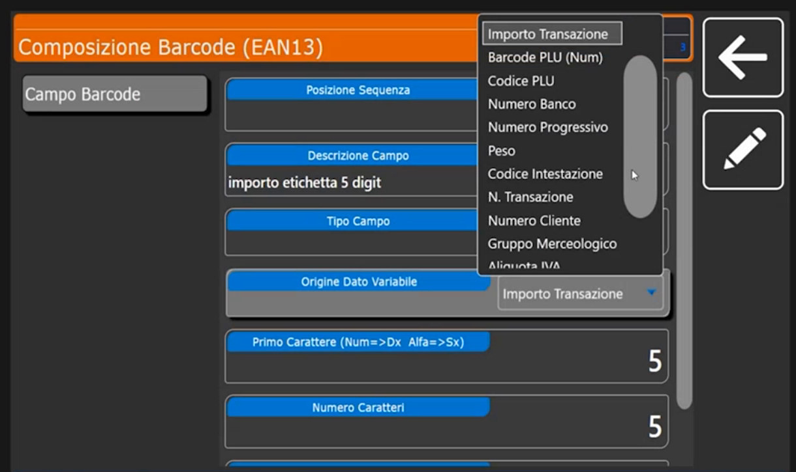

**Importo Transazione**, **Barcode PLU (Num)**, **Codice PLU**, **Numero Banco**, **Numero Progressivo**, **Peso**, **Codice Intestazione**, **N. Transazione**, **Numero Cliente**, **Gruppo Merceologico**, **Aliquota IVA** e altre voci che si raggiungono scorrendo l'elenco.

!!! tip "EAN a peso"
    Se questo campo deve riportare non l'importo ma il **peso** della transazione, scegli l'origine **Peso**: il barcode diventa un **EAN a peso**. Con lo stesso criterio si può costruire un codice che porti banco, progressivo, numero cliente, gruppo merceologico o aliquota IVA.

### 6. CODE 128, GS1-128 e QR Code

Oltre all'EAN13 sono disponibili, e personalizzabili, i formati **CODE 128** e **GS1-128** e i formati del **QR Code**. In **Composizione QRCode Data Collect** sono già presenti due formati:

| ID Formato | Descrizione | Note |
|---|---|---|
| 1 | QrCode Classic ECR | È il formato classico, usato nel **90% dei casi** |
| 2 | QrCode Bz | Emulazione **Bizerba**: prevede un'intestazione e un fine tracciato |

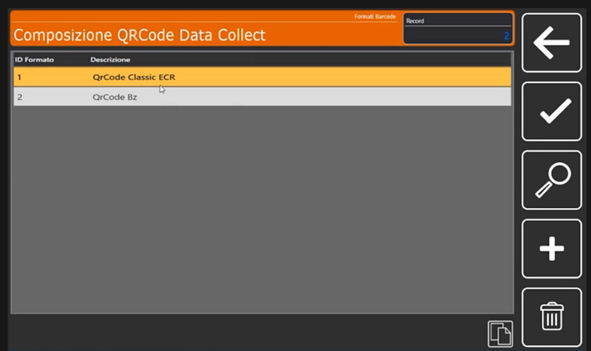

Anche per il QR Code puoi **copiare** un formato e **personalizzarlo**.

<!-- verificare: "QrCode Bz" interpretato come emulazione Bizerba (la descrizione a schermo e' abbreviata) -->

## Verifica

Nella lista dei formati EAN13 è presente il formato **11 MIO**, con i quattro campi (codice iniziale, codice PLU, importo, check digit). Per usarlo come barcode di vendita imposta il suo numero in **Configurazione Operativa** oppure nella scheda **Barcode** del singolo articolo.

## Errori comuni

| Problema | Causa probabile | Rimedio |
|---|---|---|
| Il barcode stampato non è quello atteso | Il formato è assegnato in un punto diverso da quello modificato (configurazione generale o scheda **Barcode** dell'articolo) | Controlla dove è impostato il numero del formato: la scheda dell'articolo prevale sulla configurazione generale |
| Si è modificato un formato di default | Il formato non è stato copiato prima | Crea una copia in un numero libero e lavora sulla copia |

!!! note "Controllo sulla lunghezza"
    Un EAN13 è composto da 13 cifre: dopo ogni modifica verifica **Primo Carattere** e **Numero Caratteri** di ciascun campo, in modo che il totale resti 13.

!!! tip "Prossimi argomenti"
    Per costruire un'etichetta che stampi il barcode vedi [Formati Etichetta](formati-etichetta.md).
