<!-- categoria assegnata per inferenza: verificare (la bilancia Icona non ha una categoria dedicata nell'elenco) -->

# Formati Barcode: costruire EAN13, CODE 128 e QR Code

**Target:** tecnico installatore / rivenditore · **Video:** Custom Academy, webinar *Icona configurazione di base* (10/04/2025), dal minuto 61:42 al 64:20.

## Obiettivo

Al termine sai dove si trovano i formati dei codici a barre, come copiare e rinominare un formato EAN13 e come cambiare la composizione dei suoi campi, per esempio per ottenere un **EAN a peso**. Sai inoltre che esistono i formati **CODE 128**, **GS1-128** e **QR Code** personalizzabili.

## Prerequisiti

- Hai visto come i barcode di default vengono scelti nella [Configurazione Operativa](configurazione-operativa.md): campi **Barcode => Vendita** (2) e **Barcode => Multipesata** (6).

## Passaggi

### 1. Apri Formati Barcode

> Nel video: 61:42

Dal menu **Setup Bilancia** tocca **Formati Barcode**. Le voci sono **Formati Barcode EAN13**, **Formati Barcode CODE 128**, **Formati QRCODE**, **Formati Barcode GS1-128** e **Composizione QRCode Data Collect**.

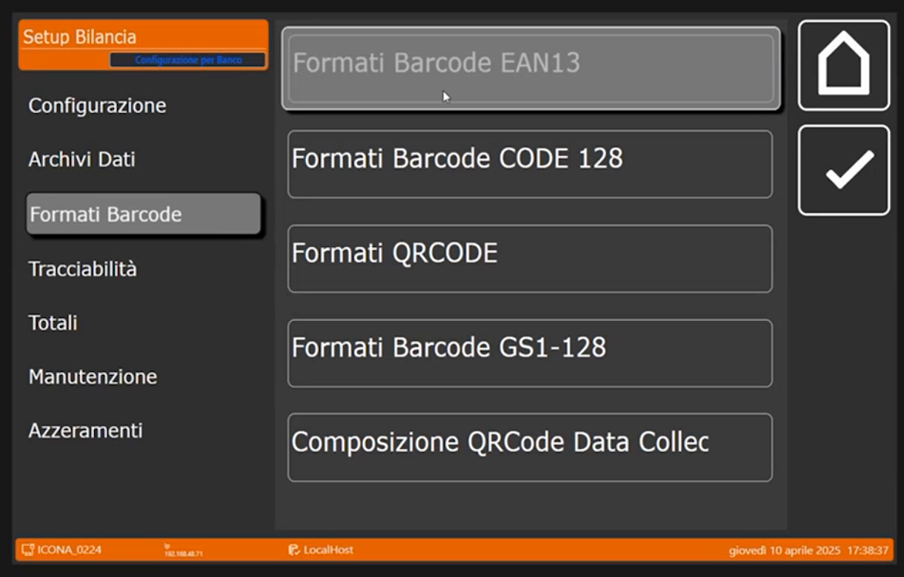

### 2. Guarda i formati EAN13 di default

> Nel video: 61:46

Tocca **Formati Barcode EAN13**. La lista ha le colonne **ID Barcode** e **Descrizione**.

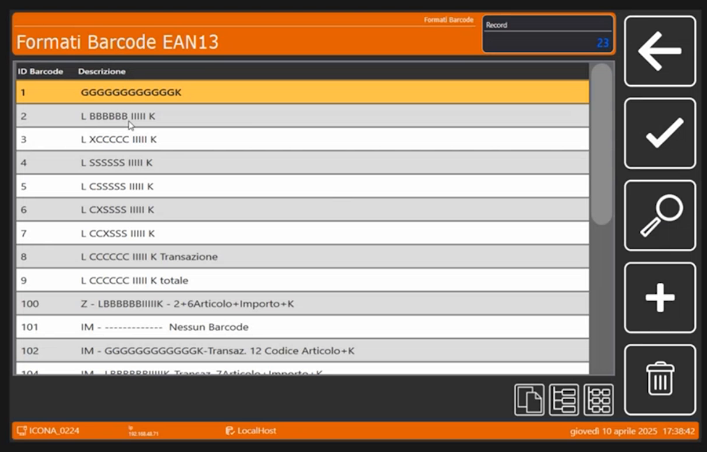

Il relatore ricorda che questa "leggenda" di sigle, per esempio *L BBBBBB IIII K*, riprende la **storia dell'archivio Italiana Macchi**. Le sigle sono **solo un nome**: la costruzione del codice a barre è sempre personalizzabile.

### 3. Copia un formato e dagli un nome tuo

> Nel video: 62:01

Il relatore prende il formato **2** e lo copia nel formato **11**.

1. Seleziona il formato **2** nella lista.

    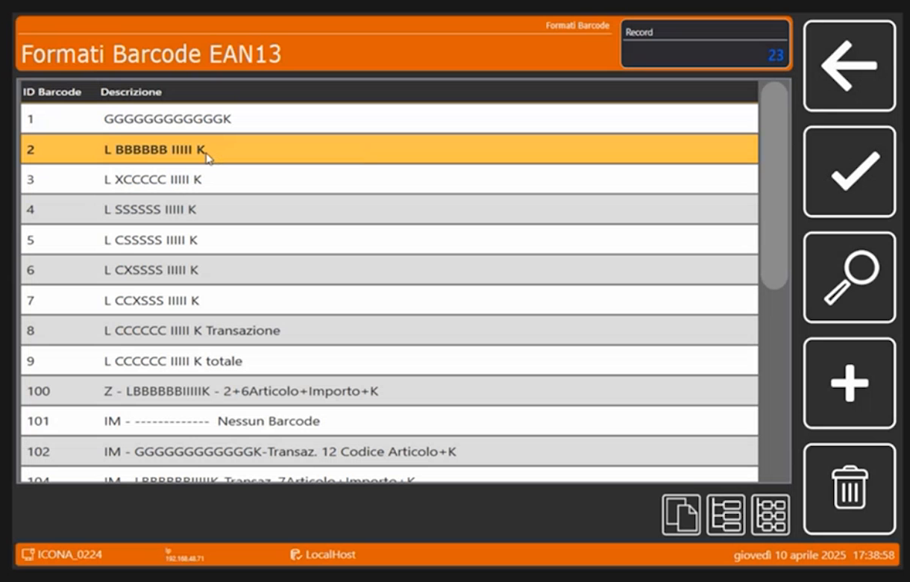

2. Copialo nel formato **11** con l'icona di copia in basso a destra: nella lista compare la nuova riga **11**, ancora con la stessa descrizione del formato 2.

    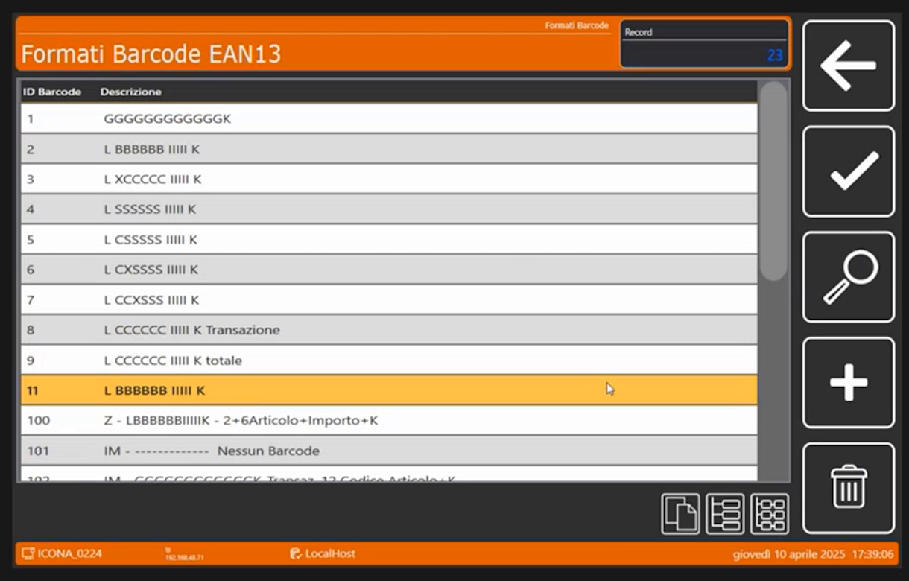

3. Apri il formato **11** e tocca **Descrizione**: scrivi il nome che vuoi. Il relatore ci scrive **MIO**: non c'è l'obbligo di mettere le sigle di default.

    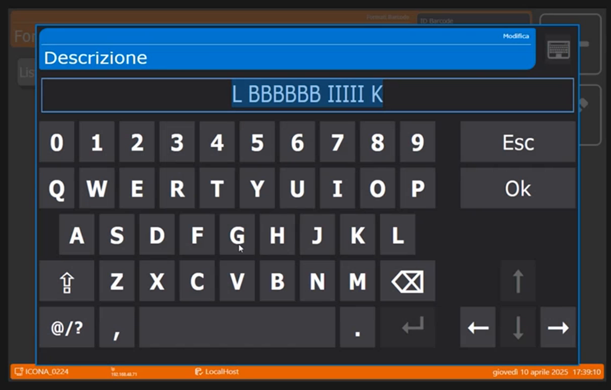

    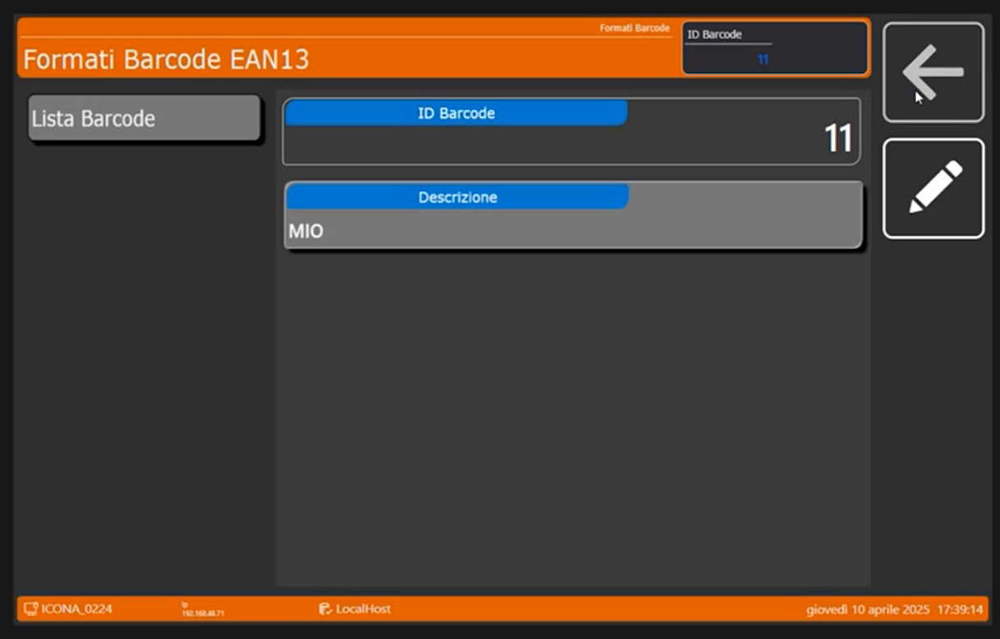

La lista ora contiene il formato **11 MIO**.

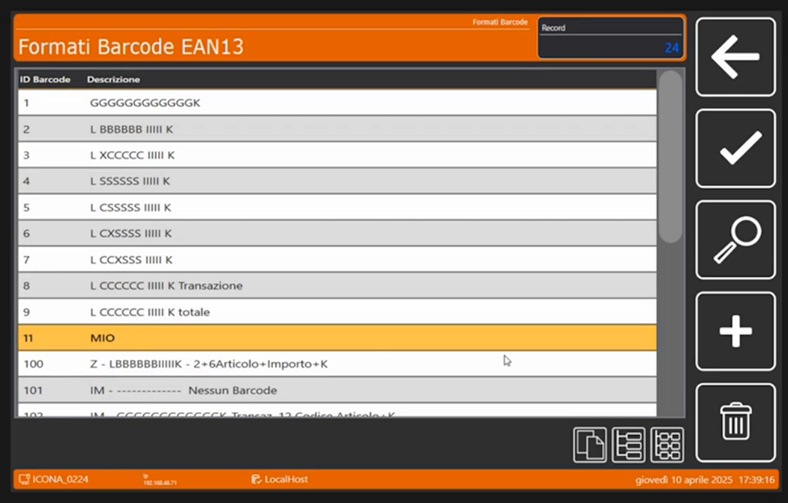

### 4. Apri la composizione del barcode

> Nel video: 62:24

Apri il formato **11**: si vede la sua composizione, cioè l'elenco dei **campi** che formano il codice, con le colonne **Posizione**, **Descrizione** e **Tipo**.

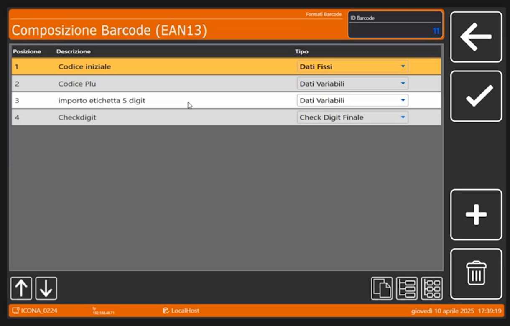

| Posizione | Descrizione | Tipo |
|---|---|---|
| 1 | Codice iniziale | Dati Fissi |
| 2 | Codice Plu | Dati Variabili |
| 3 | importo etichetta 5 digit | Dati Variabili |
| 4 | Checkdigit | Check Digit Finale |

Ogni campo si apre in **Composizione Barcode (EAN13)**, sezione **Campo Barcode**:

- **Campo 1, codice iniziale.** Il codice iniziale è il **2**: è un **codice fisso**. Nella scheda il **Tipo Campo** è *Dati Fissi* e il **Testo Fisso / Caratteri Speciali** vale **2**.

    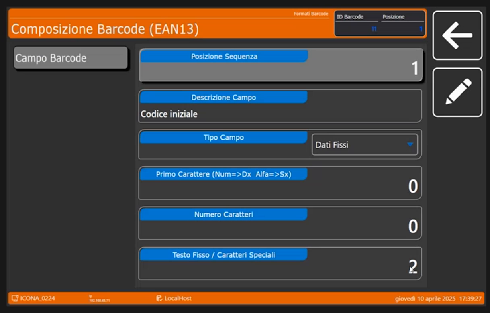

- **Campo 2, codice PLU.** Si può decidere che sia un **dato variabile**. Si regolano la lunghezza del campo (**Numero Caratteri**, qui 6), il **Primo Carattere** (qui 12) e il campo d'origine, **Origine Dato Variabile**.

    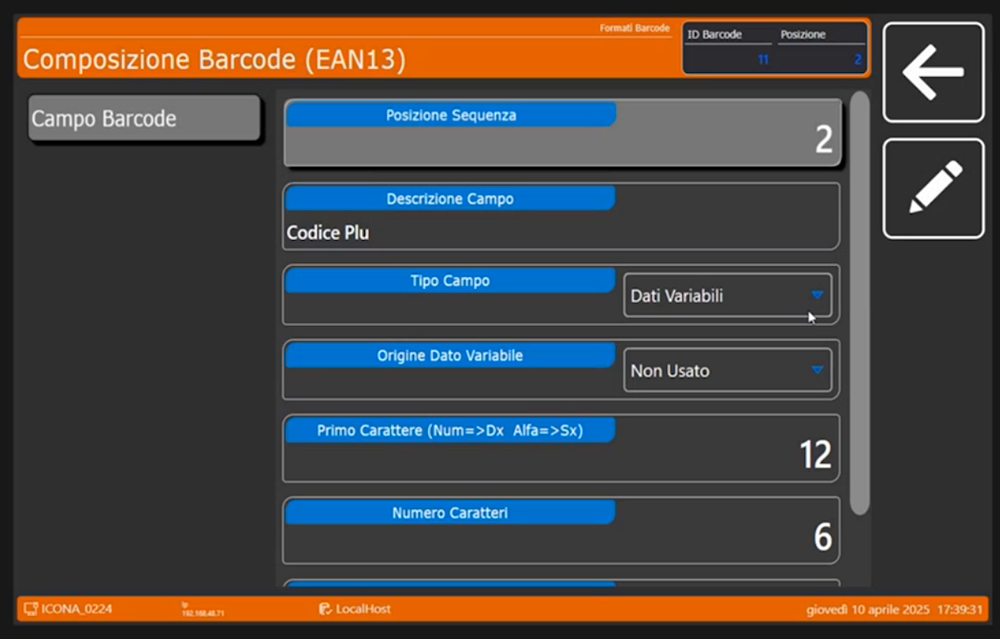

- **Campo 4, check digit.** È necessario ed è l'ultimo campo (*Check Digit Finale*).

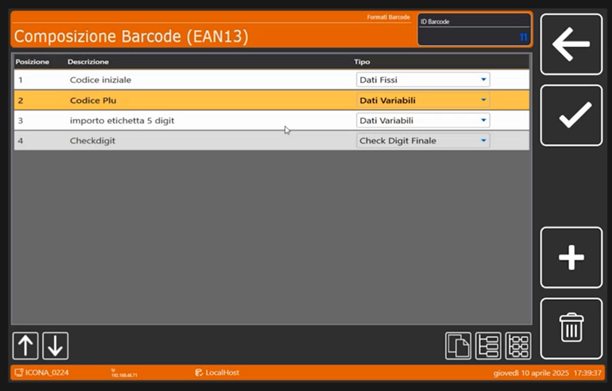

### 5. Cambia l'origine dei dati: l'EAN a peso

> Nel video: 62:46

Il campo 3 contiene l'**importo**: nel campo **Origine Dato Variabile** il valore è **Importo Transazione**, con **Primo Carattere** 5 e **Numero Caratteri** 5. Aprendo il menu a tendina si scelgono le possibili origini del dato:

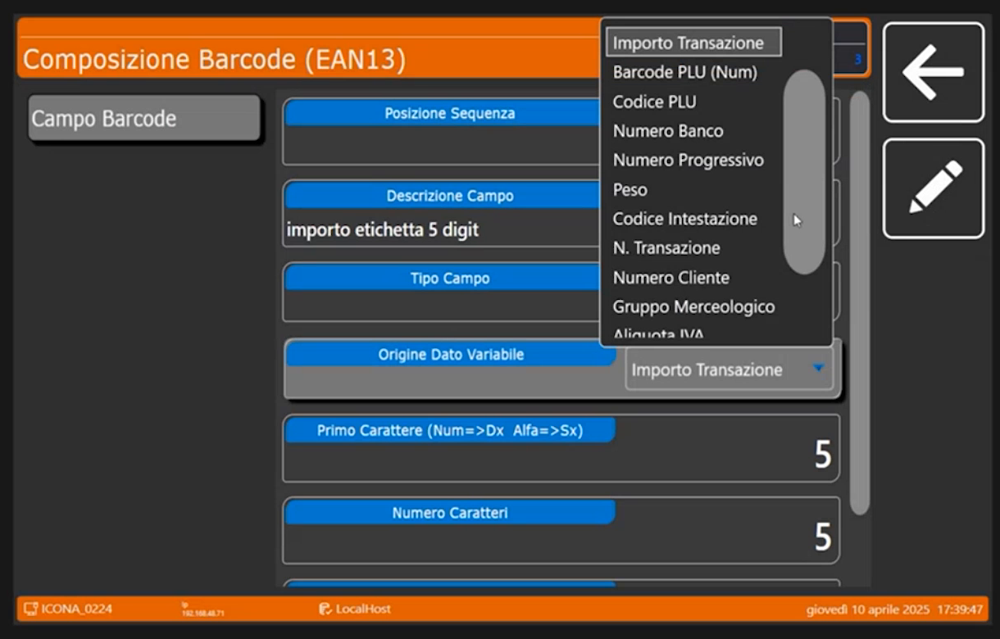

Le voci elencate sono **Importo Transazione**, **Barcode PLU (Num)**, **Codice PLU**, **Numero Banco**, **Numero Progressivo**, **Peso**, **Codice Intestazione**, **N. Transazione**, **Numero Cliente**, **Gruppo Merceologico** e **Aliquota IVA**, più altre voci che si raggiungono scorrendo.

!!! tip "EAN a peso"
    Se questo campo non deve riportare l'importo della transazione ma il **peso** della transazione (voce **Peso**), si ottiene un **EAN a peso**. Il relatore invita a personalizzare qui il codice secondo le proprie esigenze.

### 6. CODE 128, GS1-128 e QR Code

> Nel video: 63:04

Il relatore ricorda che sono stati introdotti da poco i formati **CODE 128** e i **formati personalizzabili del QR Code**. Nel menu c'è anche **Formati Barcode GS1-128**, che non viene commentata. In **Composizione QRCode Data Collect** si trovano già due formati di default:

| ID Formato | Descrizione | Note del relatore |
|---|---|---|
| 1 | QrCode Classic ECR | È il classico, usato nel **90% dei casi** |
| 2 | QrCode Bz | Emulazione **Bizerba**: prevede un'intestazione e un fine tracciato |

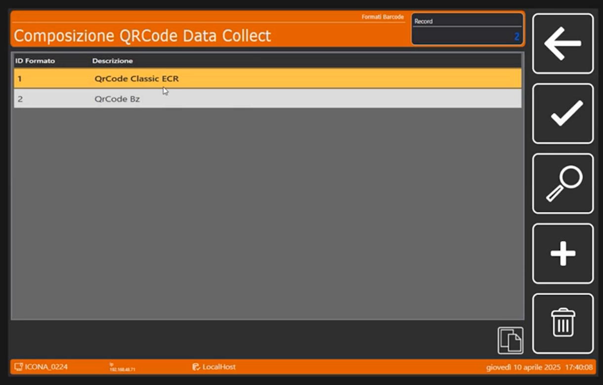

Anche per il QR Code si può **copiare** il formato e **personalizzarlo**.

<!-- verificare: la trascrizione riporta "CR usato nel 90% dei casi" e "emulazione Bizzerba"; interpretati rispettivamente come "Classic ECR" (visibile a schermo) e Bizerba -->

## Chiusura del webinar

> Nel video: 63:43

Visto l'orario, il relatore si ferma qui e rimanda il proseguimento della configurazione al **prossimo webinar**. Spera di aver fornito le basi necessarie per iniziare a configurare il prodotto. Torna infine in vendita e fa notare come i nomi degli operatori (**SALVATORE** e **ANN**) compaiano sui tasti: la bilancia **si adatta da sola alle dimensioni** dei testi, come si è detto per la parte grafica e per i tasti.

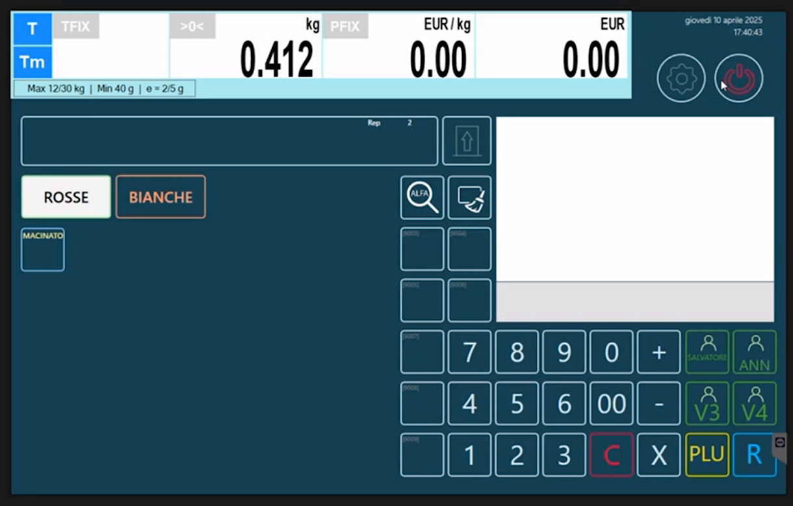

## Verifica

Nella lista dei formati EAN13 compare il formato **11 MIO**, con i quattro campi (codice iniziale, codice PLU, importo, check digit).

!!! tip "Per proseguire"
    Il relatore rimanda ai **webinar successivi** il proseguimento della configurazione e gli argomenti citati ma non affrontati: tracciabilità e lotti, tabelle nutrizionali, promozioni e applicativi collegati. Torna alla [pagina iniziale](index.md) per rivedere il percorso.
