<!-- categoria assegnata per inferenza: verificare (la bilancia Icona non ha una categoria dedicata nell'elenco) -->

# Formati Etichetta: layout di scontrino ed etichetta

**Target:** tecnico installatore / rivenditore.

## Obiettivo

Preparare i **layout di stampa** della bilancia: copiare un formato predefinito nel proprio banco, personalizzarlo nell'**editor grafico** (ingredienti, tracciabilità, lotto di produzione, testo manuale, logo, tabella nutrizionale) e verificarlo con una prova di stampa.

## Concetti da conoscere

- I formati di default sono tutti nella sezione **FX** (formati fissi): **Lista Formati Pre-Impostati**. L'archivio del banco sembra vuoto perché ogni banco ha i **propri** formati. **Si consiglia sempre di partire da un formato predefinito** copiandolo nel banco e poi personalizzandolo.
- **Anche lo scontrino è un'etichetta.** Il layout grafico dello scontrino è un'etichetta con formato standardizzato: il formato **50** è la **testa** (intestazione) e il formato **51** è la **coda**. Se ti chiedi dove si attiva il **QR code** o l'**EAN** sotto lo scontrino, la risposta è: nei formati 50 e 51.
- I formati **50 e 51 sono i layout dello scontrino**; gli altri numeri sono layout di **etichetta**.
- Dimensioni (larghezza e lunghezza) si determinano **a monte**, nel dettaglio del formato; i campi si dispongono nell'editor.

## Prerequisiti

- L'[intestazione dello scontrino](intestazioni-operatori-testi.md) è stata creata nell'archivio **Intestazioni**.
- Se l'etichetta deve stampare ingredienti, tracciabilità o tabella nutrizionale, i dati sono stati preparati: [Box ingredienti e tabelle testi](box-ingredienti-testi.md), [Tracciabilità e lotti](tracciabilita.md), [Tabelle nutrizionali](tabelle-nutrizionali.md).

## Procedura

### 1. Apri Formati Etichetta

Da **Archivi Dati** scorri la lista in basso e tocca **Formati Etichetta**.

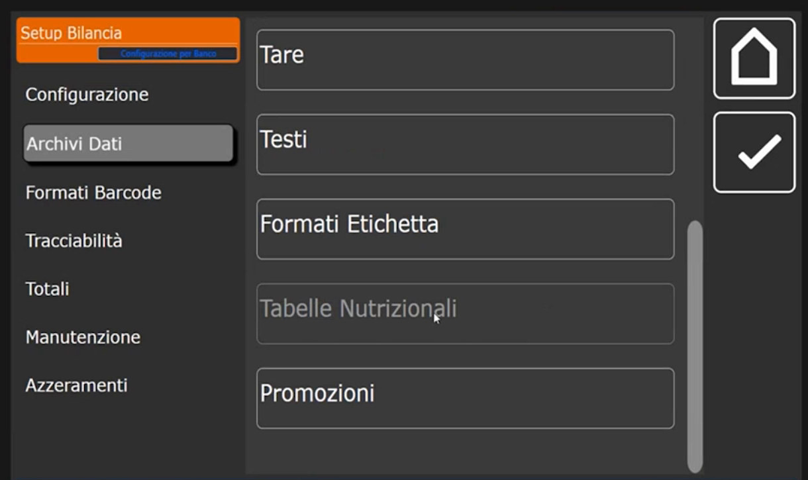

La lista del banco mostra le colonne **Formato**, **Descrizione**, **Larg (mm)** e **Lung (mm)**; il pulsante **+** crea un formato. In basso ci sono due gruppi di icone: due a sinistra (una stampante e un monitor, per la prova di stampa e l'anteprima) e cinque a destra.

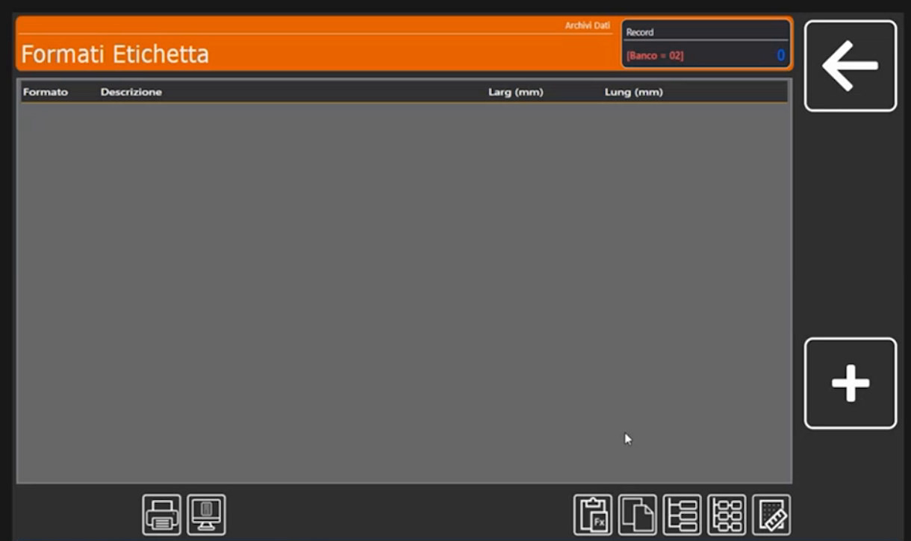

### 2. Apri la lista dei formati predefiniti

Tocca la **prima icona del gruppo in basso a destra** (il blocco appunti con la scritta *Fx*): si apre la **Lista Formati Pre-Impostati**.

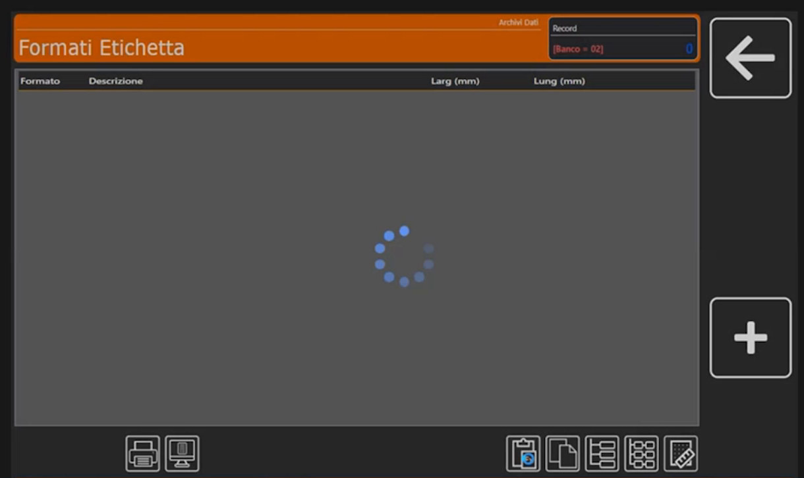

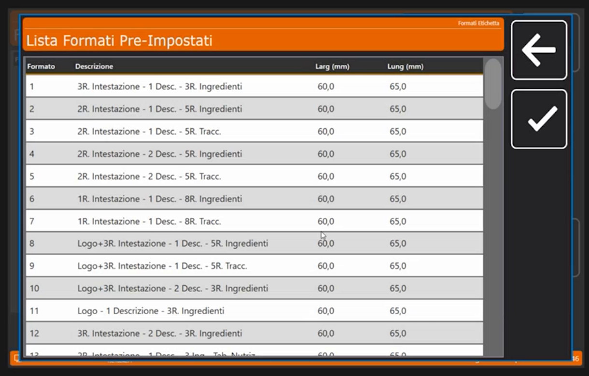

Scorrendo la lista trovi i formati di etichetta con le loro dimensioni (60 mm di larghezza; lunghezze 65, 75 o 93 mm).

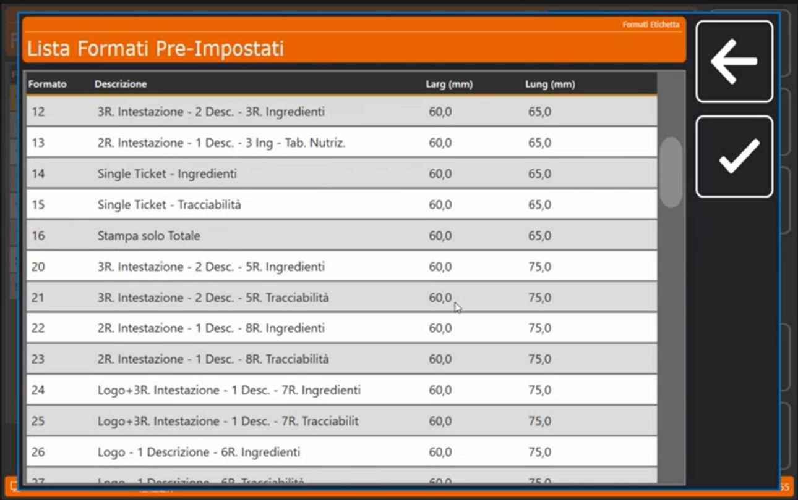

La descrizione dice che cosa contiene il formato:

| Dicitura | Significato |
|---|---|
| **nR. Intestazione** | Numero di righe dedicate all'intestazione (2R, 3R) |
| **Logo+** | Il formato inizia con un logo |
| **1 Desc.** / **2 Desc.** | Numero di descrizioni dell'articolo |
| **nR. Ingredienti** | Numero di righe del box ingredienti (3R, 5R, 7R, 8R, 12R) |
| **nR. Tracciabilità** / **Tracciab.** | Righe dedicate alla tracciabilità |
| **Tab. Nut.** | Contiene la tabella nutrizionale |
| **12R. Inglese** | Ingredienti stampati in inglese (box 2) |
| **Single Ticket - Ingredienti / Tracciabilità** | Formati per la modalità Single Ticket |
| **Stampa solo Totale** | Etichetta con i soli totali |

Tra i formati dello scontrino si incontrano, scorrendo:

| Formato | Descrizione | Larg x Lung (mm) |
|---|---|---|
| 80 | INTESTAZIONE SCONTRINO | 60,0 x 19,5 |
| 81 | INTESTAZIONE SCONTRINO + LOGO | 60,0 x 15,0 |
| 82 | TRANSAZIONE 2desc.+Lotto+TLL | 60,0 x 17,0 |
| 85 | CODA SCONTRINO EAN13 | 60,0 x 23,0 |
| 86 | CODA SCONTRINO QrCode | 60,0 x 38,0 |
| 90 | TRACCIABILITA' Box | 60,0 x 24,0 |

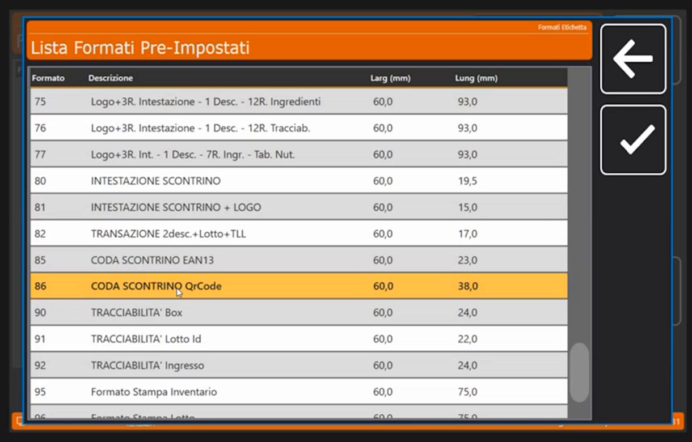

### 3. Copia un formato nel banco

1. Seleziona il formato nella lista dei predefiniti.
2. Conferma con la **spunta**: compare il tastierino **Formato Fisso : N => Nuovo Formato ...**.
3. Digita il numero con cui vuoi salvarlo nel banco (per esempio **41**, oppure **50** per l'intestazione scontrino) e conferma con **Ok**.

    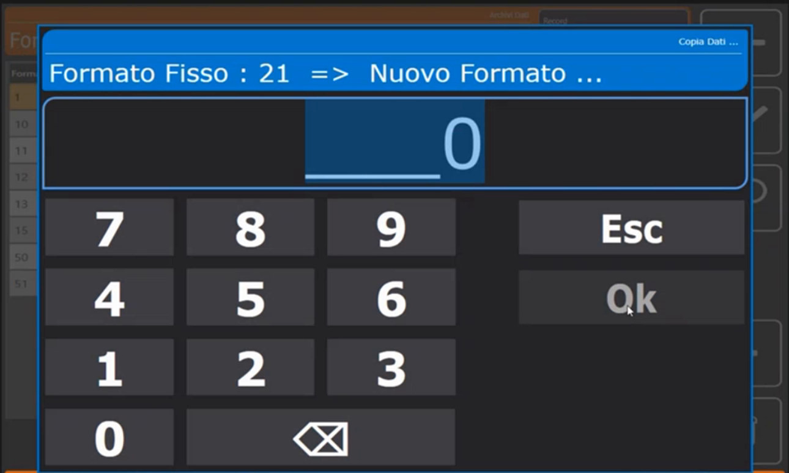

4. Alla richiesta **Eseguo la copia nel Banco Attuale ?** tocca **Sì**.

    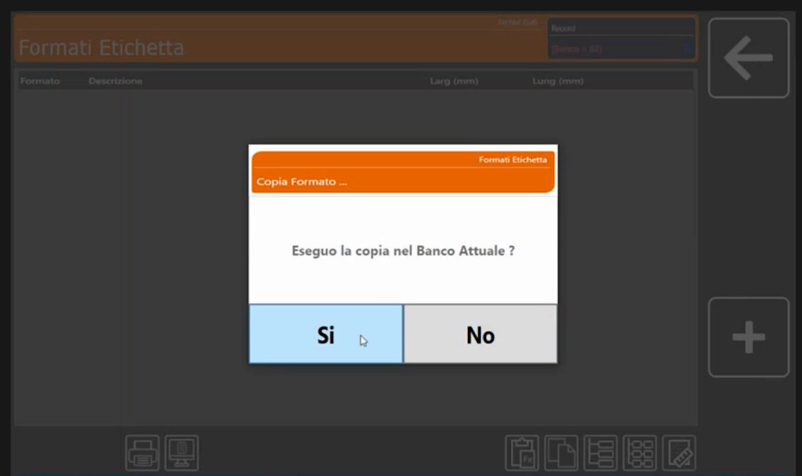

Il formato compare nella lista del banco.

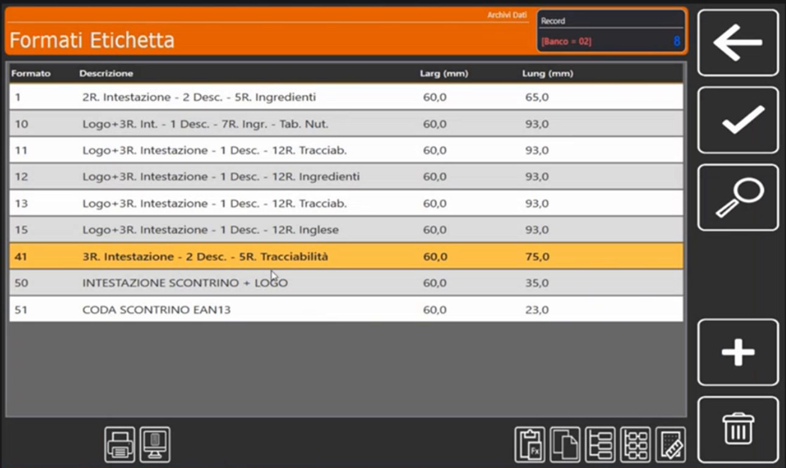

## Scontrino: formati 50 (testa) e 51 (coda)

Per l'intestazione con logo copia **81 - INTESTAZIONE SCONTRINO + LOGO** nel formato **50**; per la coda con EAN13 copia **85 - CODA SCONTRINO EAN13** nel formato **51** (per un QR code usa **86 - CODA SCONTRINO QrCode**).

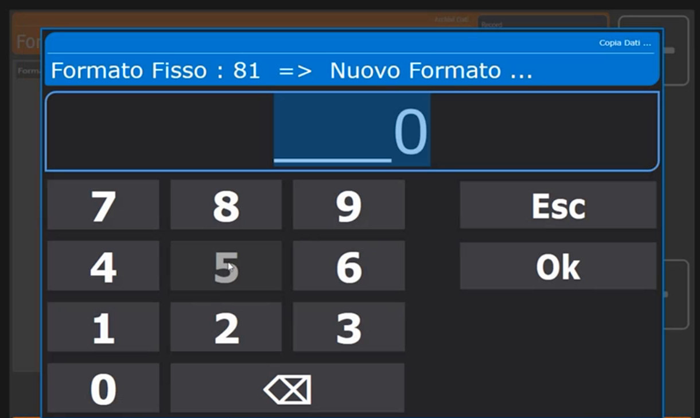

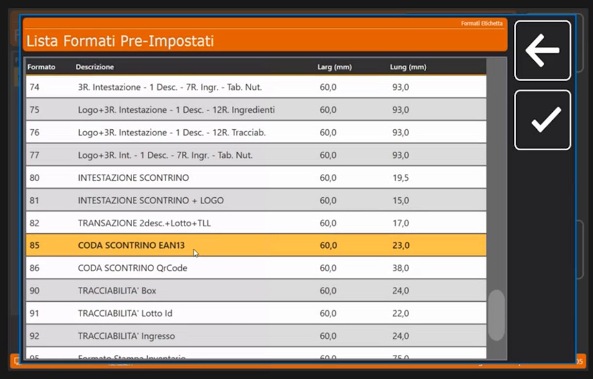

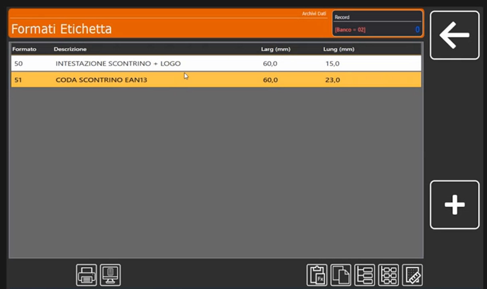

!!! warning "Da non confondere"
    **50 e 51 fanno riferimento ai layout di stampa dello scontrino**; le etichette (ingredienti, tracciabilità, tabella nutrizionale) hanno altri numeri. Per portare nel banco un'etichetta si copia un formato predefinito, per esempio nel formato **1**.

## L'editor grafico

Con il formato selezionato apri l'editor: l'etichetta si personalizza **graficamente** oppure con le **coordinate classiche x e y**.

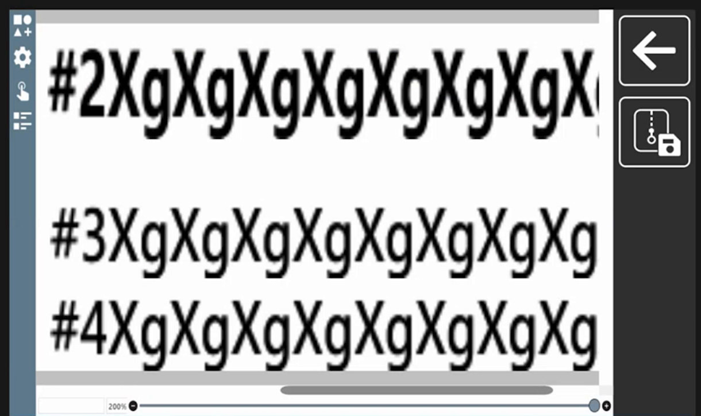

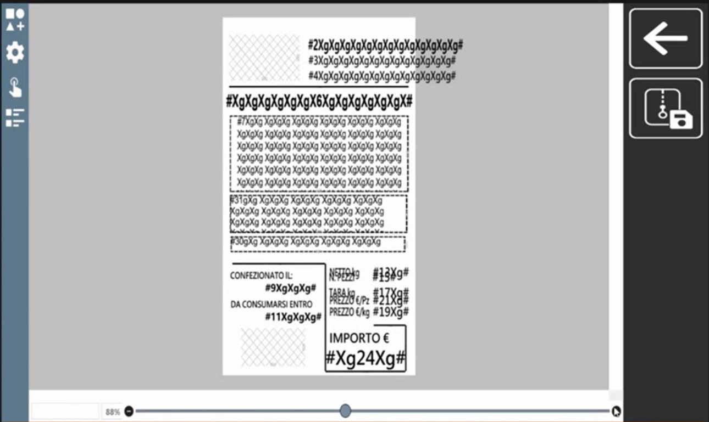

<!-- verificare: l'icona esatta che apre l'editor (nel gruppo di cinque icone a destra della lista) va confermata sulla bilancia -->

!!! warning "Da verificare"
    L'apertura dell'editor avviene con un tocco sulle icone in basso a destra della lista del banco: controlla sulla bilancia quale icona corrisponde all'editor grafico.

### Dimensioni dell'etichetta

Dalla lista, seleziona il formato e tocca la **lente**: si apre il dettaglio **Lista Formati** con **ID Formato**, **Descrizione Formato**, **Larghezza Etichetta (mm)** e **Lunghezza Etichetta (mm)**. Tocca la **matita** per modificare. Se ti serve più spazio sopra il logo, per esempio, aumenta la lunghezza (nell'esempio da 15,0 a **35**).

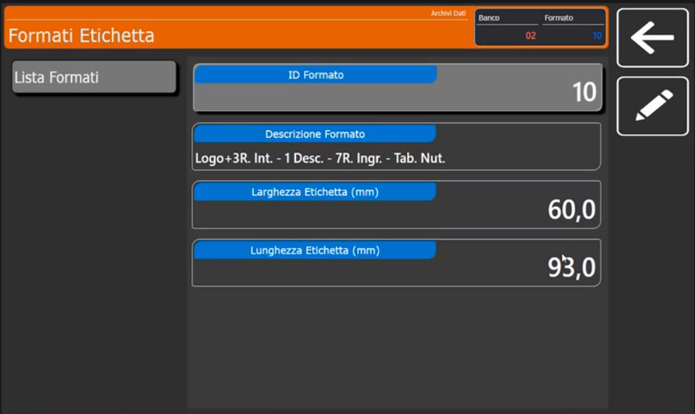

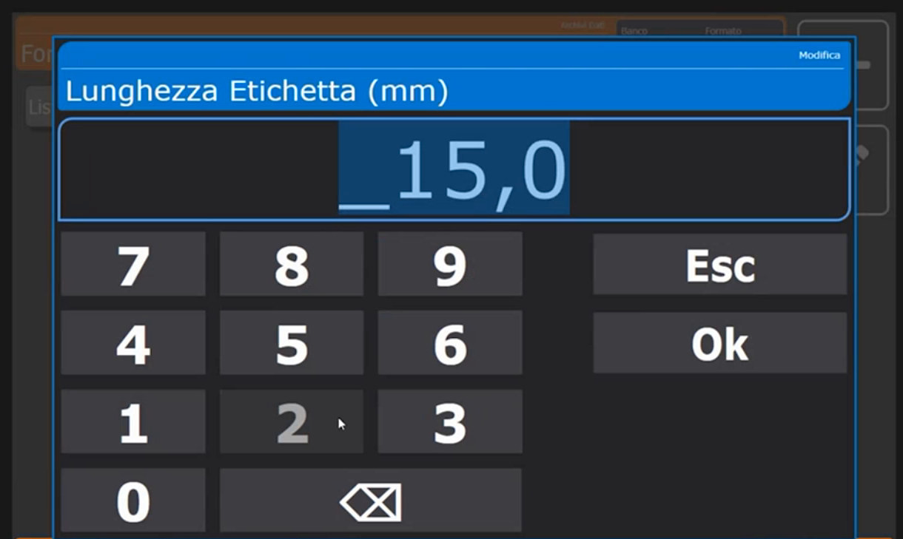

### Proprietà di un oggetto

Toccando un oggetto nell'editor il pannello a sinistra ne mostra le **proprietà**. Il campo **Origine Dato** dice a quale **dato del database** punta l'oggetto.

| Gruppo | Proprietà |
|---|---|
| **Base** | Altezza (mm), Descrizione, Direzione Campo, Lunghezza (mm), Num. Campo, Opzioni Stampa, Posizione x (mm), Posizione y (mm), Tipo Campo |
| **Estese** | Allineamento, Anteprima, **Id Testo**, **Id Tipo**, N. Riga, Numero Caratteri, **Origine Dato**, Primo Carattere, Spessore (mm) |
| **Font** | Cancellato, Corsivo, Dimensione (pt), Font, Grassetto, Proporzione (%), Sottolineato |

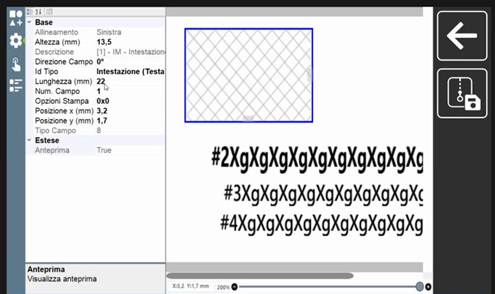

Per modificare una misura tocca la proprietà (per esempio **Lunghezza (mm)**) e usa il tastierino. Nell'esempio la lunghezza del logo passa da 22 a **60**, così occupa tutta la larghezza.

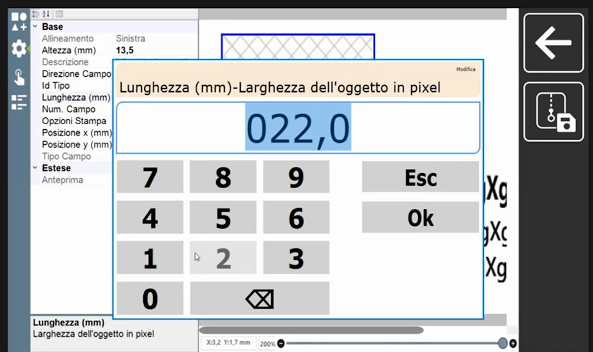

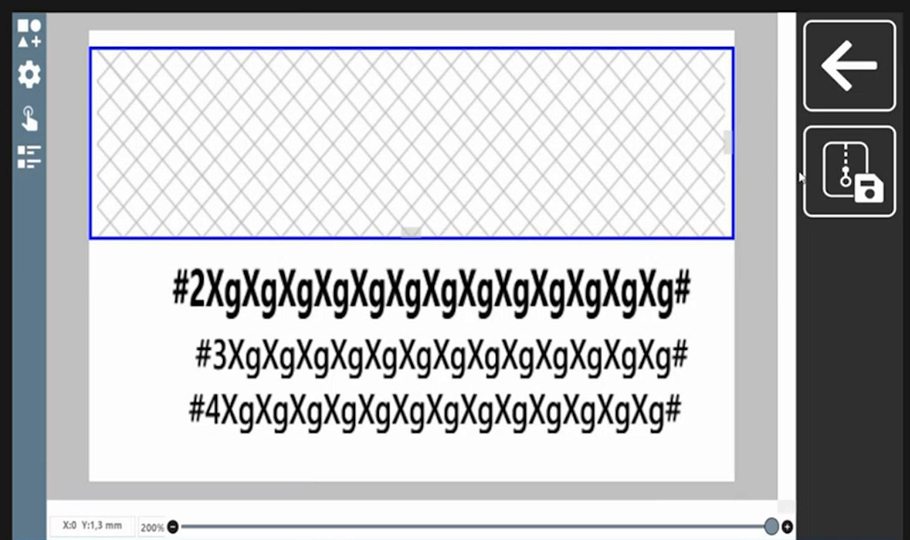

!!! danger "Salva le modifiche"
    Per salvare tocca il **dischetto** in alto a destra nell'editor. Se tocchi la **freccia indietro** si **perdono tutte le modifiche** fatte.

### Ingredienti in più lingue

Un oggetto ingredienti ha **Id Tipo** *(Mr) Multi_Riga* ed **Origine Dato** *Testo PLU*. Il campo **Id Testo** indica a quale **box** dell'articolo fa riferimento: nell'esempio l'etichetta con gli ingredienti in inglese punta al **box 2**.

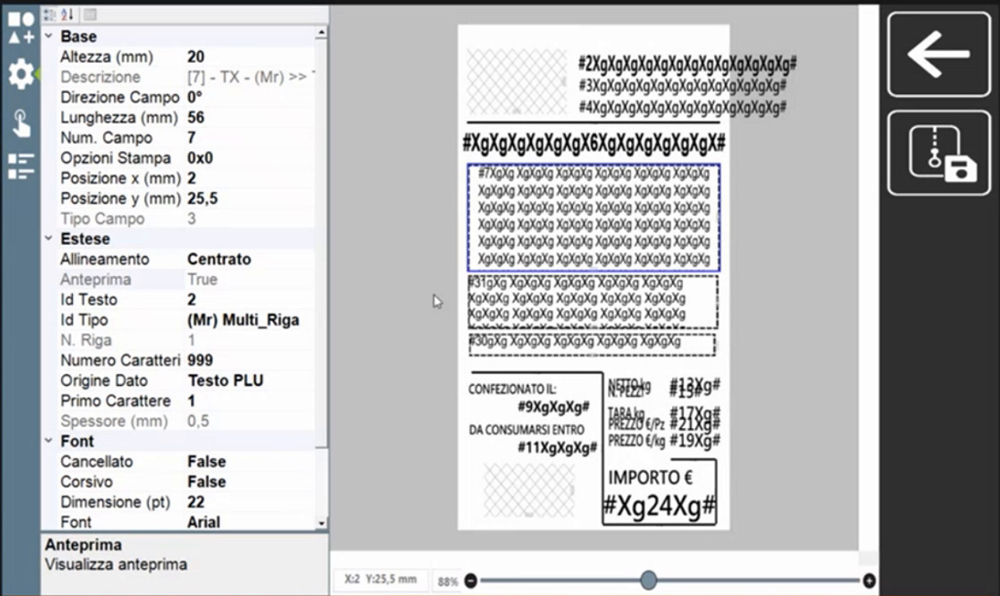

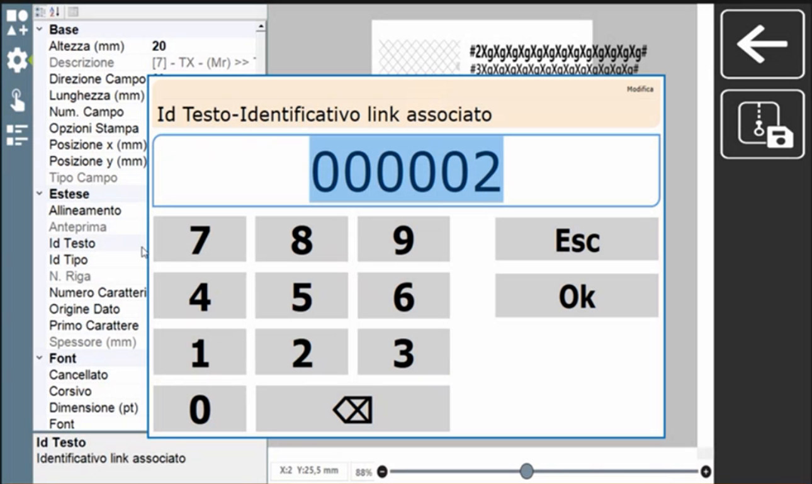

Al posto del testo del box puoi puntare al **puntatore** a una **tabella di testi** (quello che serve, per esempio, in una panetteria che ripete sempre gli stessi ingredienti): vedi [Box ingredienti e tabelle testi](box-ingredienti-testi.md).

### Tracciabilità

Un formato con la tracciabilità ha un oggetto con **Origine Dato** *Tracciabilità Allineata*: un campo **multiriga** con i dati della tracciabilità, allineati.

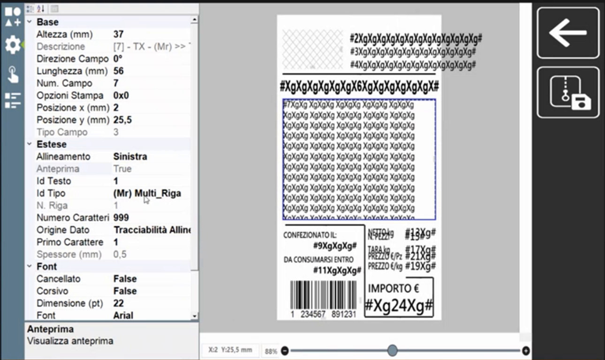

Per etichette più piccole (per esempio **60x75**) il campo completo potrebbe occupare troppo spazio: esiste una modalità alternativa in cui la tracciabilità è **divisa in due colonne**. A sinistra le **definizioni** (le "domande"), a destra le **informazioni del lotto**: serve quando devi sfruttare ogni millimetro.

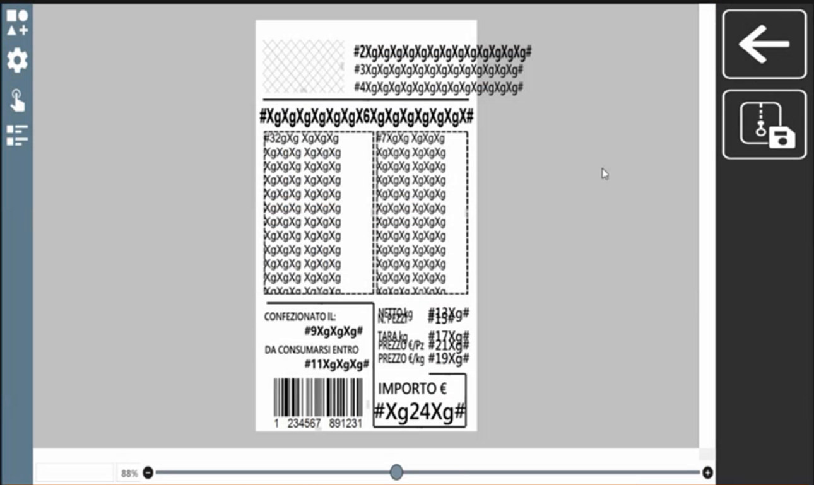

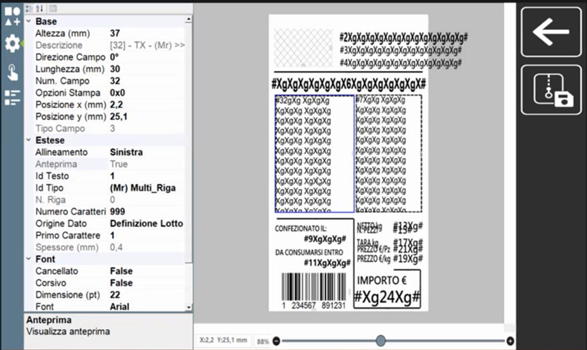

### Lotto di produzione e testo manuale

Nei formati che prevedono il **lotto di produzione** c'è un oggetto con **testo fisso** (per esempio "LOTTO:") e un oggetto dato con **Origine Dato** *Lotto Produzione*: è il valore che si scrive sulla bilancia in fase di etichettatura. Si può agganciare anche al campo che stampa in automatico il **lotto giuliano** (progressivo legato all'anno). Nelle stesse etichette si può aggiungere un **testo libero**, il **testo manuale** (per esempio il nome del cliente).

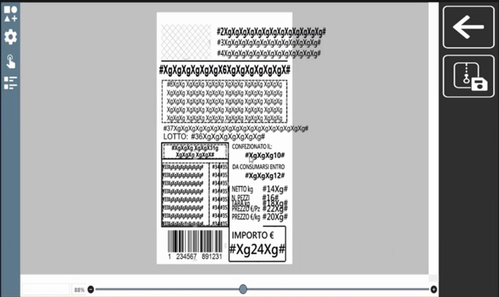

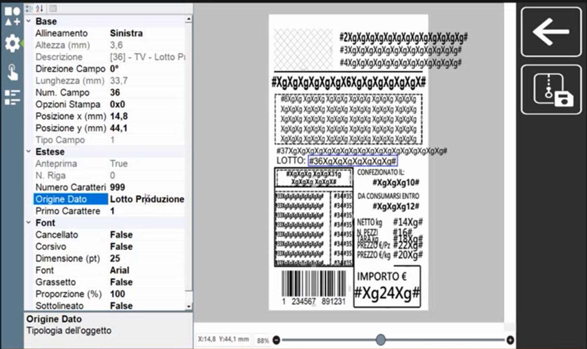

### Logo e immagini

Un oggetto immagine può puntare all'**immagine collegata all'intestazione** dello scontrino, oppure all'**immagine del PLU**: il logo/QR code che si è agganciato all'articolo (vedi [Articoli PLU](articoli-plu.md), scheda **Immagini**).

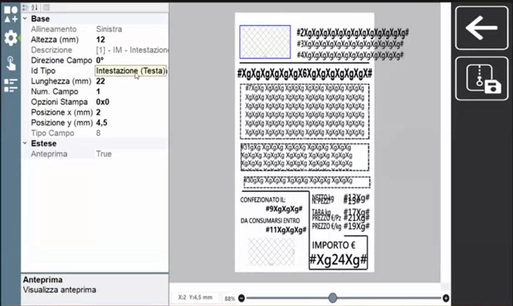

### Tabella nutrizionale

Alcuni formati (quelli con **Tab. Nut.**) contengono la tabella nutrizionale, anche in versione compatta e separata dagli altri campi. Il contenuto viene dall'articolo ([Tabelle nutrizionali](tabelle-nutrizionali.md)).

### Selezione multipla

Per spostare molti campi a destra, a sinistra, in basso, puoi **selezionare più campi contemporaneamente** (con il mouse) e muoverli insieme.

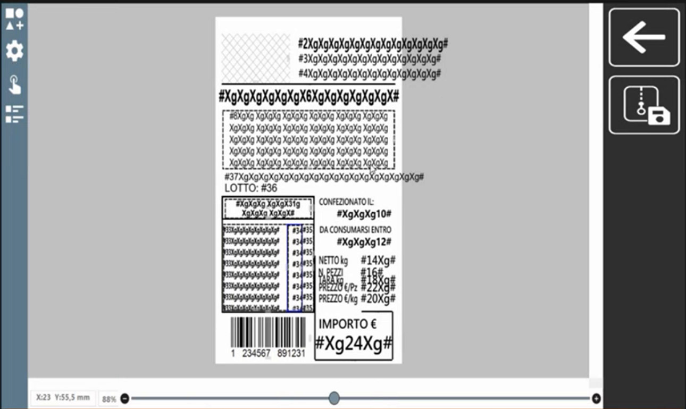

### Prova di stampa e anteprima

Dalla lista dei formati puoi **provare l'etichetta in stampa** (icona in basso a sinistra): la bilancia stampa l'etichetta con **campi fittizi**. Puoi anche vederla a video con campi fittizi, oppure in **anteprima** con i dati letti dal database.

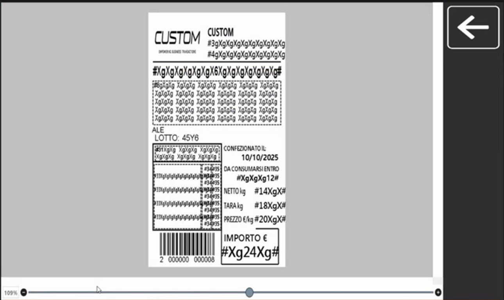

## Verifica

1. Copia e personalizza il formato.
2. Fai una prova di stampa e controlla ingredienti, tracciabilità, lotto, logo e tabella nutrizionale.
3. Assegna il formato: come formato di default in **Opzioni Etichetta** ([Configurazione Operativa](configurazione-operativa.md)) oppure nella scheda **Stampa** dell'articolo ([Articoli PLU](articoli-plu.md)).

## Errori comuni

| Problema | Causa probabile | Rimedio |
|---|---|---|
| L'archivio formati del banco è vuoto | I formati predefiniti non sono ancora stati copiati | Apri la **Lista Formati Pre-Impostati** e copia un formato nel banco |
| L'etichetta è più corta del previsto | Lunghezza non aggiornata | Modifica la lunghezza nel dettaglio del formato |
| Gli ingredienti in inglese non compaiono | **Id Testo** punta al box 1 | Imposta **Id Testo** sul box 2 |
| Le modifiche nell'editor sono andate perse | È stata usata la freccia indietro | Salva sempre con il **dischetto** |
| L'etichetta non mostra la tracciabilità | Formato senza campo di tracciabilità | Scegli un formato "Tracciab." o aggiungi il campo |

!!! tip "Prossimo passo"
    Per la costruzione dei codici a barre: [Formati Barcode](formati-barcode.md).
