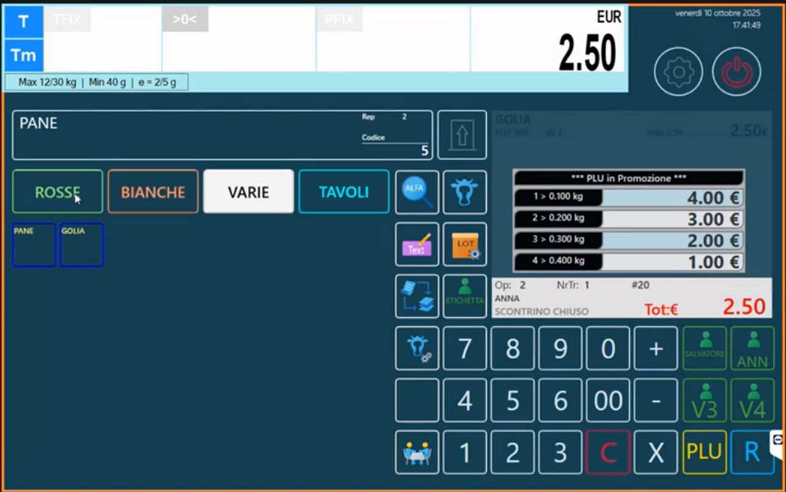
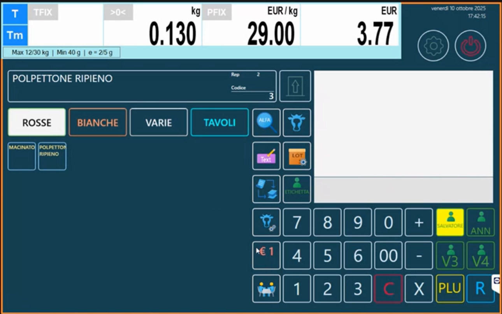
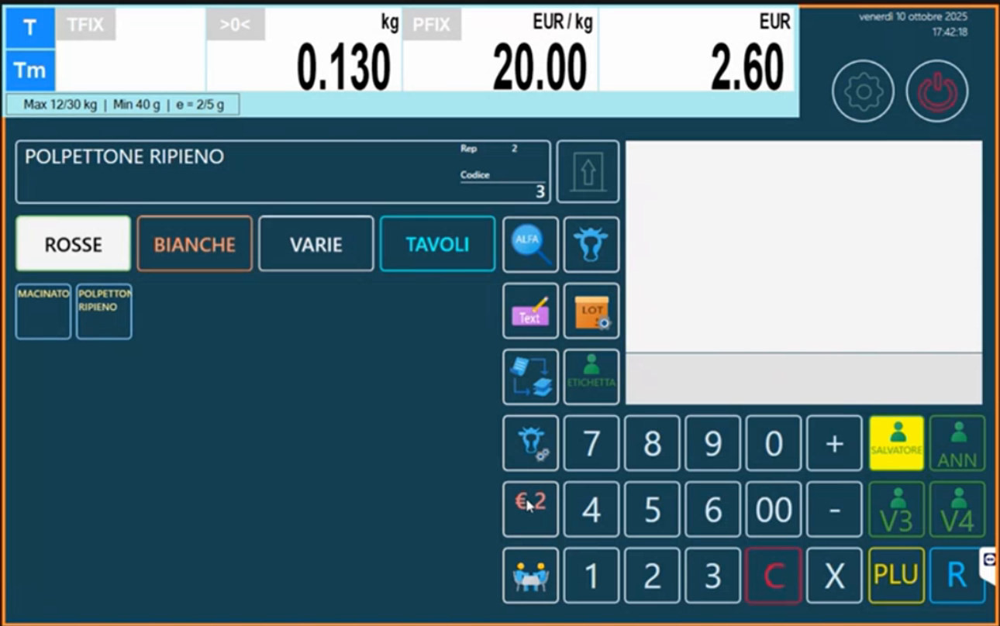
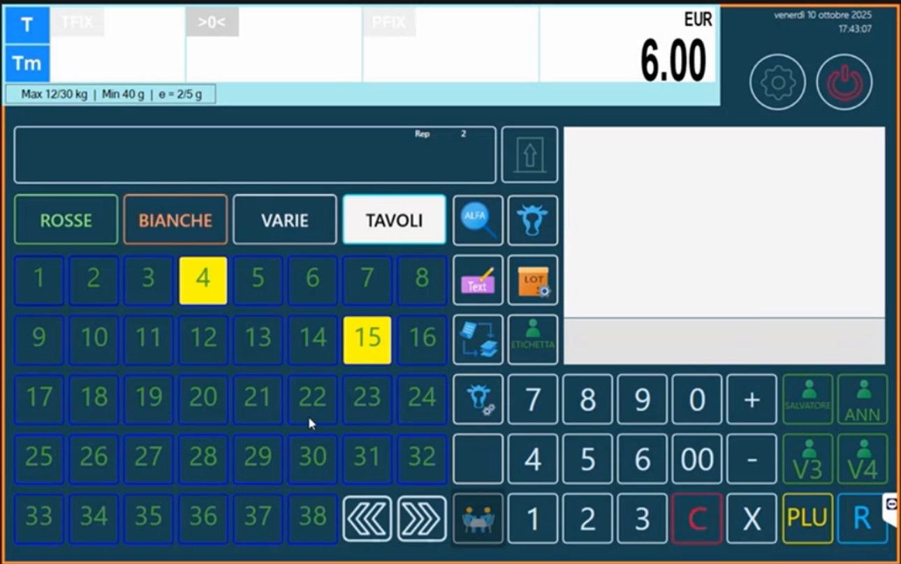
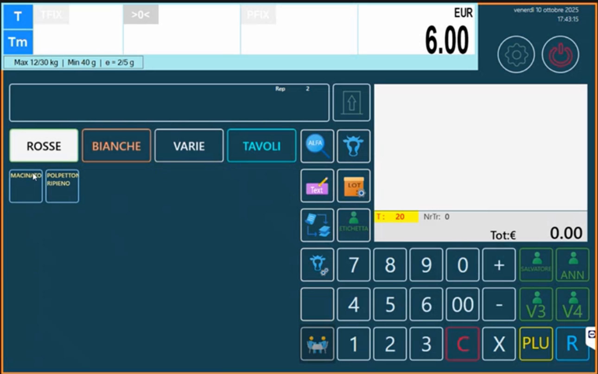
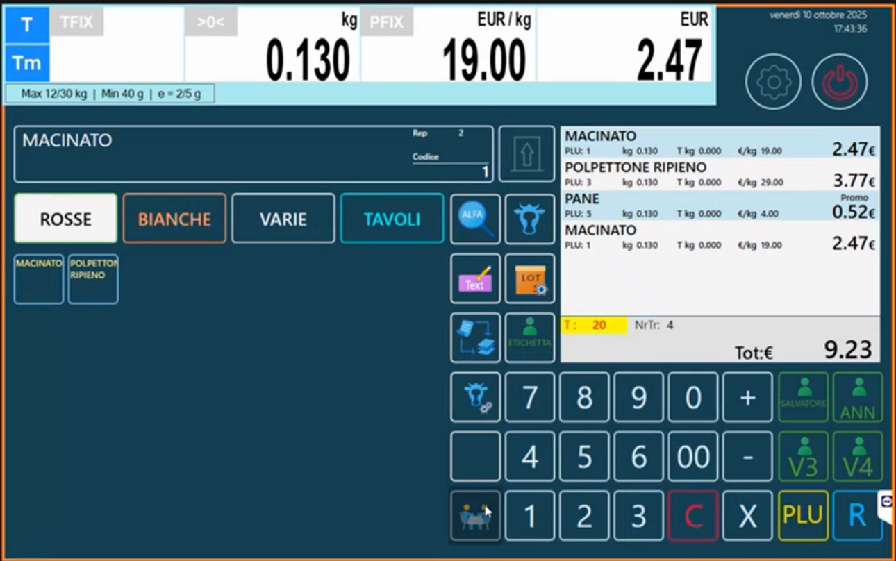
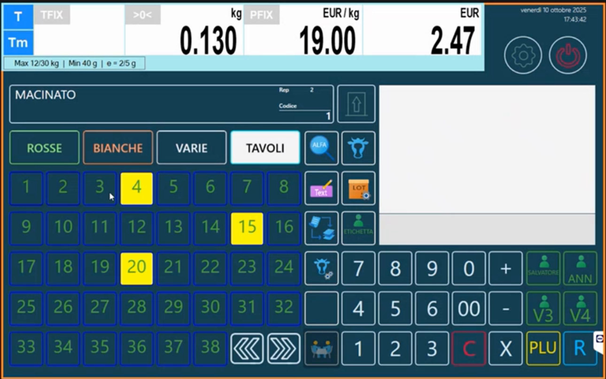
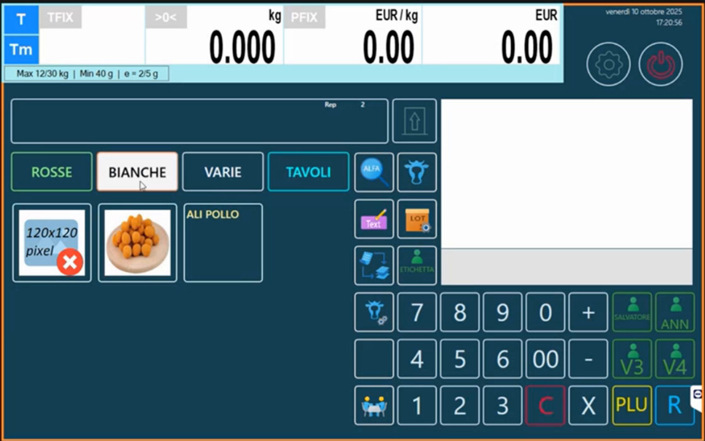

<!-- categoria assegnata per inferenza: verificare (la bilancia Icona non ha una categoria dedicata nell'elenco) -->

# Funzioni di vendita: operatori, listini, tavoli e tastiere con immagini

**Target:** tecnico installatore / rivenditore.

## Obiettivo

Conoscere le funzioni della schermata di vendita in modalità Multipesata e come attivarle: **operatore impegnato**, **doppio listino**, **tavoli e conti sospesi**, **tastiere con tasti grandi e doppi** e **immagini sui tasti**.

## Come si presenta la vendita

Nella tastiera **RETAIL => 4 Operatori** la schermata mostra le **schede** (nell'esempio ROSSE, BIANCHE, VARIE, TAVOLI), i tasti articolo, i tasti funzione e i tasti operatore (**SALVATORE**, **ANN**, **V3**, **V4**).

Per vendere un articolo: tocca l'articolo, appoggia il peso, carica; quando serve lo scontrino tocca l'operatore e poi **totale**. Si possono aggiungere articoli liberi sull'operatore stesso.

## Operatore impegnato

Nelle **Opzioni Multipesata** ([Configurazione Operativa](configurazione-operativa.md)) l'opzione **Visualizza Operatore Impegnato** (disattivata di default) fa **colorare di giallo** il tasto dell'operatore che sta lavorando. Gli altri operatori vedono subito che quel tasto è occupato e non lo usano. Quando lo scontrino viene emesso, il tasto torna libero.

## Doppio listino

Se in anagrafica è definito un **Prezzo Alternativo** ([Articoli PLU](articoli-plu.md), scheda **Extra**) si può passare da **listino 1** a **listino 2** con un tasto funzione dedicato (assegnato in [Configurazione Tastiera](configurazione-tastiera.md)). Il tasto mostra **€ 1** o **€ 2**: cambiando listino cambia il prezzo mostrato sopra. Per esempio, se sei nel mezzo di un lavoro con il listino 1 e devi emettere lo scontrino al listino 2, attivi il listino 2, confermi sull'operatore e vai in chiusura.

## Tavoli e conti sospesi

La scheda **TAVOLI** permette di gestire **conti sospesi** (tavoli occupati e conti aperti). La funzione è in fase di ampliamento. I conti sono **condivisi su tutti i banchi collegati in rete**: non sono legati al banco come lo scontrino, ma valgono indipendentemente dal banco.

Per attivarla tocca **TAVOLI**: si apre una schermata con i tavoli (numeri da 1 a 38, con frecce per scorrere), dove i **tavoli occupati** sono colorati di giallo.

Come si usa:

1. Tocca il tavolo (o il conto) di riferimento: viene indicato in alto.
2. Carica gli articoli che servono.
3. Se non chiudi lo scontrino, il tavolo resta occupato con il suo conto aperto.
4. Per **richiamare il conto**, tocca il tavolo che ti interessa, poi **totale** per fare la chiusura.
5. Toccando di nuovo **TAVOLI** passi dalla modalità tavolo alla modalità bilancia con scontrino normale.

La scheda **TAVOLI** si crea in [Schede Tastiera](schede-tastiera.md) con **Tipo Scheda** *Tavoli*.

## Tastiere con tasti grandi e tasti doppi

Cambiando il **Tipo Tastiera** nelle Opzioni Multipesata la tastiera si trasforma:

| Tipo Tastiera | Risultato |
|---|---|
| **RETAIL => 4 Operatori** | Tasti standard, piccoli |
| **RETAIL Tasti X4** | **Tasti grandi** quadrati |
| **RETAIL Tasti X2** | **Tasti doppi in orizzontale** |
| **RETAIL Tasti X2 (V)** | **Tasti doppi in verticale** |

Passare da una all'altra è molto semplice: **Configurazione Operativa > Opzioni Multipesata > Tipo Tastiera**; uscendo dal configuratore la bilancia si ritrasforma da sola.

### Immagini sui tasti

Con **Abilita immagini tastiera RETAIL** attivo, ogni tasto può mostrare l'**Immagine Tasto** dell'articolo ([Articoli PLU](articoli-plu.md), scheda **Immagini**). Le immagini **non vengono ridimensionate**: devono avere le dimensioni del tasto.

| Tasto | Immagine |
|---|---|
| Quadrato grande | 120x120 pixel |
| Piccolo standard | 60x60 pixel |
| Doppio in orizzontale | 120x60 pixel |
| Doppio in verticale | 60x120 pixel |

Se l'immagine è troppo piccola per il tasto (per esempio una 60x60 su un tasto grande da 120x120) la bilancia non la mostra e visualizza un segnaposto con la dicitura "120x120 pixel" e una croce rossa. Sui tasti doppi, invece, un'immagine 60x60 viene mostrata centrata.

!!! note "Quando conviene usarle"
    Le immagini sui tasti hanno molto effetto in dimostrazione, ma sono **poco pratiche in uso quotidiano**. Per il lavoro di tutti i giorni è preferibile la tastiera Retail standard.

!!! tip "Tastiera Retail anche in etichettatura"
    Nelle **Opzioni Etichetta** il **Tipo Tastiera** si può impostare su **Retail**: in modalità di etichettatura si porta dietro le impostazioni fatte in multipesata.

## Altre funzioni utili in vendita

- **Ingredienti a video**: toccando il nome dell'articolo si vedono gli ingredienti di tutti i box attivi ([Box ingredienti e tabelle testi](box-ingredienti-testi.md)).
- **Promozioni in vendita**: riquadro con le soglie, prezzo ricalcolato, storno dalle pesate ([Promozioni](promozioni.md)).
- **Tasto di pulizia schermo** (**Pulizia Touch**) e **ricerca alfanumerica** (**PLU => Ricerca Alfa**): vedi [Configurazione Tastiera](configurazione-tastiera.md).

## Errori comuni

| Problema | Causa probabile | Rimedio |
|---|---|---|
| Il tasto operatore non si colora | **Visualizza Operatore Impegnato** disattivato | Attivalo in **Opzioni Multipesata** |
| Non si passa da listino 1 a 2 | Manca il tasto funzione o il **Prezzo Alternativo** | Crea il tasto in Configurazione Tastiera e valorizza il prezzo alternativo |
| Compare il segnaposto rosso al posto dell'immagine | Dimensioni dell'immagine non adatte al tasto | Prepara l'immagine alla dimensione del tasto |
| La scheda TAVOLI non compare | **Tipo Scheda** diverso da *Tavoli* | Controlla la scheda in [Schede Tastiera](schede-tastiera.md) |
