<!-- categoria assegnata per inferenza: verificare (la bilancia Icona non ha una categoria dedicata nell'elenco) -->

# Intestazioni, Operatori e Testi: gli archivi di supporto

**Target:** tecnico installatore / rivenditore.

## Obiettivo

Creare l'**intestazione** dello scontrino con righe e logo, aggiungere gli **operatori** con i relativi permessi e creare i record dell'archivio **Testi**, richiamabili dagli articoli.

## Prerequisiti

- La [Configurazione Tastiera](configurazione-tastiera.md) e le [Schede Tastiera](schede-tastiera.md) sono state fatte.
- Gli archivi si trovano nella sezione **Archivi Dati** del menu **Setup Bilancia**. Scorrendo la lista compaiono **Tare**, **Testi**, **Formati Etichetta**, **Tabelle Nutrizionali** e **Promozioni**.

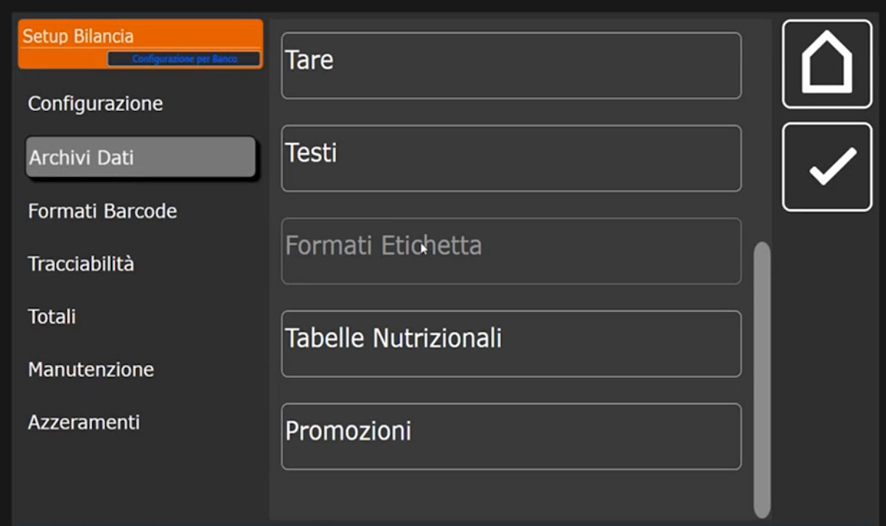

## Intestazioni

L'intestazione personalizza lo **scontrino con i dati del cliente**. La bilancia può avere **più intestazioni**: è utile, per esempio, a chi etichetta per conto terzi. L'intestazione in uso si sceglie nel campo **Intestazione Corrente** della [Configurazione Operativa](configurazione-operativa.md), dove il valore di default è **1**; in Multipesata e in Single Ticket può essere diversa.

### Creare un'intestazione

1. Tocca **+** e crea l'**intestazione numero 1**, quella collegata di default.
2. Nel menu a sinistra tocca **Dati Testa**. I campi sono da **Riga 1 (Testa)** a **Riga 4 (Testa)** e **Logo Testa**.
3. Tocca **Riga 1 (Testa)** e scrivi il testo, per esempio **CUSTOM**: l'intestazione del cliente, con tutte le righe necessarie.

    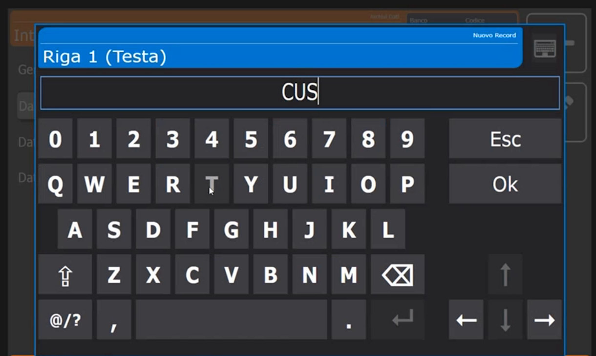

    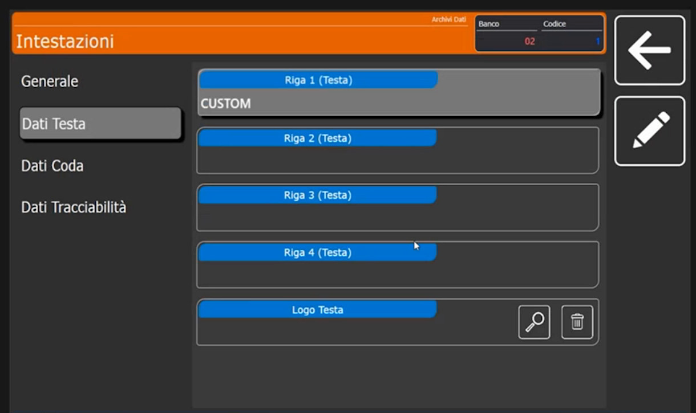

4. **Logo in testa.** Deve essere un file **BMP monocromatico**. Le dimensioni non devono essere necessariamente grandi: la bilancia lo **adatta da sola**.
5. **Dati Coda.** Personalizza le **righe di coda** dello scontrino e permette di aggiungere un ulteriore logo in coda.
6. **Dati Tracciabilità.** Personalizza ulteriori righe di coda legate alla tracciabilità, utili se il prodotto venduto è tracciabile (vedi [Tracciabilità](tracciabilita.md)).

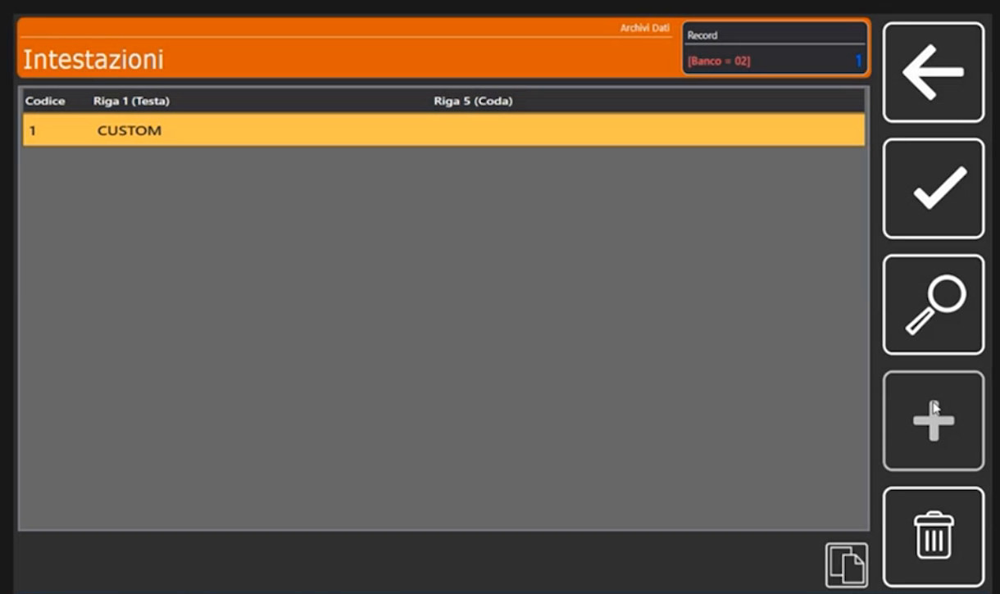

!!! tip "Dove si regola il layout"
    Le righe di testa e di coda sono i **dati**; la loro disposizione sullo scontrino dipende dai formati 50 (testa) e 51 (coda): vedi [Formati Etichetta](formati-etichetta.md).

## Operatori

Gli operatori sono le persone che usano la bilancia. Nella schermata di vendita compaiono come tasti operatore (V1, V2...) con il nome programmato.

### Creare un operatore

1. Tocca **+** e crea l'**operatore numero 1**.
2. Tocca **Nome Operatore** e scrivi il nome, per esempio **SALVATORE**.

    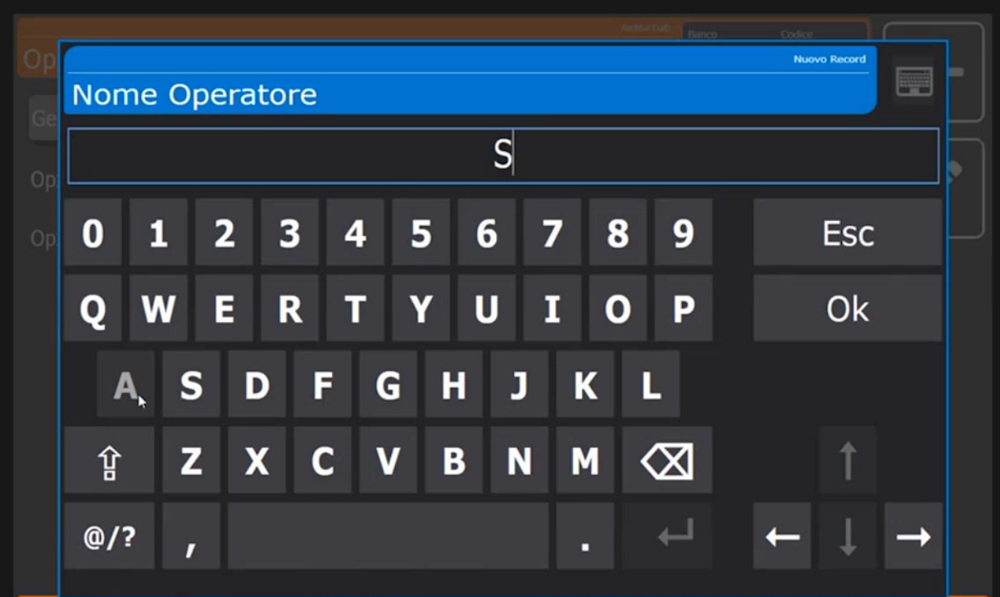

3. Nella scheda **Generale** trovi **Codice Operatore**, **Nome Operatore**, **Operatore Abilitato** (interruttore per abilitarlo o disabilitarlo), **Modalità Single Ticket** e **Modalità Training**.

    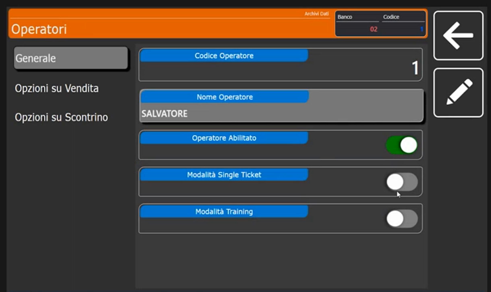

4. **Modalità Single Ticket.** Rende l'operatore un operatore in modalità single ticket: serve quando, lavorando in Multipesata, si vuole ottenere **un'etichetta al volo**. Gli operatori usati da Single Ticket ed Etichetta si indicano nella [Configurazione Operativa](configurazione-operativa.md) (campi **Operatore Single Ticket** e **Operatore Etichette**).
5. **Opzioni su Vendita** e **Opzioni su Scontrino** (menu a sinistra). Permettono di **concedere o negare all'operatore** determinate operazioni. In **Opzioni su Vendita** gli interruttori sono **Modifica Prezzi**, **Utilizzo Sconti**, **Utilizzo Resi**, **Vendite a Corpo** e **Vendite in Sottrazione**, tutti attivi nell'esempio.

    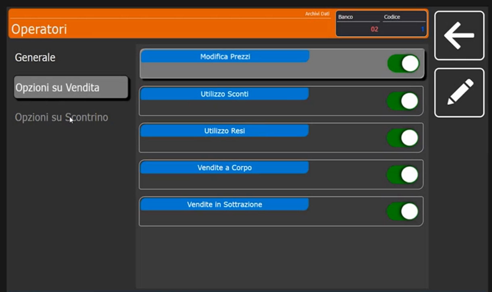

6. Crea gli altri operatori allo stesso modo, per esempio **ANNA**.

    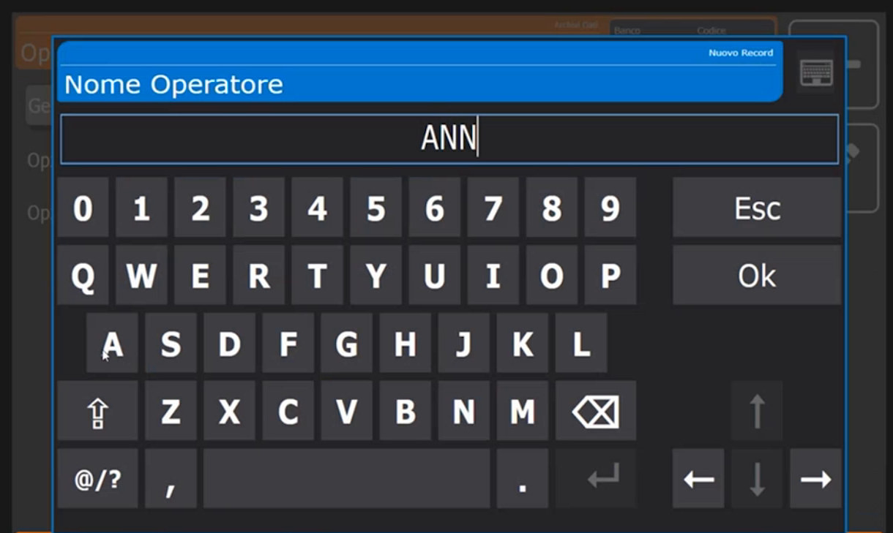

!!! note "Nomi sui tasti"
    Il nome dell'operatore compare sul tasto operatore nella schermata di vendita. La bilancia **adatta da sola la dimensione del testo** al tasto.

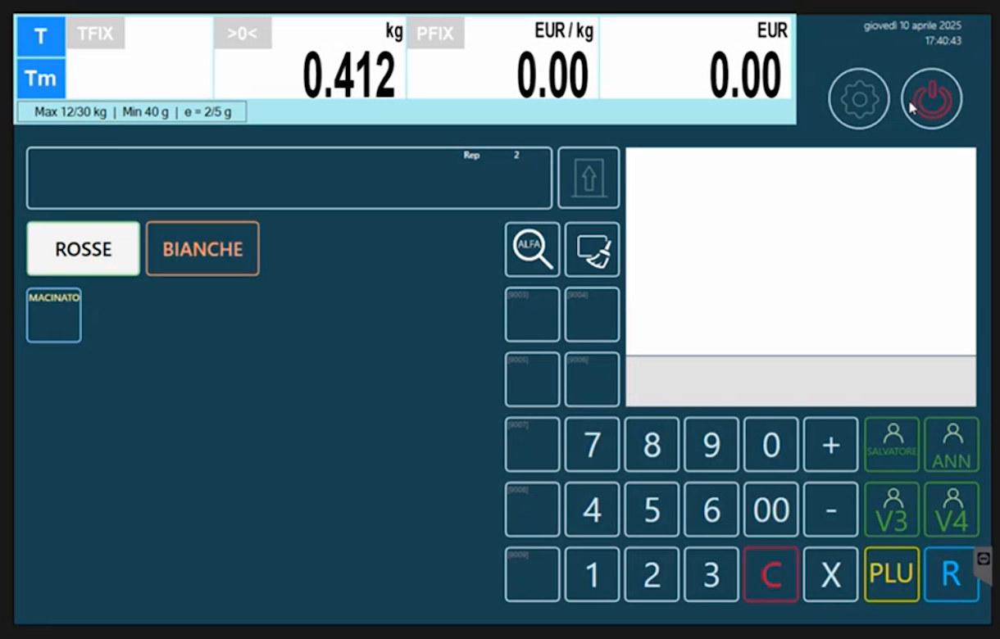

## Testi

L'archivio **Testi** raccoglie testi già pronti che gli articoli possono **richiamare** (campi **Puntatore Tabella Testi (1)**, **(2)** e **(3)** della scheda **Testi** dell'articolo, vedi [Articoli PLU](articoli-plu.md)). Si scrive il testo una sola volta e lo si richiama dove serve: per esempio una frase di conservazione.

1. Tocca **+** e digita il **Codice Testo** **1**.

    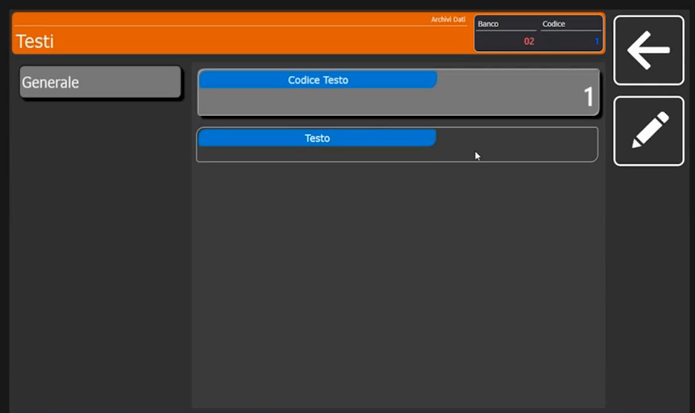

2. Tocca il campo **Testo** e scrivi il contenuto con la tastiera. Nell'esempio il testo è **COTTO**.

    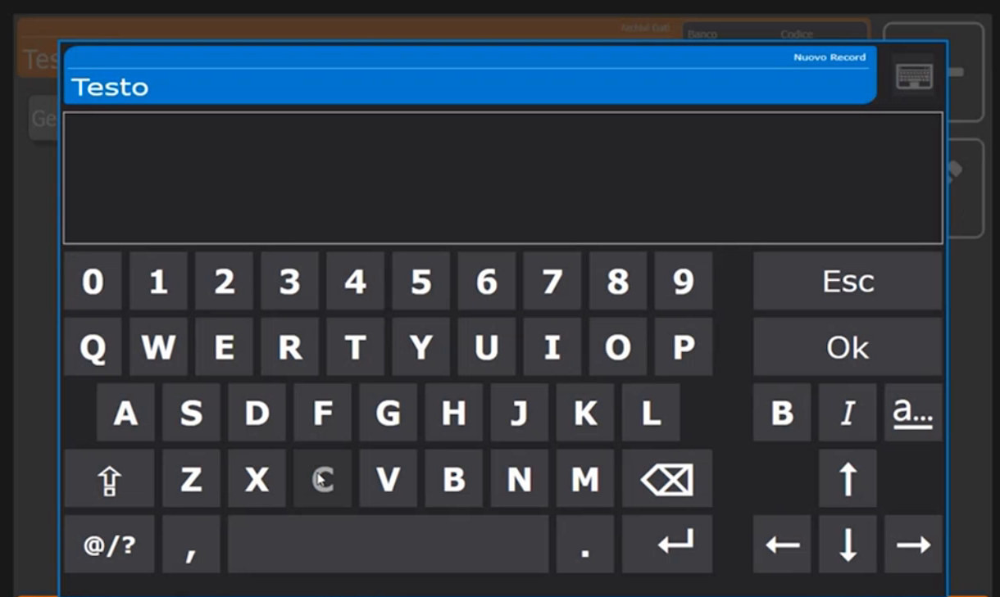

<!-- verificare: durante la dimostrazione la trascrizione parla di una "tara" collegata a un testo, ma la schermata mostra l'archivio Testi (colonne Codice e Testo); si e' documentato l'archivio Testi sulla base dello schermo -->

I testi per box ingredienti, allergeni e consigli d'uso si gestiscono in modo più ampio: vedi [Box ingredienti e tabelle testi](box-ingredienti-testi.md).

## Verifica

L'archivio **Testi** mostra la riga **1 COTTO**; l'archivio **Operatori** elenca gli operatori creati; l'archivio **Intestazioni** mostra la riga CUSTOM.

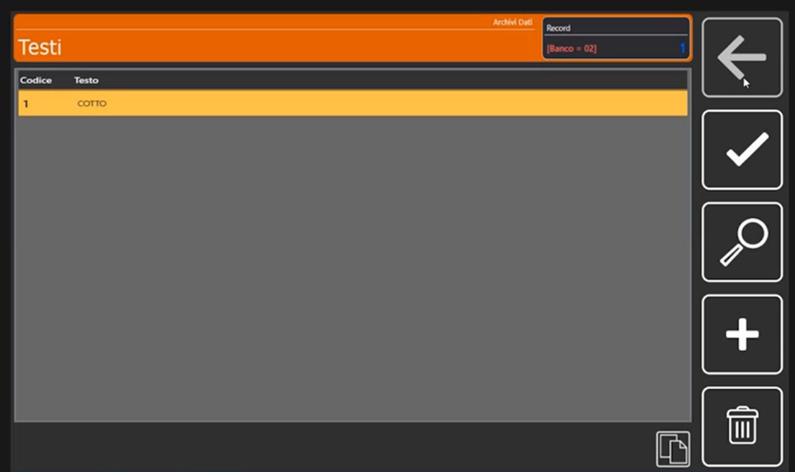

## Errori comuni

| Problema | Causa probabile | Rimedio |
|---|---|---|
| Lo scontrino non riporta l'intestazione attesa | L'**Intestazione Corrente** nella Configurazione Operativa punta a un'altra intestazione | Controlla il numero indicato per la modalità in uso |
| L'operatore non può modificare un prezzo o applicare uno sconto | I permessi nelle **Opzioni su Vendita** sono disattivati | Attiva l'interruttore corrispondente nell'operatore |

!!! tip "Prossimo passo"
    Per disporre testa e coda sullo scontrino e costruire le etichette: [Formati Etichetta](formati-etichetta.md).
