<!-- categoria assegnata per inferenza: verificare (la bilancia Icona non ha una categoria dedicata nell'elenco) -->

# Intestazioni, Operatori e Testi: gli archivi di supporto

**Target:** tecnico installatore / rivenditore · **Video:** Custom Academy, webinar *Icona configurazione di base* (10/04/2025), dal minuto 55:20 al 57:45.

## Obiettivo

Al termine sai creare un'**intestazione** dello scontrino con righe e logo, aggiungere **operatori** con i relativi permessi e creare un record nell'archivio **Testi**.

## Prerequisiti

- La [Configurazione Tastiera](configurazione-tastiera.md) e le [Schede Tastiera](schede-tastiera.md) sono state fatte.
- Il relatore **salta** le voci **Gestione Elimina Code** e **Gestione Ordini** della sezione Configurazione e si sposta direttamente sugli **Archivi Dati**. Dice anche che appena possibile ci sarà un altro webinar su Icona per continuare la parte di configurazione, cercando di non essere troppo lunghi.

## Passaggi

### 1. Apri Archivi Dati

> Nel video: 55:28

Da **Setup Bilancia** tocca **Archivi Dati**. Scorrendo la lista in basso compaiono **Tare**, **Testi**, **Formati Etichetta**, **Tabelle Nutrizionali** e **Promozioni**.

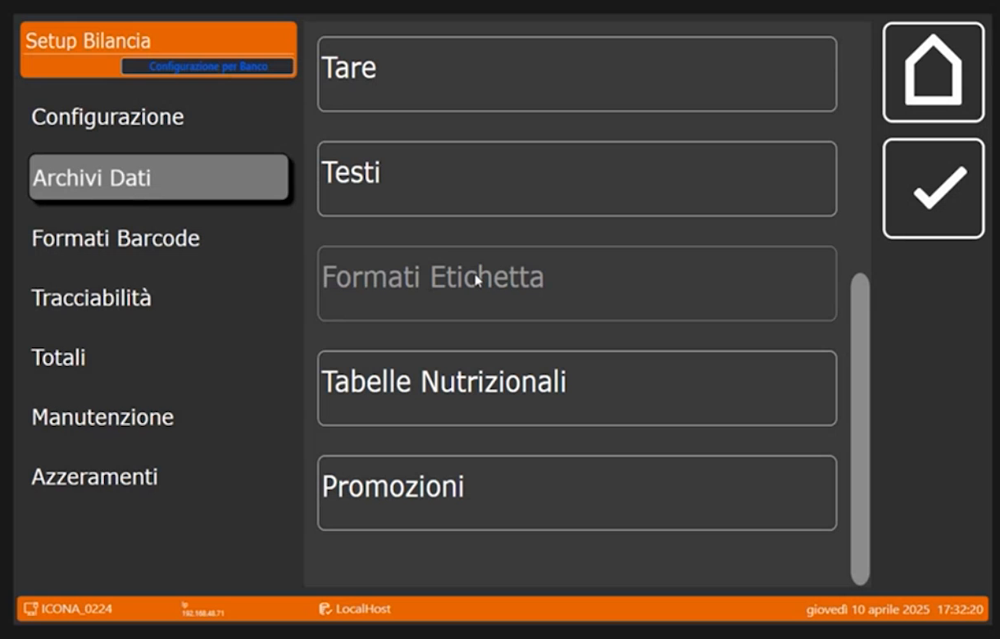

### 2. Intestazioni

> Nel video: 55:32

Il relatore la definisce **molto intuitiva**: serve per personalizzare lo scontrino con i dati del cliente.

1. Tocca **+** e crea l'**intestazione numero 1**, quella che di default era collegata.
2. Nel menu a sinistra tocca **Dati Testa**. I campi sono da **Riga 1 (Testa)** a **Riga 4 (Testa)** e **Logo Testa**.
3. Tocca **Riga 1 (Testa)** e scrivi il testo: per esempio **CUSTOM**, l'intestazione del cliente con tutte le righe.

    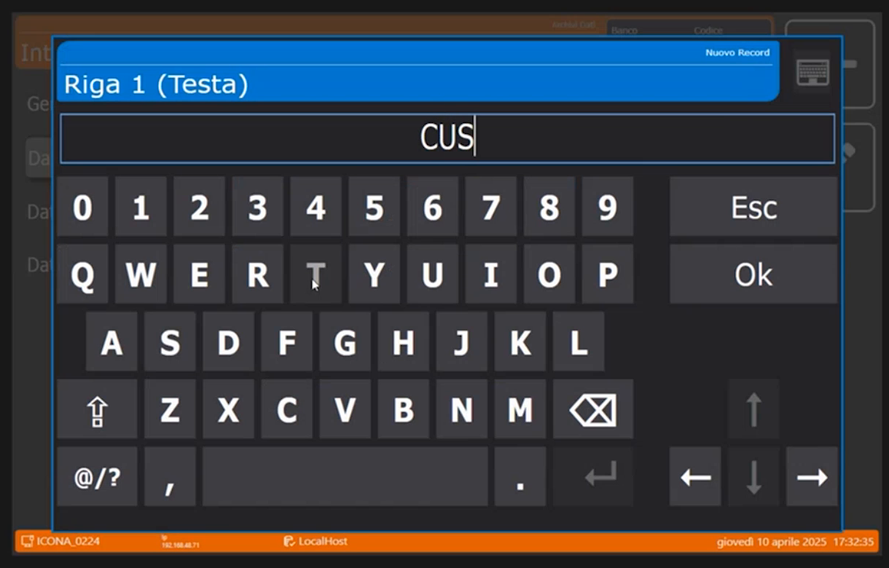

    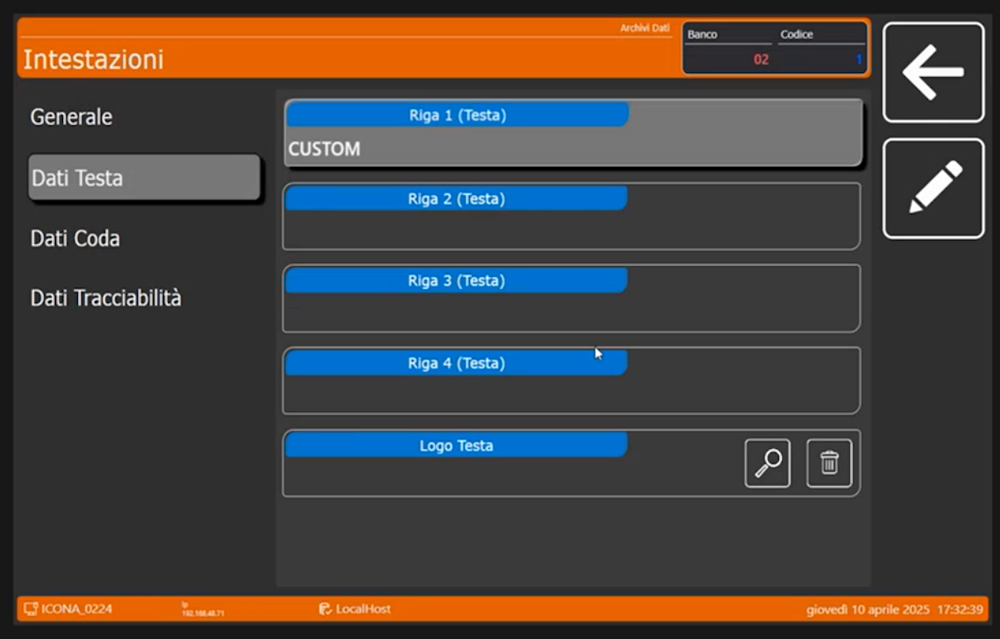

4. Per il logo in testa: deve essere un **BMP monocromatico**; le dimensioni non devono essere necessariamente grandi, perché la bilancia lo **adatta da sola**.
5. Con **Dati Coda** si personalizzano le **righe di coda** dello scontrino e si può aggiungere un ulteriore logo in coda.
6. Con **Dati Tracciabilità** si personalizzano ulteriori righe di coda legate alla tracciabilità, se il prodotto venduto è tracciabile.

È possibile aggiungere **molte intestazioni**.

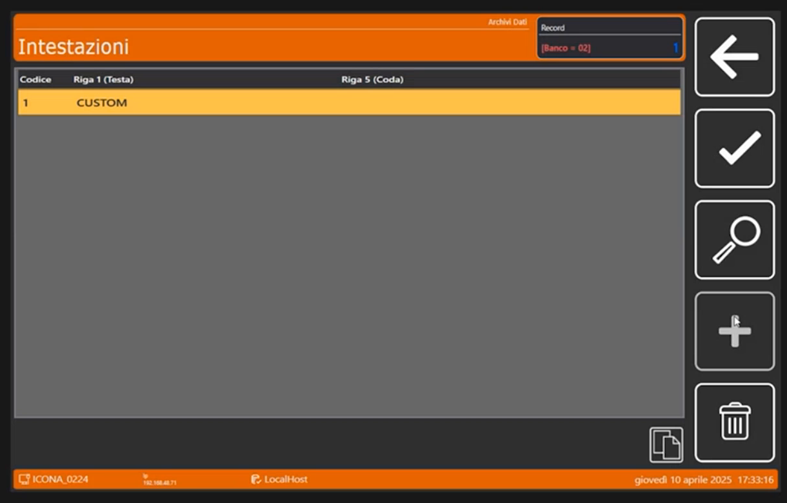

!!! note "Collegamento con la configurazione"
    L'intestazione in uso si sceglie nel campo **Intestazione Corrente** della [Configurazione Operativa](configurazione-operativa.md): vale **1** di default.

### 3. Operatori

> Nel video: 56:24

Anche gli operatori sono intuitivi.

1. Tocca **+** e crea l'**operatore numero 1**. Tocca **Nome Operatore** e scrivi il nome, per esempio **SALVATORE**.

    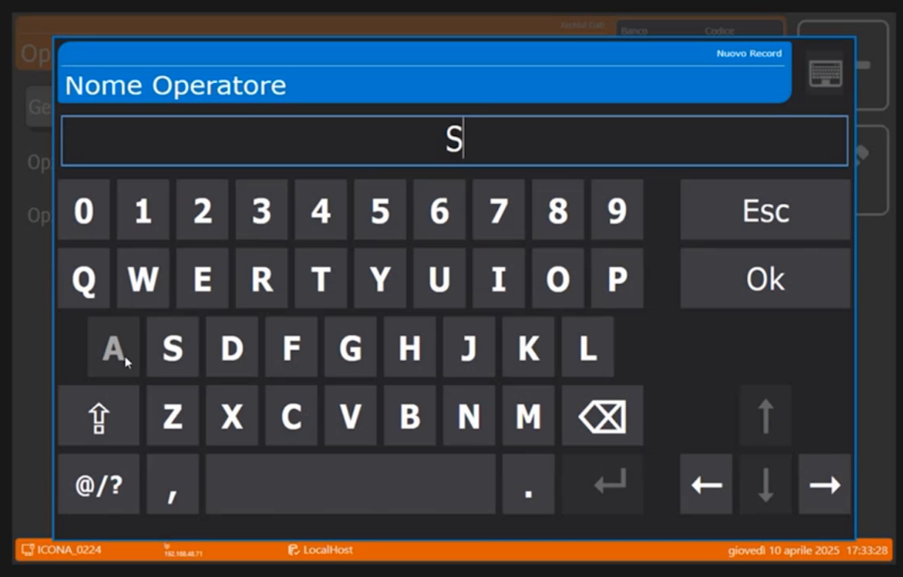

2. Nella scheda **Generale** i campi sono **Codice Operatore**, **Nome Operatore**, **Operatore Abilitato** (interruttore per abilitarlo o disabilitarlo), **Modalità Single Ticket** e **Modalità Training**.

    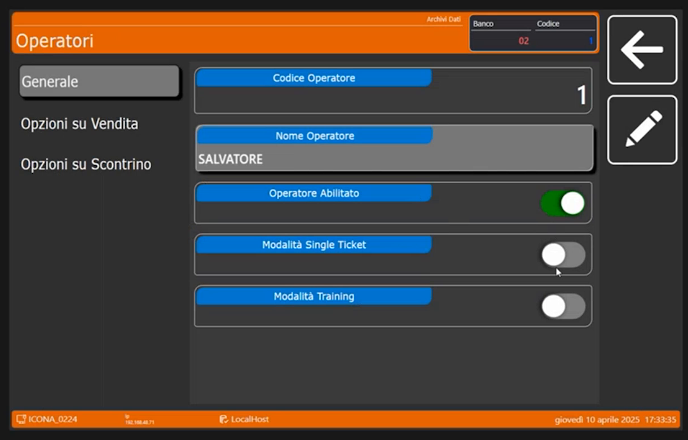

3. **Modalità Single Ticket**: serve ad avere un operatore in modalità single ticket. Il relatore ricorda che si è visto nella presentazione della bilancia, quando si vuole **un'etichetta al volo in modalità Multipesata**.
4. **Opzioni su Vendita** e **Opzioni su Scontrino** (menu a sinistra) contengono i settaggi con cui si può **concedere o non concedere all'operatore** determinate operazioni. In **Opzioni su Vendita** gli interruttori sono **Modifica Prezzi**, **Utilizzo Sconti**, **Utilizzo Resi**, **Vendite a Corpo** e **Vendite in Sottrazione**, tutti attivi nel webinar.

    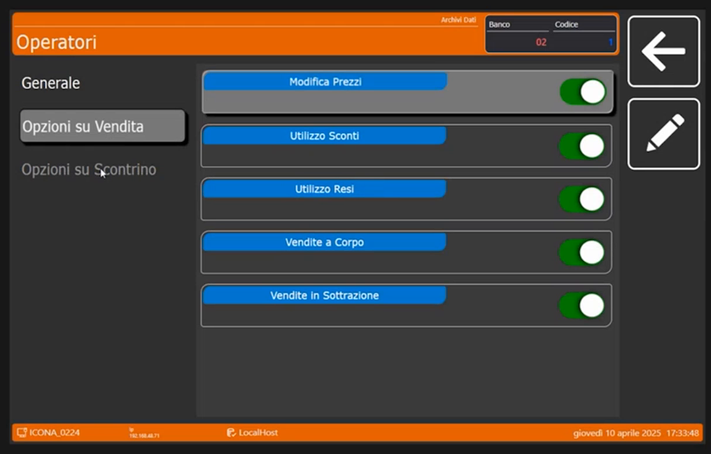

5. Crea velocemente un secondo operatore, per esempio **ANNA**.

    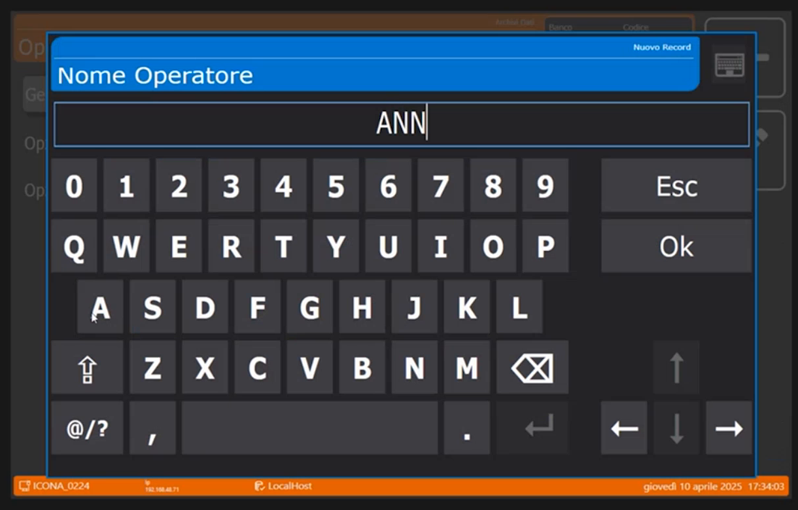

### 4. Testi

> Nel video: 57:17

L'archivio **Testi** raccoglie i testi che si possono richiamare dalle schede dell'articolo (campi **Puntatore Tabella Testi**), come visto nella pagina [Articoli PLU](articoli-plu.md).

1. Tocca **+** e digita il **Codice Testo** **1**.

    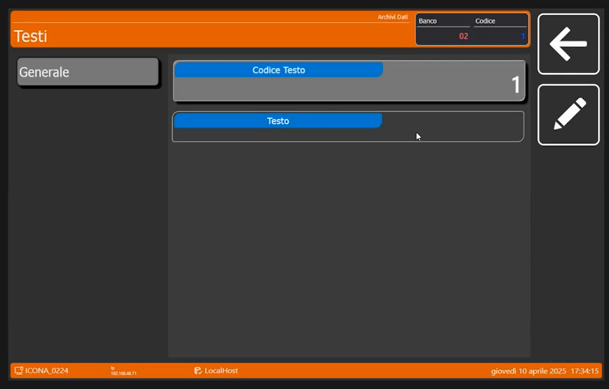

2. Tocca il campo **Testo** e scrivi il contenuto con la tastiera. Nell'esempio il testo è **COTTO**.

    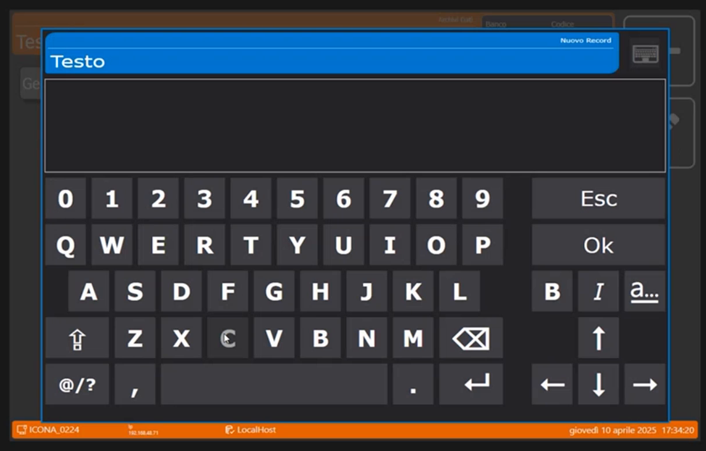

<!-- verificare: a 57:23 la trascrizione automatica riporta "aggiungo una tara numero uno... per esempio cotto", ma la schermata mostra l'archivio Testi (titolo "Testi", colonne Codice e Testo); si e' documentato l'archivio Testi sulla base dello schermo -->

## Verifica

L'archivio **Testi** mostra la riga **1 COTTO**; l'archivio **Operatori** mostra SALVATORE e ANNA; l'archivio **Intestazioni** mostra la riga CUSTOM.

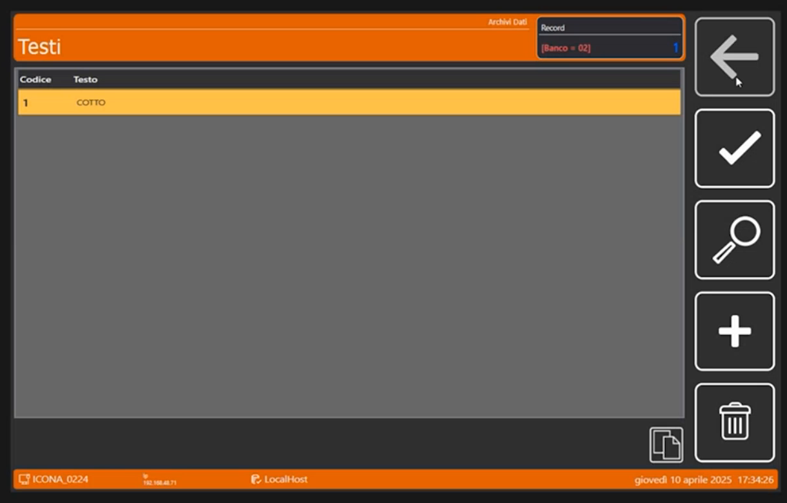

Il relatore precisa che le **Tabelle Nutrizionali** e le **Promozioni** si vedranno prossimamente.

!!! tip "Prossimo passo"
    Il relatore entra nei **Formati Etichetta**, spiegando in particolare il layout grafico dello scontrino: pagina [Formati Etichetta](formati-etichetta.md).
