<!-- categoria assegnata per inferenza: verificare (la bilancia Icona non ha una categoria dedicata nell'elenco) -->

# Lista Banchi: creare i banchi

**Target:** tecnico installatore / rivenditore · **Video:** Custom Academy, webinar *Icona configurazione di base* (10/04/2025), dal minuto 8:22 al 15:40.

## Obiettivo

Al termine sai creare i **banchi** sulla bilancia Icona, impostare i contatori di numerazione (scontrini, etichette, Self Service) e attivare la tracciabilità sul banco che la richiede.

## Prerequisiti

- La bilancia Icona è appena arrivata: **nessuna programmazione** e tastiera di default preconfigurata.
- Accesso al **configuratore**, che è già a bordo della bilancia.

!!! note "Il configuratore è un punto di accesso al database"
    Il configuratore a bordo bilancia si può installare anche su un PC, in forma di **VirtualScale**: in entrambi i casi è solo un punto di accesso al database. Si possono quindi costruire reti di bilance interconnesse, con una bilancia principale e le altre come punti di accesso al database.

## Il concetto di banco

La prima operazione da fare, appena arriva la bilancia, è **creare i banchi**: Icona è una bilancia **multibanco**, quindi sulla stessa bilancia possono esistere più banchi.

Il relatore spiega il concetto così: nella GDO ci sono più bilance interconnesse che appartengono a banchi diversi, per esempio **banco salumeria** e **banco macelleria**. Pur essendo collegati alla stessa struttura, i banchi hanno bisogno di **layout grafici della tastiera e database di riferimento completamente diversi**. Esisterà quindi il PLU numero 1 della macelleria e anche il PLU numero 1 della salumeria, e le due configurazioni coesistono sulla stessa bilancia. Il banco serve sia per una bilancia destinata al retail sia per una piccola GDO: bisogna sempre gestirlo.

## Passaggi

### 1. Parti dalla schermata di vendita di default

> Nel video: 8:22

La bilancia arriva senza programmazione e con la tastiera di default.

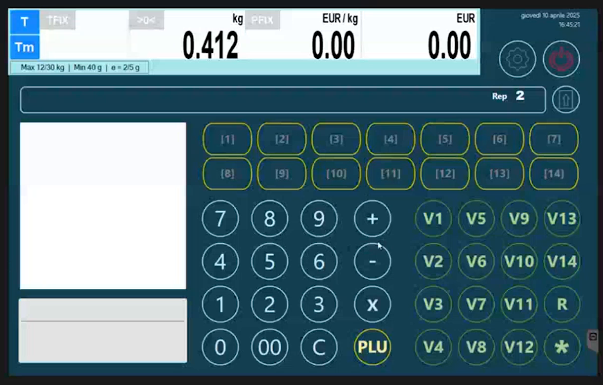

### 2. Apri il configuratore

> Nel video: 8:40

Dalla schermata di vendita il relatore entra nel **configuratore**, che si presenta con il menu **Setup Bilancia**. A sinistra le sezioni (Configurazione, Archivi Dati, Formati Barcode, Tracciabilità, Totali, Manutenzione, Azzeramenti); a destra le voci della sezione **Configurazione**: Collegamenti, Lista Banchi, Bilancia, Configurazione Operativa, Configurazione Tastiera e altre in fondo alla lista.

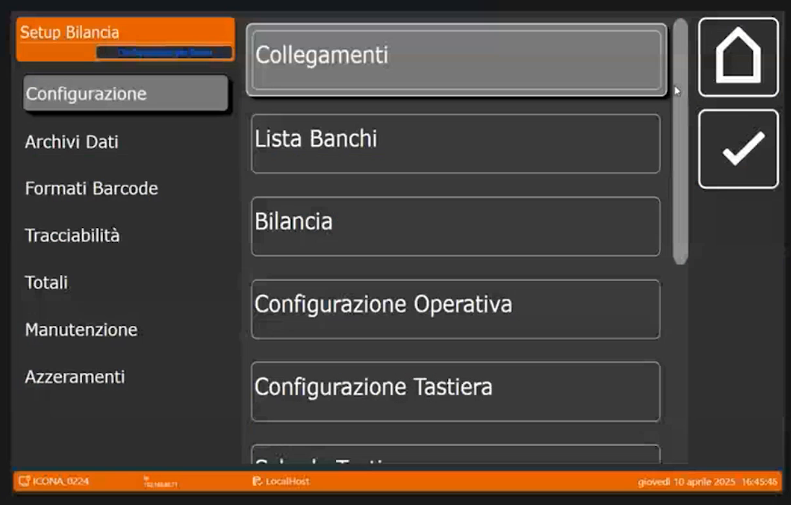

!!! warning "Da verificare"
    Il relatore dice solo «andiamo nel configuratore». Nel video la schermata di vendita resta invariata fino a circa 8:53 e il menu Setup Bilancia compare subito dopo, senza che il tocco si veda. In alto a destra nella schermata di vendita c'è un'icona a forma di ingranaggio, ma il video non conferma che sia quella da usare: verifica la procedura sulla bilancia.

### 3. Seleziona Lista Banchi

> Nel video: 9:28

Tocca **Lista Banchi**. La lista dei banchi va compilata **prima** di qualsiasi altra configurazione.

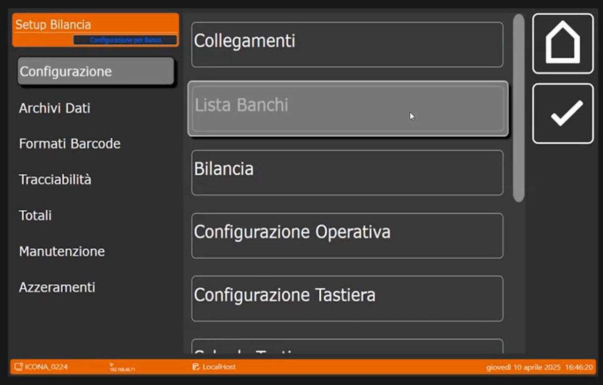

La lista è vuota: le colonne sono **Banco**, **Nome**, **Tracc.** e **New Prg.**. A destra c'è il pulsante **+** per aggiungere un banco.

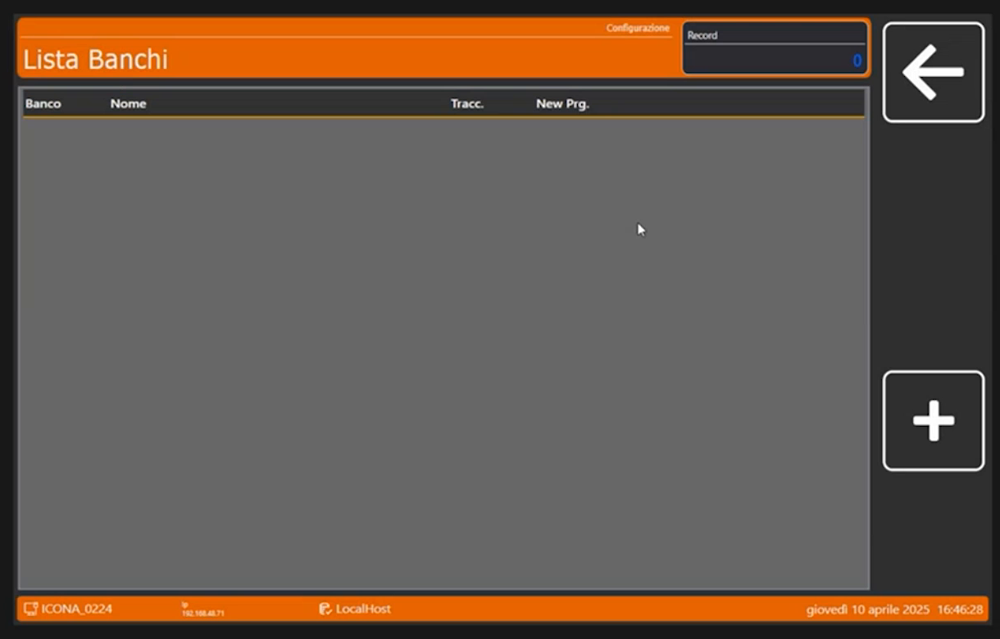

### 4. Crea il banco numero 1

> Nel video: 10:40

Tocca **+**: si apre il tastierino **Numero Banco**. Digita **1** e conferma con **Ok**.

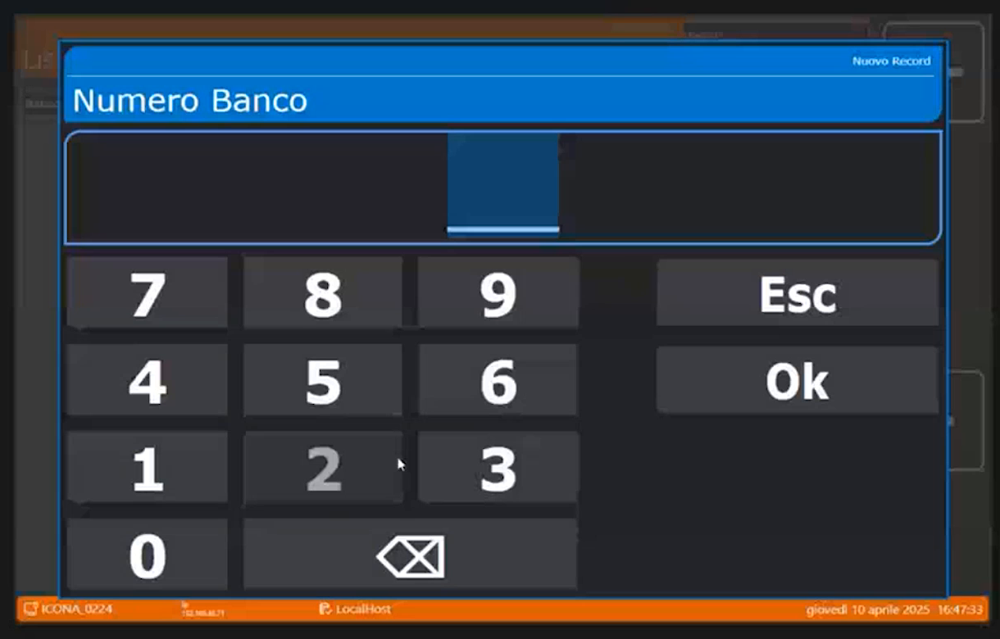

Si apre la scheda del nuovo banco, sezione **Generale**, con i campi **Numero Banco**, **Nome Banco**, **Abilita Tracciabilità** e **Nuovo progressivo per riapertura**. Il relatore la descrive come una procedura molto intuitiva: la bilancia guida su ciò che si deve fare con il banco.

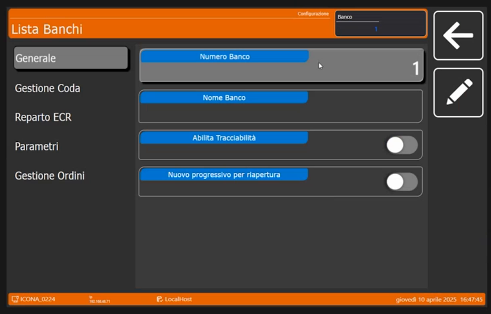

### 5. Assegna il nome al banco

> Nel video: 10:57

Tocca la **matita** (in alto a destra): si apre la tastiera alfanumerica con titolo **Nome Banco**. Scrivi il nome, per esempio **SALUMERIA**, e conferma con **Ok**.

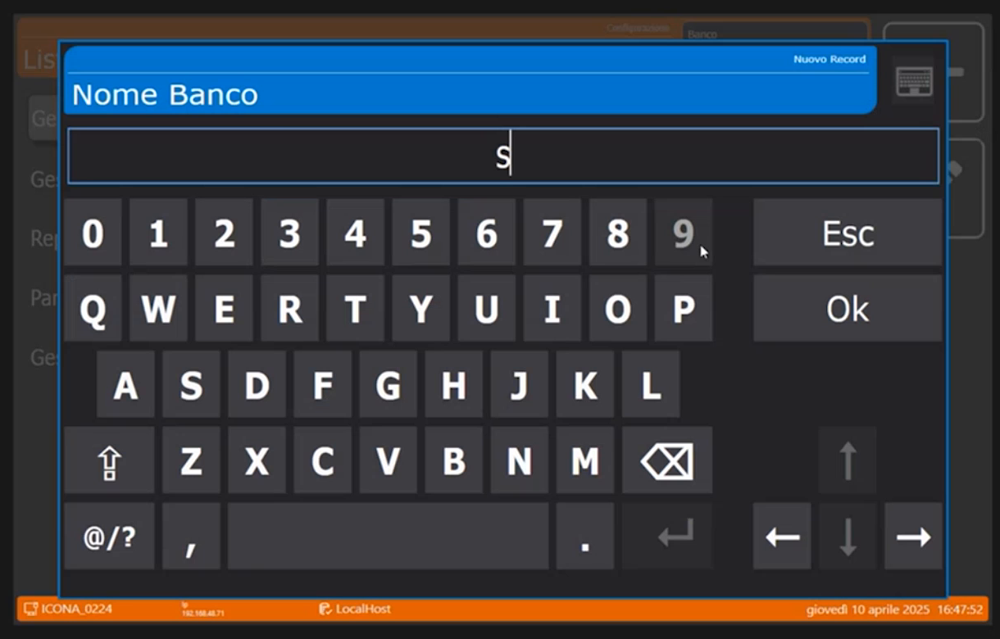

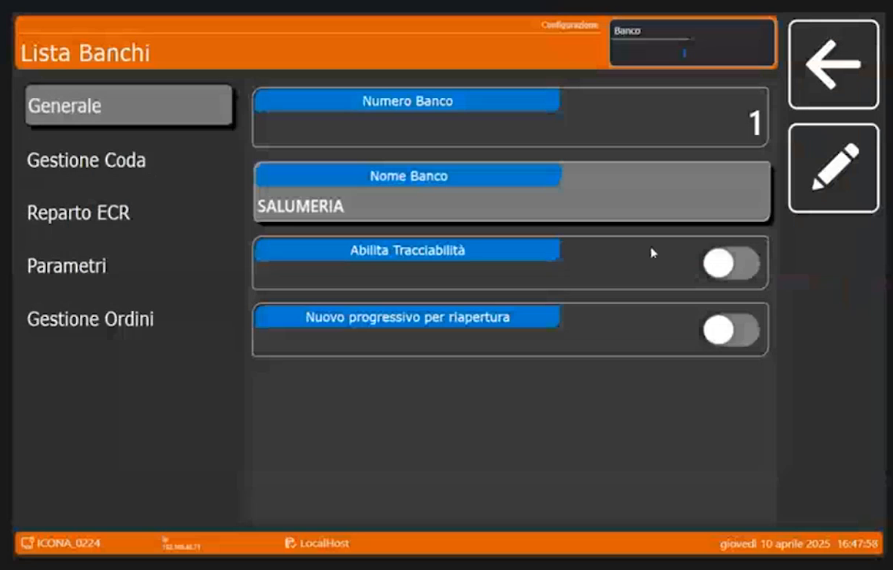

!!! note "Tracciabilità"
    Per la salumeria non serve gestire la tracciabilità, quindi **Abilita Tracciabilità** resta disattivato. Il relatore dedicherà ai webinar successivi una giornata intera alla tracciabilità, che è una gestione diversa da quella dei lotti e delle tabelle nutrizionali: oggi si tocca solo velocemente.

### 6. Scorri il menu laterale del banco

> Nel video: 11:37

Nella scheda del banco, a sinistra, compare un menu che facilita la configurazione: **Generale**, **Gestione Coda**, **Reparto ECR**, **Parametri**, **Gestione Ordini**.

**Gestione Coda** contiene i campi **ID Reparto Elimina Code**, **Numero Reparto (x Visel)**, **Colore Carattere** (Black) e **Colore Sfondo** (White).

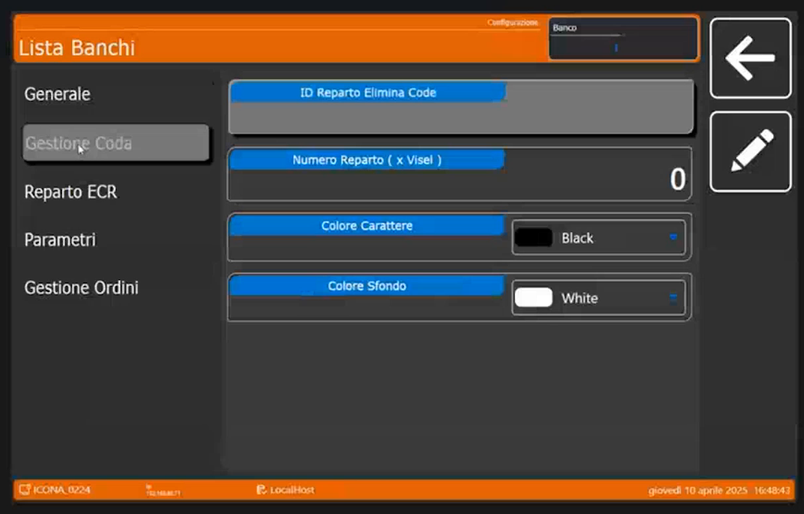

**Reparto ECR** riguarda la modalità di connessione con l'ECR e contiene i campi **Numero Reparto** e **Nome Reparto**.

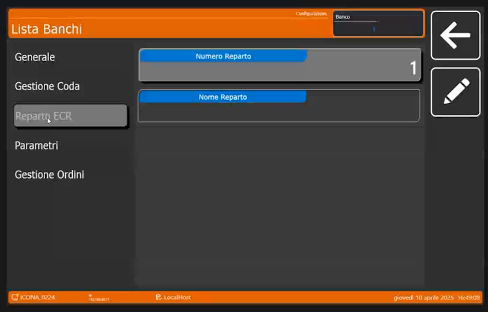

### 7. Imposta i contatori in Parametri

> Nel video: 12:13

Tocca **Parametri**. Di default la bilancia **non identifica la numerazione di scontrini, etichette e progressivi**: tutti i valori partono da 9999 e vanno impostati. I campi sono **Min Progressivo** e **Max Progressivo** per tre tipi di documento: **Scontrino**, **Etichetta** e **Self Service**.

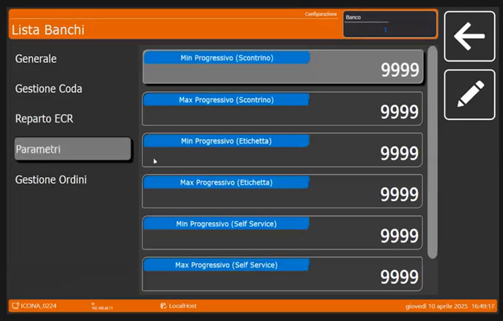

Per ogni contatore tocca il campo: si apre il tastierino con il valore corrente.

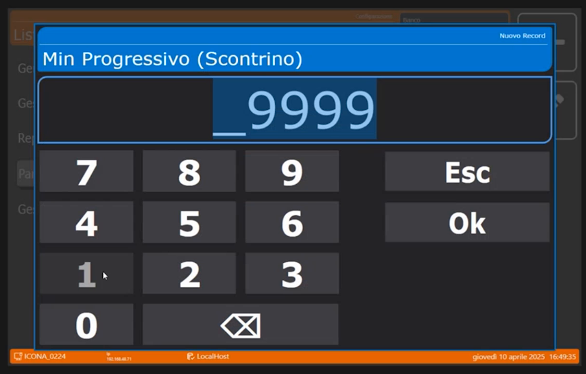

- Il **minimo** va portato a **1**: "come logica sarà uno".
- Il **massimo** del progressivo scontrino, anziché finire a 4 cifre, si può impostare anche a **3 cifre**. Nel webinar il relatore inserisce **999** per mostrare l'opzione; nella schermata successiva il massimo risulta di nuovo a **9999**.

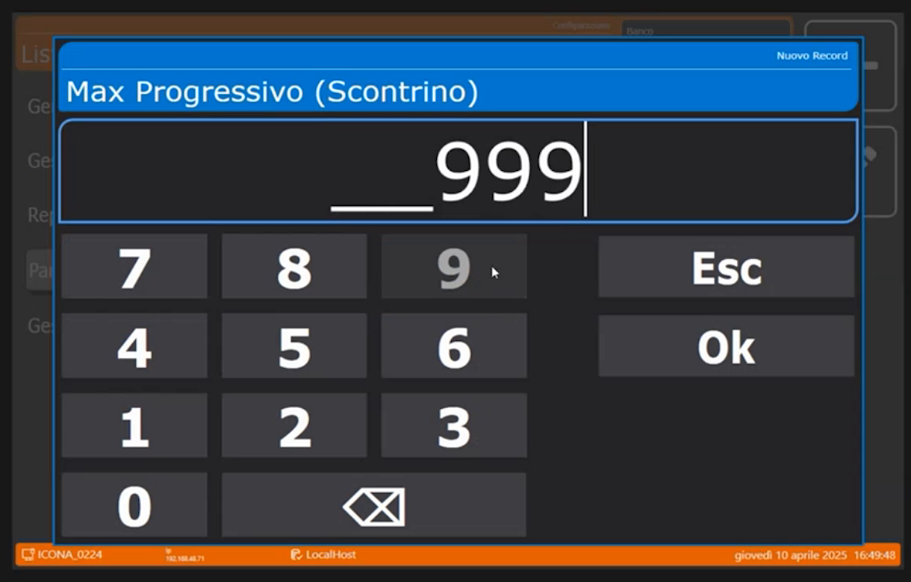

!!! warning "Perché questo parametro conta"
    Il valore giusto dipende da come si usa la bilancia. Se è **stand alone**, senza applicativi esterni a cui fare riferimento, è meno critico. Se la bilancia è **connessa a un dispositivo o interfacciata a un PC** che fa una sorta di esposizione scontrino, il parametro diventa molto importante: il progressivo viene tracciato non solo in visualizzazione ma anche sulla **stampa dello scontrino grafico**, e deve poi essere ripreso nella lettura del codice a barre.

Ripeti per **Min Progressivo (Etichetta)** e **Min Progressivo (Self Service)**. Il relatore conclude: ci si assicura che i contatori siano strutturati in modo logico, da un minimo a un massimo.

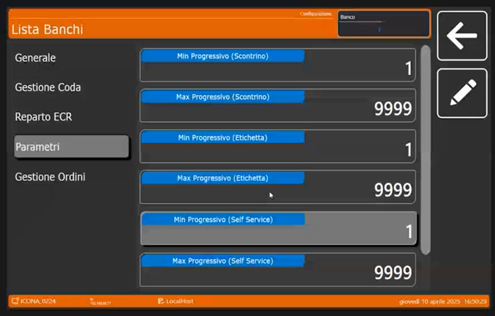

<!-- verificare: la trascrizione riporta "lettura dell'EAM"; interpretato come lettura del codice a barre (EAN) -->

### 8. Lascia stare Gestione Ordini

> Nel video: 13:38

**Gestione Ordini** non si tocca: è stata creata ad hoc per una parte della GDO. Il relatore anticipa che nei prossimi mesi verrà ampliata, per permettere anche a software house più piccole di gestire gli ordini sulla bilancia o direttamente dalla bilancia. È un lavoro in corso.

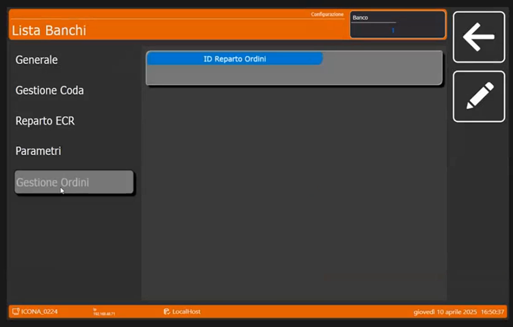

### 9. Aggiungi il secondo banco: MACELLERIA

> Nel video: 14:17

Il banco 1 è creato e compare in **Lista Banchi**. Per mostrare che la bilancia è multibanco, il relatore aggiunge un secondo banco.

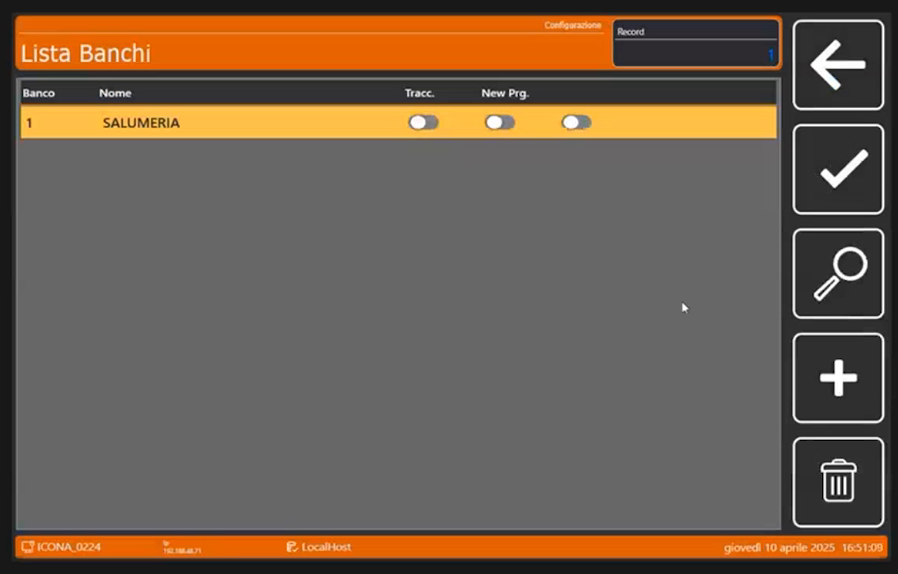

Tocca di nuovo **+**, digita **2**, poi assegna il nome **MACELLERIA** con la tastiera.

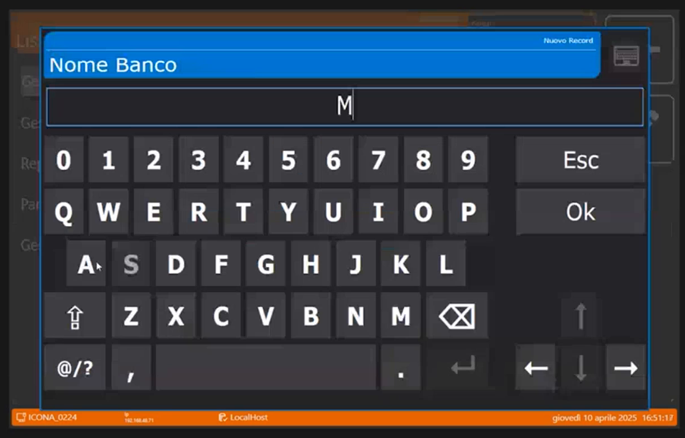

Nella macelleria si attiva **Abilita Tracciabilità**, perché i prodotti di questo settore merceologico, per circa il 90%, subiscono la gestione della tracciabilità. Il selettore diventa verde.

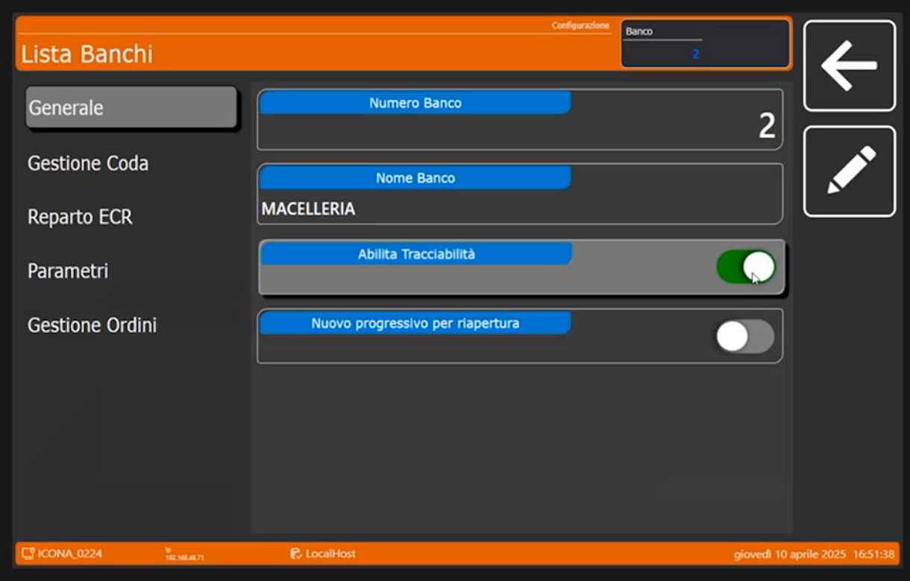

## Verifica

Torna alla **Lista Banchi**: devono comparire due righe, **1 SALUMERIA** e **2 MACELLERIA**, con l'indicatore **Tracc.** acceso solo sulla macelleria.

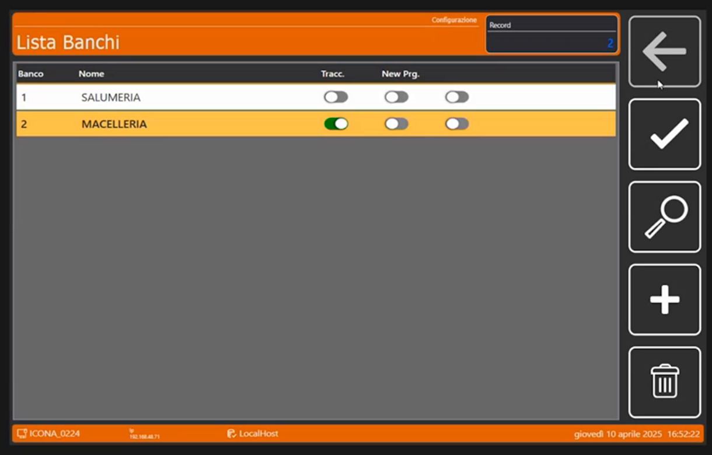

!!! tip "Prossimo passo"
    Prima di attivare un banco sulla bilancia, il relatore fa un passo indietro e configura i **[Collegamenti](collegamenti.md)**.
