<!-- categoria assegnata per inferenza: verificare (la bilancia Icona non ha una categoria dedicata nell'elenco) -->

# Lista Banchi: creare e gestire i banchi

**Target:** tecnico installatore / rivenditore.

## Obiettivo

Creare i **banchi** sulla bilancia, impostare i contatori di numerazione e attivare la tracciabilità sui banchi che la richiedono. È la **prima operazione** da fare quando si riceve una bilancia Icona.

## Il concetto di banco

Icona è una bilancia **multibanco**: sulla stessa bilancia possono coesistere più banchi (per esempio **salumeria** e **macelleria**). Un banco può lavorare da solo oppure, con le impostazioni giuste, la bilancia può lavorare in multibanco, passando da un banco all'altro con le schede della tastiera (vedi [Schede Tastiera](schede-tastiera.md)).

Ogni banco ha **tastiera, archivio articoli e impostazioni propri**. Nella grande distribuzione le bilance di banchi diversi possono essere collegate alla stessa struttura ma hanno bisogno di layout e database di riferimento completamente diversi: esisterà il PLU numero 1 della macelleria e anche il PLU numero 1 della salumeria, e le due configurazioni coesistono sulla stessa bilancia. Il banco serve anche per un negozio retail o una piccola GDO: va sempre creato.

!!! note "Il configuratore è a bordo della bilancia"
    Il **configuratore** è un punto di accesso al database. Si può usare dalla bilancia stessa oppure da un PC con **VirtualScale** (vedi [Conoscere Icona](panoramica-icona.md)). Si possono quindi costruire reti di bilance interconnesse, con una bilancia principale e le altre come punti di accesso al database.

## Prerequisiti

- La bilancia è appena arrivata: nessuna programmazione e tastiera di default preconfigurata.

## Procedura

### 1. Apri il configuratore

Dalla schermata di vendita tocca l'icona a forma di **ingranaggio**, in alto a destra accanto al tasto di spegnimento. Si apre il menu **Setup Bilancia**: a sinistra le sezioni (Configurazione, Archivi Dati, Formati Barcode, Tracciabilità, Totali, Manutenzione, Azzeramenti), a destra le voci della sezione scelta. In **Configurazione** trovi Collegamenti, Lista Banchi, Bilancia, Configurazione Operativa, Configurazione Tastiera, Schede Tastiera, Gestione Elimina Code, Gestione Ordini, Imposta Data/Ora e Lingua.

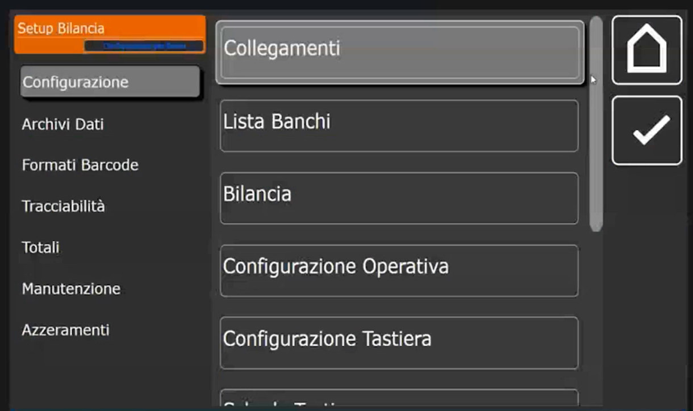

!!! warning "Da verificare"
    Il tocco sull'ingranaggio non è documentato schermata per schermata: controlla sulla bilancia. Se la **Gestione Password** è attiva (pagina [Bilancia](bilancia.md)) l'accesso alla programmazione richiede una password.

### 2. Seleziona Lista Banchi

Tocca **Lista Banchi**. Va compilata **prima** di qualsiasi altra configurazione.

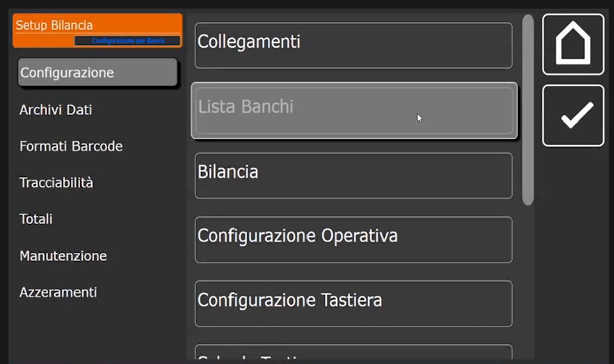

La lista parte vuota: colonne **Banco**, **Nome**, **Tracc.** e **New Prg.**. A destra il pulsante **+** aggiunge un banco.

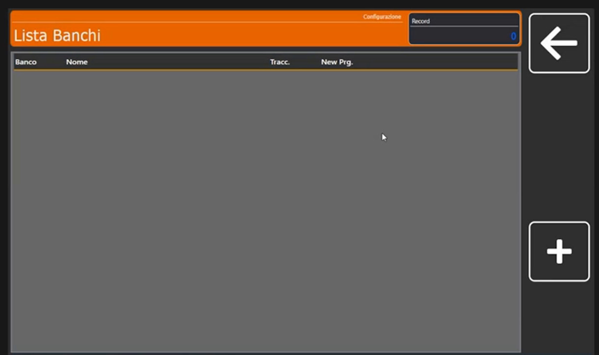

### 3. Crea il banco 1

Tocca **+**: si apre il tastierino **Numero Banco**. Digita **1** e conferma con **Ok**.

!!! warning "Il numero del banco conta"
    Il numero del banco è importante se poi si collegano driver o applicativi esterni (per esempio Zenith System, BenchComm o CE_Gest): il collegamento avviene per numero di banco.

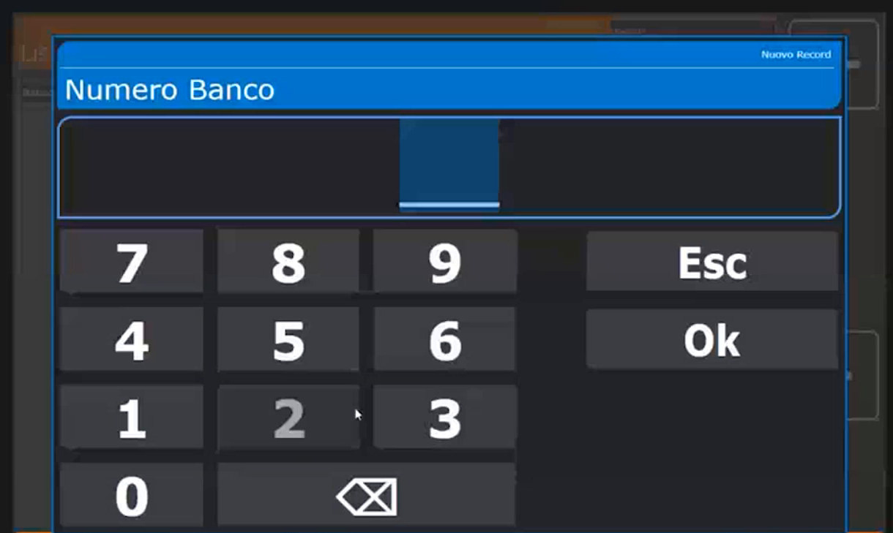

Si apre la scheda del nuovo banco, sezione **Generale**: **Numero Banco**, **Nome Banco**, **Abilita Tracciabilità** e **Nuovo progressivo per riapertura**. La bilancia guida passo passo su ciò che serve per il banco.

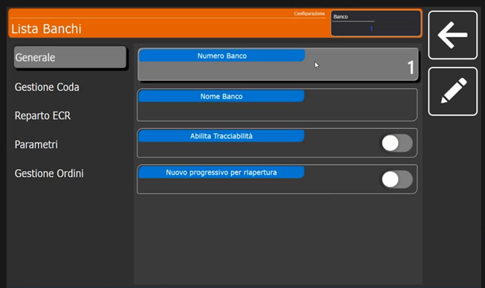

### 4. Assegna il nome

Tocca la **matita** (in alto a destra): si apre la tastiera con titolo **Nome Banco**. Scrivi il nome (nell'esempio **SALUMERIA**) e conferma con **Ok**.

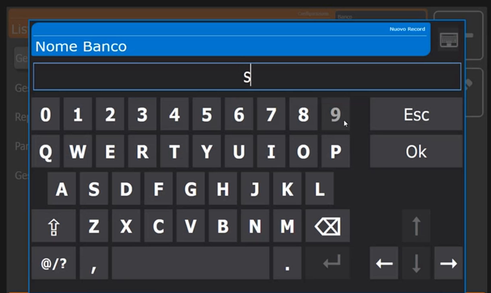

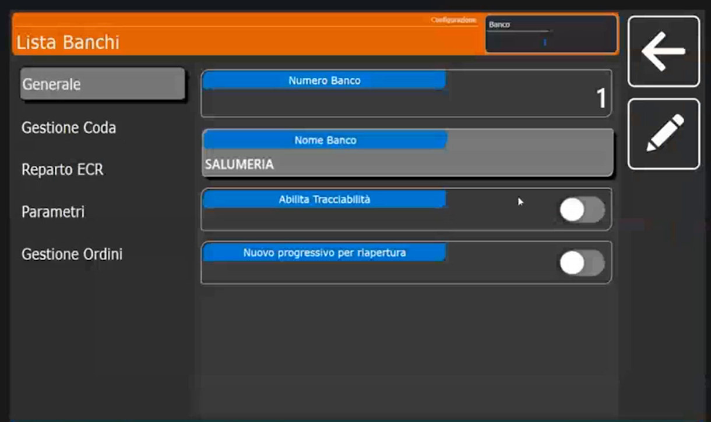

!!! note "Tracciabilità"
    Per la salumeria la tracciabilità non serve: **Abilita Tracciabilità** resta disattivato. Come funziona è descritto in [Tracciabilità e lotti](tracciabilita.md).

### 5. Scorri il menu laterale del banco

Nella scheda del banco, a sinistra, trovi **Generale**, **Gestione Coda**, **Reparto ECR**, **Parametri**, **Gestione Ordini**.

**Gestione Coda.** Abilita dispositivi esterni per la gestione dell'**eliminacode**. Tra i valori disponibili compare **Visor**, perché la bilancia si interfaccia anche con software di terzi per la gestione delle code, non solo con quelli Custom. Campi: **ID Reparto Elimina Code**, **Numero Reparto (x Visel)**, **Colore Carattere** (Black) e **Colore Sfondo** (White).

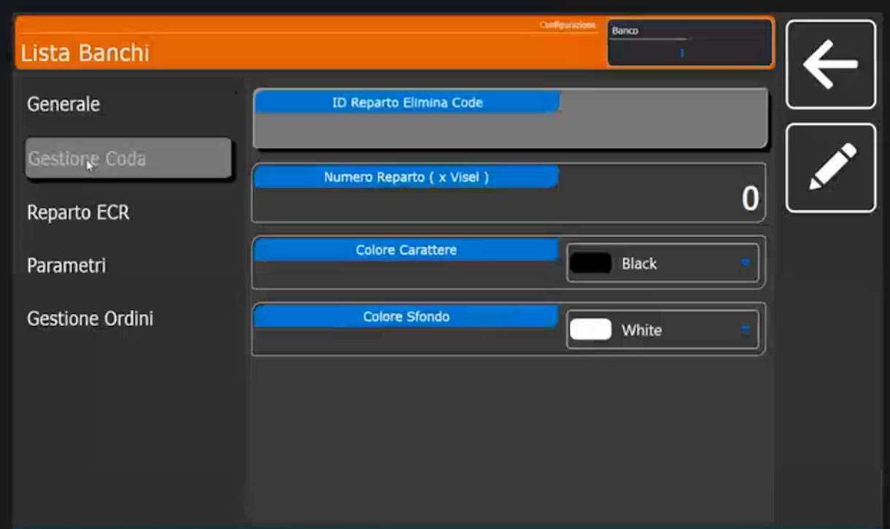

**Reparto ECR.** Riguarda la modalità di connessione con il registratore di cassa. Campi: **Numero Reparto** e **Nome Reparto**.

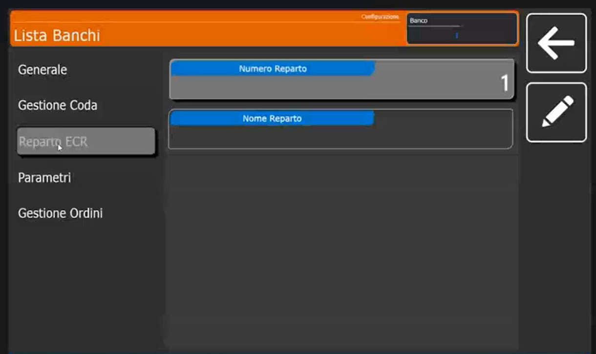

### 6. Imposta i contatori in Parametri

Tocca **Parametri**. Di default la bilancia **non identifica la numerazione di scontrini, etichette e progressivi**: i valori partono da 9999 e vanno impostati. I campi sono **Min Progressivo** e **Max Progressivo** per tre tipi di documento: **Scontrino**, **Etichetta** e **Self Service**.

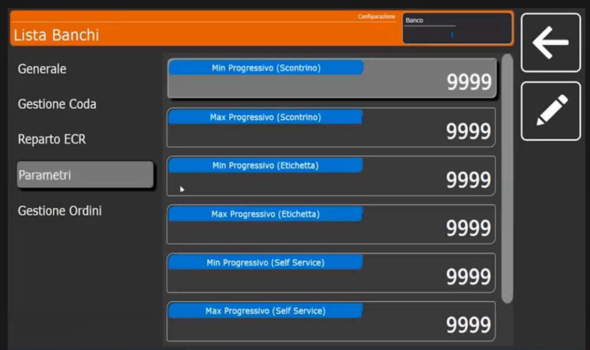

Per ogni contatore tocca il campo e usa il tastierino.

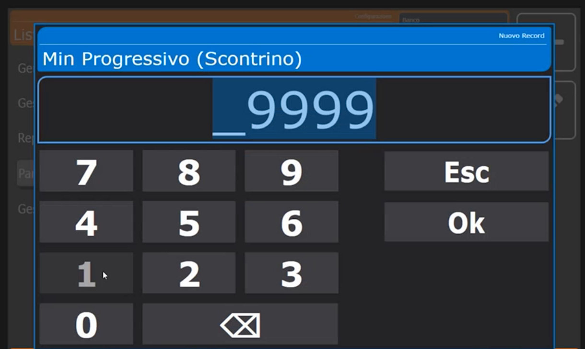

- Porta ogni **minimo** a **1**: i contatori devono andare da un minimo a un massimo con una logica coerente.
- Il **massimo** del progressivo scontrino, anziché finire a 4 cifre, si può impostare a **3 cifre** (**999**).

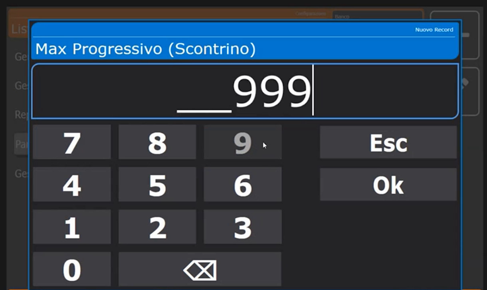

!!! warning "Quando abbassare il progressivo a 3 cifre"
    Se la bilancia è collegata a sistemi che prevedono l'**esplosione dello scontrino** (per esempio tramite **Zenith System**), imposta il progressivo scontrino a **3 cifre**: dopo il 999 la bilancia riparte automaticamente da zero. Non serve per etichette e Self Service. Il progressivo viene riportato non solo a video ma anche sulla **stampa dello scontrino grafico** e deve poi essere ripreso nella lettura del codice a barre; per una bilancia stand alone, senza applicativi esterni, il valore è meno critico.

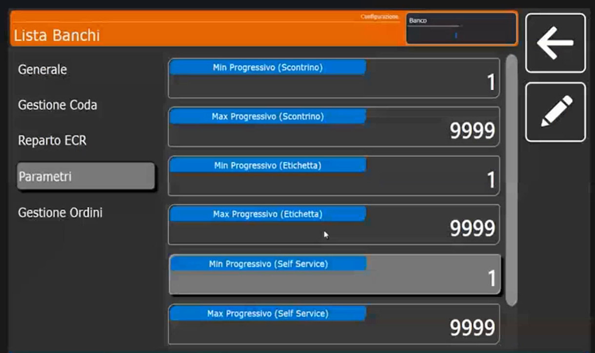

<!-- verificare: l'originale parla di "lettura dell'EAM"; interpretato come lettura del codice a barre (EAN) -->

### 7. Lascia stare Gestione Ordini

**Gestione Ordini** non va toccata: è una funzione sviluppata per una parte della grande distribuzione ed è in evoluzione, per permettere anche a software house più piccole di gestire gli ordini sulla bilancia o direttamente dalla bilancia.

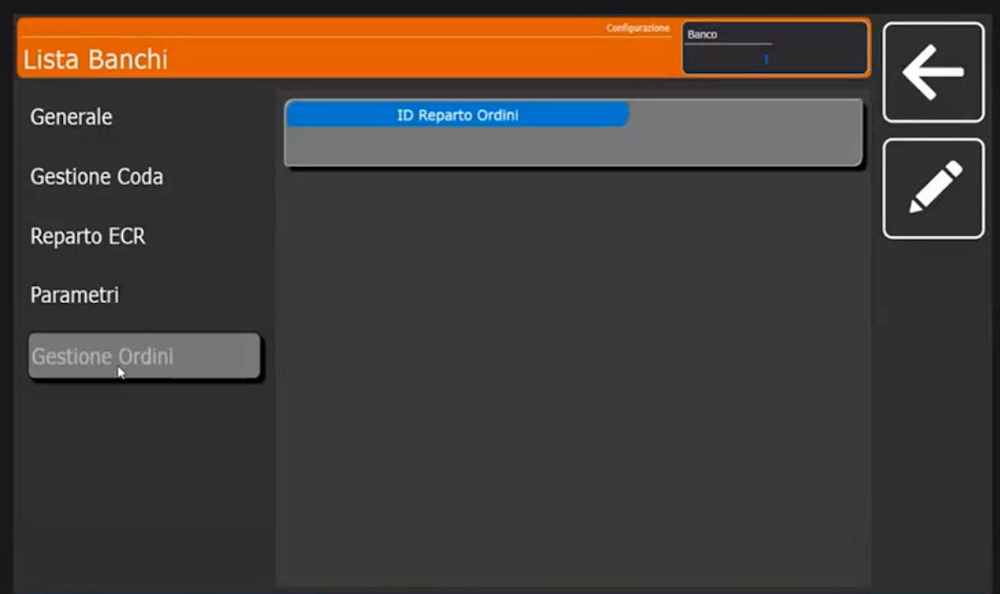

### 8. Aggiungi il secondo banco: MACELLERIA

Il banco 1 compare nella lista.

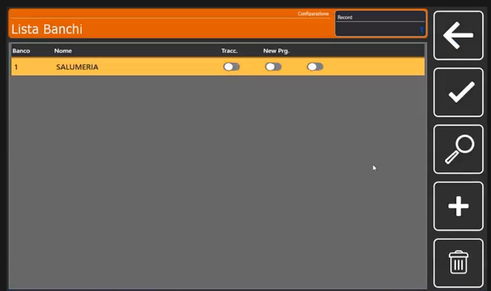

Tocca di nuovo **+**, digita **2** e assegna il nome **MACELLERIA**.

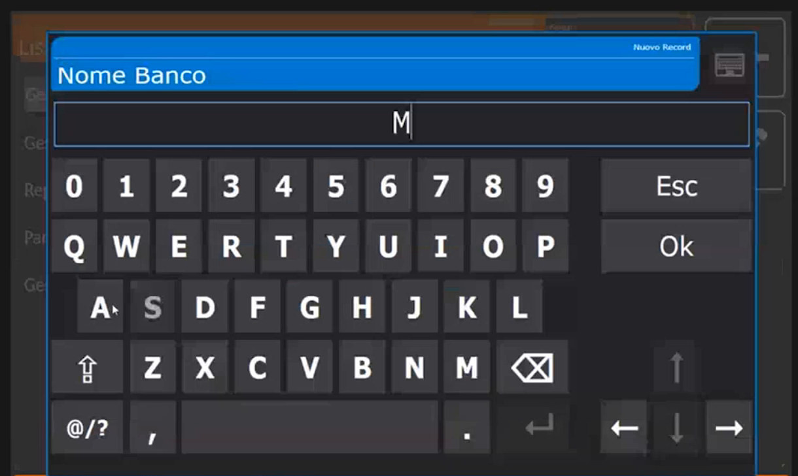

Nella macelleria attiva **Abilita Tracciabilità**: i prodotti di questo settore merceologico, per circa il 90%, richiedono la gestione della tracciabilità. Il selettore diventa verde.

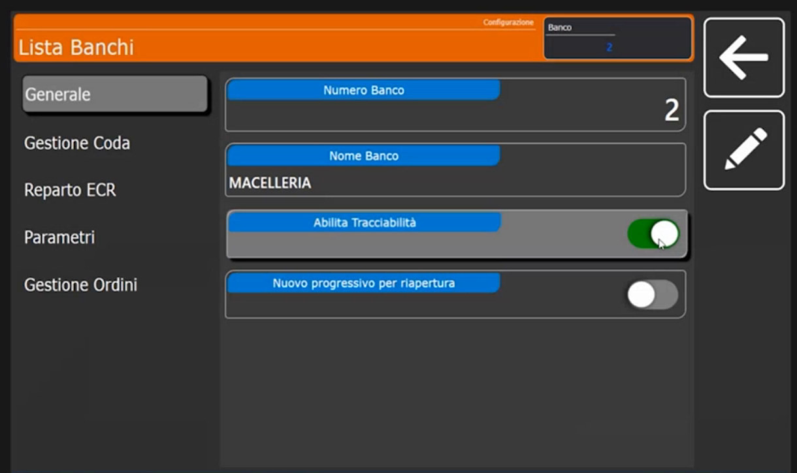

## Verifica

Nella **Lista Banchi** compaiono due righe, **1 SALUMERIA** e **2 MACELLERIA**, con l'indicatore **Tracc.** acceso solo sulla macelleria.

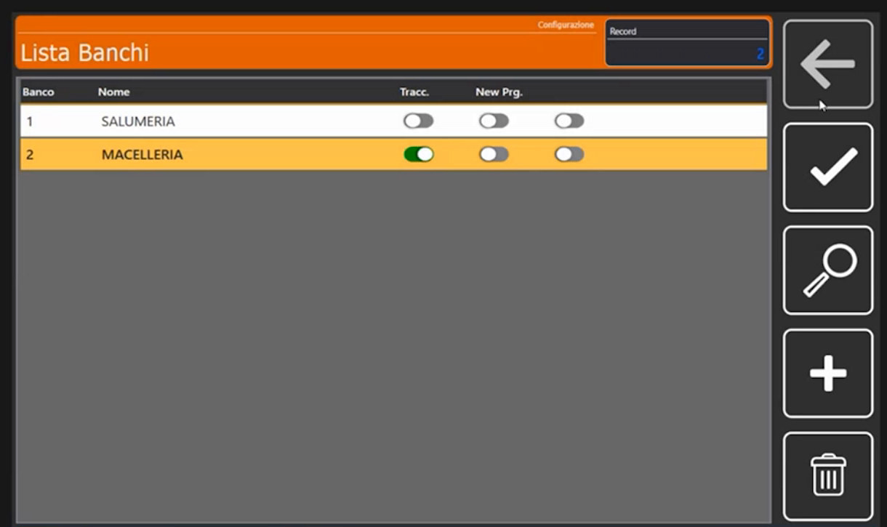

## Errori comuni

| Problema | Causa probabile | Rimedio |
|---|---|---|
| Gli scontrini o le etichette non hanno numerazione | I contatori in **Parametri** sono rimasti ai valori di default (9999) | Imposta minimo e massimo per Scontrino, Etichetta e Self Service |
| Lo scontrino esploso in cassa non viene letto correttamente | Progressivo scontrino a 4 cifre con un sistema che ne prevede 3 | Porta il massimo a 999 |
| Gli articoli di un banco compaiono in un altro | Banco attivo o numero banco della bilancia sbagliato | Controlla **Numero Banco** e **Banco Attivo** nella pagina [Bilancia](bilancia.md) |

!!! tip "Prossimo passo"
    Prima di attivare un banco sulla bilancia, controlla i [Collegamenti](collegamenti.md).
