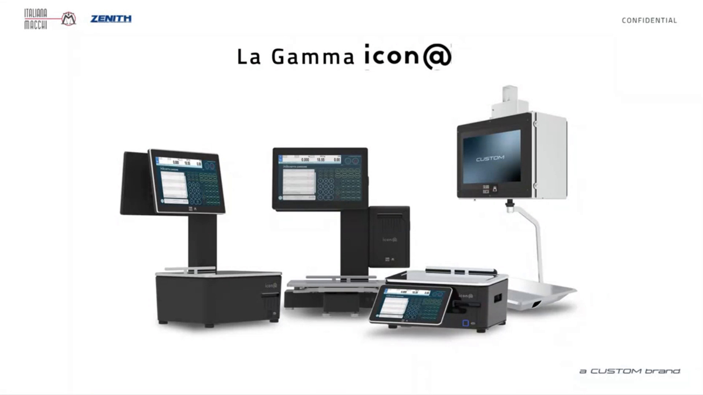
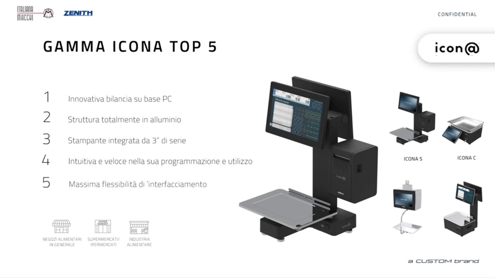
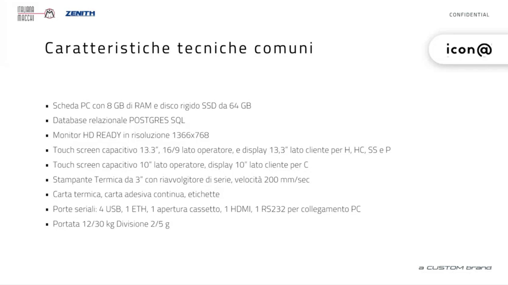
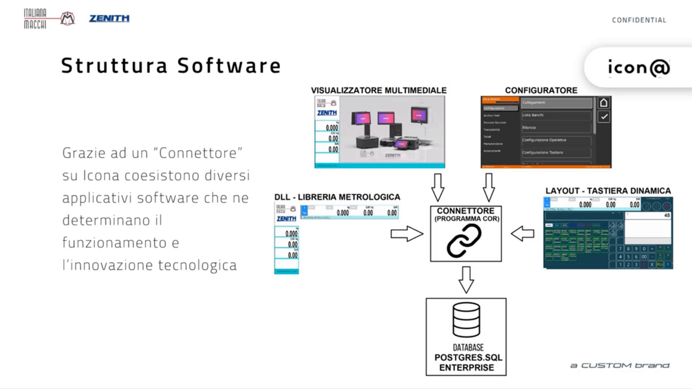
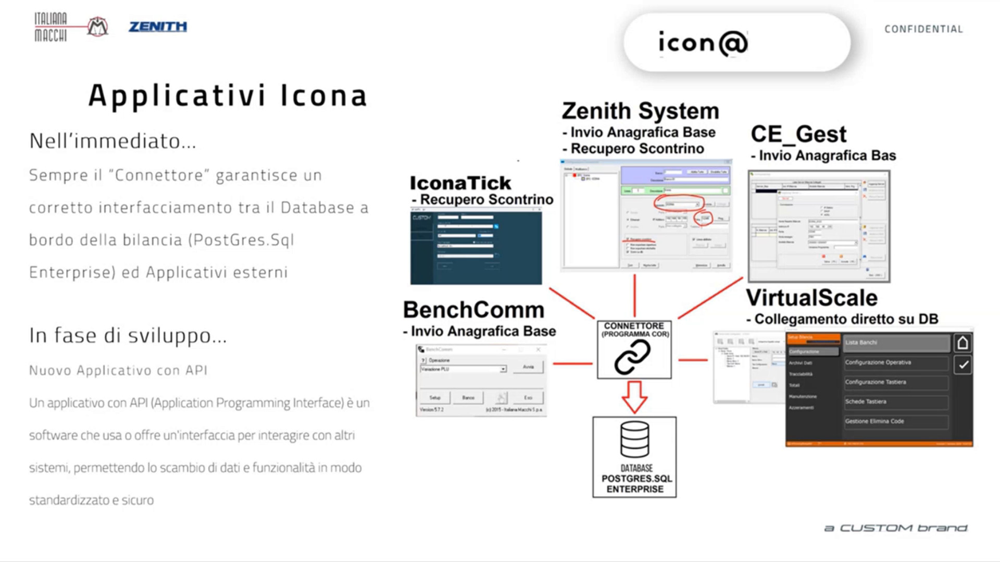
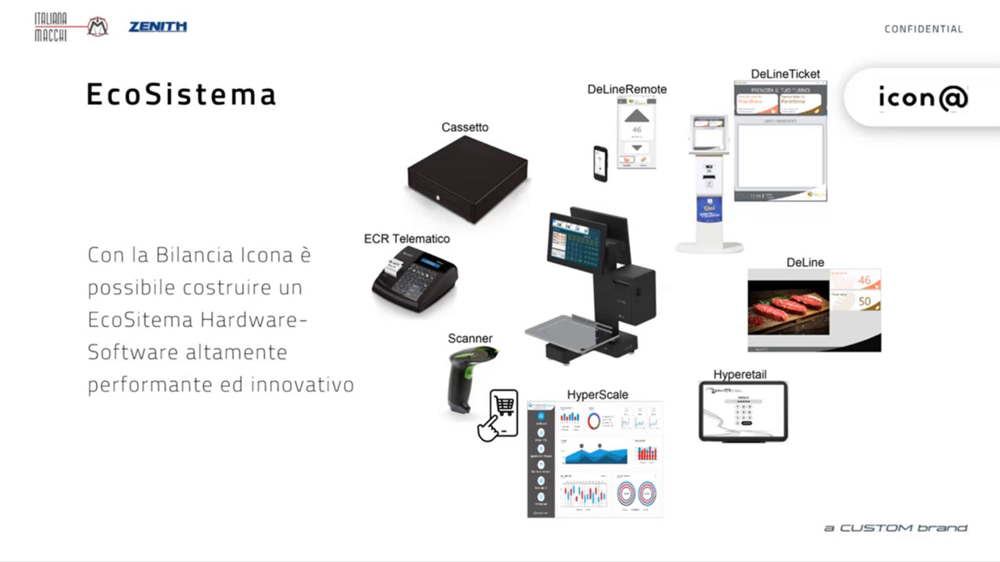

<!-- categoria assegnata per inferenza: verificare (la bilancia Icona non ha una categoria dedicata nell'elenco) -->

# Conoscere Icona: gamma, architettura e applicativi

**Target:** tecnico installatore / rivenditore. Prima di programmare la bilancia conviene sapere come è fatta, che cosa contiene e con che cosa può dialogare: questa pagina riassume le informazioni che servono per orientarsi nelle pagine di configurazione.

## In breve

Icona è una **bilancia peso-prezzo su base PC Windows**, con struttura in alluminio pressofuso, stampante termica integrata da 3" e un database **PostgreSQL** a bordo. È pensata per negozi alimentari in genere, supermercati e ipermercati, industria alimentare. Funziona sia come bilancia singola sia in **rete di bilance**.

!!! tip "Cinque punti di forza"
    1. Innovativa bilancia su base PC
    2. Struttura totalmente in alluminio
    3. Stampante integrata da 3" di serie
    4. Intuitiva e veloce nella programmazione e nell'utilizzo
    5. Massima flessibilità di interfacciamento

## La gamma

| Modello | Caratteristiche |
|---|---|
| **Icona H** | Versione alta con la stampante nella parte alta, per banchi di vendita assistita (gastronomia, macelleria e simili). Due schermi touch |
| **Icona HC** | Versione alta con la stampante nel **basamento** |
| **Icona C** | Versione **bassa**, anche per etichettatura |
| **Icona Pensile** | L'ultima arrivata, a completamento della gamma |

Tutta la famiglia usa **un unico software e un unico configuratore**: i passaggi di programmazione sono gli stessi qualunque sia il modello.

- **Modalità Self Service con un solo monitor.** I modelli H, HC e C possono essere richiesti anche in modalità Self Service, quindi con un solo display. La modalità Self Service si può attivare anche su una bilancia a due monitor.
- **Due schermi touch.** Anche lo schermo lato cliente, destinato ai contenuti multimediali, è touch: i due schermi sono intercambiabili. Questo dà la massima flessibilità nelle versioni H.
- **Struttura robusta.** Le bilance sono in alluminio pressofuso.

## Caratteristiche tecniche comuni

| Voce | Specifica |
|---|---|
| Scheda PC | 8 GB di RAM, disco SSD da 64 GB |
| Database | Relazionale PostgreSQL |
| Monitor | HD Ready, risoluzione 1366x768 |
| Touch screen capacitivo, modelli H, HC, SS e P | 13,3" lato operatore (16/9), display 13,3" lato cliente |
| Touch screen capacitivo, modello C | 10" lato operatore, display 10" lato cliente |
| Stampante | Termica da 3", riavvolgitore di serie, velocità 200 mm/sec |
| Supporti di stampa | Carta termica, carta adesiva continua, etichette |
| Porte | 4 USB, 1 ETH, 1 apertura cassetto, 1 HDMI, 1 RS232 per collegamento PC |
| Portata | 12/30 kg, divisione 2/5 g |

## Architettura software

Un programma **Connettore** (programma core) fa da filtro sul database PostgreSQL della bilancia e permette ai vari programmi di **coesistere e dialogare** tra loro.

| Componente | Funzione |
|---|---|
| **Configuratore** | È **a bordo della bilancia**. Permette di impostare e accedere a tutte le tabelle del database, anche senza programmi esterni per l'anagrafica degli articoli. È il programma descritto nelle pagine di configurazione di questo manuale |
| **Layout - Tastiera dinamica** | La schermata di vendita. Esistono diversi tipi di tastiera già pronti, con possibilità di piccole personalizzazioni |
| **Visualizzatore multimediale** | Gestisce il display esterno (lato cliente): immagini e video ad alta risoluzione, anche in 4K |
| **DLL - Libreria metrologica** | È l'**unica parte sotto vincolo metrologico**. Consente di aggiornare la bilancia ripetutamente nel tempo senza dover rientrare in omologa |
| **Database PostgreSQL** | Contiene tutti gli archivi. Può risiedere su una bilancia o su un'altra, e anche su un **server esterno** |

!!! note "Reti di bilance"
    Poiché il database può risiedere su una bilancia, su un'altra o su un server esterno, si possono costruire reti di bilance. Ogni bilancia o PC con **VirtualScale** è solo un **punto di accesso al database**. Vedi [Collegamenti](collegamenti.md) per l'indirizzo IP e la scelta del database.

## Applicativi collegati

Tutti dialogano con la bilancia tramite il Connettore e popolano le informazioni del database.

| Applicativo | Funzione |
|---|---|
| **VirtualScale** | Collegamento diretto al database. È il configuratore utilizzato su PC: diventa un punto di accesso al database della bilancia, dal quale fare le stesse configurazioni e programmazioni |
| **CE_Gest** | Invio dell'anagrafica base. Il collegamento è **unidirezionale**: si può solo inviare. Serve, per esempio, a inviare un'anagrafica articoli ripresa da una bilancia della serie 9000 per fare l'upgrade al cliente |
| **Zenith System** | Invio dell'anagrafica base e **recupero dello scontrino**. È un driver usato anche da applicativi esterni che si connettono alla bilancia |
| **BenchComm** | Invio dell'anagrafica base alla bilancia, nella modalità del collegamento Italiana Macchi |
| **IconaTick** | Recupero dello scontrino. Insieme a BenchComm permette a Icona di essere compatibile con sistemi in cui le bilance sono collegate tramite CE_Gest e BenchComm: Icona si può aggiungere come banco |

!!! warning "Limite di Zenith System e CE_Gest"
    Con questi due programmi **non è possibile recuperare le anagrafiche** presenti nella bilancia: si possono solo inviare.

!!! info "In sviluppo: applicativo con API"
    È in sviluppo un nuovo applicativo basato su **API** (Application Programming Interface), cioè un software che usa o offre un'interfaccia per interagire con altri sistemi, permettendo lo scambio di dati e funzionalità in modo standardizzato e sicuro. Sarà usato da Custom per il nuovo frontend di configurazione della bilancia e verrà messo a disposizione delle software house per gestire e collegare la bilancia a 360 gradi.

## Ecosistema

Intorno alla bilancia si può costruire un ecosistema hardware-software integrato.

- **Hardware collegabile:** cassetto, registratore di cassa o stampante fiscale (ECR telematico), scanner. Così la bilancia diventa un piccolo gestionale: si possono vendere prodotti con EAN e chiudere lo scontrino direttamente sulla cassa.
- **Software Custom:** Hyperetail e HyperScale (in arrivo), un gestionale dedicato alla gestione della bilancia, utilizzabile su hardware Windows e Android.
- **DeLine, DeLineTicket, DeLineRemote:** gestione dei contenuti pubblicitari, delle code e dei ticket in un negozio di qualsiasi tipo, con totem personalizzabili in ambiente Windows e Android.

## Aggiornare la bilancia

!!! tip "Aggiornamento all'ultima versione"
    Le prime bilance Icona sono arrivate sul mercato senza l'infrastruttura dell'**etichettatura evoluta**. Chi ha già un'installazione può ottenere tutte le funzioni di etichettatura descritte in questo manuale (box ingredienti, tabelle testi, tracciabilità, tabelle nutrizionali, lotti di produzione) **aggiornando la bilancia all'ultima versione**.

## Come proseguire

Segui l'ordine delle pagine di configurazione: prima i banchi, poi le impostazioni della bilancia, gli archivi, la tastiera e infine formati di stampa, tracciabilità e promozioni. La [pagina iniziale](index.md) riporta il percorso completo.
