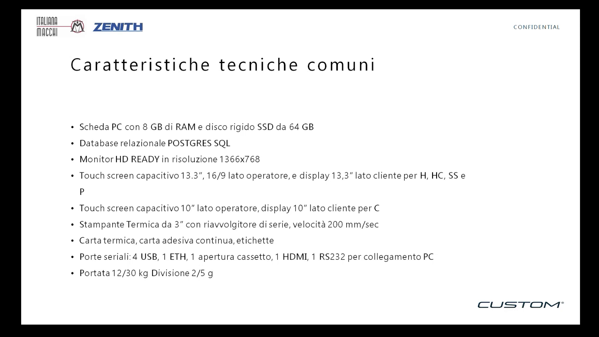
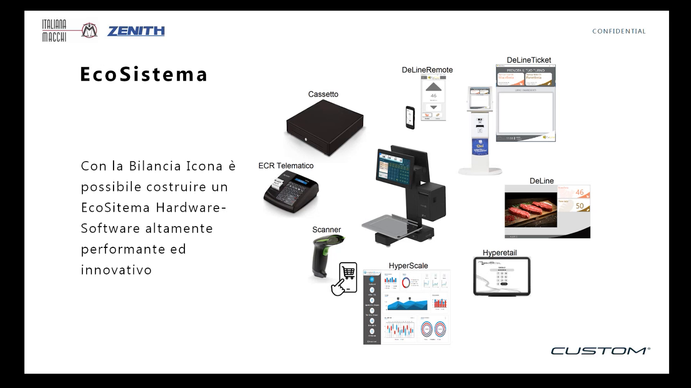
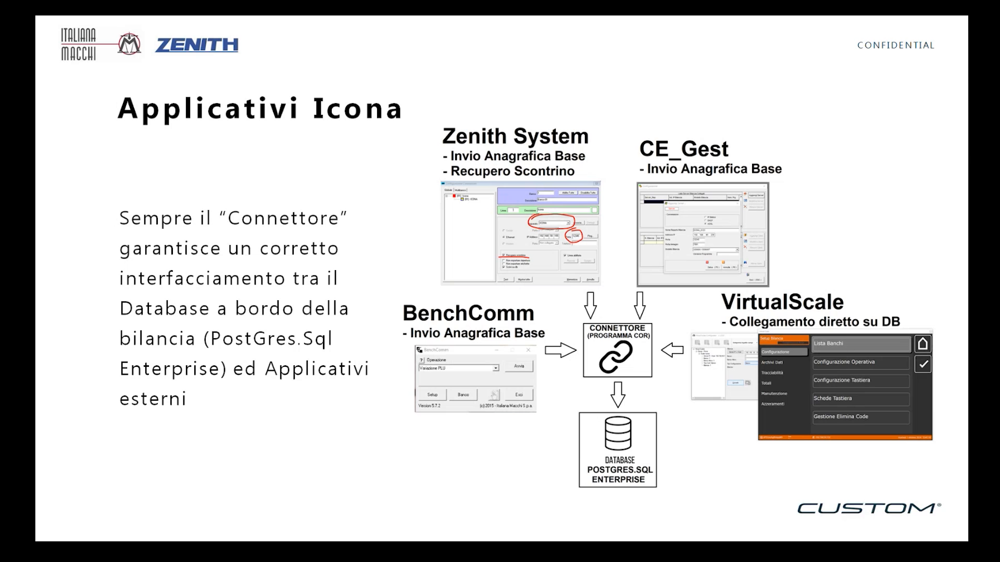

<!-- categoria assegnata per inferenza: verificare (la bilancia Icona e HyperScale non hanno una categoria dedicata nell'elenco) -->

# Preambolo: gamma, ecosistema e applicativi Icona

Prima di passare alla configurazione, il webinar del 10 aprile 2025 dedica i primi minuti a un richiamo veloce di quanto già visto nel webinar precedente (*Icona: novità e applicazioni*, 10 gennaio 2025). Questa pagina riassume solo quel richiamo: la parte pratica inizia da [Configurazione della bilancia](index.md).

!!! note "Obiettivo del webinar"
    Oggi il focus è sul **configuratore**: le configurazioni di base e gli archivi. La bilancia viene programmata **partendo da zero**, insieme al relatore.

## La gamma Icona

La famiglia comprende le versioni **Pensile**, **Icona C** (bassa), **Icona H** e **Icona HC**. Tutta la famiglia usa **un unico software e un unico configuratore**, che si adatta ai diversi utilizzi e all'hardware su cui viene installato:

- con un solo monitor si può lavorare in modalità **Self Service**; la modalità Self Service si può attivare anche su una bilancia a doppio monitor;
- etichettatura evoluta, gestione dei lotti e tracciabilità non sono limitate alla versione bassa: si possono usare anche sulle versioni alte;
- la Pensile ha struttura in acciaio inox e alluminio pressofuso.

## Caratteristiche tecniche comuni

| Voce | Specifica |
|---|---|
| Scheda PC | 8 GB di RAM, disco SSD da 64 GB |
| Database | Relazionale PostgreSQL |
| Monitor | HD Ready, risoluzione 1366x768 |
| Touch capacitivo, modelli H, HC, SS e P | 13,3" lato operatore (16/9), display 13,3" lato cliente |
| Touch capacitivo, modello C | 10" lato operatore, display 10" lato cliente |
| Stampante | Termica da 3", riavvolgitore di serie, velocità 200 mm/sec |
| Supporti di stampa | Carta termica, carta adesiva continua, etichette |
| Porte | 4 USB, 1 ETH, 1 apertura cassetto, 1 HDMI, 1 RS232 per collegamento PC |
| Portata | 12/30 kg, divisione 2/5 g |

## L'ecosistema

Attorno alla bilancia si può costruire un ecosistema hardware-software integrato con **Hyperetail**, con **HyperScale** (utilizzabile su hardware Windows e Android) e con gli altri componenti mostrati in slide: cassetto, ECR telematico, scanner, DeLine, DeLineTicket e DeLineRemote. La bilancia può vendere anche prodotti **a pezzo**, che non passano dalla parte metrologica.

## Struttura software e applicativi

Un **Connettore** (programma COM) fa da filtro sul database PostgreSQL della bilancia; gli applicativi si collegano al Connettore e popolano le informazioni del database. Gli applicativi citati sono:

| Applicativo | Funzione indicata in slide |
|---|---|
| Zenith System | Invio anagrafica base, recupero scontrino |
| CE_Gest | Invio anagrafica base |
| BenchComm | Invio anagrafica base |
| VirtualScale | Collegamento diretto sul database |

Completano la struttura il **visualizzatore multimediale** (immagini e video ad alta risoluzione sugli schermi posteriori), il **layout tastiera** personalizzabile, il **configuratore** e la **libreria DLL**, l'unica parte soggetta a vincolo metrologico. Gli applicativi saranno approfonditi in un webinar successivo.

!!! tip "Prossimo passo"
    Da qui il relatore condivide lo schermo della bilancia e inizia la programmazione dal menu **Setup Bilancia**.
