<!-- categoria assegnata per inferenza: verificare (la bilancia Icona non ha una categoria dedicata nell'elenco) -->

# Promozioni: taglio prezzo e sconto percentuale

**Target:** tecnico installatore / rivenditore.

## Obiettivo

Creare promozioni sulla bilancia (volantino), definirne **step**, giorni e orari di attivazione, collegarle agli articoli e riconoscerne il comportamento in vendita.

## Tipi di promozione

| Tipo | Come funziona | Esempio |
|---|---|---|
| **Taglio Prezzo** | Il prezzo al kg cambia in base al **peso**: a ogni soglia (step) corrisponde un prezzo | Oltre 100 g: 4,00 €/kg; oltre 200 g: 3,00 €/kg; oltre 300 g: 2,00 €/kg; oltre 400 g: 1,00 €/kg |
| **Sconto %** | Lo sconto cambia in base ai **pezzi** (o ai grammi): a ogni soglia corrisponde una percentuale | Pannello di vendita con soglie da 2 a 5 pezzi e sconti dal 5% al 20% |

## Procedura

### 1. Apri Promozioni

Da **Archivi Dati** tocca **Promozioni** (si trova scorrendo la lista). La lista mostra **Codice**, **Nome** e **Tipo** (menu a tendina **Taglio Prezzo** o **Sconto %**).

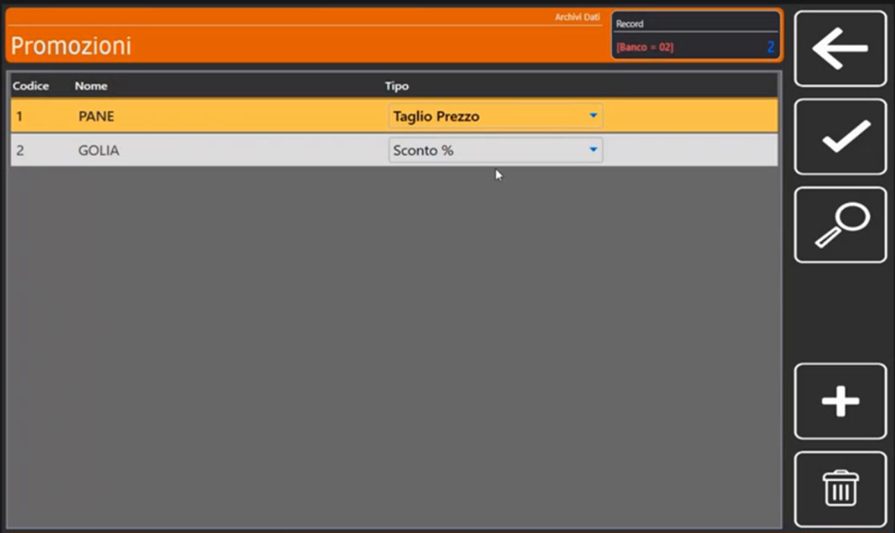

### 2. Scheda Generale

Tocca **+** e scegli il codice della promozione. Nella sezione **Generale** compila:

- **Codice Promozione**;
- **Nome Promozione** (nell'esempio **PANE**);
- **Tipo Promozione** (**Taglio Prezzo** o **Sconto %**);
- **Messaggio Stampato**: il testo che compare sullo scontrino della bilancia (nell'esempio **TAGLIA TUTTO**).

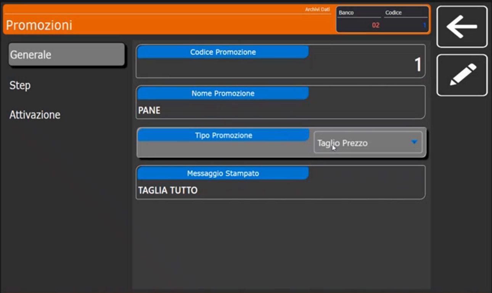

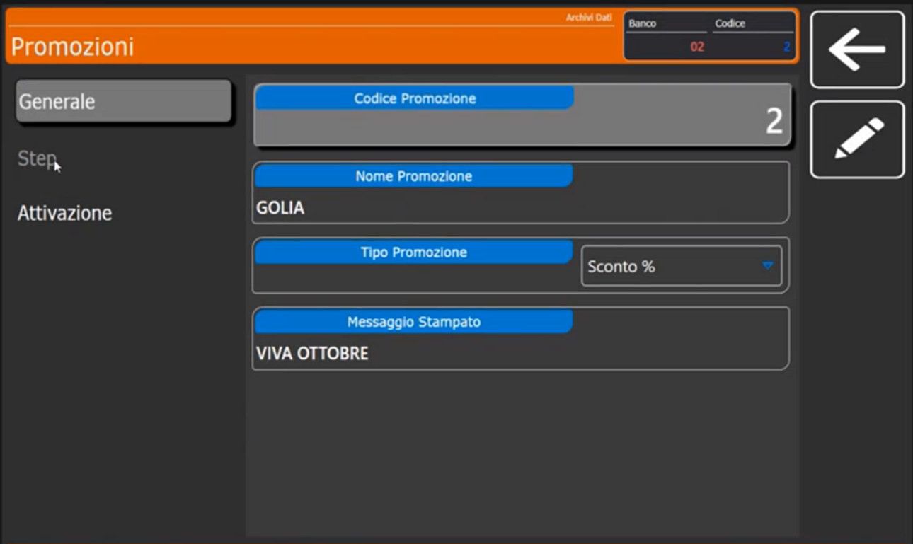

### 3. Sezione Step

Nella sezione **Step** si definiscono le soglie. Per ogni step: **Step n (g / Pz)** e il valore corrispondente (**Prezzo €** per il Taglio Prezzo, **Sconto %** per lo Sconto %).

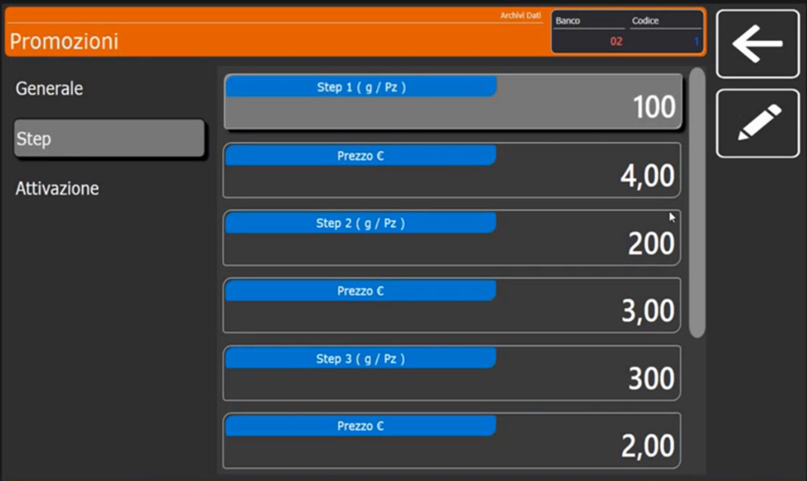

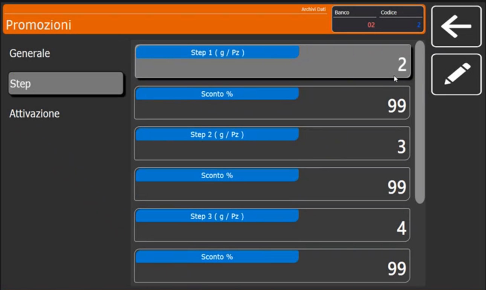

### 4. Sezione Attivazione

Qui decidi **quando** la promozione è attiva:

- **Data Inizio** e **Data Termine** (filtro sulle date);
- **Ora Inizio** e **Ora Termine** (a che ora parte e finisce);
- **Lun, Mar, Mer, Gio, Ven...**: gli interruttori dei giorni della settimana. Puoi attivarla per **tutti i giorni** oppure per **uno solo**.

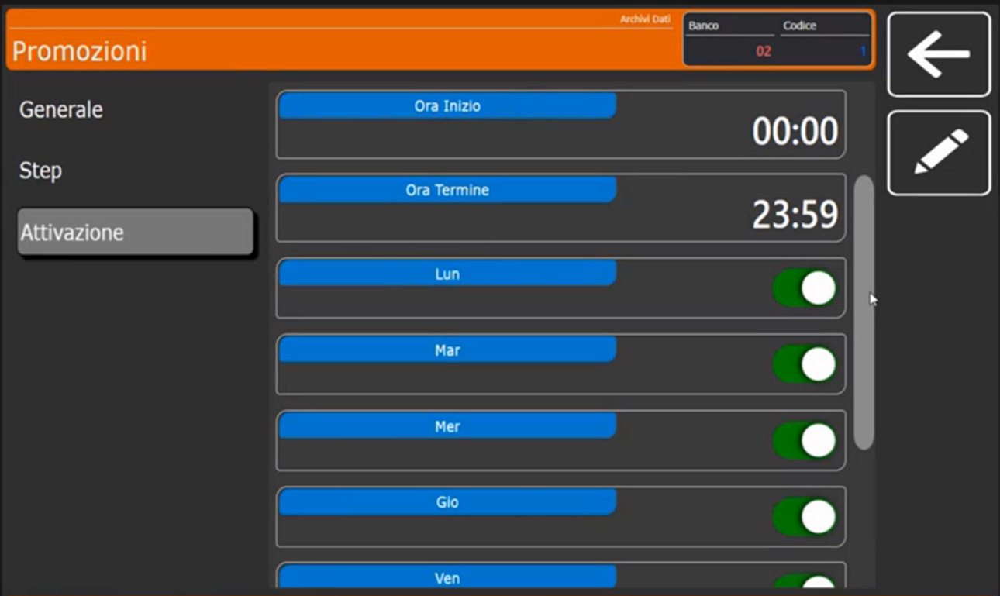

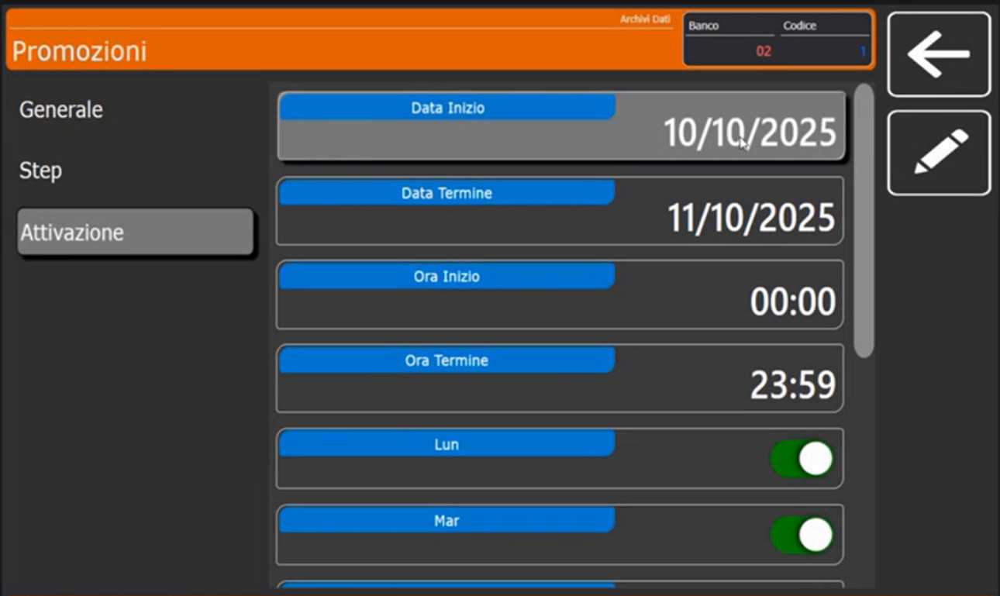

### 5. Collega la promozione all'articolo

Una volta create le promozioni, apri l'articolo ([Articoli PLU](articoli-plu.md)) e, nella scheda **Extra**, imposta **ID Promozione** con la lente: l'articolo prende il comportamento della promozione scelta. Si possono collegare le promozioni anche a un intero reparto, collegandone gli articoli.<!-- verificare: collegamento a reparto citato a voce, da confermare sul prodotto -->

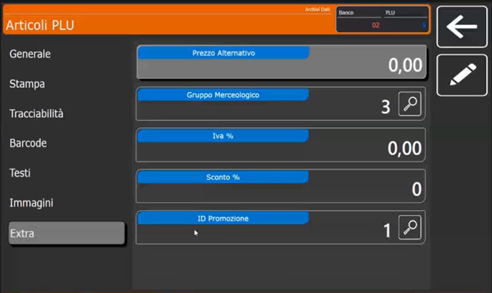

## Comportamento in vendita

Toccando un articolo in promozione la bilancia mostra il riquadro **PLU in Promozione** con le soglie e i valori, così l'operatore sa cosa applicherà. Per il Taglio Prezzo le soglie sono espresse in peso (per esempio *1 > 0.100 kg 4.00 €*, *2 > 0.200 kg 3.00 €*...).

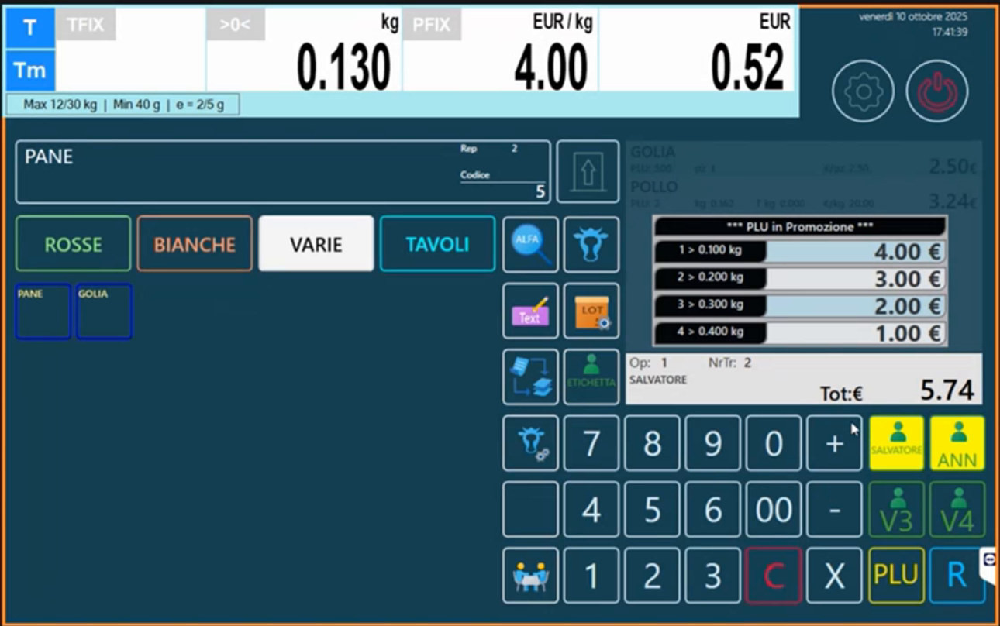

Il prezzo al kg si ricalcola in base al peso: nell'esempio il pane viene venduto a **3,00 €/kg** con una pesata sopra i 200 g e a **1,00 €/kg** con una pesata sopra i 400 g.

Lo **storno** è disponibile: **tenendo premuto sullo scontrino virtuale** si apre una visualizzazione di servizio con **Storna**, **Storna Scontrino**, **Stampa vendita** ed **Esci**. Vale sia per gli articoli a peso sia per quelli a pezzo e in promozione. L'informazione viene stampata anche sullo scontrino.

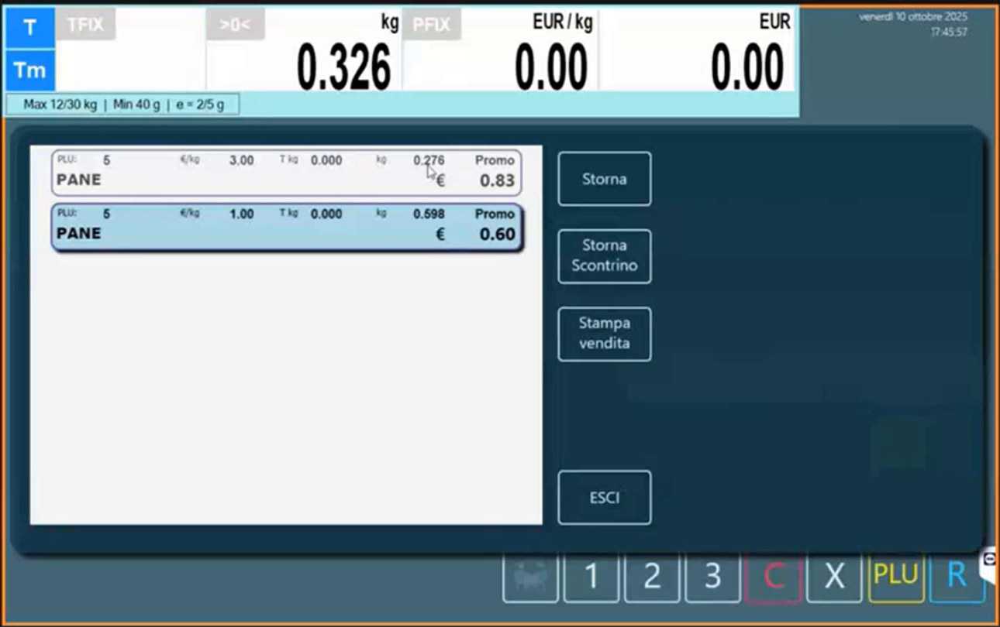

Per gli articoli a pezzo con **Sconto %** il riquadro mostra le soglie in pezzi e le percentuali.

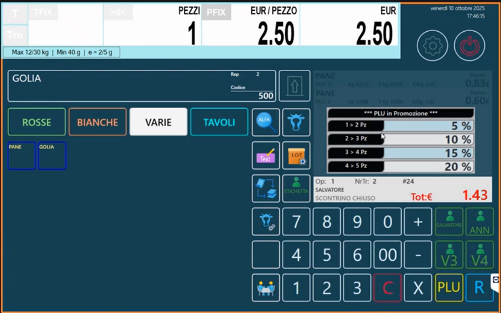

## Verifica

1. Vendi l'articolo con un peso (o un numero di pezzi) sopra una soglia.
2. Controlla che prezzo o sconto cambino come previsto e che lo scontrino riporti la dicitura **Promo** e il **Messaggio Stampato**.

## Errori comuni

| Problema | Causa probabile | Rimedio |
|---|---|---|
| La promozione non si applica | Fuori da data, ora o giorno di attivazione | Controlla la sezione **Attivazione** |
| L'articolo non mostra il riquadro | **ID Promozione** non impostato | Collega l'articolo alla promozione nella scheda **Extra** |
| Il prezzo non cambia con il peso | Tipo promozione sbagliato | Usa **Taglio Prezzo** per soglie di peso, **Sconto %** per soglie di pezzi |

!!! tip "Prossimo passo"
    Altre funzioni di vendita (operatori impegnati, doppio listino, tavoli): [Funzioni di vendita](funzioni-di-vendita.md).
