<!-- categoria assegnata per inferenza: verificare (la bilancia Icona non ha una categoria dedicata nell'elenco) -->

# Schede Tastiera: raggruppare gli articoli per categoria, reparto o tavoli

**Target:** tecnico installatore / rivenditore.

## Obiettivo

Attivare le **schede** sulla tastiera, crearne una per ogni categoria merceologica (o per reparto, o per i tavoli) e personalizzarne colori e immagini, così che gli articoli non siano tutti sulla stessa schermata.

## Prerequisiti

- Le [Categorie Merceologiche](categorie-merceologiche.md) esistono e sono collegate agli articoli (scheda **Extra**, **Gruppo Merceologico**: [Articoli PLU](articoli-plu.md)).
- Il **Tipo Tastiera** è *RETAIL => 4 Operatori* o una variante Retail ([Configurazione Operativa](configurazione-operativa.md)).

!!! note "Quando usare le schede"
    Avere tutti gli articoli sulla stessa schermata oppure raggrupparli per scheda è una **scelta di configurazione**. Le schede si attivano sia in Self Service sia in Multipesata e, con il tipo di scheda giusto, permettono anche di gestire i tavoli o di passare da un reparto all'altro.

## Procedura

### 1. Apri Schede Tastiera

Dal menu **Setup Bilancia**, sezione **Configurazione**, scorri la lista oltre **Configurazione Tastiera**: compare **Schede Tastiera**.

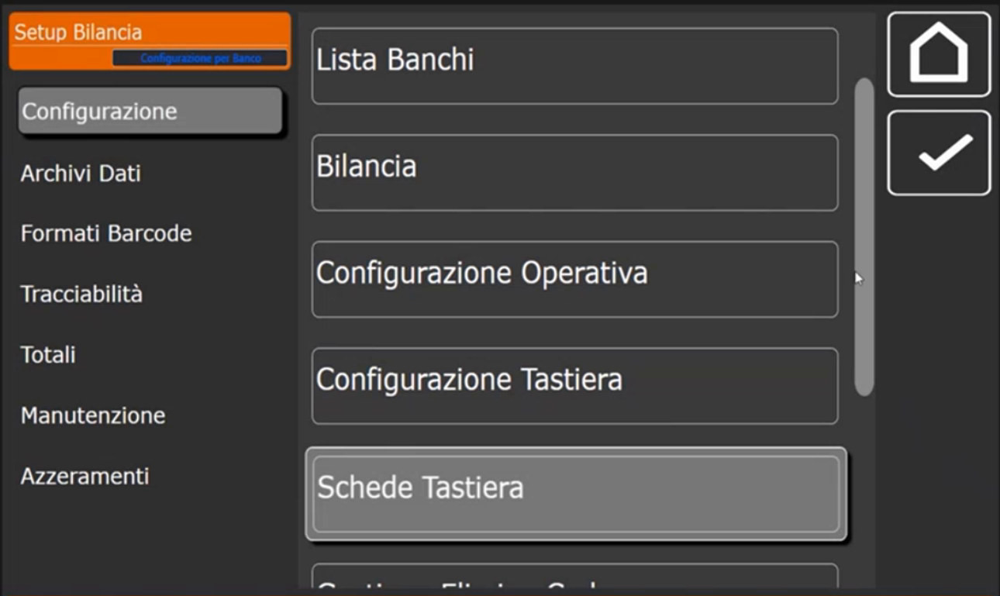

La lista ha le colonne **Cond. Scheda** (condivisione) e **Numero Schede**.

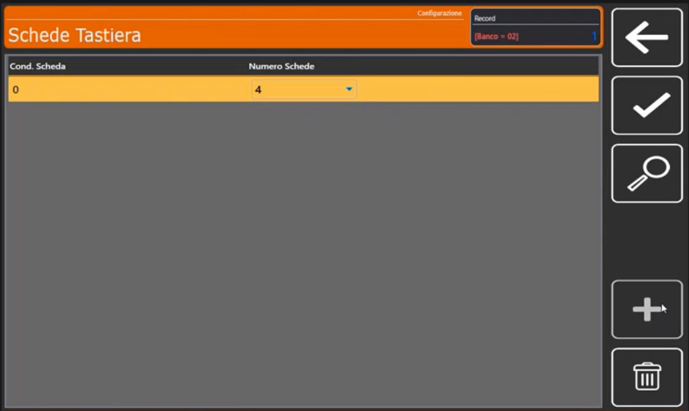

### 2. Crea le schede e indica quante sono

1. Tocca **+**: si apre il tastierino **Condivisione ( 0=Banco NN=Bilancia )**. Digita **0** per schede **relative al banco**.
2. Nella scheda **Generale** il campo **Numero Schede** indica quante schede devono esistere (nell'esempio 4). Nel menu a sinistra compaiono **Scheda 1**, **Scheda 2**... in numero pari a quello scelto.

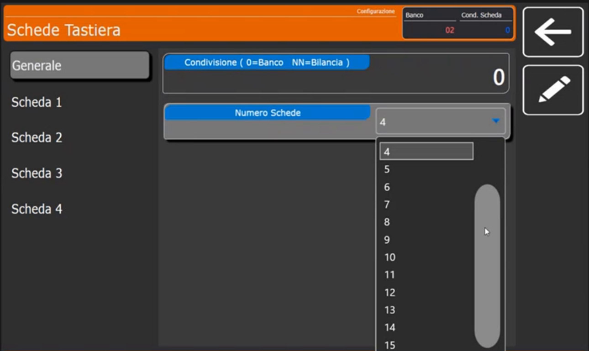

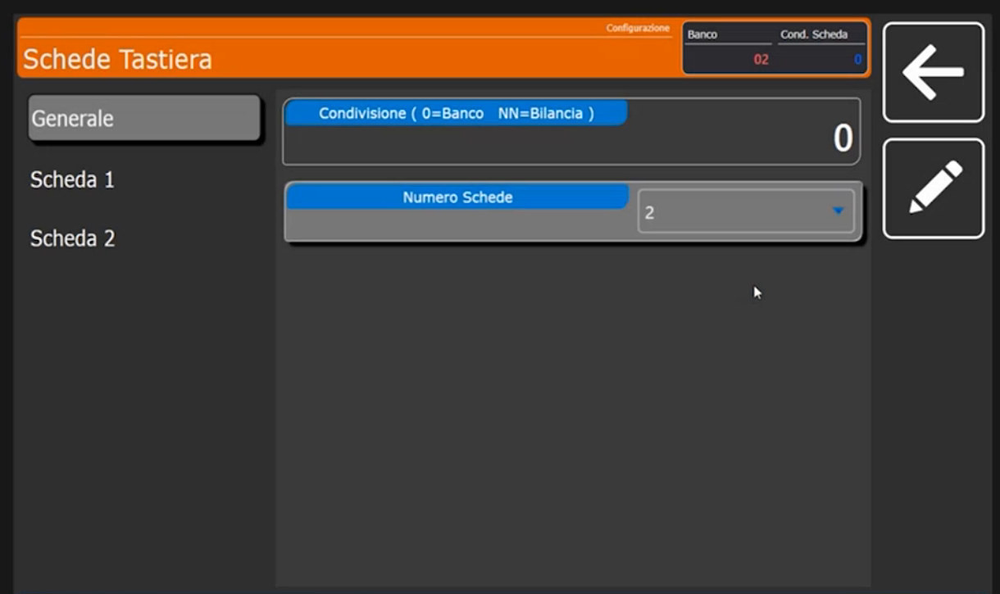

!!! tip "Quante schede e che dimensione"
    Si possono avere **fino a 16** schede. Con poche schede (per esempio fino a 4) i **tasti di raggruppamento sono più grandi** e più facili da usare per il cliente; più schede si mettono, più il tasto di selezione diventa piccolo, perché lo spazio dedicato alle schede è delimitato.

### 3. Configura una scheda per categoria

Nel menu a sinistra tocca **Scheda 1**. I campi sono **Nome Scheda**, **Colore Scheda**, **Tipo Scheda**, **Merceologico Scheda PLU** (o **Reparto Associato**, secondo il tipo), **Immagine Scheda** e **Colore Tasti**.

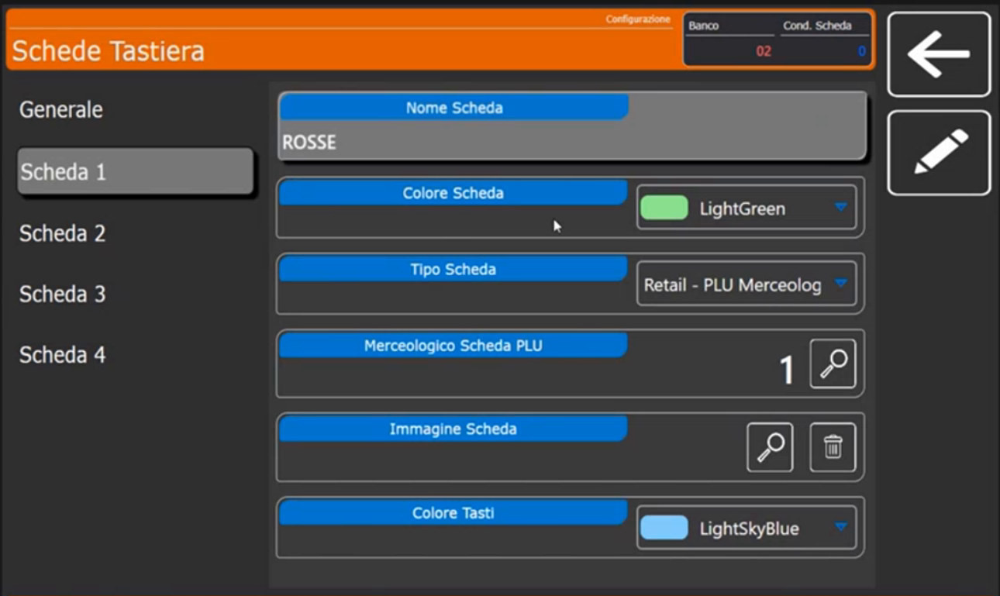

1. **Nome Scheda**: scrivi il nome (nell'esempio **ROSSE**).
2. **Tipo Scheda**: scegli come si comporta la scheda.

    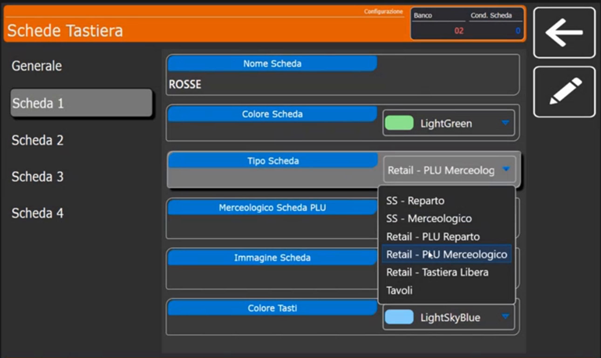

| Tipo Scheda | A cosa serve |
|---|---|
| **Retail - PLU Merceologico** | Raggruppa i PLU per **categoria merceologica**: è il caso d'uso più comune in Multipesata e Retail |
| **Retail - PLU Reparto** | Raggruppa i PLU per **reparto**: permette di passare con le schede dal reparto macelleria al reparto salumeria (e viceversa). In una rete di bilance, anche se fisicamente appartengono a reparti diversi, le bilance possono richiamare e vendere gli articoli di altri reparti |
| **Retail - Tastiera Libera** | Tastiera libera, senza raggruppamento automatico |
| **SS - Reparto** / **SS - Merceologico** | Per il **Self Service**: la scheda lavora a pittogrammi, per reparto o per merceologico |
| **Tavoli** | Gestisce i tavoli e i conti sospesi ([Funzioni di vendita](funzioni-di-vendita.md)) |

Gli altri campi:

- **Merceologico Scheda PLU**: con la lente abbina la scheda alla categoria (nell'esempio **ROSSE**, codice **1**). È un collegamento **bilaterale**: il nome della scheda è connesso al gruppo merceologico.

    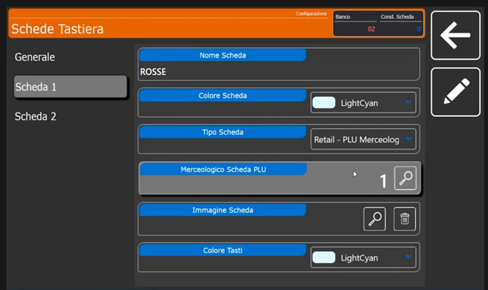

- **Colore Scheda** e **Colore Tasti**: personalizzazione estetica con un menu a tendina di colori (nell'esempio *LightGreen*, *LightSkyBlue*, *LightSalmon*, *LightCyan*, *Aqua*).
- **Immagine Scheda**: serve quando usi la scheda in **Self Service** per il raggruppamento; in Retail non serve.

### 4. Configura le altre schede

Ripeti per ogni scheda. Per le **BIANCHE** il **Merceologico Scheda PLU** è il codice **2**, con colori diversi.

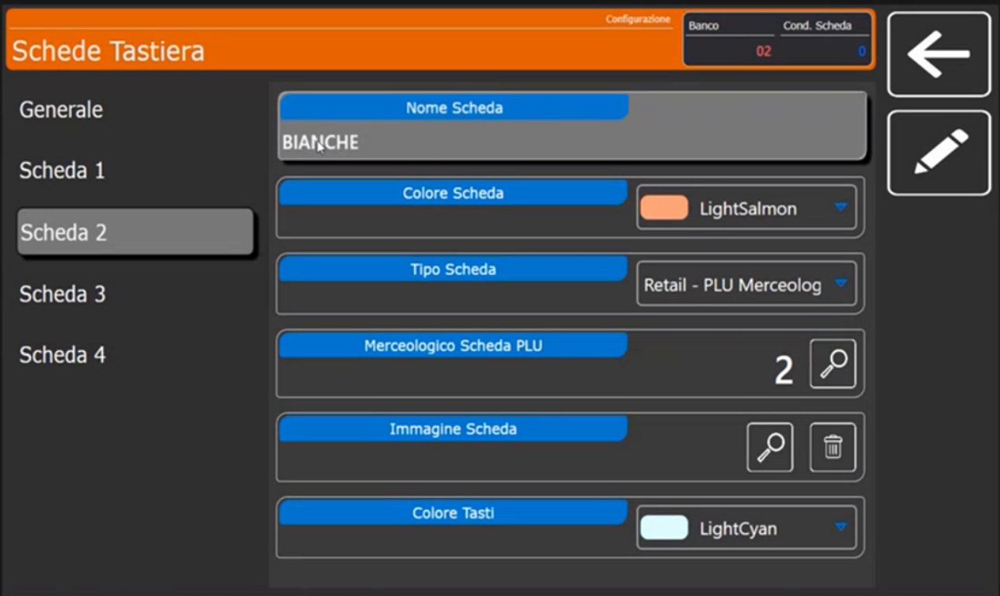

Ogni scheda può avere un **utilizzo diverso**. Per esempio la quarta scheda si chiama **TAVOLI**, ha **Tipo Scheda** *Tavoli* e non è collegata a un merceologico, perché serve a raggruppare i tavoli che si gestiscono direttamente dalla bilancia.

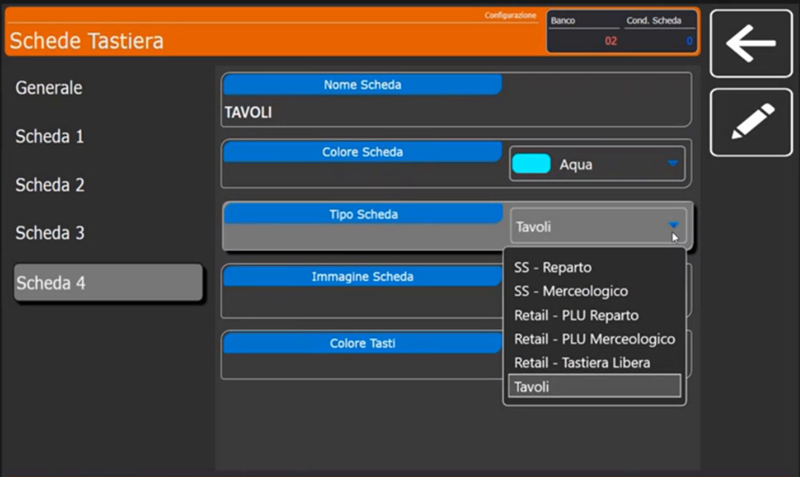

## Verifica

Esci dal configuratore e torna in vendita. Sulla tastiera compaiono i pulsanti di scheda **ROSSE**, **BIANCHE**, **VARIE**, **TAVOLI**. Selezionando una scheda compaiono gli articoli collegati alla sua categoria: **MACINATO** e **POLPETTONE RIPIENO** sotto ROSSE.

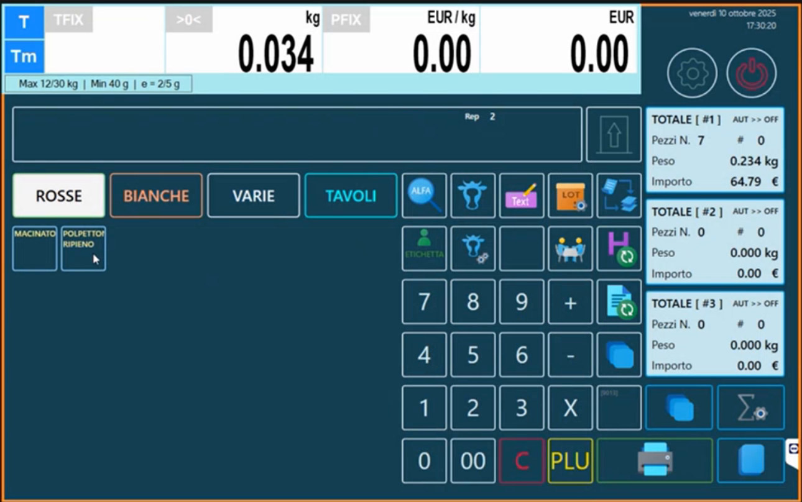

Selezionando **BIANCHE** compaiono gli articoli delle carni bianche (nell'esempio con le immagini sui tasti). La bilancia mostra il messaggio **Programmazione Bilancia ....** quando riapplica la programmazione.

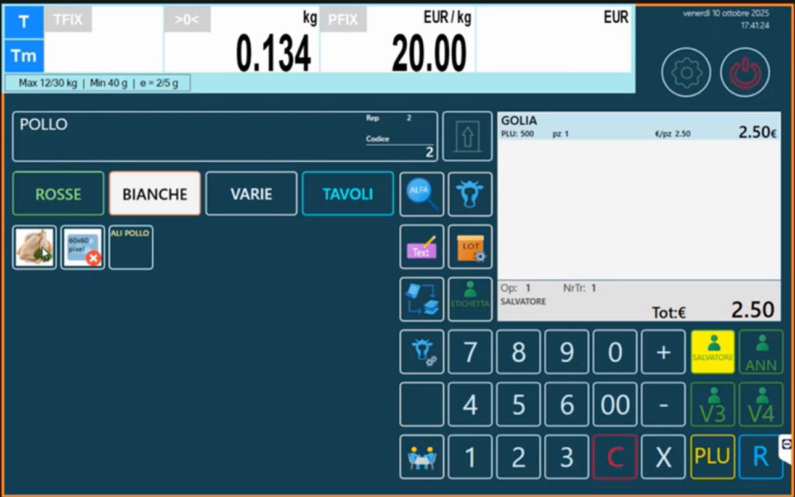

!!! note "Gestione Elimina Code e Gestione Ordini"
    Nello stesso menu **Configurazione** trovi anche **Gestione Elimina Code** e **Gestione Ordini**: in questa configurazione di base non servono.

## Errori comuni

| Problema | Causa probabile | Rimedio |
|---|---|---|
| Una scheda non mostra articoli | Gli articoli non sono collegati alla categoria della scheda | In **Extra** dell'articolo imposta **Gruppo Merceologico** |
| La scheda mostra gli articoli sbagliati | **Merceologico Scheda PLU** punta a un'altra categoria | Controlla il codice con la lente |
| Il tasto della scheda è piccolo | Troppe schede | Riduci il numero di schede |
| Non compaiono le schede | Tastiera diversa dalla Retail | Controlla il **Tipo Tastiera** in [Configurazione Operativa](configurazione-operativa.md) |

!!! tip "Prossimo passo"
    Per gli archivi di supporto: [Intestazioni, Operatori e Testi](intestazioni-operatori-testi.md).
