<!-- categoria assegnata per inferenza: verificare (la bilancia Icona non ha una categoria dedicata nell'elenco) -->

# Schede Tastiera: raggruppare gli articoli per categoria

**Target:** tecnico installatore / rivenditore · **Video:** Custom Academy, webinar *Icona configurazione di base* (10/04/2025), dal minuto 51:50 al 55:20.

## Obiettivo

Al termine sai attivare la modalità **schede** sulla tastiera, creare una scheda per ogni categoria merceologica e personalizzarne i colori, così che gli articoli non siano tutti sulla stessa schermata.

## Prerequisiti

- Le [Categorie Merceologiche](categorie-merceologiche.md) ROSSE e BIANCHE esistono e sono agganciate agli articoli MACINATO e POLLO.
- I tasti articolo 1 e 2 sono stati creati: vedi [Configurazione Tastiera](configurazione-tastiera.md).

!!! note "Quando usare le schede"
    Il relatore la presenta come una **scelta di configurazione**: si può volere tutti gli articoli sulla stessa schermata oppure no. Le schede si attivano sia in Self Service sia in Multipesata; qui si lavora in Multipesata.

## Passaggi

### 1. Apri Schede Tastiera

> Nel video: 52:03

Dal menu **Setup Bilancia**, sezione **Configurazione**, scorri la lista oltre **Configurazione Tastiera**: compare **Schede Tastiera**. Tocca la voce.

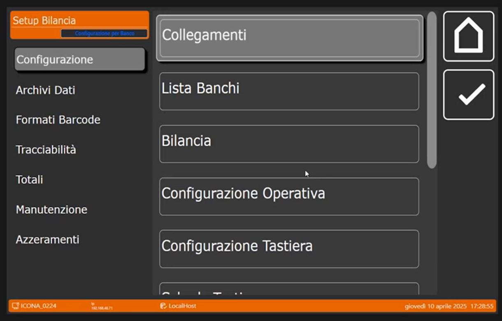

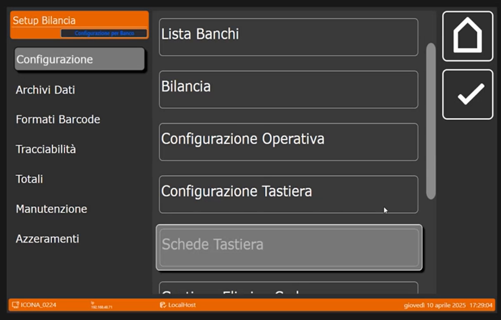

### 2. Crea le schede e indica quante sono

> Nel video: 52:13

1. Tocca **+**: si apre il tastierino **Condivisione ( 0=Banco NN=Bilancia )**. Digita **0**, cioè schede **relative al banco**.
2. Nella scheda **Generale** il campo **Numero Schede** indica quante schede devono esistere. Il relatore ne imposta **due**, perché ne servono realmente due.

    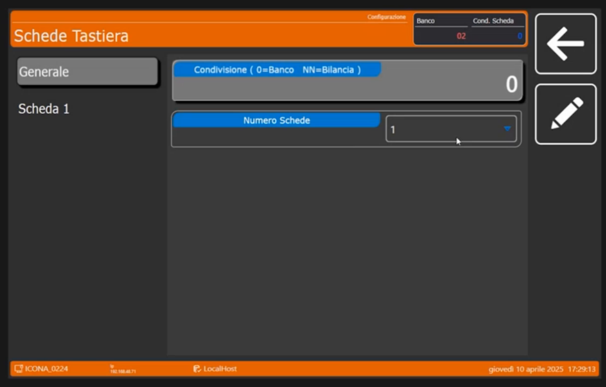

    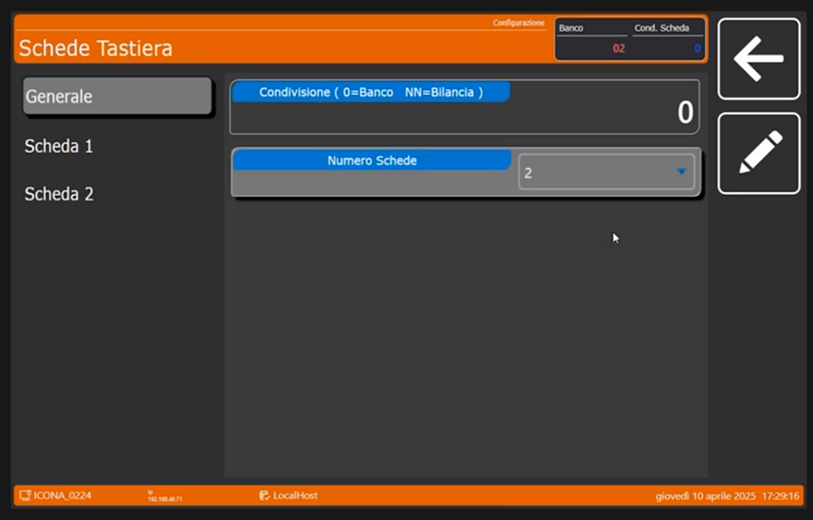

!!! tip "Quante schede si possono creare"
    Si possono mettere **fino a 16** schede. Con un numero tra **1 e 4** la scheda è anche **grande visivamente**; più schede si mettono, più il tasto di selezione diventa piccolo, perché lo **spazio dedicato alle schede è delimitato**.

### 3. Configura la Scheda 1: ROSSE

> Nel video: 52:46

Nel menu a sinistra tocca **Scheda 1**. I campi sono **Nome Scheda**, **Colore Scheda**, **Tipo Scheda**, **Reparto Associato** o **Merceologico Scheda PLU** (secondo il tipo scelto), **Immagine Scheda**, **Colore Tasti** e altri in fondo.

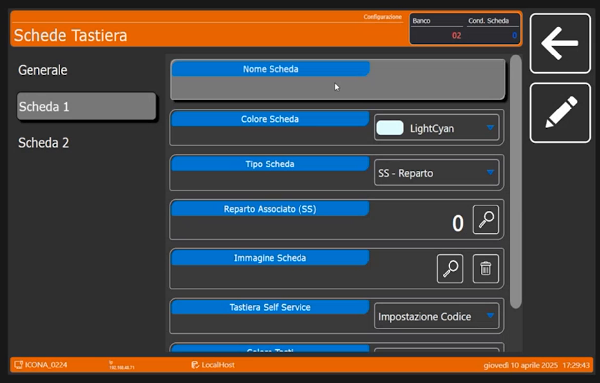

1. **Nome Scheda**: tocca il campo e scrivi **ROSSE**, perché l'intenzione è collegare la scheda ai merceologici.

    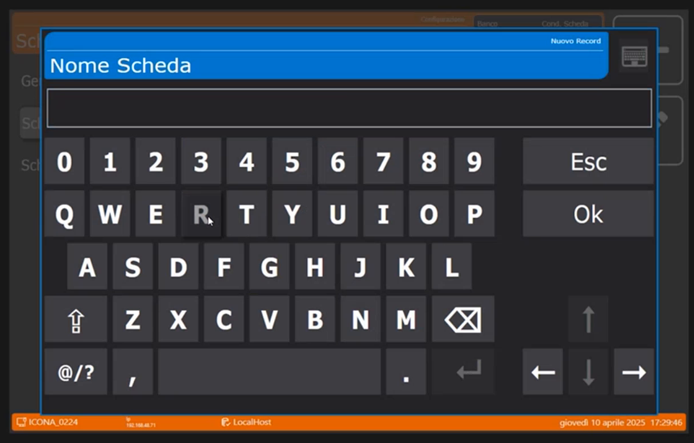

    

2. **Tipo Scheda**: apri il menu a tendina. Le voci sono **SS - Reparto**, **SS - Merceologico**, **Retail - PLU Reparto**, **Retail - PLU Merceologico** e **Retail - Tastiera Libera**.

    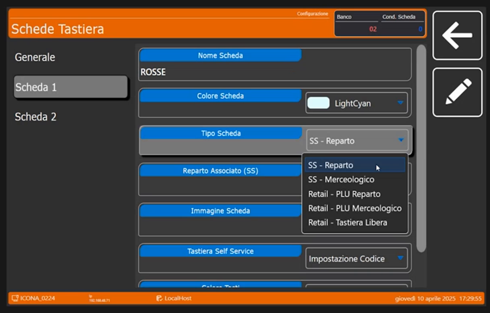

    Le voci **SS** riguardano il Self Service: anche in quella modalità si può lavorare a schede, per reparto o per merceologico. In **Multipesata e Retail** si può scegliere di passare da **reparto** o da **merceologico**. Avendo creato i merceologici, il relatore sceglie **Retail - PLU Merceologico**.

3. **Merceologico Scheda PLU**: tocca la **lente** e abbina la categoria **ROSSE** (codice **1**).

    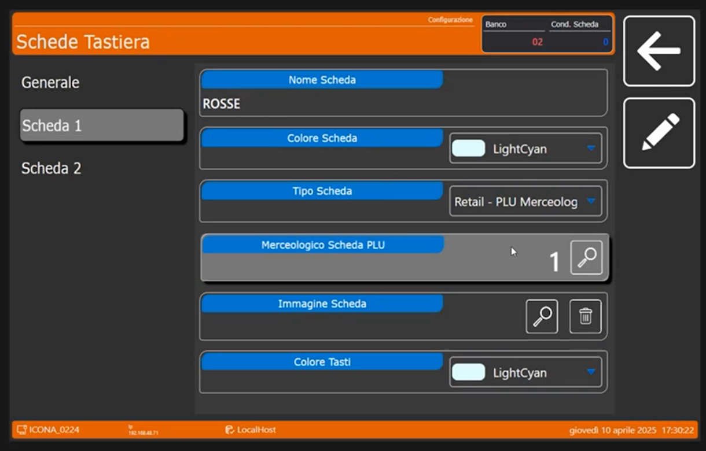

4. Facoltativo: un minimo di **personalizzazione estetica**, cioè i colori e le cornici. **Colore Scheda** e **Colore Tasti** hanno un menu a tendina di colori; il relatore prova per la Scheda 1 un colore diverso (nella schermata *LightGreen* per la scheda e *LightSkyBlue* per i tasti).

    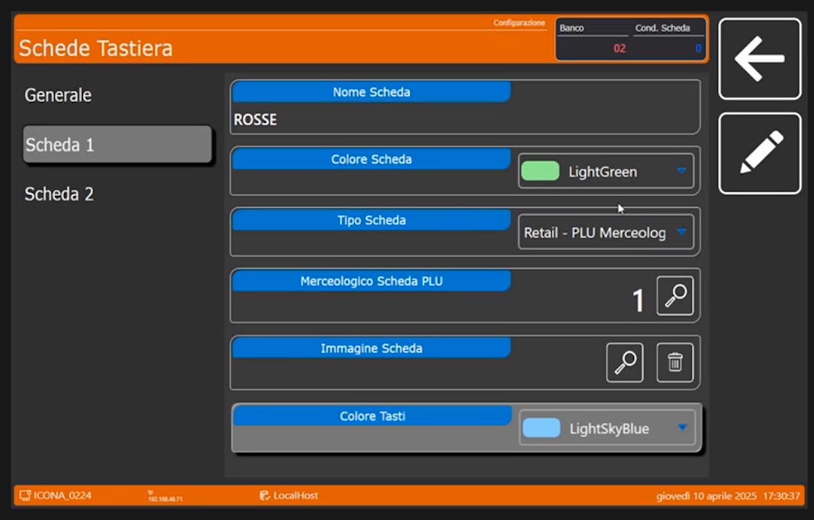

### 4. Configura la Scheda 2: BIANCHE

> Nel video: 53:49

Passa alla **Scheda 2** e ripeti gli stessi passaggi:

1. **Nome Scheda**: **BIANCHE**.

    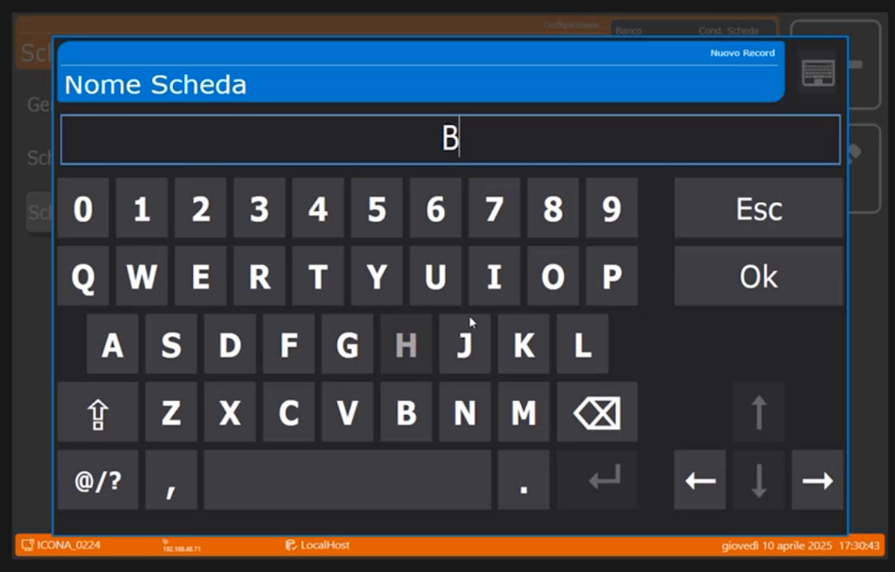

    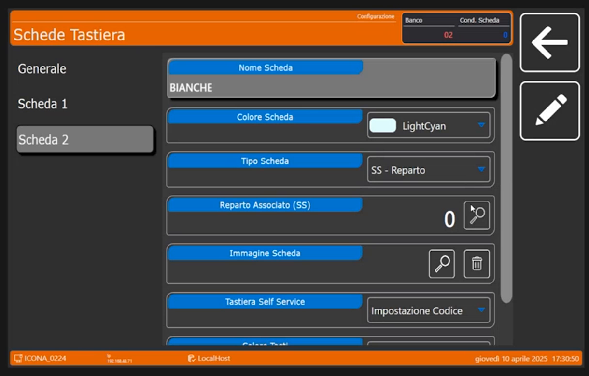

2. **Tipo Scheda**: di nuovo un merceologico, quindi **Retail - PLU Merceologico**.

    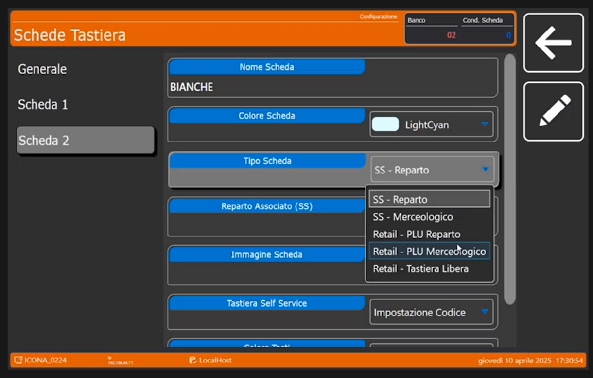

3. Collegala al merceologico **BIANCHE** (codice **2**) e, se vuoi, cambia i colori.

    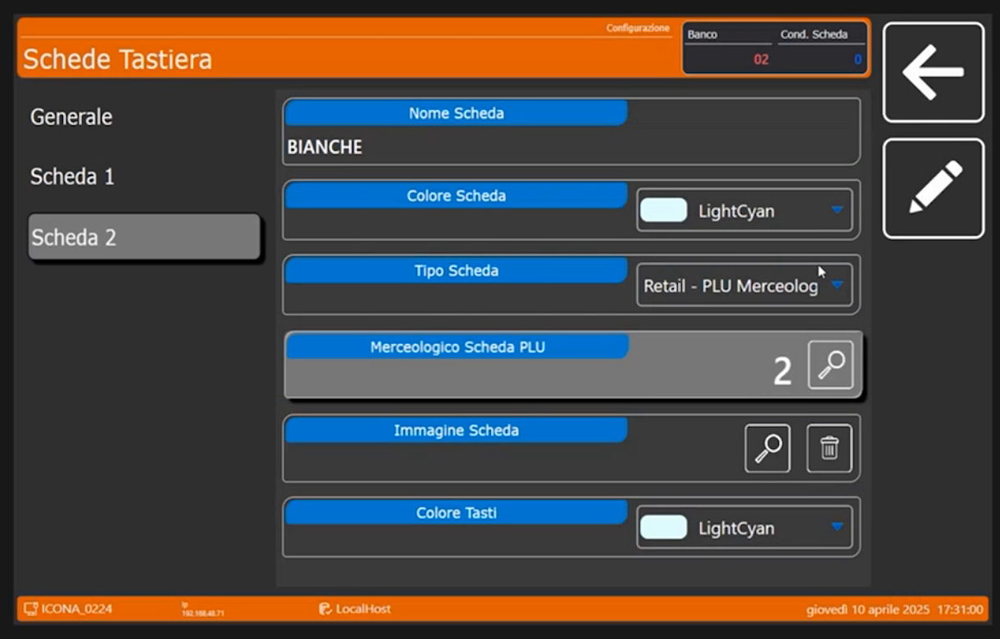

## Verifica

Esci dal configuratore e torna in vendita. Sulla tastiera compaiono i due pulsanti di scheda **ROSSE** e **BIANCHE**. Selezionando una scheda, sotto di essa compare l'articolo collegato alla sua categoria: **MACINATO** sotto ROSSE.

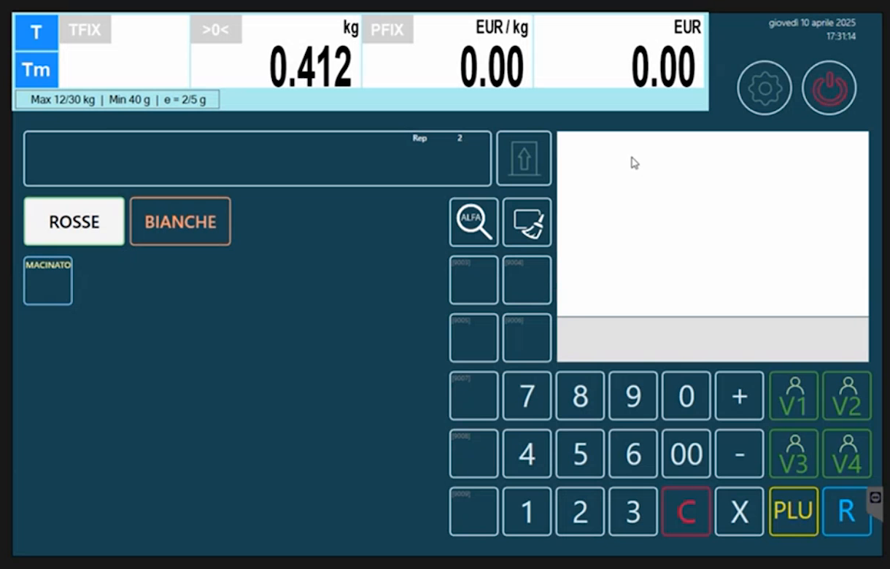

Selezionando **BIANCHE** compare **POLLO**. Sullo schermo si vede anche il messaggio **Programmazione Bilancia ....**, che compare quando la bilancia riapplica la programmazione.

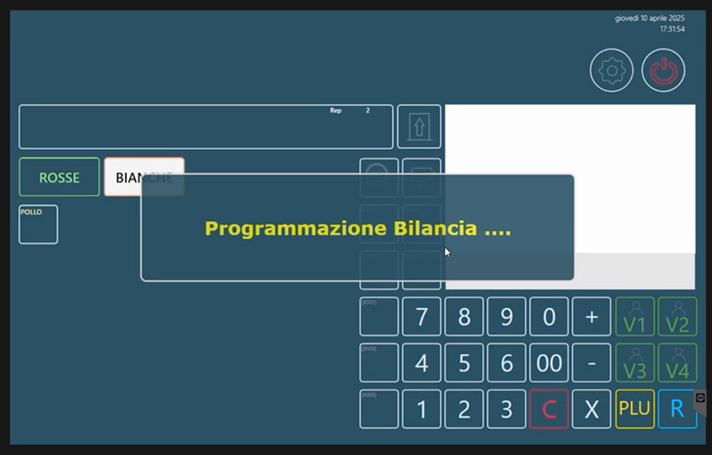

Il relatore commenta che il tasto per la pulizia dello schermo e la ricerca alfanumerica sono quelli già visti nel webinar precedente, e che **seguendo questo iter la programmazione è abbastanza lineare e semplice**: si costruisce e si personalizza la bilancia per il cliente man mano.

!!! note "Parti saltate"
    Il relatore salta per ora **Gestione Elimina Code** e **Gestione Ordini**, che si trovano nello stesso menu **Configurazione**.

!!! tip "Prossimo passo"
    Si passa agli archivi minori: [Intestazioni, Operatori e Testi](intestazioni-operatori-testi.md).
