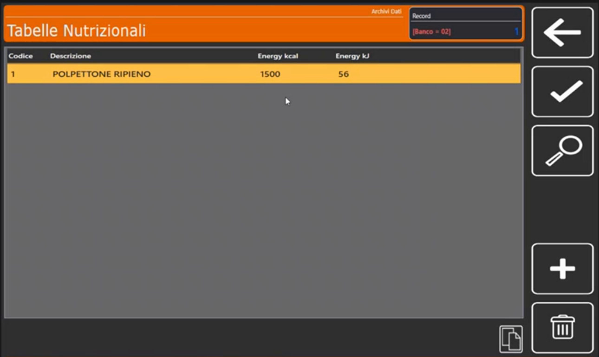
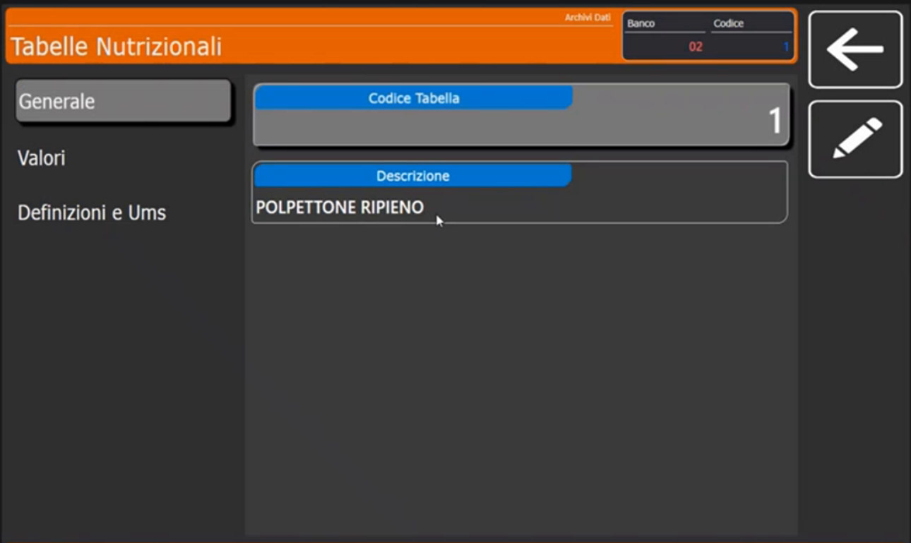
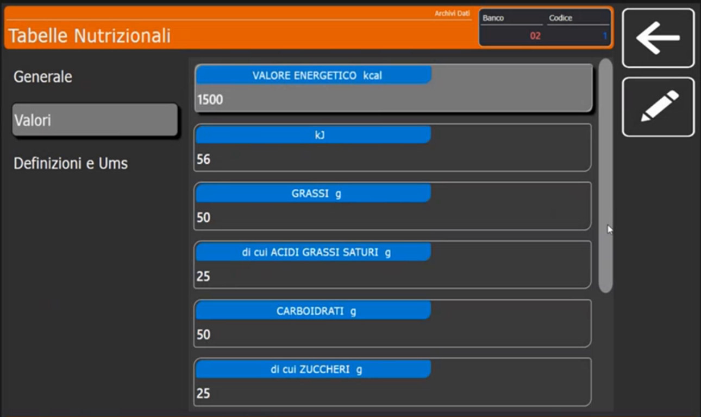
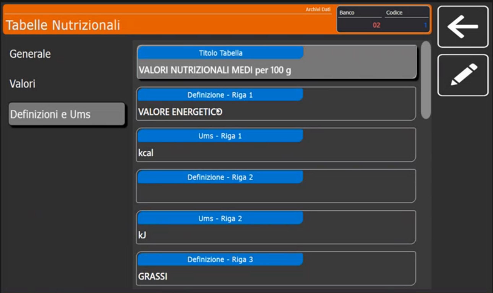
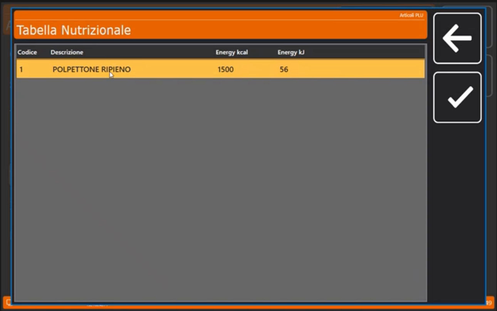

<!-- categoria assegnata per inferenza: verificare (la bilancia Icona non ha una categoria dedicata nell'elenco) -->

# Tabelle nutrizionali

**Target:** tecnico installatore / rivenditore.

## Obiettivo

Creare una **tabella nutrizionale** nell'archivio della bilancia, personalizzarne le definizioni e collegarla a un articolo, in modo che venga stampata sull'etichetta.

## Come funziona

Le tabelle nutrizionali si trovano in **Archivi Dati > Tabelle Nutrizionali**. L'inserimento è analogo alla gestione della tracciabilità, con una particolarità: qui non si definiscono prima le "domande". Si crea la tabella e le si dà un **riferimento** all'articolo. La tabella contiene i **valori obbligatori** per una tabella nutrizionale (valore energetico in kcal e kJ, grassi, grassi saturi, carboidrati, zuccheri, ...).

La tabella si collega all'articolo dal campo **Tabella Nutrizionale** della scheda **Testi** ([Box ingredienti e tabelle testi](box-ingredienti-testi.md)). Per essere stampata, il formato etichetta deve prevedere la tabella nutrizionale ([Formati Etichetta](formati-etichetta.md)).

## Procedura

### 1. Apri l'archivio

Da **Archivi Dati** tocca **Tabelle Nutrizionali**. La lista ha le colonne **Codice**, **Descrizione**, **Energy kcal** e **Energy kJ**.

### 2. Scheda Generale

Apri la tabella: nella sezione **Generale** trovi il **Titolo Tabella**, per esempio *VALORI NUTRIZIONALI MEDI per 100 g*.

### 3. Valori

Nella sezione **Valori** inserisci i dati per ogni riga: **VALORE ENERGETICO kcal**, **kJ**, **GRASSI g**, **di cui ACIDI GRASSI SATURI g**, **CARBOIDRATI g**, **di cui ZUCCHERI g** e le altre voci. I valori mostrati nelle immagini sono dati di prova.

### 4. Definizioni e Ums

Nella sezione **Definizioni e Ums** puoi **personalizzare le diciture** di ogni riga: per ogni riga ci sono **Definizione** e **Ums** (unità di misura), per esempio *VALORE ENERGETICO* con *kcal* e la riga successiva con *kJ*, poi *GRASSI*. Se il cliente vuole definizioni proprie puoi modificarle **sulla singola tabella**: per esempio puoi cambiare il nome della prima riga da *VALORE ENERGETICO* a un'altra dicitura.

### 5. Collega la tabella all'articolo

Nella scheda **Testi** dell'articolo, campo **Tabella Nutrizionale**, tocca la lente e scegli il codice della tabella.

## Verifica

Stampa o visualizza in anteprima l'etichetta di un articolo con la tabella collegata: devono comparire titolo e valori. Il formato etichetta deve avere il campo della tabella nutrizionale.

## Errori comuni

| Problema | Causa probabile | Rimedio |
|---|---|---|
| La tabella non compare sull'etichetta | Il formato scelto non include la tabella nutrizionale | Usa un formato "... Tab. Nut." ([Formati Etichetta](formati-etichetta.md)) |
| Le diciture non sono quelle volute | Definizioni non personalizzate | Modifica le righe in **Definizioni e Ums** |
| La tabella non è collegata all'articolo | Campo **Tabella Nutrizionale** vuoto | Imposta il codice nella scheda **Testi** |

!!! tip "Prossimo passo"
    Come si compongono i formati etichetta: [Formati Etichetta](formati-etichetta.md).
